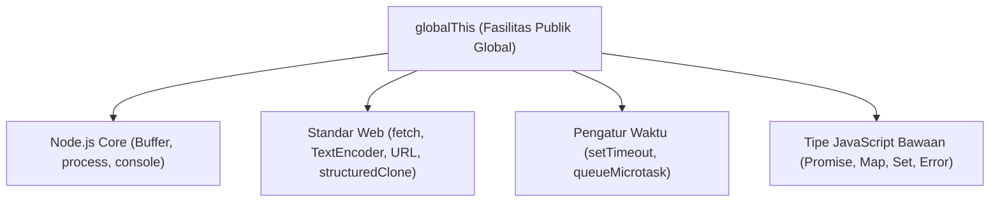

# Globals

> Ringkasan
>
> - Tingkat: Fondasi
> - Fungsi: Menyediakan objek, fungsi bantuan, dan standar Web API bawaan tanpa deklarasi impor.
> - Digunakan saat: Menggandakan data bersarang, mengukur durasi eksekusi, konversi teks-biner, dan membatalkan proses asinkron.
> - Aturan praktis: Hindari menyimpan data custom di `globalThis`; pakai `queueMicrotask()` untuk tugas penting sebelum giliran macrotask.

## Cheat Sheet

| Tugas                                   | Kode                                              |
| :-------------------------------------- | :------------------------------------------------ |
| Mengakses objek global runtime          | `globalThis`                                      |
| Menggandakan objek secara mendalam      | `const clone = structuredClone(source);`          |
| Mengukur durasi waktu presisi tinggi    | `const start = performance.now();`                |
| Mengubah string ke byte biner           | `const bytes = new TextEncoder().encode("teks");` |
| Menerjemahkan byte biner ke string      | `const str = new TextDecoder().decode(bytes);`    |
| Menjadwalkan tugas ke antrean microtask | `queueMicrotask(() => {});`                       |
| Membuat sinyal pembatalan operasi       | `const controller = new AbortController();`       |

## Tujuan Belajar

- Memahami cakupan objek global bawaan `globalThis` dan standar Web API di Node.js.
- Menggandakan struktur data kompleks secara mendalam memakai `structuredClone()`.
- Mengukur durasi eksekusi kode berpresisi tinggi memakai `performance.now()`.
- Mengonversi data string ke biner UTF-8 dan sebaliknya lewat `TextEncoder` dan `TextDecoder`.
- Mengelola prioritas eksekusi microtask serta membatalkan operasi asinkron memakai `AbortController`.

## Konsep

Bayangkan Node.js seperti gedung kantor bersama. Objek `globalThis` adalah lobi utama gedung beserta fasilitas publiknya (jam dinding, dispenser air, papan informasi) yang bisa diakses siapa saja tanpa izin khusus. Sebaliknya, setiap file modul adalah ruangan kerja privat. Menaruh variabel bisnis langsung di lobi publik (`globalThis`) memicu konflik nama dan kebocoran data antar bagian aplikasi.



## Referensi

| Item                       | Fungsi                                                       | Catatan                                               |
| :------------------------- | :----------------------------------------------------------- | :---------------------------------------------------- |
| `globalThis`               | Mengakses objek global teratas di platform runtime mana pun  | Standar ECMAScript pengganti `global` dan `window`    |
| `structuredClone(value)`   | Membuat salinan mendalam (_deep copy_) dari suatu objek      | Mendukung Date, Set, Map, dan referensi melingkar     |
| `performance.now()`        | Mengembalikan stempel waktu presisi tinggi (milidetik)       | Nilai monotonic tidak dipengaruhi pergeseran jam OS   |
| `TextEncoder`              | Mengubah string teks menjadi deretan biner `Uint8Array`      | Selalu memakai format UTF-8                           |
| `TextDecoder`              | Menerjemahkan barisan byte biner kembali menjadi string teks | Mampu menangani karakter multibyte dan emoji          |
| `queueMicrotask(callback)` | Memasukkan fungsi ke antrean tugas mikro (_microtask queue_) | Berjalan tepat setelah kode sinkron, mendahului timer |
| `AbortController`          | Mengirim sinyal pembatalan ke operasi asinkron               | Menyediakan properti `signal` untuk diteruskan        |

### `globalThis`

`globalThis` adalah objek universal standar JavaScript untuk merujuk ke lingkup terluar runtime. Di Node.js, `globalThis` merujuk ke objek yang sama dengan `global`.

Struktur parameter: tidak memiliki parameter pemanggilan.

Nilai kembalian: objek global runtime (`object`).

```javascript
console.log(globalThis === global);
// Output: true
```

Kondisi khusus: Menambahkan properti baru ke `globalThis` dapat menimpa variabel global bawaan dan memicu bug sulit dilacak.

### `structuredClone(value)`

`structuredClone()` membuat salinan mendalam dari nilai JavaScript secara menyeluruh tanpa mempertahankan referensi memori objek lama.

Struktur parameter: `structuredClone(value)`

- `value` (any, wajib): nilai atau objek yang ingin digandakan.

Nilai kembalian: salinan baru dari nilai input (`any`).

```javascript
const user = { name: "Budi", roles: ["admin"], created: new Date() };
const copy = structuredClone(user);
copy.roles.push("editor");

console.log(user.roles.length);
// Output: 1
console.log(copy.created instanceof Date);
// Output: true
```

Kondisi khusus: Melempar `DOMException` tipe `DataCloneError` bila objek mengandung fungsi, symbol, atau instance class kustom yang tidak bisa diserialisasi.

### `performance.now()`

`performance.now()` mengembalikan stempel waktu dalam milidetik sejak runtime aktif dengan presisi sub-milidetik.

Struktur parameter: `performance.now()` tanpa argumen.

Nilai kembalian: angka stempel waktu monotonic (`number`).

```javascript
const start = performance.now();
const diff = performance.now() - start;

console.log(diff >= 0);
// Output: true
```

Kondisi khusus: Nilai waktu bersifat relatif terhadap waktu mulai runtime, bukan penanggalan kalender sistem operasi.

### `TextEncoder`

`TextEncoder` mengonversi string teks menjadi barisan byte biner `Uint8Array` biner berformat UTF-8.

Struktur parameter: `new TextEncoder()`, dengan metode `encode(input)`

- `input` (string, wajib): teks yang akan diubah ke biner.

Nilai kembalian: array biner `Uint8Array`.

```javascript
const encoder = new TextEncoder();
const bytes = encoder.encode("Node.js");

console.log(bytes.length);
// Output: 7
console.log(bytes instanceof Uint8Array);
// Output: true
```

Kondisi khusus: Karakter multibyte (seperti huruf non-Latin atau emoji) menghasilkan jumlah byte lebih besar daripada panjang string `.length`.

### `TextDecoder`

`TextDecoder` menerjemahkan barisan byte biner menjadi string teks biasa.

Struktur parameter: `new TextDecoder(label)`, dengan metode `decode(buffer)`

- `label` (string, opsional, default: `"utf-8"`): jenis encoding teks.
- `buffer` (Buffer atau Uint8Array, wajib): deretan byte yang ingin diuraikan.

Nilai kembalian: string hasil terjemahan teks (`string`).

```javascript
const decoder = new TextDecoder();
const bytes = new Uint8Array([78, 111, 100, 101]);

console.log(decoder.decode(bytes));
// Output: Node
```

Kondisi khusus: Menerima byte yang terpotong di tengah urutan karakter multibyte dapat menghasilkan karakter pengganti tanda tanya (``).

### `queueMicrotask(callback)`

`queueMicrotask()` mendaftarkan callback ke antrean microtask untuk dieksekusi segera setelah tumpukan sinkron saat ini kosong, sebelum antrean macrotask (timer atau I/O).

Struktur parameter: `queueMicrotask(callback)`

- `callback` (function, wajib): fungsi yang akan dijalankan di fase microtask.

Nilai kembalian: `undefined`.

```javascript
let order = [];
queueMicrotask(() => order.push("microtask"));
order.push("sync");

Promise.resolve().then(() => {
  console.log(order.join(" -> "));
});
// Output: sync -> microtask
```

Kondisi khusus: Menjadwalkan microtask rekursif terus-menerus akan membuat antrean macrotask kelaparan (_starvation_) dan membekukan aplikasi.

### `AbortController`

`AbortController` adalah mekanisme standar untuk mengirim sinyal pembatalan ke operasi asinkron yang sedang berjalan.

Struktur parameter: `new AbortController()`, metode `abort(reason)`

- `reason` (any, opsional): pesan atau objek error pembatalan.

Nilai kembalian: instance `AbortController` yang memiliki properti `signal` (`AbortSignal`).

```javascript
const ac = new AbortController();
ac.signal.addEventListener("abort", () => {
  console.log(ac.signal.reason);
});
ac.abort("Proses dibatalkan");
// Output: Proses dibatalkan
```

Kondisi khusus: Memanggil `abort()` berkali-kali hanya memicu event pembatalan sekali; pemanggilan berikutnya diabaikan.

## Kesalahan Umum

### Menyimpan State Aplikasi di `globalThis`

Menyimpan objek state di `globalThis` memicu tabrakan variabel saat modul lain memakai nama yang sama.

```javascript
// Salah
globalThis.currentUser = { id: 101, name: "Ali" };

// Benar
// Simpan di variabel lingkup modul dan ekspor secara eksplisit
export const currentUser = { id: 101, name: "Ali" };
```

### Menggandakan Objek Bertingkat dengan `JSON.parse(JSON.stringify())`

Trik JSON merusak tipe data khusus seperti Date (berubah jadi string) dan membuang nilai `undefined` atau Map.

```javascript
// Salah
const original = { created: new Date() };
const clone = JSON.parse(JSON.stringify(original));
console.log(clone.created instanceof Date); // false

// Benar
const properClone = structuredClone(original);
console.log(properClone.created instanceof Date); // true
```

### Mengakses Variabel CommonJS di ES Modules

Variabel `__dirname` dan `__filename` tidak tersedia di ES Modules karena digantikan oleh properti bawaan `import.meta.url`.

```javascript
// Salah: __dirname adalah variabel khusus CommonJS
console.log(__dirname); // ReferenceError: __dirname is not defined

// Benar: Gunakan properti global import.meta.url di ES Modules
console.log(typeof import.meta.url);
// Output: string
```

## Studi Kasus

Membangun validator tugas komputasi yang mengukur durasi pengerjaan, memvalidasi pembatalan tugas via `AbortController`, dan memastikan data asli aman dari mutasi memakai `structuredClone`.

```javascript
class TaskDispatcher {
  process(inputData, options = {}) {
    const startTime = performance.now();

    if (options.signal?.aborted) {
      return {
        success: false,
        reason: options.signal.reason,
        durationMs: 0,
      };
    }

    const isolatedData = structuredClone(inputData);
    isolatedData.status = "PROCESSED";

    const encoder = new TextEncoder();
    const serializedPayload = JSON.stringify(isolatedData);
    const binaryPayload = encoder.encode(serializedPayload);

    const endTime = performance.now();

    return {
      success: true,
      byteLength: binaryPayload.byteLength,
      data: isolatedData,
      durationMs: Number((endTime - startTime).toFixed(4)),
    };
  }
}

const dispatcher = new TaskDispatcher();
const controller = new AbortController();

const normalResult = dispatcher.process(
  { id: 1, item: "Buku" },
  { signal: controller.signal },
);
console.log(normalResult.success);
// Output: true
console.log(normalResult.data.status);
// Output: PROCESSED
console.log(normalResult.byteLength > 0);
// Output: true

controller.abort("Operasi dibatalkan sistem");
const abortedResult = dispatcher.process(
  { id: 2, item: "Pena" },
  { signal: controller.signal },
);
console.log(abortedResult.success);
// Output: false
console.log(abortedResult.reason);
// Output: Operasi dibatalkan sistem
```

Pola ini mengamankan integritas data input memakai `structuredClone`, mengonversi payload ke representasi biner terukur, dan menghormati sinyal pembatalan standar tanpa bergantung pada library eksternal.

## Latihan Mandiri

Buat fungsi `processTask(payload, options = {})` untuk memproses antrean data terisolasi.

- **Level 1 (Dasar):** Gandakan `payload` memakai `structuredClone()` agar objek input asli tidak termutasi. Hitung ukuran byte hasil encoding string JSON payload memakai `TextEncoder`. Kembalikan objek `{ success: true, byteLength, data: payloadClone }`.
- **Level 2 (Menengah):** Ukur durasi pengerjaan fungsi dari awal hingga akhir memakai `performance.now()` dalam satuan milidetik, lalu tambahkan nilainya ke properti `durationMs` bertipe number.
- **Level 3 (Menantang):** Dukung opsi `options.signal` (`AbortSignal`). Jika sinyal dalam keadaan dibatalkan (`options.signal?.aborted`), lempar `Error` dengan pesan dari `options.signal.reason` atau pesan default `"Task aborted"`. Jika `byteLength` melebihi batas `options.maxBytes`, lempar `Error("Payload melebihi batas")`.

Contoh input dan output normal:

```javascript
const payload = { title: "Audit Log" };
const result = processTask(payload, { maxBytes: 1024 });

console.log(result.success);
// Output: true
console.log(result.byteLength > 0);
// Output: true
console.log(typeof result.durationMs);
// Output: number
```

Contoh input dan penanganan error:

```javascript
const controller = new AbortController();
controller.abort("Dibatalkan pengguna");

try {
  processTask({ title: "Audit Log" }, { signal: controller.signal });
} catch (err) {
  console.log(err.message);
  // Output: Dibatalkan pengguna
}
```

Tanda selesai:

- [ ] Objek asli payload tidak termutasi setelah pemrosesan.
- [ ] Ukuran payload biner dihitung memakai `TextEncoder`.
- [ ] Durasi eksekusi diukur dalam satuan milidetik memakai `performance.now()`.
- [ ] Sinyal pembatalan `AbortController` membatalkan proses dan melempar `Error`.

---

## Navigasi

[Selanjutnya: Process](../02-process/README.md) | [Daftar Isi](../README.md)
