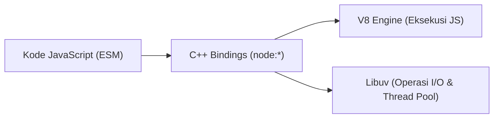

# Standard Library

> Ringkasan
> - Fungsi: Menyediakan modul bawaan native Node.js untuk menangani operasi sistem dasar tanpa instalasi paket pihak ketiga.
> - Digunakan saat: Menjalankan tugas I/O berkas, manipulasi path, networking, kriptografi, dan utilitas sistem.
> - Aturan praktis: Selalu gunakan prefiks protokol `node:` pada setiap impor modul bawaan untuk menjamin resolusi C++ internal dan mencegah kerentanan _dependency confusion_.

---

## Tujuan Belajar

- Mengidentifikasi modul bawaan utama di dalam Standard Library Node.js.
- Menerapkan prefiks protokol `node:` pada pemanggilan modul native.
- Membedakan peran mesin V8, pustaka Libuv, dan _C++ bindings_ dalam eksekusi modul bawaan.
- Menggantikan ketergantungan paket pihak ketiga dengan modul bawaan modern.

---

## Konsep

> Runtime Node.js dianalogikan sebagai dapur restoran profesional. Mesin V8 bertindak sebagai koki utama yang mengeksekusi instruksi JavaScript. Pustaka Libuv bekerja sebagai tim asisten dapur yang mengurus pekerjaan latar belakang seperti logistik bahan dan jaringan. Modul Standard Library (`node:*`) adalah peralatan dapur standar bawaan yang steril, aman, dan langsung siap pakai tanpa perlu membeli perlengkapan dari toko luar.



---

## Referensi

| Item | Fungsi | Catatan |
| :--- | :--- | :--- |
| **`node:os`** | Membaca metadata sistem operasi dan perangkat keras host | Menyediakan data platform, arsitektur CPU, dan kapasitas memori |
| **`node:path`** | Memanipulasi dan menormalisasi jalur sistem berkas | Menyesuaikan pemisah direktori secara otomatis untuk POSIX dan Windows |
| **`node:fs/promises`** | Menjalankan operasi I/O berkas secara asinkron berbasis Promise | Menghindari penggunaan callback manual bergaya legacy |
| **`node:crypto`** | Menyediakan algoritma kriptografi, hashing, dan pembuatan pengenal acak | Memiliki generator UUID v4 bawaan melalui `randomUUID()` |
| **`node:util`** | Menyediakan fungsi bantuan diagnostik dan parsing argumen baris perintah | Memiliki `parseArgs` untuk parsing CLI tanpa pustaka tambahan |
| **`node:url`** | Mengurai dan memanipulasi format URL sesuai standar WHATWG | Mempermudah ekstraksi query parameter dan konversi jalur berkas |

### `node:os`

Modul `node:os` digunakan untuk membaca informasi sistem operasi serta spesifikasi perangkat keras tempat runtime dijalankan. Modul ini umum dipakai dalam penentuan alokasi proses worker atau pengumpulan metrik server.

```javascript
import os from 'node:os';

const platform = os.platform();
const architecture = os.arch();

console.log(platform);
// Output: linux
console.log(architecture);
// Output: x64
```

Kasus lain: Menghitung kuota konkurensi CPU yang tersedia secara dinamis menggunakan `os.availableParallelism()`.

```javascript
import os from 'node:os';

const workerCount = os.availableParallelism();
console.log(workerCount > 0);
// Output: true
```

### `node:path`

Modul `node:path` digunakan untuk memanipulasi dan menyusun string jalur berkas agar kompatibel lintas platform. Modul ini membedakan separator slash POSIX (`/`) dan backslash Windows (`\`).

```javascript
import path from 'node:path';

const filePath = path.join('app', 'data', 'users.json');
console.log(filePath);
// Output: app/data/users.json
```

Kasus lain: Menormalkan jalur yang memuat karakter navigasi relatif (`..` atau `.`) agar terbebas dari redundansi.

```javascript
import path from 'node:path';

const normalizedPath = path.normalize('/var/log/../log/audit.log');
console.log(normalizedPath);
// Output: /var/log/audit.log
```

### `node:fs/promises`

Modul `node:fs/promises` menangani interaksi baca dan tulis pada sistem berkas secara non-blocking dengan mengembalikan Promise. Modul ini menjadi standar modern pengganti callback manual.

```javascript
import fs from 'node:fs/promises';
import path from 'node:path';
import os from 'node:os';

const targetFile = path.join(os.tmpdir(), 'standard-library-test.txt');
await fs.writeFile(targetFile, 'Hello Standard Library', 'utf-8');
const content = await fs.readFile(targetFile, 'utf-8');

console.log(content);
// Output: Hello Standard Library

await fs.unlink(targetFile);
```

Kasus lain: Menangani galat saat membaca berkas yang tidak ditemukan di disk.

```javascript
import fs from 'node:fs/promises';

try {
  await fs.readFile('/path/does/not/exist.txt', 'utf-8');
} catch (error) {
  console.log(error.code);
  // Output: ENOENT
}
```

### `node:crypto`

Modul `node:crypto` menyediakan fungsionalitas keamanan tingkat lanjut seperti pembuatan pengenal unik, digest hashing, dan enkripsi. Modul ini meniadakan kebutuhan library pihak ketiga untuk pembuatan ID unik.

```javascript
import { randomUUID, createHash } from 'node:crypto';

const token = randomUUID();
console.log(typeof token, token.length);
// Output: string 36

const digest = createHash('sha256').update('secret-key').digest('hex');
console.log(digest.slice(0, 8));
// Output: 85dbe15d
```

Kasus lain: Menghitung nilai hash dari payload kosong untuk validasi struktur data.

```javascript
import { createHash } from 'node:crypto';

const emptyHash = createHash('sha256').update('').digest('hex');
console.log(emptyHash.slice(0, 8));
// Output: e3b0c442
```

### `node:util`

Modul `node:util` menyediakan berbagai perkakas pembantu logika runtime dan manipulasi format string. Salah satu fitur modernnya adalah `parseArgs` untuk mengurai opsi baris perintah terminal.

```javascript
import { parseArgs } from 'node:util';

const result = parseArgs({
  args: ['--port', '8080'],
  options: {
    port: { type: 'string' },
  },
});

console.log(result.values.port);
// Output: 8080
```

Kasus lain: Menangkap error ketika terminal memasukkan argumen yang tidak didaftarkan pada opsi skema.

```javascript
import { parseArgs } from 'node:util';

try {
  parseArgs({
    args: ['--unknown-option'],
    options: { port: { type: 'string' } },
  });
} catch (error) {
  console.log(error.code);
  // Output: ERR_PARSE_ARGS_UNKNOWN_OPTION
}
```

### `node:url`

Modul `node:url` digunakan untuk parsing, validasi, dan rekonstruksi format tautan sesuai spesifikasi standar WHATWG URL. Modul ini juga menyediakan utilitas konversi antara format string file URL dan jalur berkas sistem.

```javascript
import { fileURLToPath } from 'node:url';

const targetUrl = new URL('https://api.example.com/v1/users?status=active');
console.log(targetUrl.pathname);
// Output: /v1/users
console.log(targetUrl.searchParams.get('status'));
// Output: active

const localPath = fileURLToPath(new URL('file:///app/server.js'));
console.log(localPath);
// Output: /app/server.js
```

Kasus lain: Menangani URL dengan format string yang tidak valid sehingga memicu galat runtime.

```javascript
try {
  new URL('not-a-valid-url');
} catch (error) {
  console.log(error.code);
  // Output: ERR_INVALID_URL
}
```

### Perbandingan: Modul Bawaan vs Paket Pihak Ketiga (NPM)

| Karakteristik | Modul Bawaan (`node:*`) | Paket NPM Pihak Ketiga |
| :--- | :--- | :--- |
| **Instalasi** | Tersedia langsung di runtime | Wajib melalui `npm install` |
| **Waktu Mulai** | Instan tanpa pembacaan disk tambahan | Membutuhkan I/O untuk memuat file di `node_modules` |
| **Keamanan** | Diuji dan diaudit langsung oleh tim Node.js | Rentan terhadap serangan rantai pasok dan perubahan repositori |
| **Ukuran Distribusi** | Tidak menambah ukuran proyek | Menambah ukuran `node_modules` dan image container |

---

## Kesalahan Umum

### Mengimpor Modul Native Tanpa Prefiks `node:`

Penggunaan nama modul tanpa prefiks `node:` memaksa runtime memeriksa direktori `node_modules` terlebih dahulu dan membuka celah keamanan _dependency confusion_.

```javascript
// Salah
import fs from 'fs/promises';
```

```javascript
// Benar
import fs from 'node:fs/promises';
```

### Memasang Modul Inti Melalui Perintah NPM

Mengeksekusi perintah instalasi untuk nama modul inti Node.js dapat mengunduh paket berbahaya tiruan dari registri publik dan mengotori berkas `package.json`.

```bash
# Salah
npm install path os crypto
```

```bash
# Benar
# Modul langsung diimpor dari runtime tanpa proses instalasi
```

### Menambahkan Prefiks `node:` pada Dependensi Eksternal

Menyematkan prefiks `node:` pada paket pihak ketiga yang diinstal dari NPM menyebabkan runtime melempar galat fatal `ERR_UNKNOWN_BUILTIN_MODULE`.

```javascript
// Salah
import express from 'node:express';
```

```javascript
// Benar
import express from 'express';
```

---

## Studi Kasus

Skenario: Membangun fungsi pencatat audit keamanan mandiri (_zero-dependency security audit log_) yang menghasilkan rekam jejak sistem, waktu presisi, identitas unik berbasis UUID v4, dan checksum integritas data SHA-256.

```javascript
import { randomUUID, createHash } from 'node:crypto';
import os from 'node:os';

function createAuditLog(action, actor, payload) {
  const logId = randomUUID();
  const timestamp = new Date('2026-10-12T00:00:00.000Z').toISOString();
  const systemFingerprint = `${os.platform()}-${os.arch()}`;

  const rawPayload = JSON.stringify(payload);
  const integrityHash = createHash('sha256').update(rawPayload).digest('hex');

  return {
    logId,
    action,
    actor,
    timestamp,
    systemFingerprint,
    integrityHash,
  };
}

const audit = createAuditLog('LOGIN_SUCCESS', 'admin', { ip: '127.0.0.1' });
console.log(audit.action);
// Output: LOGIN_SUCCESS
console.log(audit.actor);
// Output: admin
console.log(audit.timestamp);
// Output: 2026-10-12T00:00:00.000Z
console.log(audit.systemFingerprint);
// Output: linux-x64
console.log(audit.integrityHash.slice(0, 8));
// Output: e48dfcf1
```

Desain ini dipilih karena mengandalkan modul inti `node:crypto` dan `node:os` tanpa dependensi eksternal, sehingga inisialisasi fungsi berjalan instan dan kebal terhadap perubahan paket pihak ketiga.

---

## Latihan Mandiri

### Soal 1 (Dasar)

Buat fungsi `getSystemIdentity()` yang mengembalikan objek ringkas berisi nama platform (`platform`), arsitektur CPU (`arch`), dan jumlah konkurensi CPU yang tersedia (`parallelism`) menggunakan modul `node:os`.

Contoh masukan:
```javascript
getSystemIdentity();
```

Contoh keluaran yang diharapkan:
```javascript
{
  platform: 'linux',
  arch: 'x64',
  parallelism: 8
}
```

Batasan: Wajib menggunakan modul `node:os` dengan prefiks protokol `node:` dan tanpa pustaka tambahan.

### Soal 2 (Menengah)

Buat fungsi `createTicket(category, userMessage)` yang menghasilkan objek tiket. Objek tersebut memuat ID acak berformat UUID v4, kode hash SHA-256 sepanjang 12 karakter pertama dari gabungan string `category:userMessage`, serta jalur direktori arsip yang dinormalisasi dengan pola `archive/<category>/<id>.json` menggunakan `node:crypto` dan `node:path`.

Contoh masukan:
```javascript
createTicket('payment', 'auto debit failed');
```

Contoh keluaran yang diharapkan:
```javascript
{
  id: 'd9b2b512-4f76-4d22-b5e2-26f6eb8b1c41',
  hash: '9a6c721b0e3f',
  archivePath: 'archive/payment/d9b2b512-4f76-4d22-b5e2-26f6eb8b1c41.json'
}
```

Batasan: Gunakan modul bawaan `node:crypto` dan `node:path`. Nilai `id` harus berupa string UUID v4 valid.

### Soal 3 (Menantang)

Buat fungsi pemroses baris perintah mandiri `processArgsAndHash(argvList)`. Fungsi ini wajib mengurai opsi `--file` bertipe string dan opsi `--salt` bertipe string (nilai bawaan string kosong `''`) menggunakan `node:util.parseArgs`. Bersihkan jalur berkas dari karakter navigasi traversal menggunakan `node:path.normalize()`. Hitung hash HMAC-SHA256 dari jalur bersih tersebut menggunakan rahasia garam (_salt_) dengan modul `node:crypto.createHmac`.

Ketentuan penanganan kasus tepi:
- Jika opsi `--file` tidak diberikan atau hanya berisi spasi kosong, kembalikan objek `{ success: false, message: 'File argument is required' }`.
- Jika masukan memuat opsi yang tidak terdaftar dalam skema, tangkap kode galat `ERR_PARSE_ARGS_UNKNOWN_OPTION` dan kembalikan objek `{ success: false, message: 'Invalid CLI option' }`.
- Jalur berkas harus bersih dari karakter navigasi relatif (`..` atau `.`).

Contoh masukan 1:
```javascript
processArgsAndHash(['--file', './data/../config/app.json', '--salt', 'key-123']);
```

Contoh keluaran 1:
```javascript
{
  success: true,
  path: 'config/app.json',
  hash: '49fb09519958ae2c23a44e9ca12e9576135e76c7182bd8e374d3887f57c54cd3'
}
```

Contoh masukan 2:
```javascript
processArgsAndHash(['--invalid-option', 'value']);
```

Contoh keluaran 2:
```javascript
{
  success: false,
  message: 'Invalid CLI option'
}
```

Contoh masukan 3:
```javascript
processArgsAndHash([]);
```

Contoh keluaran 3:
```javascript
{
  success: false,
  message: 'File argument is required'
}
```

Batasan: Dilarang menggunakan dependensi eksternal dari NPM. Wajib menangani potensi error secara terprogram tanpa membiarkan aplikasi terhenti paksa.

---

## Navigasi

[Selanjutnya: Globals](../02-globals/README.md) | [Daftar Isi](../README.md)
