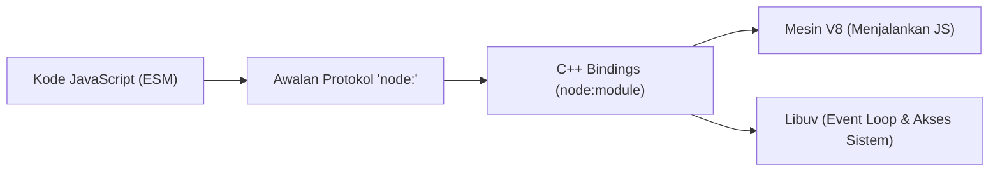

# Standard Library

> Ringkasan
>
> - Fungsi: Menyediakan modul bawaan resmi dari Node.js untuk menangani kebutuhan dasar aplikasi tanpa perlu menginstal paket tambahan dari luar.
> - Digunakan saat: Memanggil fitur inti Node.js, mengecek ketersediaan modul native, dan memastikan aplikasi memuat modul yang aman dari ancaman pihak ketiga.
> - Aturan praktis: Selalu gunakan awalan protokol `node:` saat mengimpor modul bawaan agar Node.js langsung memuat modul internal dan terhindar dari salah ambil paket tiruan (_dependency confusion_).

---

## Tujuan Belajar

- Memahami apa itu library standar (_Standard Library_) dan bagaimana modul bawaan bekerja di Node.js.
- Membiasakan penggunaan awalan `node:` saat mengimpor modul bawaan demi keamanan aplikasi.
- Mengecek keberadaan modul bawaan secara langsung lewat kode menggunakan `node:module`.
- Mengetahui peran mesin V8, Libuv, dan _C++ bindings_ saat menjalankan modul bawaan.
- Membedakan modul bawaan runtime dengan paket eksternal yang diinstal melalui NPM.

---

## Konsep

> Bayangkan Node.js seperti laptop baru yang baru kamu beli dari toko. Library standar (_Standard Library_) adalah aplikasi bawaan yang sudah terpasang dari pabrik, seperti kalkulator, pengatur jam, dan terminal. Kamu bisa langsung memakainya tanpa perlu membuka toko aplikasi untuk mendownload apa pun. Modul bawaan ini terhubung langsung ke mesin laptop lewat perantara internal (_C++ bindings_). Menambahkan awalan `node:` sama seperti memilih aplikasi resmi pabrik, memastikan laptop tidak membuka aplikasi tiruan dari internet yang namanya mirip.



---

## Referensi

| Item                                 | Fungsi                                                              | Catatan                                                                             |
| :----------------------------------- | :------------------------------------------------------------------ | :---------------------------------------------------------------------------------- |
| **`node:` Protocol**                 | Menandai bahwa modul yang diimpor adalah modul bawaan resmi Node.js | Menghemat waktu karena tidak mencari ke `node_modules` dan kebal dari nama tiruan   |
| **`module.isBuiltin()`**             | Mengecek apakah suatu nama modul merupakan modul bawaan runtime     | Menghasilkan nilai `true` untuk modul bawaan dan `false` untuk paket luar           |
| **`module.builtinModules`**          | Menampilkan daftar nama seluruh modul bawaan yang didukung runtime  | Berisi daftar string nama modul tanpa awalan `node:`                                |
| **`module.createRequire()`**         | Membuat fungsi `require()` sendiri di dalam berkas ES Modules       | Berguna saat perlu memanggil modul bawaan dengan format CommonJS                    |
| **`module.syncBuiltinESMExports()`** | Menyelaraskan ekspor modul bawaan antara gaya CommonJS dan ESM      | Menjaga konsistensi data jika ada nilai ekspor modul bawaan yang berubah di runtime |

### `node:` Protocol

Awalan `node:` memberi tahu runtime secara tegas bahwa modul yang dipanggil berasal dari modul internal Node.js. Dengan awalan ini, Node.js tidak perlu repot mencari ke folder `node_modules` di disk, sehingga aplikasi memuat modul lebih cepat dan aman.

```javascript
import module from "node:module";

console.log(typeof module.isBuiltin);
// Output: function
```

Kasus lain: Jika kamu memanggil modul dengan awalan `node:` tetapi modul tersebut tidak ada di Node.js, runtime akan langsung memberikan error `ERR_UNKNOWN_BUILTIN_MODULE`.

```javascript
try {
  await import("node:non_existent_core_module");
} catch (error) {
  console.log(error.code);
  // Output: ERR_UNKNOWN_BUILTIN_MODULE
}
```

### `module.isBuiltin()`

Fungsi `isBuiltin()` dari modul `node:module` berguna untuk memastikan apakah sebuah nama modul benar-benar modul bawaan resmi. Fungsi ini bisa membaca nama modul baik yang memakai awalan `node:` maupun yang tidak.

```javascript
import { isBuiltin } from "node:module";

console.log(isBuiltin("node:module"));
// Output: true
console.log(isBuiltin("express"));
// Output: false
```

Kasus lain: Jika kamu memasukkan string kosong atau nama paket yang tidak dikenal, fungsi ini akan mengembalikan nilai `false` dengan aman tanpa membuat program terhenti.

```javascript
import { isBuiltin } from "node:module";

console.log(isBuiltin(""));
// Output: false
console.log(isBuiltin("unknown-library"));
// Output: false
```

### `module.builtinModules`

Properti `builtinModules` berisi daftar nama seluruh modul bawaan yang didukung oleh versi Node.js yang sedang kamu pakai.

```javascript
import { builtinModules } from "node:module";

console.log(Array.isArray(builtinModules));
// Output: true
console.log(builtinModules.length > 50);
// Output: true
console.log(builtinModules.includes("module"));
// Output: true
```

Kasus lain: Modul bawaan internal Node.js biasanya diawali dengan garis bawah (`_`). Kamu bisa menyaringnya dengan mudah jika hanya ingin melihat daftar modul yang ditujukan untuk publik.

```javascript
import { builtinModules } from "node:module";

const publicModules = builtinModules.filter((name) => !name.startsWith("_"));
console.log(publicModules.includes("module"));
// Output: true
```

### `module.createRequire()`

Saat menulis kode dengan format modern ES Modules (`import`), terkadang kamu tetap butuh fungsi lama `require()`. Fungsi `createRequire()` memungkinkan kamu membuat pemanggil `require` secara fleksibel di dalam berkas ESM.

```javascript
import { createRequire } from "node:module";

const require = createRequire(import.meta.url);
const nativeModule = require("node:module");

console.log(typeof nativeModule.isBuiltin);
// Output: function
```

Kasus lain: Jika modul yang dipanggil lewat `require` tidak ditemukan di sistem, Node.js akan melempar error `MODULE_NOT_FOUND`.

```javascript
import { createRequire } from "node:module";

const require = createRequire(import.meta.url);

try {
  require("non-existent-package-xyz");
} catch (error) {
  console.log(error.code);
  // Output: MODULE_NOT_FOUND
}
```

### `module.syncBuiltinESMExports()`

Node.js mendukung dua sistem modul: CommonJS dan ES Modules. Jika ada data pada modul bawaan CommonJS yang diperbarui di tengah jalan, fungsi `syncBuiltinESMExports()` memastikan perubahan tersebut ikut terlihat pada format ES Modules.

```javascript
import { syncBuiltinESMExports } from "node:module";

syncBuiltinESMExports();
console.log(typeof syncBuiltinESMExports === "function");
// Output: true
```

Kasus lain: Fungsi ini aman dipanggil berulang kali kapan saja tanpa menimbulkan efek samping yang merusak proses aplikasi.

```javascript
import { syncBuiltinESMExports } from "node:module";

syncBuiltinESMExports();
syncBuiltinESMExports();
console.log(true);
// Output: true
```

### Perbandingan: Modul Bawaan vs Paket Pihak Ketiga (NPM)

| Karakteristik       | Modul Bawaan (`node:*`)                           | Paket NPM Pihak Ketiga                                             |
| :------------------ | :------------------------------------------------ | :----------------------------------------------------------------- |
| **Instalasi**       | Sudah tersedia langsung di Node.js                | Perlu diinstal via `npm install`                                   |
| **Waktu Mulai**     | Instan tanpa membaca berkas dari disk             | Butuh waktu untuk membaca folder `node_modules`                    |
| **Keamanan**        | Diawasi dan diuji langsung oleh tim resmi Node.js | Berisiko terhadap perubahan kode atau serangan dari pengelola luar |
| **Ukuran Aplikasi** | Tidak menambah beban ukuran proyek                | Menambah ukuran folder `node_modules` dan container server         |

---

## Kesalahan Umum

### Mengimpor Modul Native Tanpa Prefiks `node:`

Memanggil modul bawaan tanpa awalan `node:` memaksa Node.js mengecek folder `node_modules` terlebih dahulu. Selain memperlambat proses, ini berbahaya jika ada paket tiruan dari luar dengan nama serupa.

```javascript
// Salah
import module from "module";
```

```javascript
// Benar
import module from "node:module";
```

### Memasang Modul Inti Melalui Perintah NPM

Menjalankan perintah install untuk modul bawaan justru bisa mengunduh paket palsu dari internet dan membuat berkas `package.json` berantakan.

```bash
# Salah
npm install module
```

```bash
# Benar
# Modul bawaan langsung diimpor dari runtime tanpa proses instalasi
```

### Menambahkan Prefiks `node:` pada Dependensi Eksternal

Menempelkan awalan `node:` pada paket dari NPM akan membuat Node.js mengira paket tersebut adalah modul bawaan resmi, sehingga memicu error `ERR_UNKNOWN_BUILTIN_MODULE`.

```javascript
// Salah
import express from "node:express";
```

```javascript
// Benar
import express from "express";
```

---

## Studi Kasus

Skenario: Membuat alat pemeriksa dependensi mandiri (_supply chain security auditor_). Alat ini menerima daftar modul yang dipakai proyek, memisahkan modul bawaan resmi dari paket luar menggunakan `node:module`, memberi peringatan jika ada modul bawaan yang belum memakai awalan `node:`, dan mendeteksi modul bawaan palsu.

```javascript
import { isBuiltin, builtinModules } from "node:module";

class SupplyChainAuditor {
  constructor() {
    this.knownBuiltins = new Set(builtinModules);
  }

  auditImports(importList) {
    const report = {
      compliant: [],
      warnings: [],
      external: [],
      invalidBuiltins: [],
    };

    for (const specifier of importList) {
      if (specifier.startsWith("node:")) {
        const moduleName = specifier.slice(5).split("/")[0];
        if (this.knownBuiltins.has(moduleName)) {
          report.compliant.push(specifier);
        } else {
          report.invalidBuiltins.push(specifier);
        }
      } else if (isBuiltin(specifier)) {
        report.warnings.push({
          specifier,
          recommended: `node:${specifier}`,
          reason: "Missing node: protocol prefix",
        });
      } else {
        report.external.push(specifier);
      }
    }

    return report;
  }
}

const auditor = new SupplyChainAuditor();
const testImports = [
  "node:module",
  "node:unknown_core",
  "module",
  "lodash",
  "express",
];

const result = auditor.auditImports(testImports);

console.log(result.compliant);
// Output: [ 'node:module' ]
console.log(result.warnings.length);
// Output: 1
console.log(result.warnings[0].recommended);
// Output: node:module
console.log(result.external);
// Output: [ 'lodash', 'express' ]
console.log(result.invalidBuiltins);
// Output: [ 'node:unknown_core' ]
```

Pendekatan ini sepenuhnya memanfaatkan modul bawaan `node:module` untuk memeriksa keamanan daftar paket secara mandiri, tanpa membutuhkan library tambahan dari luar atau materi yang belum dipelajari.

---

## Latihan Mandiri

### Soal 1 (Dasar)

Buat fungsi `isNativeModule(moduleName)` yang menerima sebuah string nama modul. Fungsi harus mengembalikan nilai boolean `true` jika modul tersebut merupakan modul bawaan resmi Node.js, atau `false` jika bukan.

Contoh input:

```javascript
isNativeModule("node:module");
```

Contoh output yang diharapkan:

```javascript
true;
```

Batasan: Gunakan fungsi `isBuiltin()` dari `node:module` dengan awalan protokol resmi.

### Soal 2 (Menengah)

Buat fungsi `categorizeModules(moduleList)` yang menerima daftar nama modul berupa array string. Fungsi harus mengelompokkan modul menjadi dua kelompok: `builtins` (kumpulan modul bawaan) dan `thirdParty` (kumpulan paket luar). Untuk setiap modul di kelompok `builtins`, pastikan namanya selalu diawali dengan protokol `node:`.

Contoh input:

```javascript
categorizeModules(["module", "node:module", "axios", "dotenv"]);
```

Contoh output yang diharapkan:

```javascript
{
  builtins: ['node:module', 'node:module'],
  thirdParty: ['axios', 'dotenv']
}
```

Batasan: Gunakan fungsi `isBuiltin` dari `node:module`. Objek input asli tidak boleh diubah secara langsung.

### Soal 3 (Menantang)

Buat fungsi pemeriksa keamanan impor `auditModuleRegistry(specifiers)` yang menerima daftar nama modul. Fungsi harus mengevaluasi setiap modul dengan aturan berikut:

1. Jika diawali `node:`, periksa apakah nama modul setelah awalan tersebut terdaftar di dalam `builtinModules`. Jika tidak terdaftar, masukkan ke kategori `invalidBuiltins`. Jika valid, masukkan ke kategori `securedBuiltins`.
2. Jika tidak diawali `node:` tetapi `isBuiltin(specifier)` bernilai `true`, masukkan ke kategori `unprefixedBuiltins` dengan objek `{ specifier: string, fix: string }` di mana `fix` adalah nama modul yang sudah dilengkapi awalan `node:`.
3. Jika bukan modul bawaan, masukkan ke kategori `externalPackages`.
4. Kembalikan objek rekapitulasi yang berisi properti `securedBuiltins`, `unprefixedBuiltins`, `invalidBuiltins`, `externalPackages`, serta nilai kepatuhan `complianceScore` (persentase jumlah `securedBuiltins` terhadap total modul bawaan yang ditemukan).

Contoh input:

```javascript
auditModuleRegistry([
  "node:module",
  "module",
  "node:fake_system",
  "express",
  "react",
]);
```

Contoh output yang diharapkan:

```javascript
{
  securedBuiltins: ['node:module'],
  unprefixedBuiltins: [
    { specifier: 'module', fix: 'node:module' }
  ],
  invalidBuiltins: ['node:fake_system'],
  externalPackages: ['express', 'react'],
  complianceScore: 50
}
```

Batasan: Dilarang menggunakan library eksternal. Gunakan `node:module` secara mandiri dan tangani kasus daftar input kosong dengan mengembalikan `complianceScore: 100`.

---

## Navigasi

[Selanjutnya: Globals](../02-globals/README.md) | [Daftar Isi](../README.md)
