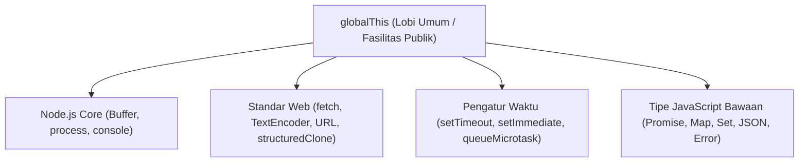

# Globals

> Ringkasan
>
> - Fungsi: Menyediakan objek, fungsi bantuan, dan standar Web API yang bisa langsung kamu gunakan di mana saja tanpa perlu deklarasi impor.
> - Digunakan saat: Mengatur antrean tugas mikro asinkron, menggandakan data bersarang, mengukur durasi kode dengan presisi tinggi, dan mengonversi format teks ke data biner.
> - Aturan praktis: Hindari menyimpan data baru di dalam `globalThis` agar tidak terjadi tabrakan nama variabel; gunakan `queueMicrotask()` untuk menjalankan tugas mendesak sebelum giliran macrotask (seperti timer).

---

## Tujuan Belajar

- Mengenal objek global bawaan Node.js dan standar Web API universal.
- Membedakan cakupan global (`globalThis`) dengan cakupan lokal di dalam file modul ES.
- Menggandakan data kompleks secara mendalam tanpa merusak data asli menggunakan `structuredClone()`.
- Mengukur durasi eksekusi kode berpresisi tinggi menggunakan `performance.now()`.
- Mengubah teks menjadi data biner dan sebaliknya lewat `TextEncoder` dan `TextDecoder`.
- Mengatur prioritas tugas asinkron dengan `queueMicrotask()` dan membatalkan proses via `AbortController`.

---

## Konsep

> Bayangkan Node.js seperti gedung kantor bersama (_co-working space_). Objek `globalThis` adalah lobi utama gedung beserta fasilitas umumnya—seperti jam dinding, dispenser air, dan papan informasi yang bebas diakses siapa saja tanpa kunci khusus. Sementara itu, setiap file kode adalah meja kerja pribadi dengan laci terkunci (_module scope_). Menaruh berkas rahasia di atas meja lobi publik tentu berisiko membuat dokumen tertukar atau bocor ke divisi lain.



---

## Referensi

| Item                    | Fungsi                                                                   | Catatan                                                                |
| :---------------------- | :----------------------------------------------------------------------- | :--------------------------------------------------------------------- |
| **`globalThis`**        | Mengakses objek global tertinggi secara seragam di platform apa pun      | Menggantikan `global` di Node.js dan `window` di browser               |
| **`structuredClone()`** | Membuat salinan data mendalam (_deep clone_) dari suatu nilai JavaScript | Mendukung tipe Date, Map, Set, serta referensi melingkar               |
| **`performance.now()`** | Mengembalikan catatan waktu berpresisi tinggi dalam satuan milidetik     | Waktunya terus bertambah maju dan tidak terpengaruh jam sistem operasi |
| **`TextEncoder`**       | Mengubah string teks menjadi deretan byte biner `Uint8Array` (UTF-8)     | Standar universal untuk mengolah data biner dan pengiriman jaringan    |
| **`TextDecoder`**       | Menerjemahkan kembali deretan byte biner menjadi string teks biasa       | Membaca karakter multibyte dan emoji secara tepat                      |
| **`queueMicrotask()`**  | Memasukkan fungsi ke dalam antrean tugas mikro (_microtask queue_)       | Dijalankan tepat setelah kode sinkron selesai, sebelum macrotask       |
| **`AbortController`**   | Mengirimkan sinyal pembatalan ke operasi asinkron yang sedang berjalan   | Memiliki properti `signal` untuk memantau status pembatalan            |

### `globalThis`

`globalThis` adalah objek universal standar JavaScript untuk merujuk ke cakupan terluar runtime. Di Node.js, `globalThis` menunjuk ke objek yang sama dengan pengenal lama `global`.

```javascript
console.log(globalThis === global);
// Output: true

globalThis.appRegion = "ID-JKT";
console.log(global.appRegion);
// Output: ID-JKT
```

Kasus lain: Di dalam ES Modules, deklarasi variabel biasa seperti `const` atau `let` tidak akan menempel ke properti `globalThis`.

```javascript
const localIdentifier = "secret";
console.log(globalThis.localIdentifier);
// Output: undefined
```

### `structuredClone()`

Fungsi `structuredClone()` dipakai untuk menyalin objek secara menyeluruh hingga ke lapisan terdalam (_deep clone_). Cara ini memutus kaitan memori antara objek asli dan objek salinan.

```javascript
const originalProfile = {
  name: "Sarah",
  settings: { theme: "dark", notifications: true },
};

const clonedProfile = structuredClone(originalProfile);
clonedProfile.settings.theme = "light";

console.log(originalProfile.settings.theme);
// Output: dark
console.log(clonedProfile.settings.theme);
// Output: light
```

Kasus lain: Node.js akan melempar error `DataCloneError` jika kamu mencoba menggandakan fungsi, simbol, atau objek yang tidak bisa diserialisasi.

```javascript
try {
  structuredClone({ calculate: () => 42 });
} catch (error) {
  console.log(error.name);
  // Output: DataCloneError
}
```

### `performance.now()`

Metode `performance.now()` menghasilkan waktu presisi tinggi dalam satuan milidetik hingga pecahan desimal terkecil. Waktu ini dihitung sejak proses Node.js mulai berjalan, sehingga tidak terpengaruh oleh jam kalender komputer yang diubah.

```javascript
const startTime = performance.now();

let total = 0;
for (let i = 0; i < 100_000; i++) {
  total += i;
}

const endTime = performance.now();
const duration = endTime - startTime;

console.log(typeof duration);
// Output: number
console.log(duration >= 0);
// Output: true
```

Kasus lain: Dua pengukuran waktu berturut-turut akan selalu menghasilkan angka yang konsisten bertambah maju.

```javascript
const timeA = performance.now();
const timeB = performance.now();
console.log(timeB >= timeA);
// Output: true
```

### `TextEncoder`

Kelas `TextEncoder` mengubah string teks menjadi deretan byte data biner (`Uint8Array`) berformat UTF-8. Objek ini sangat umum digunakan untuk menyiapkan payload sebelum dikirim lewat jaringan.

```javascript
const encoder = new TextEncoder();
const encodedBytes = encoder.encode("Node.js");

console.log(encodedBytes instanceof Uint8Array);
// Output: true
console.log(encodedBytes.length);
// Output: 7
```

Kasus lain: Karakter khusus atau simbol mata uang akan otomatis dipecah menjadi beberapa byte sesuai aturan UTF-8.

```javascript
const encoder = new TextEncoder();
const symbolBytes = encoder.encode("€");
console.log(symbolBytes.length);
// Output: 3
```

### `TextDecoder`

Kelas `TextDecoder` membaca deretan byte biner dan mengubahnya kembali menjadi teks yang bisa dibaca manusia. Objek ini melengkapi tugas `TextEncoder` untuk komunikasi bolak-balik.

```javascript
const decoder = new TextDecoder("utf-8");
const binaryInput = new Uint8Array([72, 101, 108, 108, 111]);
const decodedText = decoder.decode(binaryInput);

console.log(decodedText);
// Output: Hello
```

Kasus lain: Memasukkan array byte kosong akan menghasilkan string kosong tanpa menimbulkan error.

```javascript
const decoder = new TextDecoder();
const emptyResult = decoder.decode(new Uint8Array([]));
console.log(emptyResult === "");
// Output: true
```

### `queueMicrotask()`

Fungsi `queueMicrotask()` menjadwalkan tugas ke antrean prioritas mikro (_microtask queue_). Tugas ini akan dieksekusi segera setelah kode sinkron saat ini selesai, sebelum Event Loop berpindah ke antrean timer.

```javascript
const executionOrder = [];

setTimeout(() => {
  executionOrder.push("timer-macrotask");
}, 0);

queueMicrotask(() => {
  executionOrder.push("microtask");
});

executionOrder.push("sync");

setTimeout(() => {
  console.log(executionOrder.join(" -> "));
  // Output: sync -> microtask -> timer-macrotask
}, 10);
```

Kasus lain: Node.js akan melempar `TypeError` jika argumen yang diberikan bukan berupa fungsi yang bisa dipanggil.

```javascript
try {
  queueMicrotask("not-a-function");
} catch (error) {
  console.log(error.name);
  // Output: TypeError
}
```

### `AbortController`

Kelas `AbortController` menyediakan cara standar untuk membatalkan proses asinkron kapan saja. Komponen lain bisa memantau status `signal.aborted` atau mendengarkan event pembatalan.

```javascript
const controller = new AbortController();
const signal = controller.signal;

console.log(signal.aborted);
// Output: false

controller.abort("Operation timed out");

console.log(signal.aborted);
// Output: true
console.log(signal.reason);
// Output: Operation timed out
```

Kasus lain: Memanggil `.abort()` berkali-kali tidak akan mengubah alasan pembatalan pertama yang sudah tercatat.

```javascript
const controller = new AbortController();
controller.abort("First reason");
controller.abort("Second reason");
console.log(controller.signal.reason);
// Output: First reason
```

### Perbandingan: Penjadwalan Asinkron

| Fitur                            | Jenis Antrean           | Prioritas Eksekusi                            | Beban Memori                                     |
| :------------------------------- | :---------------------- | :-------------------------------------------- | :----------------------------------------------- |
| **`queueMicrotask()`**           | Microtask Queue         | Tepat setelah blok sinkron, sebelum Macrotask | Paling ringan (tanpa membuat objek Promise baru) |
| **`setTimeout(fn, 0)`**          | Macrotask Queue (Timer) | Setelah seluruh antrean Microtask beres       | Memerlukan registrasi slot timer di Libuv        |
| **`Promise.resolve().then(fn)`** | Microtask Queue         | Setara dengan `queueMicrotask()`              | Membentuk instance objek Promise di memori       |

---

## Kesalahan Umum

### Menyimpan Data Aplikasi di `globalThis`

Menaruh variabel konfigurasi atau data aplikasi langsung di `globalThis` membuat alur data sulit dilacak dan berisiko tabrakan nama jika ada library luar yang memakai nama serupa.

```javascript
// Salah
globalThis.currentUser = { id: 101, name: "Alice" };
```

```javascript
// Benar
// Simpan di dalam modul tersendiri lalu ekspor secara terang-terangan
export const currentUser = { id: 101, name: "Alice" };
```

### Menggunakan `JSON.parse(JSON.stringify())` untuk Deep Clone

Menggandakan data lewat serialisasi JSON akan menghilangkan properti bernilai `undefined`, simbol, serta mengubah objek `Date` menjadi string biasa sehingga tipe aslinya hilang.

```javascript
// Salah
const copiedData = JSON.parse(
  JSON.stringify({ timestamp: new Date(), payload: undefined }),
);
console.log(typeof copiedData.timestamp); // string (kehilangan objek Date)
console.log("payload" in copiedData); // false (properti lenyap)
```

```javascript
// Benar
const copiedData = structuredClone({
  timestamp: new Date(),
  payload: undefined,
});
console.log(copiedData.timestamp instanceof Date); // true
console.log("payload" in copiedData); // true
```

### Mengakses Variabel CommonJS pada ES Modules

Memanggil variabel khas CommonJS seperti `__dirname` atau `__filename` di dalam file ES Modules akan memicu error karena variabel tersebut tidak tersedia di ESM.

```javascript
// Salah
const currentDirectory = __dirname;
```

```javascript
// Benar
// Di lingkungan ES Modules modern, gunakan properti bawaan import.meta.dirname
const currentDirectory = import.meta.dirname;
```

---

## Studi Kasus

Skenario: Membangun pengelola tugas terisolasi yang mengukur durasi pengerjaan, mengubah data teks menjadi biner, memvalidasi pembatalan tugas via `AbortController`, dan memastikan data asli aman dari mutasi menggunakan `structuredClone`.

```javascript
class TaskDispatcher {
  process(inputData, options = {}) {
    const startTime = performance.now();

    if (options.signal?.aborted) {
      return {
        success: false,
        reason: options.signal.reason,
        durationMs: 0,
      };
    }

    const isolatedData = structuredClone(inputData);
    isolatedData.status = "PROCESSED";

    const encoder = new TextEncoder();
    const serializedPayload = JSON.stringify(isolatedData);
    const binaryPayload = encoder.encode(serializedPayload);

    const endTime = performance.now();

    return {
      success: true,
      byteLength: binaryPayload.byteLength,
      data: isolatedData,
      durationMs: Number((endTime - startTime).toFixed(4)),
    };
  }
}

const dispatcher = new TaskDispatcher();
const controller = new AbortController();

const normalResult = dispatcher.process(
  { id: 1, item: "Book" },
  { signal: controller.signal },
);
console.log(normalResult.success);
// Output: true
console.log(normalResult.data.status);
// Output: PROCESSED
console.log(normalResult.byteLength > 0);
// Output: true

controller.abort("Operation cancelled by system");
const abortedResult = dispatcher.process(
  { id: 2, item: "Pen" },
  { signal: controller.signal },
);
console.log(abortedResult.success);
// Output: false
console.log(abortedResult.reason);
// Output: Operation cancelled by system
```

Desain ini memanfaatkan fitur global bawaan (`structuredClone`, `performance.now`, `TextEncoder`, `AbortController`) untuk menjaga keamanan data dan mencatat durasi proses secara mandiri tanpa library tambahan.

---

## Latihan Mandiri

### Soal 1 (Dasar)

Buat fungsi `getUtf8ByteLength(text)` yang menerima sebuah string teks dan mengembalikan total ukuran byte biner yang dihasilkan setelah diubah menggunakan `TextEncoder`.

Contoh input:

```javascript
getUtf8ByteLength("Hello Node.js");
```

Contoh output yang diharapkan:

```javascript
13;
```

Batasan: Gunakan kelas `TextEncoder` bawaan global tanpa menghitung panjang karakter string secara manual dengan `.length`.

### Soal 2 (Menengah)

Buat fungsi `cloneAndMeasure(targetObject)` yang menerima sebuah objek bertingkat. Fungsi ini harus membuat salinan mendalam dari objek target menggunakan `structuredClone()`, menambahkan properti baru `clonedAt` bertipe objek `Date`, serta menyisipkan properti `durationMs` yang mencatat durasi waktu proses kloning dalam satuan milidetik menggunakan `performance.now()`.

Contoh input:

```javascript
cloneAndMeasure({ module: "Globals", version: 1 });
```

Contoh output yang diharapkan:

```javascript
{
  module: 'Globals',
  version: 1,
  clonedAt: 2026-10-12T00:00:00.000Z, // Objek Date asli
  durationMs: 0.045 // Bilangan positif
}
```

Batasan: Objek asli tidak boleh mengalami perubahan nilai. Wajib menggunakan `structuredClone()` dan `performance.now()`.

### Soal 3 (Menantang)

Buat fungsi penjadwal antrean tugas `scheduleMicroBatch(payloads, byteLimit, signal)` yang memproses serangkaian teks input dengan aturan berikut:

1. Setiap teks input diubah menjadi deretan byte `Uint8Array` menggunakan `TextEncoder`.
2. Jika total ukuran byte yang sedang diproses melebihi nilai `byteLimit`, proses harus dihentikan dan kembalikan error operasional `{ success: false, reason: 'Byte quota exceeded' }`.
3. Sebelum memproses tiap item, periksa apakah `signal.aborted` bernilai `true`. Jika dibatalkan, hentikan proses dan kembalikan `{ success: false, reason: signal.reason }`.
4. Jika seluruh data valid, kembalikan objek `{ success: true, totalBytes: number, binaries: Uint8Array[] }`. Seluruh perhitungan harus dijalankan di dalam fungsi mikro berbasis `queueMicrotask()` yang mengembalikan Promise hasil akhir.

Contoh input 1:

```javascript
const controller = new AbortController();
await scheduleMicroBatch(["alpha", "beta"], 50, controller.signal);
```

Contoh output 1:

```javascript
{
  success: true,
  totalBytes: 9,
  binaries: [
    Uint8Array(5) [ 97, 108, 112, 104, 97 ],
    Uint8Array(4) [ 98, 101, 116, 97 ]
  ]
}
```

Contoh input 2:

```javascript
const controller = new AbortController();
await scheduleMicroBatch(
  ["very long payload exceeding byte quota limit"],
  10,
  controller.signal,
);
```

Contoh output 2:

```javascript
{
  success: false,
  reason: 'Byte quota exceeded'
}
```

Contoh input 3:

```javascript
const controller = new AbortController();
controller.abort("Cancelled by user");
await scheduleMicroBatch(["data"], 100, controller.signal);
```

Contoh output 3:

```javascript
{
  success: false,
  reason: 'Cancelled by user'
}
```

Batasan: Dilarang menggunakan library eksternal. Wajib mengombinasikan `queueMicrotask`, `TextEncoder`, dan `AbortSignal` dengan penanganan pembatalan dan batasan ukuran data.

---

## Navigasi

[Sebelumnya: Standard Library](../01-standard-library/README.md) | [Selanjutnya: Process](../03-process/README.md) | [Daftar Isi](../README.md)
