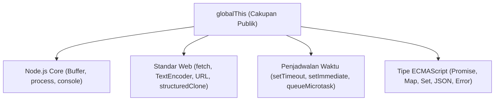

# Globals

> Ringkasan
>
> - Fungsi: Menyediakan objek, fungsi utilitas, dan antarmuka Web API standar yang dapat diakses di seluruh cakupan kode tanpa deklarasi impor.
> - Digunakan saat: Mengelola antrean tugas mikro asinkron, mengkloning data berstruktur dalam, mengukur latensi eksekusi presisi tinggi, dan mengonversi format teks biner.
> - Aturan praktis: Hindari menambahkan properti baru ke `globalThis` untuk mencegah tabrakan nama dan kebocoran memori; gunakan `queueMicrotask()` untuk penjadwalan fungsi mendesak sebelum siklus macrotask.

---

## Tujuan Belajar

- Mengidentifikasi objek global bawaan Node.js dan standar Web API universal.
- Membedakan cakupan global (`globalThis`) dengan cakupan berkas terisolasi pada modul ES.
- Menerapkan fungsi `structuredClone()` untuk menduplikasi struktur data kompleks secara mandiri.
- Mengukur durasi performa komputasi berpresisi tinggi menggunakan `performance.now()`.
- Mengonversi representasi string teks menjadi byte array menggunakan `TextEncoder` dan `TextDecoder`.
- Mengendalikan prioritas eksekusi kode asinkron dengan `queueMicrotask()` dan pembatalan operasi melalui `AbortController`.

---

## Konsep

> Runtime Node.js dapat dianalogikan sebagai gedung kantor bersama (_co-working space_). Cakupan `globalThis` adalah lobi umum beserta fasilitas publiknya (jam dinding, dispenser, dan meja informasi) yang bebas digunakan seluruh penghuni gedung tanpa kunci akses khusus. Setiap berkas kode adalah meja kerja pribadi dengan laci terkunci (_module scope_). Menyimpan dokumen rahasia di atas meja lobi publik berisiko menimbulkan tertukarnya dokumen antar-divisi dan kebocoran informasi.



---

## Referensi

| Item                    | Fungsi                                                                       | Catatan                                                                 |
| :---------------------- | :--------------------------------------------------------------------------- | :---------------------------------------------------------------------- |
| **`globalThis`**        | Mengakses objek akar cakupan global lintas platform secara konsisten         | Menggantikan referensi `global` pada Node.js dan `window` pada peramban |
| **`structuredClone()`** | Membuat salinan mendalam (_deep clone_) dari suatu nilai JavaScript          | Mendukung tipe bawaan seperti Date, Map, Set, dan referensi melingkar   |
| **`performance.now()`** | Menghasilkan stempel waktu resolusi tinggi dalam satuan milidetik            | Bersifat monotonik sehingga kebal terhadap koreksi jam sistem operasi   |
| **`TextEncoder`**       | Mengodekan string karakter menjadi deretan biner `Uint8Array` berbasis UTF-8 | Standar universal untuk manipulasi payload biner dan kriptografi        |
| **`TextDecoder`**       | Menerjemahkan deretan byte `Uint8Array` kembali menjadi string teks UTF-8    | Menangani karakter multibyte dan emoji secara akurat                    |
| **`queueMicrotask()`**  | Memasukkan fungsi panggilan balik ke antrean tugas mikro (_microtask queue_) | Dieksekusi sebelum macrotask berikutnya tanpa beban alokasi Promise     |
| **`AbortController`**   | Mengirimkan sinyal pembatalan ke operasi asinkron atau pendengar peristiwa   | Memiliki properti `signal` untuk memeriksa status pembatalan            |

### `globalThis`

`globalThis` adalah objek universal standar ECMAScript yang merujuk pada cakupan terluar runtime. Di Node.js, `globalThis` setara dengan pengenal lama `global`.

```javascript
console.log(globalThis === global);
// Output: true

globalThis.lokasiAplikasi = "ID-JKT";
console.log(global.lokasiAplikasi);
// Output: ID-JKT
```

Kasus lain: Di dalam ES Modules, deklarasi variabel `var` atau `const` tingkat atas tidak secara otomatis terikat pada properti `globalThis`.

```javascript
const identifierLokal = "rahasia";
console.log(globalThis.identifierLokal);
// Output: undefined
```

### `structuredClone()`

Fungsi `structuredClone()` digunakan untuk menduplikasi objek secara mendalam tanpa mempertahankan referensi memori pada properti bersarang. Fungsi ini meniadakan kebutuhan pustaka eksternal untuk kloning data.

```javascript
const profilAsli = {
  nama: "Sinta",
  pengaturan: { tema: "gelap", notifikasi: true },
};

const profilKloning = structuredClone(profilAsli);
profilKloning.pengaturan.tema = "terang";

console.log(profilAsli.pengaturan.tema);
// Output: gelap
console.log(profilKloning.pengaturan.tema);
// Output: terang
```

Kasus lain: Melempar pengecualian `DataCloneError` saat mencoba menyalin fungsi, simbol, atau objek DOM yang tidak dapat diserialisasi.

```javascript
try {
  structuredClone({ hitung: () => 42 });
} catch (error) {
  console.log(error.name);
  // Output: DataCloneError
}
```

### `performance.now()`

Metode `performance.now()` mengembalikan stempel waktu presisi tinggi dengan fraksi sub-milidetik. Nilainya dihitung relatif terhadap awal inisialisasi runtime sehingga tidak terpengaruh pergeseran waktu jam kalender.

```javascript
const awal = performance.now();

let total = 0;
for (let i = 0; i < 100_000; i++) {
  total += i;
}

const akhir = performance.now();
const durasi = akhir - awal;

console.log(typeof durasi);
// Output: number
console.log(durasi >= 0);
// Output: true
```

Kasus lain: Menghitung selisih waktu antara dua pengukuran yang terjadi secara berurutan menghasilkan angka positif atau nol yang konsisten.

```javascript
const t1 = performance.now();
const t2 = performance.now();
console.log(t2 >= t1);
// Output: true
```

### `TextEncoder`

Kelas `TextEncoder` mengonversi representasi string teks menjadi aliran byte biner dalam format `Uint8Array` dengan penyandian baku UTF-8. Objek ini sangat umum digunakan untuk memproses data sebelum dikirim melalui soket jaringan atau algoritma hashing.

```javascript
const encoder = new TextEncoder();
const dataBiner = encoder.encode("Node.js");

console.log(dataBiner instanceof Uint8Array);
// Output: true
console.log(dataBiner.length);
// Output: 7
```

Kasus lain: Mengodekan karakter simbol multi-byte menghasilkan beberapa byte sekaligus sesuai standar UTF-8.

```javascript
const encoder = new TextEncoder();
const binerSimbol = encoder.encode("€");
console.log(binerSimbol.length);
// Output: 3
```

### `TextDecoder`

Kelas `TextDecoder` membaca deretan byte biner seperti `Uint8Array` atau `Buffer` dan merekonstruksinya kembali menjadi string teks manusia. Objek ini melengkapi operasi `TextEncoder` untuk komunikasi dua arah.

```javascript
const decoder = new TextDecoder("utf-8");
const binerInput = new Uint8Array([72, 97, 108, 111]);
const hasilTeks = decoder.decode(binerInput);

console.log(hasilTeks);
// Output: Halo
```

Kasus lain: Membaca array byte kosong mengembalikan string kosong tanpa melempar galat.

```javascript
const decoder = new TextDecoder();
const hasilKosong = decoder.decode(new Uint8Array([]));
console.log(hasilKosong === "");
// Output: true
```

### `queueMicrotask()`

Fungsi `queueMicrotask()` menjadwalkan eksekusi panggilan balik ke dalam antrean tugas mikro (_microtask queue_). Tugas mikro dieksekusi tepat setelah bingkai eksekusi sinkron saat ini kosong dan sebelum perputaran Event Loop berpindah ke macrotask seperti timer.

```javascript
const jejak = [];

setTimeout(() => {
  jejak.push("timer-macrotask");
}, 0);

queueMicrotask(() => {
  jejak.push("antrean-microtask");
});

jejak.push("sinkron");

setTimeout(() => {
  console.log(jejak.join(" -> "));
  // Output: sinkron -> antrean-microtask -> timer-macrotask
}, 10);
```

Kasus lain: Melempar `TypeError` jika argumen yang diberikan bukan berupa fungsi yang dapat dieksekusi.

```javascript
try {
  queueMicrotask("bukan-fungsi");
} catch (error) {
  console.log(error.name);
  // Output: TypeError
}
```

### `AbortController`

Kelas `AbortController` menyediakan mekanisme standar untuk mengirimkan sinyal pembatalan ke operasi asinkron. Objek pendengar dapat memantau status `signal.aborted` atau mendengarkan peristiwa `abort`.

```javascript
const pengendali = new AbortController();
const sinyal = pengendali.signal;

console.log(sinyal.aborted);
// Output: false

pengendali.abort("Waktu operasi habis");

console.log(sinyal.aborted);
// Output: true
console.log(sinyal.reason);
// Output: Waktu operasi habis
```

Kasus lain: Memanggil `.abort()` berulang kali tidak mengubah alasan asli yang sudah didaftarkan pertama kali.

```javascript
const controller = new AbortController();
controller.abort("Alasan pertama");
controller.abort("Alasan kedua");
console.log(controller.signal.reason);
// Output: Alasan pertama
```

### Perbandingan: Penjadwalan Asinkron

| Fitur                            | Jenis Antrean           | Prioritas Relatif                       | Kebutuhan Alokasi                             |
| :------------------------------- | :---------------------- | :-------------------------------------- | :-------------------------------------------- |
| **`queueMicrotask()`**           | Microtask Queue         | Setelah blok sinkron, sebelum Macrotask | Ringan (tanpa objek Promise baru)             |
| **`setTimeout(fn, 0)`**          | Macrotask Queue (Timer) | Setelah seluruh Microtask rampung       | Memerlukan registrasi slot timer di Libuv     |
| **`Promise.resolve().then(fn)`** | Microtask Queue         | Setara dengan `queueMicrotask()`        | Membentuk instance Promise tambahan di memori |

---

## Kesalahan Umum

### Mengotori `globalThis` untuk Menyimpan State Aplikasi

Menyimpan state atau variabel konfigurasi pada `globalThis` membuat dependensi tersembunyi, mempersulit pengujian unit, dan rentan terhadap tabrakan nama antar-pustaka.

```javascript
// Salah
globalThis.penggunaAktif = { id: 101, nama: "Budi" };
```

```javascript
// Benar
// Simpan di dalam modul tersendiri lalu ekspor secara eksplisit
export const penggunaAktif = { id: 101, nama: "Budi" };
```

### Menggunakan `JSON.parse(JSON.stringify())` untuk Deep Clone

Metode serialisasi JSON menghilangkan properti bertipe `undefined`, simbol, serta mengubah objek `Date` menjadi string biasa tanpa mempertahankan tipe aslinya.

```javascript
// Salah
const salinan = JSON.parse(
  JSON.stringify({ waktu: new Date(), data: undefined }),
);
console.log(typeof salinan.waktu); // string (kehilangan objek Date)
console.log("data" in salinan); // false (properti lenyap)
```

```javascript
// Benar
const salinan = structuredClone({ waktu: new Date(), data: undefined });
console.log(salinan.waktu instanceof Date); // true
console.log("data" in salinan); // true
```

### Mengakses Variabel Pseudo-Global CommonJS pada ES Modules

Memanggil variabel lingkungan CommonJS seperti `__dirname` atau `__filename` di dalam berkas modul standar ES memicu pengecualian fatal karena variabel tersebut tidak didaftarkan di lingkungan ESM.

```javascript
// Salah
const folderSekarang = __dirname;
```

```javascript
// Benar
import { fileURLToPath } from "node:url";
const folderSekarang = fileURLToPath(new URL(".", import.meta.url));
```

---

## Studi Kasus

Skenario: Membangun dispatcher tugas terenkapsulasi yang mengukur latensi pemrosesan data, mengonversi payload string menjadi biner, memvalidasi pembatalan tugas via `AbortController`, dan memastikan isolasi salinan data menggunakan `structuredClone`.

```javascript
class TaskDispatcher {
  proses(dataMasukan, opsi = {}) {
    const awal = performance.now();

    if (opsi.signal?.aborted) {
      return {
        sukses: false,
        alasan: opsi.signal.reason,
        durasiMs: 0,
      };
    }

    const dataTerisolasi = structuredClone(dataMasukan);
    dataTerisolasi.status = "DIPROSES";

    const encoder = new TextEncoder();
    const payloadTeks = JSON.stringify(dataTerisolasi);
    const biner = encoder.encode(payloadTeks);

    const akhir = performance.now();

    return {
      sukses: true,
      ukuranByte: biner.byteLength,
      data: dataTerisolasi,
      durasiMs: Number((akhir - awal).toFixed(4)),
    };
  }
}

const dispatcher = new TaskDispatcher();
const kontrol = new AbortController();

const hasilNormal = dispatcher.proses(
  { id: 1, item: "Buku" },
  { signal: kontrol.signal },
);
console.log(hasilNormal.sukses);
// Output: true
console.log(hasilNormal.data.status);
// Output: DIPROSES
console.log(hasilNormal.ukuranByte > 0);
// Output: true

kontrol.abort("Operasi dibatalkan sistem");
const hasilBatal = dispatcher.proses(
  { id: 2, item: "Pena" },
  { signal: kontrol.signal },
);
console.log(hasilBatal.sukses);
// Output: false
console.log(hasilBatal.alasan);
// Output: Operasi dibatalkan sistem
```

Desain ini memanfaatkan fitur global murni (`structuredClone`, `performance.now`, `TextEncoder`, `AbortController`) untuk menjamin keamanan mutasi data dan memberikan observabilitas eksekusi tanpa memerlukan dependensi pihak ketiga.

---

## Latihan Mandiri

### Soal 1 (Dasar)

Buat fungsi `hitungUkuranByteUtf8(teks)` yang menerima sebuah string teks dan mengembalikan jumlah byte biner yang dihasilkan setelah dikodekan menggunakan `TextEncoder`.

Contoh masukan:

```javascript
hitungUkuranByteUtf8("Belajar Node.js");
```

Contoh keluaran yang diharapkan:

```javascript
15;
```

Batasan: Gunakan kelas `TextEncoder` bawaan global tanpa menghitung panjang karakter string secara manual dengan `.length`.

### Soal 2 (Menengah)

Buat fungsi `klonDanUkur(objekTarget)` yang menerima sebuah objek bertingkat. Fungsi ini wajib membuat salinan mendalam dari objek target menggunakan `structuredClone()`, menambahkan properti baru `waktuKloning` bertipe objek `Date`, serta menyisipkan properti `durasiKloningMs` yang menghitung waktu proses kloning dalam satuan milidetik menggunakan `performance.now()`.

Contoh masukan:

```javascript
klonDanUkur({ modul: "Globals", versi: 1 });
```

Contoh keluaran yang diharapkan:

```javascript
{
  modul: 'Globals',
  versi: 1,
  waktuKloning: 2026-10-12T00:00:00.000Z, // Instance objek Date
  durasiKloningMs: 0.045 // Bilangan positif
}
```

Batasan: Objek asli tidak boleh mengalami mutasi. Wajib menggunakan `structuredClone()` dan `performance.now()`.

### Soal 3 (Menantang)

Buat fungsi penjadwal antrean batch `jadwalkanBatchMikro(daftarPayload, batasByte, sinyal)` yang memproses serangkaian payload teks. Fungsi harus mematuhi aturan berikut:

1. Setiap payload diubah menjadi biner `Uint8Array` menggunakan `TextEncoder`.
2. Jika akumulasi ukuran byte biner pada batch yang sedang diproses melebihi nilai `batasByte`, proses harus dihentikan dan kembalikan galat operasional `{ sukses: false, alasan: 'Batas kuota byte terlampaui' }`.
3. Sebelum memproses tiap item, periksa apakah `sinyal.aborted` bernilai `true`. Jika dibatalkan, hentikan iterasi dan kembalikan `{ sukses: false, alasan: sinyal.reason }`.
4. Jika seluruh payload valid, kembalikan objek `{ sukses: true, totalByte: number, daftarBiner: Uint8Array[] }`. Seluruh komputasi harus dijalankan di dalam pembungkus fungsi mikro berbasis `queueMicrotask()` yang mengembalikan Promise hasil akhir.

Contoh masukan 1:

```javascript
const pembatal = new AbortController();
await jadwalkanBatchMikro(["alpha", "beta"], 50, pembatal.signal);
```

Contoh keluaran 1:

```javascript
{
  sukses: true,
  totalByte: 9,
  daftarBiner: [
    Uint8Array(5) [ 97, 108, 112, 104, 97 ],
    Uint8Array(4) [ 98, 101, 116, 97 ]
  ]
}
```

Contoh masukan 2:

```javascript
const pembatal = new AbortController();
await jadwalkanBatchMikro(
  ["teks sangat panjang melebihi kapasitas kuota"],
  10,
  pembatal.signal,
);
```

Contoh keluaran 2:

```javascript
{
  sukses: false,
  alasan: 'Batas kuota byte terlampaui'
}
```

Contoh masukan 3:

```javascript
const pembatal = new AbortController();
pembatal.abort("Dibatalkan pengguna");
await jadwalkanBatchMikro(["data"], 100, pembatal.signal);
```

Contoh keluaran 3:

```javascript
{
  sukses: false,
  alasan: 'Dibatalkan pengguna'
}
```

Batasan: Dilarang menggunakan pustaka eksternal. Wajib mengombinasikan `queueMicrotask`, `TextEncoder`, dan `AbortSignal` dengan penanganan kasus pembatalan dan batasan kuota.

---

## Navigasi

[Sebelumnya: Standard Library](../01-standard-library/README.md) | [Selanjutnya: Process](../03-process/README.md) | [Daftar Isi](../README.md)
