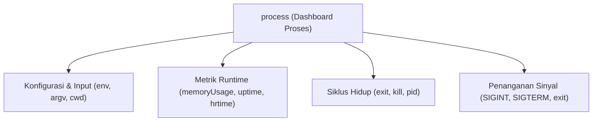

# Process

> Ringkasan
>
> - Tingkat: Fondasi
> - Fungsi: Memberikan kendali dan informasi tentang proses Node.js yang sedang berjalan di sistem operasi.
> - Digunakan saat: Membaca variabel environment, menangkap argumen CLI, memantau penggunaan RAM, dan menangani terminasi aplikasi.
> - Aturan praktis: Jangan gunakan `process.exit()` mendadak di tengah operasi asynchronous yang belum selesai; selalu validasi tipe data string dari `process.env`.

## Cheat Sheet

| Tugas                                     | Kode                                  |
| :---------------------------------------- | :------------------------------------ |
| Membaca variabel environment              | `const port = process.env.PORT;`      |
| Mengambil argumen CLI pengguna            | `const args = process.argv.slice(2);` |
| Menghentikan proses dengan kode status    | `process.exit(1);`                    |
| Membaca direktori kerja aktif             | `const dir = process.cwd();`          |
| Membaca durasi proses aktif (detik)       | `const uptime = process.uptime();`    |
| Menginspeksi pemakaian memori heap        | `const mem = process.memoryUsage();`  |
| Menangkap sinyal terminasi sistem operasi | `process.on("SIGINT", () => {});`     |

## Tujuan Belajar

- Mengakses dan mengonfigurasi variabel lingkungan lewat `process.env`.
- Membedakan path biner Node.js dan parameter pengguna pada `process.argv`.
- Mengontrol siklus hidup proses secara aman memakai `process.exit()`.
- Memantau kesehatan server lewat metrik memori RAM `process.memoryUsage()`.
- Menangkap sinyal OS dan unhandled exception menggunakan event listener `process.on()`.

## Konsep

Bayangkan proses Node.js seperti sebuah mobil yang sedang melaju di jalan raya. Objek `process` adalah dashboard kendali di depan pengemudi. Melalui dashboard ini, pengemudi bisa melihat kecepatan dan bahan bakar yang tersisa (`process.memoryUsage()`), mengetahui lama perjalanan (`process.uptime()`), membaca konfigurasi transmisi (`process.env`), serta menginjak rem darurat untuk mematikan mesin (`process.exit()`).



## Referensi

| Item                          | Fungsi                                                     | Catatan                                              |
| :---------------------------- | :--------------------------------------------------------- | :--------------------------------------------------- |
| `process.env`                 | Objek berisi variabel lingkungan sistem operasi            | Semua nilai properti selalu bertipe string           |
| `process.argv`                | Array berisi argumen baris perintah saat proses dijalankan | Argumen pengguna dimulai dari indeks ke-2            |
| `process.exit([code])`        | Menghentikan proses Node.js secara langsung                | Kode `0` berarti sukses, `1` berarti ada error       |
| `process.cwd()`               | Mengembalikan path absolut direktori kerja aktif           | Berbeda dengan lokasi file kode modul saat ini       |
| `process.uptime()`            | Menghitung lama proses berjalan dalam satuan detik         | Mengembalikan angka desimal dengan presisi tinggi    |
| `process.memoryUsage()`       | Mengembalikan rincian pemakaian memori dalam byte          | Mencakup `heapUsed`, `heapTotal`, dan `rss`          |
| `process.hrtime.bigint()`     | Mengukur interval waktu berpresisi tinggi dalam nanodetik  | Nilai bertipe `bigint` yang tidak terpengaruh jam OS |
| `process.on(event, listener)` | Menangani event dan sinyal terminasi dari sistem           | Menangani `uncaughtException`, `SIGINT`, dan `exit`  |

### `process.env`

`process.env` adalah objek yang menampung seluruh variabel lingkungan (environment variables) dari sistem operasi atau file konfigurasi.

Struktur parameter: properti objek bawaan tanpa pemanggilan fungsi.

Nilai kembalian: objek kamus berisi pasangan kunci dan nilai teks (`object`).

```javascript
process.env.APP_ENV = "staging";

console.log(process.env.APP_ENV);
// Output: staging
console.log(typeof process.env.PATH);
// Output: string
```

Kondisi khusus: Seluruh nilai yang dimasukkan ke `process.env` otomatis dikonversi menjadi tipe string. Nilai boolean `false` akan terbaca sebagai string `"false"`.

### `process.argv`

`process.argv` menyimpan seluruh argumen baris perintah yang diketik saat menjalankan perintah Node.js di terminal.

Struktur parameter: properti array bawaan tanpa pemanggilan fungsi.

Nilai kembalian: daftar string argumen CLI (`string[]`).

```javascript
console.log(Array.isArray(process.argv));
// Output: true
console.log(process.argv.length >= 2);
// Output: true
```

Kondisi khusus: Indeks `0` selalu berisi path biner node, indeks `1` berisi file eksekusi, dan argumen buatan developer baru muncul mulai indeks `2`.

### `process.exit([code])`

`process.exit()` memaksa runtime Node.js untuk segera berhenti berjalan.

Struktur parameter: `process.exit(code)`

- `code` (number, opsional, default: `0`): kode status terminasi proses.

Nilai kembalian: tidak mengembalikan nilai (`never`).

```javascript
process.on("exit", (code) => {
  console.log(`Process exited with code: ${code}`);
});

process.exitCode = 0;
console.log(process.exitCode);
// Output: 0
```

Kondisi khusus: Memanggil `process.exit()` membatalkan antrean operasi asynchronous yang sedang berjalan tanpa menunggu operasi tersebut selesai.

### `process.cwd()`

`process.cwd()` mengembalikan path absolut dari direktori tempat perintah dijalankan di terminal.

Struktur parameter: `process.cwd()` tanpa argumen.

Nilai kembalian: string path absolut direktori aktif (`string`).

```javascript
console.log(typeof process.cwd());
// Output: string
console.log(process.cwd().length > 0);
// Output: true
```

Kondisi khusus: Nilai `process.cwd()` bisa berbeda dari lokasi file kode jika kamu menjalankan script dari subfolder atau folder induk yang berbeda.

### `process.uptime()`

`process.uptime()` menghitung berapa detik proses Node.js telah berjalan sejak pertama kali dijalankan.

Struktur parameter: `process.uptime()` tanpa argumen.

Nilai kembalian: angka durasi waktu dalam satuan detik (`number`).

```javascript
console.log(process.uptime() >= 0);
// Output: true
```

Kondisi khusus: Mengembalikan nilai desimal float sehingga perlu dibulatkan dengan `Math.floor()` jika membutuhkan bilangan bulat.

### `process.memoryUsage()`

`process.memoryUsage()` memberikan gambaran alokasi memori RAM yang digunakan oleh proses Node.js dalam satuan byte.

Struktur parameter: `process.memoryUsage()` tanpa argumen.

Nilai kembalian: objek berisi rincian byte `rss`, `heapTotal`, `heapUsed`, dan `external` (`object`).

```javascript
const mem = process.memoryUsage();

console.log(typeof mem.heapUsed);
// Output: number
console.log(mem.heapUsed > 0);
// Output: true
```

Kondisi khusus: Nilai `rss` (Resident Set Size) mewakili total alokasi memori RAM fisik dari OS, sedangkan `heapUsed` adalah memori objek JavaScript aktif.

### `process.hrtime.bigint()`

`process.hrtime.bigint()` mengembalikan stempel waktu beresolusi nanodetik untuk mengukur jeda performa kode secara akurat.

Struktur parameter: `process.hrtime.bigint()` tanpa argumen.

Nilai kembalian: angka bernilai nanodetik berformat integer besar (`bigint`).

```javascript
const start = process.hrtime.bigint();
const diff = process.hrtime.bigint() - start;

console.log(typeof diff);
// Output: bigint
console.log(diff >= 0n);
// Output: true
```

Kondisi khusus: Nilai kembalian bertipe `bigint`, sehingga tidak bisa dicampur langsung dengan operasi aritmatika tipe `number` biasa tanpa konversi eksplisit.

### `process.on(event, listener)`

`process.on()` mendaftarkan listener untuk merespons sinyal sistem operasi atau event siklus hidup Node.js.

Struktur parameter: `process.on(event, listener)`

- `event` (string, wajib): nama sinyal OS (seperti `"SIGINT"`, `"SIGTERM"`) atau event proses (`"uncaughtException"`, `"exit"`).
- `listener` (function, wajib): fungsi penangan event.

Nilai kembalian: instance `process` (`EventEmitter`).

```javascript
process.once("customTestEvent", (msg) => {
  console.log(`Caught: ${msg}`);
});

process.emit("customTestEvent", "success");
// Output: Caught: success
```

Kondisi khusus: Jangan biarkan handler `uncaughtException` berjalan tanpa memanggil `process.exit(1)`, karena proses berada dalam kondisi korup yang tidak dapat diprediksi.

## Kesalahan Umum

### Membiarkan Aplikasi Berjalan Setelah `uncaughtException`

Menangkap `uncaughtException` tanpa mematikan proses berisiko membiarkan aplikasi berjalan dalam status memori yang rusak.

```javascript
// Incorrect
process.on("uncaughtException", (err) => {
  console.error("Unexpected error:", err.message);
  // Application continues serving requests with corrupted state
});

// Correct
process.on("uncaughtException", (err) => {
  console.error("Fatal error:", err.message);
  process.exit(1); // Stop the process and allow supervisor to restart
});
```

### Mengabaikan Tipe Data String pada `process.env`

Semua nilai di `process.env` selalu berupa string teks, bahkan saat ditulis angka atau boolean.

```javascript
// Incorrect
process.env.PORT = 8080;
if (process.env.PORT === 8080) {
  // This condition is always false due to strict equality check against a string
}

// Correct
process.env.PORT = "8080";
const port = Number(process.env.PORT) || 3000;
```

## Studi Kasus

Membangun pengawas kesehatan proses server (_process health monitor_) yang membaca konfigurasi lingkungan dari `process.env`, memantau penggunaan RAM via `process.memoryUsage()`, dan mengukur durasi pengecekan memakai `process.hrtime.bigint()`.

```javascript
import process from "node:process";

class ProcessMonitor {
  constructor(options = {}) {
    this.heapThresholdMb = options.heapThresholdMb || 250;
    this.environment = process.env.NODE_ENV || "development";
    this.port = Number(process.env.PORT) || 3000;
  }

  getHealthReport() {
    const startNs = process.hrtime.bigint();
    const memory = process.memoryUsage();
    const usedHeapMb = Number((memory.heapUsed / 1024 / 1024).toFixed(2));
    const endNs = process.hrtime.bigint();
    const latencyMs = Number(endNs - startNs) / 1_000_000;

    const isHealthy = usedHeapMb < this.heapThresholdMb;

    return {
      status: isHealthy ? "HEALTHY" : "CRITICAL",
      pid: process.pid,
      uptimeSeconds: Math.floor(process.uptime()),
      environment: this.environment,
      port: this.port,
      heapMb: usedHeapMb,
      diagnosisLatencyMs: Number(latencyMs.toFixed(4)),
    };
  }
}

process.env.NODE_ENV = "production";
process.env.PORT = "8080";

const monitor = new ProcessMonitor({ heapThresholdMb: 500 });
const report = monitor.getHealthReport();

console.log(report.status);
// Output: HEALTHY
console.log(report.environment);
// Output: production
console.log(report.port);
// Output: 8080
console.log(typeof report.pid === "number");
// Output: true
console.log(report.heapMb > 0);
// Output: true
```

Pola pemantauan ini membaca konfigurasi runtime secara aman, memvalidasi ambang batas RAM, dan menyediakan informasi diagnostik yang esensial untuk observabilitas server backend.

## Latihan Mandiri

Buat fungsi `parseServerConfig(cliArgs = [], envVars = {})` untuk memvalidasi konfigurasi server berbasis baris perintah dan variabel lingkungan.

- **Level 1 (Dasar):** Periksa array `cliArgs` untuk mencari nilai flag `--port <angka>` dan `--env <string>`. Jika tidak ditemukan di argumen, gunakan nilai cadangan dari `envVars.PORT` dan `envVars.NODE_ENV`. Jika masih tidak ada, pakai nilai bawaan port `3000` dan env `"development"`. Kembalikan objek `{ port: Number(port), env }`.
- **Level 2 (Menengah):** Tambahkan metrik diagnostik sistem: `uptimeSeconds` (menggunakan `Math.floor(process.uptime())`) dan `heapUsedMb` (dihitung dari `Number((process.memoryUsage().heapUsed / 1024 / 1024).toFixed(2))`).
- **Level 3 (Menantang):** Validasi nomor port. Jika nilai port bukan angka (NaN), kurang dari 1, atau lebih dari 65535, lempar `RangeError("Invalid port number")`.

Contoh input dan output normal:

```javascript
const config = parseServerConfig(["--port", "8080", "--env", "production"], {});

console.log(config.port);
// Output: 8080
console.log(config.env);
// Output: production
console.log(config.heapUsedMb > 0);
// Output: true
```

Contoh input dan penanganan error:

```javascript
try {
  parseServerConfig(["--port", "99999"], {});
} catch (err) {
  console.log(err.message);
  // Output: Invalid port number
}
```

Tanda selesai:

- [ ] Parsing argumen CLI `--port` dan `--env` berfungsi dengan nilai fallback environment.
- [ ] Metrik memori `heapUsedMb` dan `uptimeSeconds` tercatat secara akurat.
- [ ] Port di luar jangkauan 1–65535 melempar `RangeError`.

---

## Navigasi

[Sebelumnya: Globals](../01-globals/README.md) | [Selanjutnya: Path](../03-path/README.md) | [Daftar Isi](../README.md)
