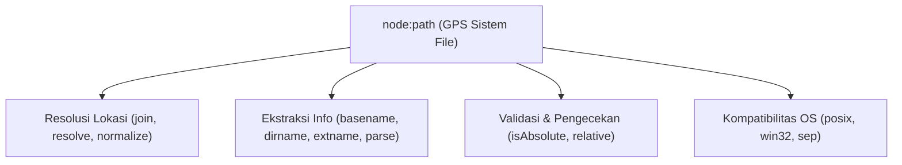

# Path

> Ringkasan
> - Tingkat: Fondasi
> - Fungsi: Menangani dan menormalisasi path file serta folder lintas sistem operasi (POSIX dan Windows).
> - Digunakan saat: Menggabungkan lokasi direktori, mengekstrak nama file dan ekstensi, serta mengamankan aplikasi dari serangan path traversal.
> - Aturan praktis: Selalu gunakan `path.join()` atau `path.resolve()` daripada menggabungkan string path manual dengan operator `+`; validasi awal path pengguna untuk mencegah akses direktori berbahaya.

## Cheat Sheet

| Tugas | Kode |
| :--- | :--- |
| Menggabungkan segmen path | `path.join("data", "uploads", "file.txt");` |
| Menghasilkan path absolut | `path.resolve("data", "file.txt");` |
| Mengambil nama file dan ekstensi | `path.basename("/data/report.pdf");` |
| Mengambil nama direktori induk | `path.dirname("/data/report.pdf");` |
| Mengambil ekstensi file | `path.extname("avatar.PNG");` |
| Membersihkan segmen `..` dan `.` | `path.normalize("a/b/../c");` |
| Menghitung jalur relatif antar direktori | `path.relative("/app/src", "/app/dist");` |
| Memeriksa apakah path berformat absolut | `path.isAbsolute("/var/log");` |

## Tujuan Belajar

- Memahami perbedaan separator path antara sistem operasi POSIX (garis miring `/`) dan Windows (garis miring terbalik `\`).
- Menggabungkan segmen path secara aman memakai `path.join()` dan `path.resolve()`.
- Mengekstrak informasi nama file, folder, dan ekstensi file lewat fungsi inspeksi.
- Mencegah celah kerentanan keamanan _directory traversal attack_ pada server.

## Konsep

Bayangkan sistem file komputer seperti peta jalan raya. Setiap sistem operasi punya gaya penulisan alamat yang berbeda: sistem POSIX (Linux dan macOS) memakai pemisah garis miring `/`, sedangkan Windows memakai garis miring terbalik `\`. Menggabungkan alamat memakai manipulasi string mentah seperti `folder + "/" + file` akan merusak kompatibilitas aplikasi di Windows. Modul `node:path` bekerja seperti sistem navigasi GPS yang secara otomatis mengenali sistem operasi tempat aplikasi berjalan dan merapikan rute alamat tanpa kesalahan penulisan simbol.



## Referensi

| Item | Fungsi | Catatan |
| :--- | :--- | :--- |
| `path.join(...paths)` | Menggabungkan potongan path menjadi satu path utuh | Otomatis menormalisasi separator sesuai OS |
| `path.resolve(...paths)` | Menghasilkan path absolut dari urutan path yang diberikan | Memakai `process.cwd()` jika tidak ada root absolut |
| `path.basename(path, [suffix])` | Mengambil bagian akhir nama file dari path | Parameter `suffix` opsional untuk menghapus ekstensi |
| `path.dirname(path)` | Mengambil path folder induk yang menampung file | Mengabaikan trailing slash sistem file |
| `path.extname(path)` | Mengambil ekstensi file dimulai dari titik terakhir | Mengembalikan string kosong jika file tanpa ekstensi |
| `path.normalize(path)` | Merapikan segmen `.` dan `..` yang tidak perlu | Tidak menyelesaikan path menjadi absolut |
| `path.relative(from, to)` | Menghitung jarak navigasi relatif dari `from` ke `to` | Bermanfaat saat membuat link symlink atau dokumen |
| `path.isAbsolute(path)` | Memeriksa apakah path diawali dari root sistem | Mengembalikan boolean `true` atau `false` |
| `path.parse(path)` | Mengurai path menjadi objek komponen terpisah | Menghasilkan `root`, `dir`, `base`, `ext`, `name` |
| `path.format(pathObject)` | Menyusun kembali objek path menjadi string utuh | Kebalikan dari operasi `path.parse()` |

### `path.join(...paths)`

`path.join()` menggabungkan semua segmen path yang diberikan menggunakan pemisah spesifik platform, lalu menormalisasi hasilnya.

Struktur parameter: `path.join(...paths)`
- `paths` (string, wajib): barisan string segmen path yang ingin disambung.

Nilai kembalian: string path hasil penggabungan (`string`).

```javascript
import path from "node:path";

const full = path.posix.join("/app", "uploads", "images", "avatar.png");
console.log(full);
// Output: /app/uploads/images/avatar.png
```

Kondisi khusus: Argumen bernilai string kosong `""` akan diabaikan; jika seluruh argumen kosong, fungsi mengembalikan `"."`.

### `path.resolve(...paths)`

`path.resolve()` memproses urutan path dari kanan ke kiri hingga membentuk sebuah path absolut. Jika belum menemukan root absolut, fungsi menggunakan direktori kerja aktif saat ini (`process.cwd()`).

Struktur parameter: `path.resolve(...paths)`
- `paths` (string, wajib): barisan string path yang ingin diselesaikan.

Nilai kembalian: string path absolut yang dinormalisasi (`string`).

```javascript
import path from "node:path";

const abs = path.posix.resolve("/app", "data", "report.pdf");
console.log(abs);
// Output: /app/data/report.pdf
```

Kondisi khusus: Setiap kali menemukan argumen yang diawali dengan root separator (seperti `/`), fungsi membuang semua jalur di sebelah kirinya dan menganggap argumen tersebut sebagai root baru.

### `path.basename(path, [suffix])`

`path.basename()` mengembalikan nama file atau segmen direktori paling belakang dari sebuah path.

Struktur parameter: `path.basename(path, suffix)`
- `path` (string, wajib): string lokasi file yang ingin diperiksa.
- `suffix` (string, opsional): ekstensi file yang ingin dihilangkan dari hasil.

Nilai kembalian: string nama file atau direktori (`string`).

```javascript
import path from "node:path";

console.log(path.basename("/data/invoices/inv-001.pdf"));
// Output: inv-001.pdf
console.log(path.basename("/data/invoices/inv-001.pdf", ".pdf"));
// Output: inv-001
```

Kondisi khusus: Parameter `suffix` bersifat case-sensitive di sebagian besar implementasi runtime.

### `path.dirname(path)`

`path.dirname()` mengambil path direktori induk dari suatu file atau folder.

Struktur parameter: `path.dirname(path)`
- `path` (string, wajib): string alamat path yang ingin diperiksa.

Nilai kembalian: string direktori induk (`string`).

```javascript
import path from "node:path";

console.log(path.posix.dirname("/var/log/nginx/access.log"));
// Output: /var/log/nginx
```

Kondisi khusus: Jika path hanya berupa nama file tanpa folder (misalnya `"index.js"`), fungsi mengembalikan `"."` yang menandakan direktori saat ini.

### `path.extname(path)`

`path.extname()` mengambil ekstensi file dimulai dari karakter titik `.` terakhir pada segmen nama file.

Struktur parameter: `path.extname(path)`
- `path` (string, wajib): string alamat path file.

Nilai kembalian: string ekstensi beserta titiknya (`string`).

```javascript
import path from "node:path";

console.log(path.extname("archive.tar.gz"));
// Output: .gz
console.log(path.extname(".env"));
// Output: 
```

Kondisi khusus: File dotfile tanpa ekstensi lanjutan (seperti `".gitignore"` atau `".env"`) mengembalikan string kosong `""`.

### `path.normalize(path)`

`path.normalize()` merapikan string path dengan menghitung segmen `.` (direktori saat ini) dan `..` (direktori induk) serta membersihkan garis miring ganda.

Struktur parameter: `path.normalize(path)`
- `path` (string, wajib): string alamat yang ingin dirapikan.

Nilai kembalian: string path yang telah dinormalisasi (`string`).

```javascript
import path from "node:path";

console.log(path.posix.normalize("/app/api/../config/./db.json"));
// Output: /app/config/db.json
```

Kondisi khusus: Operasi ini hanya memanipulasi string teks dan tidak memeriksa apakah folder fisik benar-benar ada di hard disk.

### `path.relative(from, to)`

`path.relative()` menghitung navigasi path relatif yang harus ditempuh untuk berpindah dari lokasi `from` menuju lokasi `to`.

Struktur parameter: `path.relative(from, to)`
- `from` (string, wajib): path awal keberangkatan.
- `to` (string, wajib): path tujuan.

Nilai kembalian: string rute relatif (`string`).

```javascript
import path from "node:path";

console.log(path.posix.relative("/app/src/utils", "/app/dist/bundle.js"));
// Output: ../../dist/bundle.js
```

Kondisi khusus: Jika kedua parameter menunjuk ke alamat yang sama persis, fungsi mengembalikan string kosong `""`.

### `path.isAbsolute(path)`

`path.isAbsolute()` memeriksa apakah path yang diberikan berakar dari pangkal sistem file.

Struktur parameter: `path.isAbsolute(path)`
- `path` (string, wajib): path yang ingin divalidasi.

Nilai kembalian: boolean `true` bila absolut, atau `false` bila relatif (`boolean`).

```javascript
import path from "node:path";

console.log(path.posix.isAbsolute("/var/www"));
// Output: true
console.log(path.posix.isAbsolute("./config.json"));
// Output: false
```

Kondisi khusus: Pada sistem Windows, path dianggap absolut hanya jika diawali nama drive (seperti `C:\\`) atau dua garis miring terbalik (jalur UNC).

### `path.parse(path)` dan `path.format(pathObject)`

`path.parse()` mengurai string path menjadi objek komponen, sedangkan `path.format()` menyusun objek tersebut kembali menjadi string.

Struktur parameter: `path.parse(path)` menerima string path. `path.format(pathObject)` menerima objek hasil uraian.

Nilai kembalian: `path.parse()` menghasilkan objek berisi `{ root, dir, base, ext, name }`. `path.format()` menghasilkan `string`.

```javascript
import path from "node:path";

const parsed = path.posix.parse("/app/docs/spec.pdf");
console.log(parsed.name);
// Output: spec
console.log(parsed.ext);
// Output: .pdf

parsed.name = "final-spec";
parsed.base = ""; // kosongkan base agar format memakai name + ext
console.log(path.posix.format(parsed));
// Output: /app/docs/final-spec.pdf
```

Kondisi khusus: Jika properti `base` tetap diisi saat memanggil `path.format()`, nilai `name` dan `ext` akan diabaikan.

## Kesalahan Umum

### Menggabungkan Path Memakai Operator Tambah String

Menyambung path secara manual dengan tanda `+` rentan menghasilkan garis miring ganda atau rusak saat dijalankan di sistem operasi lain.

```javascript
// Incorrect
const filePath = baseDir + "/" + fileName; // Problematic on Windows

// Correct
import path from "node:path";
const filePath = path.join(baseDir, fileName);
```

### Mengira `path.join()` Otomatis Melindungi dari Path Traversal

`path.join()` tetap memproses segmen `..` sehingga input jahat pengguna bisa kabur dari direktori yang ditentukan.

```javascript
// Incorrect: vulnerable to path traversal escaping into system folders
const target = path.join("/app/uploads", "../../etc/passwd");
// target evaluates to: /etc/passwd

// Correct: lock with path.resolve and validate base prefix
const safeBase = path.resolve("/app/uploads");
const safeTarget = path.resolve(safeBase, userInput);
if (!safeTarget.startsWith(safeBase)) {
  throw new Error("Access denied: path escapes safe directory");
}
```

## Studi Kasus

Membangun validator path penyimpanan file server yang menyelesaikan path absolut, memvalidasi isolasi direktori dasar (_directory jail_), serta membersihkan ekstensi file dari manipulasi karakter.

```javascript
import path from "node:path";

class StoragePathResolver {
  constructor(baseDirectory) {
    this.baseDir = path.resolve(baseDirectory);
  }

  resolveSafe(userRelativePath) {
    const resolvedPath = path.resolve(this.baseDir, userRelativePath);

    if (!resolvedPath.startsWith(this.baseDir)) {
      throw new Error("Access denied: path escapes safe directory");
    }

    const fileExt = path.extname(resolvedPath).toLowerCase();
    const fileName = path.basename(resolvedPath);

    return {
      safePath: resolvedPath,
      fileName,
      extension: fileExt,
    };
  }
}

const resolver = new StoragePathResolver("/app/storage");

const validFile = resolver.resolveSafe("documents/report.PDF");
console.log(validFile.fileName);
// Output: report.PDF
console.log(validFile.extension);
// Output: .pdf
console.log(validFile.safePath.endsWith("documents/report.PDF"));
// Output: true

try {
  resolver.resolveSafe("../../secret/passwords.txt");
} catch (err) {
  console.log(err.message);
  // Output: Access denied: path escapes safe directory
}
```

Pola ini menggunakan `path.resolve` untuk mengevaluasi alamat absolut riil, mengonfirmasi batas direktori dengan `startsWith()`, dan mengekstrak metadata file dengan aman sebelum file diakses oleh file system.

## Latihan Mandiri

Buat fungsi `normalizeStoragePath(baseDir, userPath, allowedExtensions = [])` untuk memvalidasi lokasi penyimpanan file pada server aplikasi.

- **Level 1 (Dasar):** Gabungkan `baseDir` dan `userPath` menggunakan `path.resolve()`. Ambil nama file memakai `path.basename()` dan ekstensi file memakai `path.extname()`. Kembalikan objek `{ fullPath, filename, ext }` dengan `ext` berupa huruf kecil.
- **Level 2 (Menengah):** Jika parameter `allowedExtensions` diisi (misalnya `[".pdf", ".docx"]`), validasi apakah ekstensi file termasuk dalam daftar tersebut (abaikan huruf besar/kecil). Jika tidak terdaftar, lempar `Error("File extension format not allowed")`.
- **Level 3 (Menantang):** Cegah celah keamanan _path traversal_. Jika `fullPath` hasil resolusi berada di luar direktori dasar aman (`baseDir`), lempar `Error("Access denied: path escapes safe directory")`.

Contoh input dan output normal:

```javascript
const res = normalizeStoragePath("data/uploads", "docs/report.PDF", [".pdf", ".docx"]);

console.log(res.filename);
// Output: report.PDF
console.log(res.ext);
// Output: .pdf
console.log(res.fullPath.endsWith("docs/report.PDF"));
// Output: true
```

Contoh input dan penanganan error:

```javascript
try {
  normalizeStoragePath("data/uploads", "../../secret.key", [".key"]);
} catch (err) {
  console.log(err.message);
  // Output: Access denied: path escapes safe directory
}
```

Tanda selesai:
- [ ] Path dinormalisasi dan dipecah komponen nama serta ekstensinya.
- [ ] Validasi daftar ekstensi file memeriksa kecocokan tanpa sensitivitas huruf besar/kecil.
- [ ] Upaya path traversal keluar dari direktori dasar melempar `Error`.

---

## Navigasi

[Sebelumnya: Process](../02-process/README.md) | [Selanjutnya: URL](../04-url/README.md) | [Daftar Isi](../README.md)
