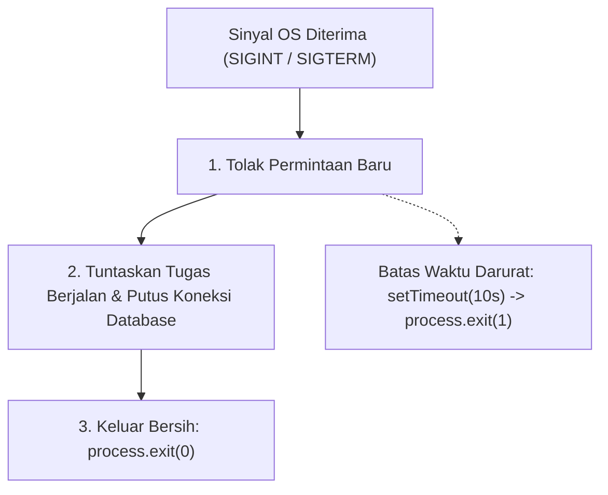

# Process

> Ringkasan
>
> - Fungsi: Membaca informasi runtime, variabel lingkungan, penggunaan memori RAM, serta mengendalikan jalan dan matinya aplikasi Node.js.
> - Digunakan saat: Mengambil konfigurasi rahasia dari environment, membaca argumen baris perintah terminal, memantau konsumsi RAM, dan mematikan server secara rapi (_graceful shutdown_).
> - Aturan praktis: Selalu gunakan status keluar `0` jika aplikasi selesai normal dan selain `0` jika gagal; pasang penangkap sinyal OS agar aplikasi sempat menutup koneksi database sebelum berhenti.

---

## Tujuan Belajar

- Membaca konfigurasi aplikasi dan informasi proses aktif melalui objek `process`.
- Membedakan folder kerja terminal saat ini (`process.cwd()`) dengan lokasi fisik file kode sumber.
- Membaca dan memahami rincian penggunaan memori RAM lewat `process.memoryUsage()`.
- Mengukur durasi eksekusi kode super presisi hingga skala nanodetik menggunakan `process.hrtime.bigint()`.
- Menangani sinyal sistem operasi (`SIGINT`, `SIGTERM`) untuk mematikan server dengan aman tanpa memutus data di tengah jalan.

---

## Konsep

> Bayangkan aplikasi Node.js seperti sebuah mobil yang sedang melaju di jalan raya. Objek `process` adalah panel instrumen di depan sopir: indikator bensin memantau alokasi RAM (`process.memoryUsage()`), speedometer mengukur kecepatan komputasi (`process.hrtime.bigint()`), buku peta menyimpan setelan operasional (`process.env`), dan kunci kontak mematikan mesin (`process.exit()`). Saat lampu merah menyala atau ada aba-aba berhenti (_sinyal SIGTERM_), sopir yang tertib tidak langsung mencabut kunci, melainkan mengerem perlahan, menyelesaikan antrean penumpang (_graceful shutdown_), baru kemudian mematikan mesin mobil.



---

## Referensi

| Item                          | Fungsi                                                              | Catatan                                                                   |
| :---------------------------- | :------------------------------------------------------------------ | :------------------------------------------------------------------------ |
| **`process.env`**             | Membaca variabel lingkungan dari sistem operasi host                | Semua nilainya selalu bertipe string atau `undefined` jika tidak ada      |
| **`process.argv`**            | Mengambil daftar argumen mentah dari baris perintah terminal        | Indeks 0 adalah biner Node.js, indeks 1 adalah file yang dijalankan       |
| **`process.exit(code)`**      | Menghentikan jalannya aplikasi seketika dengan kode status tertentu | Angka `0` tanda sukses, angka selain `0` menandakan adanya error          |
| **`process.cwd()`**           | Mengembalikan jalur direktori kerja terminal saat ini               | Menunjuk ke folder tempat kamu mengetikkan perintah di terminal           |
| **`process.uptime()`**        | Menghitung berapa lama proses Node.js sudah aktif dalam detik       | Mengembalikan angka desimal yang terus bertambah selama runtime aktif     |
| **`process.memoryUsage()`**   | Mengambil laporan ringkas penggunaan memori dalam satuan byte       | Menyajikan rincian `rss`, `heapTotal`, `heapUsed`, dan `external`         |
| **`process.hrtime.bigint()`** | Mengukur waktu komputasi beresolusi tinggi dalam skala nanodetik    | Berbasis jam perangkat keras sehingga kebal terhadap koreksi jam kalender |
| **`process.on(event, fn)`**   | Memasang fungsi listener sinyal dan siklus hidup proses             | Menangani sinyal dari sistem operasi seperti `SIGINT` dan `SIGTERM`       |

### `process.env`

Properti `process.env` berisi representasi objek dari variabel lingkungan sistem operasi. Properti ini menjadi standar utama untuk membaca setelan aplikasi (seperti port server atau mode rilis) tanpa menulis rahasia langsung di kode sumber.

```javascript
import process from "node:process";

process.env.APP_ENV = "production";
const environment = process.env.APP_ENV;

console.log(environment);
// Output: production
```

Kasus lain: Jika sebuah variabel belum pernah didaftarkan di sistem operasi, membacanya akan selalu menghasilkan `undefined`.

```javascript
import process from "node:process";

const secretKey = process.env.NON_EXISTENT_KEY;
console.log(secretKey === undefined);
// Output: true
```

### `process.argv`

Properti `process.argv` mengembalikan array string yang memuat seluruh teks yang kamu ketikkan di terminal saat menjalankan perintah Node.js. Dua item pertama selalu berisi lokasi biner Node.js dan path file utama.

```javascript
import process from "node:process";

const args = process.argv;
console.log(Array.isArray(args));
// Output: true
console.log(args.length > 0);
// Output: true
```

Kasus lain: Untuk mengambil argumen tambahan yang diketikkan pengguna, cukup potong dua elemen awal menggunakan `.slice(2)`.

```javascript
import process from "node:process";

const userArgs = process.argv.slice(2);
console.log(Array.isArray(userArgs));
// Output: true
```

### `process.exit(code)`

Metode `process.exit()` memaksa proses Node.js berhenti seketika itu juga. Memberikan angka `0` menandakan aplikasi selesai dengan sukses, sedangkan angka `1` atau lebih menandakan penghentian darurat akibat error.

```javascript
import process from "node:process";

function checkReadiness(isReady) {
  if (!isReady) {
    return (process.exitCode = 1);
  }
  return (process.exitCode = 0);
}

checkReadiness(true);
console.log(process.exitCode);
// Output: 0
```

Kasus lain: Mengatur properti `process.exitCode` biasanya lebih disukai daripada memanggil `process.exit()` langsung, karena memberi kesempatan bagi Event Loop untuk menyelesaikan tugas asinkron yang sedang nanggung.

```javascript
import process from "node:process";

process.exitCode = 1;
console.log(process.exitCode);
// Output: 1
process.exitCode = 0;
```

### `process.cwd()`

Metode `process.cwd()` mengembalikan string jalur folder tempat terminal sedang berada saat menjalankan perintah `node`. Nilai ini tergantung pada posisi kursor terminal, bukan di mana file JavaScript itu disimpan secara fisik.

```javascript
import process from "node:process";

const workingDirectory = process.cwd();
console.log(typeof workingDirectory);
// Output: string
console.log(workingDirectory.length > 0);
// Output: true
```

Kasus lain: Memastikan hasil `process.cwd()` bertipe string dan valid untuk memeriksa apakah folder kerja bisa diakses dengan benar.

```javascript
import process from "node:process";

const isString = typeof process.cwd() === "string";
console.log(isString);
// Output: true
```

### `process.uptime()`

Metode `process.uptime()` mengembalikan angka dalam detik yang menunjukkan berapa lama aplikasi Node.js kamu sudah menyala sejak pertama kali dijalankan.

```javascript
import process from "node:process";

const uptimeSeconds = process.uptime();
console.log(typeof uptimeSeconds);
// Output: number
console.log(uptimeSeconds >= 0);
// Output: true
```

Kasus lain: Kamu bisa membulatkan angkanya ke bawah menggunakan `Math.floor()` untuk membuat laporan status kesehatan server yang rapi.

```javascript
import process from "node:process";

const roundedSeconds = Math.floor(process.uptime());
console.log(Number.isInteger(roundedSeconds));
// Output: true
```

### `process.memoryUsage()`

Metode `process.memoryUsage()` memberikan gambaran alokasi memori RAM yang dipakai oleh aplikasi dalam ukuran byte. Properti `heapUsed` mencerminkan ukuran memori yang sedang aktif dipakai oleh variabel dan objek JavaScript.

```javascript
import process from "node:process";

const memory = process.memoryUsage();
console.log(typeof memory.rss);
// Output: number
console.log(typeof memory.heapTotal);
// Output: number
console.log(memory.heapUsed <= memory.heapTotal);
// Output: true
```

Kasus lain: Membagi nilainya dengan `1024 / 1024` mempermudah kita membaca ukuran memori ke dalam satuan Megabyte (MB).

```javascript
import process from "node:process";

const heapMb = process.memoryUsage().heapUsed / 1024 / 1024;
console.log(heapMb > 0);
// Output: true
```

### `process.hrtime.bigint()`

Metode `process.hrtime.bigint()` mengembalikan catatan waktu perangkat keras bertipe `bigint` dalam satuan nanodetik. Fitur ini sangat cocok untuk menguji efisiensi algoritma karena kebal terhadap perubahan jam komputer.

```javascript
import process from "node:process";

const startTime = process.hrtime.bigint();
let counter = 0;
for (let i = 0; i < 50_000; i++) {
  counter++;
}
const endTime = process.hrtime.bigint();
const durationNanoseconds = endTime - startTime;

console.log(typeof durationNanoseconds);
// Output: bigint
console.log(durationNanoseconds >= 0n);
// Output: true
```

Kasus lain: Mengubah selisih nanodetik ke milidetik cukup dengan membaginya dengan angka `1_000_000n`.

```javascript
import process from "node:process";

const start = process.hrtime.bigint();
const end = process.hrtime.bigint();
const durationMs = Number(end - start) / 1_000_000;
console.log(durationMs >= 0);
// Output: true
```

### `process.on(event, fn)`

Metode `process.on()` dipakai untuk memasang listener pada siklus hidup aplikasi, termasuk menangani sinyal sistem operasi seperti `SIGINT` (saat kamu menekan tombol Ctrl+C di terminal).

```javascript
import process from "node:process";

let signalStatus = "PENDING";
const handler = () => {
  signalStatus = "SIGNAL_RECEIVED";
};

process.on("customEvent", handler);
process.emit("customEvent");

console.log(signalStatus);
// Output: SIGNAL_RECEIVED

process.removeListener("customEvent", handler);
```

Kasus lain: Untuk mencegah penumpukan fungsi listener di memori, lepaskan listener yang sudah tidak terpakai menggunakan `removeListener`.

```javascript
import process from "node:process";

const testListener = () => {};
process.on("testSignal", testListener);
console.log(process.listenerCount("testSignal") >= 1);
// Output: true
process.removeListener("testSignal", testListener);
```

### Perbandingan: Kode Keluar Status `process.exit`

| Nilai Kode | Makna Umum         | Respon Sistem Orkestrasi (Docker/K8s)                | Status di Baris Perintah (`$?`)              |
| :--------- | :----------------- | :--------------------------------------------------- | :------------------------------------------- |
| **`0`**    | Sukses / Normal    | Tugas selesai; container tidak di-restart paksa      | Menghasilkan kode keluar `0` (berhasil)      |
| **`1`**    | Error / Error Umum | Aplikasi rusak; container ditandai CrashLoop         | Menghasilkan kode keluar `1` (gagal)         |
| **`130`**  | Dihentikan Manual  | Pengguna menekan Ctrl+C di terminal (`128 + SIGINT`) | Menandakan pembatalan langsung oleh pengguna |

---

## Kesalahan Umum

### Membiarkan Error pada `uncaughtException` Tanpa Mematikan Proses

Menangkap error fatal tetapi membiarkan aplikasi tetap berjalan bisa membuat memori aplikasi berada dalam kondisi rusak dan tidak bisa diprediksi.

```javascript
// Salah
process.on("uncaughtException", (error) => {
  console.log(
    "Error tertangkap tapi aplikasi dibiarkan terus jalan:",
    error.message,
  );
});
```

```javascript
// Benar
process.on("uncaughtException", (error) => {
  console.error(
    "Error fatal tidak tertangani, aplikasi dimatikan:",
    error.message,
  );
  process.exit(1);
});
```

### Mengira Nilai `process.env` Mengembalikan Tipe Selain String

Semua nilai yang diambil dari `process.env` selalu berupa string. Membandingkan nilai string dengan boolean atau angka secara langsung bisa memicu kesalahan logika.

```javascript
// Salah
process.env.DEBUG = "false";
if (process.env.DEBUG) {
  // Kondisi ini tetap true karena string "false" dianggap truthy di JavaScript!
}
```

```javascript
// Benar
process.env.DEBUG = "false";
const isDebug = process.env.DEBUG === "true";
if (isDebug) {
  // Blok ini tidak akan jalan jika nilainya adalah string "false"
}
```

### Mengira `process.cwd()` Selalu Sama dengan Lokasi File Kode

Memakai `process.cwd()` untuk mencari file internal aplikasi akan gagal jika perintah `node` dijalankan dari luar folder proyek.

```javascript
// Salah
import process from "node:process";

// Mengira posisi terminal selalu sama dengan tempat file disimpan
const configPath = `${process.cwd()}/config.json`;
```

```javascript
// Benar
// Gunakan properti bawaan import.meta.dirname untuk menunjuk langsung ke folder file kode
const configPath = `${import.meta.dirname}/config.json`;
```

---

## Studi Kasus

Skenario: Membangun pengawas kesehatan proses server (_process health monitor_) yang membaca setelan port dan lingkungan dari `process.env`, memantau alokasi RAM via `process.memoryUsage()`, mengukur durasi pengecekan memakai `process.hrtime.bigint()`, serta menyusun status kesehatan sistem secara mandiri.

```javascript
import process from "node:process";

class ProcessMonitor {
  constructor(options = {}) {
    this.heapThresholdMb = options.heapThresholdMb || 250;
    this.environment = process.env.NODE_ENV || "development";
    this.port = Number(process.env.PORT) || 3000;
  }

  getHealthReport() {
    const startNanoseconds = process.hrtime.bigint();
    const memory = process.memoryUsage();
    const usedHeapMb = Number((memory.heapUsed / 1024 / 1024).toFixed(2));
    const endNanoseconds = process.hrtime.bigint();
    const latencyMs = Number(endNanoseconds - startNanoseconds) / 1_000_000;

    const isHealthy = usedHeapMb < this.heapThresholdMb;

    return {
      status: isHealthy ? "HEALTHY" : "CRITICAL",
      pid: process.pid,
      uptimeSeconds: Math.floor(process.uptime()),
      environment: this.environment,
      port: this.port,
      heapMb: usedHeapMb,
      diagnosisLatencyMs: Number(latencyMs.toFixed(4)),
    };
  }
}

process.env.NODE_ENV = "production";
process.env.PORT = "8080";

const monitor = new ProcessMonitor({ heapThresholdMb: 500 });
const report = monitor.getHealthReport();

console.log(report.status);
// Output: HEALTHY
console.log(report.environment);
// Output: production
console.log(report.port);
// Output: 8080
console.log(typeof report.pid === "number");
// Output: true
console.log(report.heapMb > 0);
// Output: true
```

Desain ini memanfaatkan pembacaan `process.env` dengan nilai cadangan, memantau penggunaan RAM dari `process.memoryUsage()`, serta mencatat durasi diagnostik memakai `process.hrtime.bigint()` tanpa dependensi eksternal.

---

## Latihan Mandiri

### Soal 1 (Dasar)

Buat fungsi `formatMemoryStatistics()` yang memanggil `process.memoryUsage()` dan mengembalikan objek dengan nilai alokasi `rssMb`, `heapTotalMb`, dan `heapUsedMb` yang sudah diubah ke satuan Megabyte (MB) dengan pembulatan dua angka di belakang koma.

Contoh input:

```javascript
formatMemoryStatistics();
```

Contoh output yang diharapkan:

```javascript
{
  rssMb: 35.42,
  heapTotalMb: 7.89,
  heapUsedMb: 5.12
}
```

Batasan: Gunakan properti bawaan `process.memoryUsage()`. Semua nilai pada objek output harus berupa angka positif.

### Soal 2 (Menengah)

Buat fungsi `measureFunctionLatency(targetFunction)` yang menerima sebuah fungsi sinkron, menjalankannya satu kali, dan mengembalikan objek berisi hasil pemanggilan fungsi tersebut serta durasi waktu eksekusinya dalam satuan mikrodetik (µs) menggunakan `process.hrtime.bigint()`.

Contoh input:

```javascript
measureFunctionLatency(() => {
  let count = 0;
  for (let i = 0; i < 10_000; i++) count += i;
  return count;
});
```

Contoh output yang diharapkan:

```javascript
{
  result: 49995000,
  durationMicroseconds: 142.35 // Bilangan positif
}
```

Batasan: Gunakan `process.hrtime.bigint()` untuk mengukur waktu. Ubah selisih durasi nanodetik ke mikrodetik dengan rumus pembagian `1_000`.

### Soal 3 (Menantang)

Buat fungsi pemvalidasi konfigurasi server `initializeApplication(envSchema)` yang memeriksa kesiapan environment variable saat aplikasi pertama kali dinyalakan dengan aturan:

1. `envSchema` menerima objek berisi daftar variabel yang wajib ada, misalnya `{ PORT: 'number', DATABASE_URL: 'string' }`.
2. Lakukan pengecekan pada setiap kunci skema di `process.env`. Jika ada variabel yang tidak ada atau gagal diubah ke tipe yang diminta, kumpulkan seluruh pesan kesalahan tersebut.
3. Jika konfigurasi tidak lengkap, kembalikan objek `{ ready: false, errors: string[] }` dan ubah `process.exitCode = 1` tanpa langsung mematikan aplikasi agar pemanggil sempat mencatat log error.
4. Jika seluruh variabel valid, pasang listener sinyal `SIGINT` menggunakan `process.once()`. Listener ini harus mengembalikan status sukses dan menyetel `process.exitCode = 0`.
5. Kembalikan objek konfigurasi yang nilainya sudah diubah ke tipe data yang sesuai (`number` atau `string`).

Contoh input 1:

```javascript
process.env.PORT = "3000";
process.env.DATABASE_URL = "postgres://localhost/db";
initializeApplication({ PORT: "number", DATABASE_URL: "string" });
```

Contoh output 1:

```javascript
{
  ready: true,
  config: {
    PORT: 3000,
    DATABASE_URL: 'postgres://localhost/db'
  }
}
```

Contoh input 2:

```javascript
delete process.env.DATABASE_URL;
process.env.PORT = "not-a-number";
initializeApplication({ PORT: "number", DATABASE_URL: "string" });
```

Contoh output 2:

```javascript
{
  ready: false,
  errors: [
    'PORT must be a valid number',
    'DATABASE_URL is required'
  ]
}
```

Batasan: Dilarang menggunakan library validasi pihak ketiga. Wajib mengelola `process.env`, `process.exitCode`, dan penanganan sinyal secara mandiri.

---

## Navigasi

[Sebelumnya: Globals](../02-globals/README.md) | [Selanjutnya: OS](../04-os/README.md) | [Daftar Isi](../README.md)
