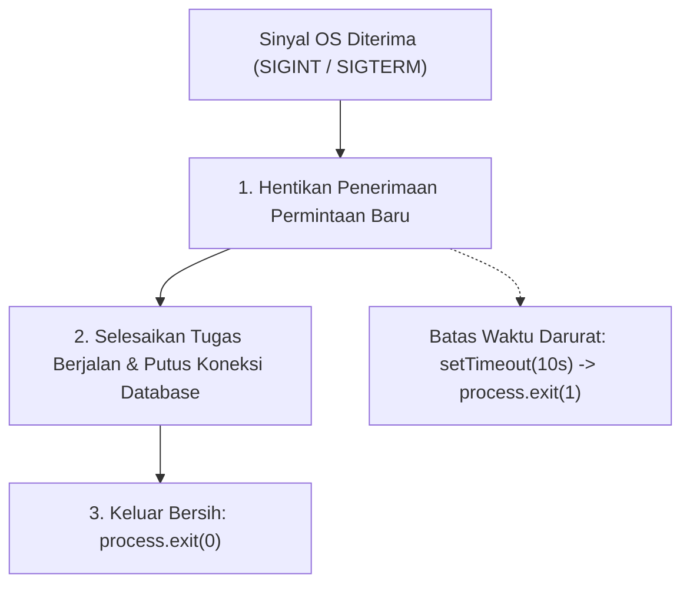

# Process

> Ringkasan
> - Fungsi: Mengakses informasi runtime, konfigurasi variabel lingkungan, status memori, serta mengendalikan siklus hidup proses Node.js yang sedang berjalan.
> - Digunakan saat: Membaca kredensial lingkungan, memproses argumen baris perintah, memantau penggunaan RAM, dan menangani prosedur terminasi aman (_graceful shutdown_).
> - Aturan praktis: Selalu gunakan kode keluar `0` untuk terminasi normal dan kode selain `0` untuk kegagalan fatal; tangkap sinyal sistem operasi untuk membersihkan koneksi sebelum proses berakhir.

---

## Tujuan Belajar

- Mengakses konfigurasi lingkungan dan metadata proses aktif melalui properti objek `process`.
- Membedakan direktori kerja runtime (`process.cwd()`) dengan lokasi berkas kode sumber.
- Membaca dan menafsirkan komponen penggunaan memori melalui `process.memoryUsage()`.
- Mengukur interval waktu berpresisi tinggi hingga satuan nanodetik menggunakan `process.hrtime.bigint()`.
- Mengimplementasikan penanganan sinyal sistem operasi (`SIGINT`, `SIGTERM`) untuk penghentian aplikasi secara bersih.

---

## Konsep

> Runtime Node.js dapat dianalogikan sebagai sebuah kendaraan yang melaju di jalan raya. Objek `process` adalah panel instrumen di ruang kemudi: indikator bensin memantau alokasi RAM (`process.memoryUsage()`), speedometer mengukur waktu tempuh komputasi (`process.hrtime.bigint()`), buku rute menyimpan konfigurasi operasional (`process.env`), dan kunci kontak mematikan mesin (`process.exit()`). Saat petugas lalu lintas menginstruksikan berhenti (_sinyal SIGTERM_), pengemudi yang disiplin menyalakan lampu sein, memperlambat kendaraan, menurunkan muatan secara aman (_graceful shutdown_), baru kemudian mematikan mesin.



---

## Referensi

| Item | Fungsi | Catatan |
| :--- | :--- | :--- |
| **`process.env`** | Membaca variabel lingkungan dari sistem host operasi | Seluruh nilai bertipe string atau bernilai `undefined` jika tak ada |
| **`process.argv`** | Mengambil larik argumen mentah dari baris perintah terminal | Indeks 0 adalah biner Node.js, indeks 1 adalah berkas yang dijalankan |
| **`process.exit(code)`** | Menghentikan proses secara langsung dengan kode status keluar | Kode `0` menunjukkan keberhasilan, kode selain `0` menandakan galat |
| **`process.cwd()`** | Mengembalikan direktori kerja saat ini (_Current Working Directory_) | Mengacu pada folder tempat perintah terminal dijalankan |
| **`process.uptime()`** | Menghitung durasi aktif proses dalam satuan detik | Mengembalikan bilangan pecahan yang terus bertambah selama runtime |
| **`process.memoryUsage()`** | Menghasilkan cuplikan alokasi memori proses dalam satuan byte | Menyediakan rincian `rss`, `heapTotal`, `heapUsed`, dan `external` |
| **`process.hrtime.bigint()`** | Mengukur waktu komputasi beresolusi tinggi dalam skala nanodetik | Menggunakan jam monotonik perangkat keras sehingga kebal drift jam |
| **`process.on(event, fn)`** | Mendaftarkan fungsi penanganan sinyal dan peristiwa siklus hidup | Menangani sinyal sistem operasi seperti `SIGINT` dan `SIGTERM` |

### `process.env`

Properti `process.env` berisi representasi objek dari variabel lingkungan sistem operasi. Properti ini menjadi standar industri untuk membaca konfigurasi aplikasi tanpa menuliskannya langsung ke dalam kode sumber.

```javascript
import process from 'node:process';

process.env.APP_ENV = 'production';
const environment = process.env.APP_ENV;

console.log(environment);
// Output: production
```

Kasus lain: Nilai variabel yang belum didefinisikan pada sistem operasi akan selalu menghasilkan `undefined`.

```javascript
import process from 'node:process';

const secretKey = process.env.NON_EXISTENT_KEY;
console.log(secretKey === undefined);
// Output: true
```

### `process.argv`

Properti `process.argv` mengembalikan larik string yang memuat argumen yang diberikan pengguna saat menjalankan perintah di terminal. Dua elemen pertama selalu merujuk pada biner eksekusi Node.js dan path berkas utama.

```javascript
import process from 'node:process';

const args = process.argv;
console.log(Array.isArray(args));
// Output: true
console.log(args.length > 0);
// Output: true
```

Kasus lain: Mengambil argumen pengguna tambahan dapat dilakukan dengan memotong dua elemen awal menggunakan `.slice(2)`.

```javascript
import process from 'node:process';

const userArgs = process.argv.slice(2);
console.log(Array.isArray(userArgs));
// Output: true
```

### `process.exit(code)`

Metode `process.exit()` memaksa proses Node.js berhenti seketika. Meneruskan angka `0` menandakan proses selesai dengan normal, sedangkan angka `1` atau lebih menandakan penghentian akibat galat fatal.

```javascript
import process from 'node:process';

function checkReadiness(isReady) {
  if (!isReady) {
    return (process.exitCode = 1);
  }
  return (process.exitCode = 0);
}

checkReadiness(true);
console.log(process.exitCode);
// Output: 0
```

Kasus lain: Mengatur properti `process.exitCode` lebih disukai daripada memanggil `process.exit()` langsung karena memungkinkan Event Loop menuntaskan operasi asinkron yang sedang berjalan.

```javascript
import process from 'node:process';

process.exitCode = 1;
console.log(process.exitCode);
// Output: 1
process.exitCode = 0;
```

### `process.cwd()`

Metode `process.cwd()` mengembalikan string jalur absolut direktori kerja tempat terminal mengeksekusi perintah. Nilai ini bergantung pada lokasi terminal saat memanggil perintah, bukan letak fisik berkas kode.

```javascript
import process from 'node:process';

const workingDirectory = process.cwd();
console.log(typeof workingDirectory);
// Output: string
console.log(workingDirectory.length > 0);
// Output: true
```

Kasus lain: Membandingkan jalur kerja saat ini dengan direktori akar dapat dilakukan untuk memvalidasi batas akses aplikasi.

```javascript
import process from 'node:process';

const isString = typeof process.cwd() === 'string';
console.log(isString);
// Output: true
```

### `process.uptime()`

Metode `process.uptime()` mengembalikan angka dalam satuan detik yang menunjukkan berapa lama proses Node.js telah berjalan sejak pertama kali diinisialisasi.

```javascript
import process from 'node:process';

const uptimeSeconds = process.uptime();
console.log(typeof uptimeSeconds);
// Output: number
console.log(uptimeSeconds >= 0);
// Output: true
```

Kasus lain: Menghitung pembulatan durasi aktif dalam format detik penuh untuk kebutuhan telemetri endpoint status.

```javascript
import process from 'node:process';

const roundedSeconds = Math.floor(process.uptime());
console.log(Number.isInteger(roundedSeconds));
// Output: true
```

### `process.memoryUsage()`

Metode `process.memoryUsage()` mengembalikan objek ringkasan alokasi memori proses dalam satuan byte. Properti `heapUsed` mencerminkan ukuran memori yang sedang aktif dipakai oleh objek-objek JavaScript V8.

```javascript
import process from 'node:process';

const memory = process.memoryUsage();
console.log(typeof memory.rss);
// Output: number
console.log(typeof memory.heapTotal);
// Output: number
console.log(memory.heapUsed <= memory.heapTotal);
// Output: true
```

Kasus lain: Mengonversi byte ke megabyte mempermudah pembacaan metrik kapasitas RAM.

```javascript
import process from 'node:process';

const heapMb = process.memoryUsage().heapUsed / 1024 / 1024;
console.log(heapMb > 0);
// Output: true
```

### `process.hrtime.bigint()`

Metode `process.hrtime.bigint()` mengembalikan stempel waktu perangkat keras dalam tipe data `bigint` dengan satuan nanodetik. Metode ini dirancang untuk pembandingan durasi kinerja algoritma tanpa terganggu penyesuaian jam sistem.

```javascript
import process from 'node:process';

const startTime = process.hrtime.bigint();
let counter = 0;
for (let i = 0; i < 50_000; i++) {
  counter++;
}
const endTime = process.hrtime.bigint();
const durationNanoseconds = endTime - startTime;

console.log(typeof durationNanoseconds);
// Output: bigint
console.log(durationNanoseconds >= 0n);
// Output: true
```

Kasus lain: Mengonversi selisih durasi nanodetik ke milidetik presisi pecahan dengan membaginya dengan `1_000_000n`.

```javascript
import process from 'node:process';

const start = process.hrtime.bigint();
const end = process.hrtime.bigint();
const durationMs = Number(end - start) / 1_000_000;
console.log(durationMs >= 0);
// Output: true
```

### `process.on(event, fn)`

Metode `process.on()` menyematkan pendengar peristiwa pada siklus hidup proses, termasuk penanganan interupsi sinyal POSIX seperti `SIGINT` (Ctrl+C) atau `SIGTERM` (sinyal penghentian container).

```javascript
import process from 'node:process';

let signalStatus = 'PENDING';
const handler = () => {
  signalStatus = 'SIGNAL_RECEIVED';
};

process.on('customEvent', handler);
process.emit('customEvent');

console.log(signalStatus);
// Output: SIGNAL_RECEIVED

process.removeListener('customEvent', handler);
```

Kasus lain: Mencegah penumpukan listener dengan melepas pendengar peristiwa menggunakan `removeListener`.

```javascript
import process from 'node:process';

const testListener = () => {};
process.on('testSignal', testListener);
console.log(process.listenerCount('testSignal') >= 1);
// Output: true
process.removeListener('testSignal', testListener);
```

### Perbandingan: Kode Keluar Status `process.exit`

| Nilai Kode | Makna Standar | Respon Sistem Orkestrasi (Docker/K8s) | Status Baris Perintah (`$?`) |
| :--- | :--- | :--- | :--- |
| **`0`** | Sukses / Normal | Tugas selesai sempurna; pod tidak di-restart darurat | Menghasilkan kode keluar `0` (lulus) |
| **`1`** | Galat Fatal Umum | Aplikasi rusak; pod ditandai CrashLoopBackOff | Menghasilkan kode keluar `1` (gagal) |
| **`130`** | Dihentikan oleh Pengguna | Interupsi terminal via Ctrl+C (`128 + SIGINT`) | Menandakan interupsi manual dari luar |

---

## Kesalahan Umum

### Menelan Galat pada `uncaughtException` Tanpa Mematikan Proses

Menangkap kesalahan fatal sinkron tetapi tidak mematikan proses menyebabkan aplikasi berjalan dalam status memori yang korup (_undefined state_).

```javascript
// Salah
process.on('uncaughtException', (error) => {
  console.log('Error caught but process keeps running:', error.message);
});
```

```javascript
// Benar
process.on('uncaughtException', (error) => {
  console.error('Fatal uncaught error, terminating process:', error.message);
  process.exit(1);
});
```

### Mengasumsikan Nilai `process.env` Mengembalikan Tipe Non-String

Semua nilai yang diambil dari `process.env` selalu berupa string. Membandingkan nilai string dengan boolean atau angka secara langsung menyebabkan galat logika.

```javascript
// Salah
process.env.DEBUG = 'false';
if (process.env.DEBUG) {
  // Evaluasi menghasilkan true karena string "false" bernilai truthy!
}
```

```javascript
// Benar
process.env.DEBUG = 'false';
const isDebug = process.env.DEBUG === 'true';
if (isDebug) {
  // Blok tidak akan dieksekusi jika bernilai string "false"
}
```

### Mengasumsikan `process.cwd()` Identik dengan Folder Berkas

Menggunakan `process.cwd()` untuk mencari berkas internal modul akan gagal apabila perintah `node` dieksekusi dari direktori lain di luar akar proyek.

```javascript
// Salah
import path from 'node:path';
import process from 'node:process';
const configPath = path.join(process.cwd(), 'config.json');
```

```javascript
// Benar
import path from 'node:path';
import { fileURLToPath } from 'node:url';
const moduleDirectory = path.dirname(fileURLToPath(import.meta.url));
const configPath = path.join(moduleDirectory, 'config.json');
```

---

## Studi Kasus

Skenario: Membangun pengawas kesehatan proses server (_process health monitor_) yang membaca konfigurasi port dan lingkungan dari `process.env`, memantau penggunaan alokasi heap RAM via `process.memoryUsage()`, mengukur latensi operasi dengan `process.hrtime.bigint()`, dan mengembalikan diagnosa status sistem.

```javascript
import process from 'node:process';

class ProcessMonitor {
  constructor(options = {}) {
    this.heapThresholdMb = options.heapThresholdMb || 250;
    this.environment = process.env.NODE_ENV || 'development';
    this.port = Number(process.env.PORT) || 3000;
  }

  getHealthReport() {
    const startNanoseconds = process.hrtime.bigint();
    const memory = process.memoryUsage();
    const usedHeapMb = Number((memory.heapUsed / 1024 / 1024).toFixed(2));
    const endNanoseconds = process.hrtime.bigint();
    const latencyMs = Number(endNanoseconds - startNanoseconds) / 1_000_000;

    const isHealthy = usedHeapMb < this.heapThresholdMb;

    return {
      status: isHealthy ? 'HEALTHY' : 'CRITICAL',
      pid: process.pid,
      uptimeSeconds: Math.floor(process.uptime()),
      environment: this.environment,
      port: this.port,
      heapMb: usedHeapMb,
      diagnosisLatencyMs: Number(latencyMs.toFixed(4)),
    };
  }
}

process.env.NODE_ENV = 'production';
process.env.PORT = '8080';

const monitor = new ProcessMonitor({ heapThresholdMb: 500 });
const report = monitor.getHealthReport();

console.log(report.status);
// Output: HEALTHY
console.log(report.environment);
// Output: production
console.log(report.port);
// Output: 8080
console.log(typeof report.pid === 'number');
// Output: true
console.log(report.heapMb > 0);
// Output: true
```

Desain ini memanfaatkan pembacaan `process.env` dengan nilai cadangan baku, menghitung penggunaan RAM dari `process.memoryUsage()`, serta mencatat durasi diagnostik memakai `process.hrtime.bigint()` tanpa dependensi eksternal.

---

## Latihan Mandiri

### Soal 1 (Dasar)

Buat fungsi `formatMemoryStatistics()` yang memanggil `process.memoryUsage()` dan mengembalikan objek dengan nilai alokasi `rssMb`, `heapTotalMb`, dan `heapUsedMb` yang sudah dikonversi ke dalam satuan Megabyte (MB) dengan pembulatan dua angka di belakang koma.

Contoh masukan:
```javascript
formatMemoryStatistics();
```

Contoh keluaran yang diharapkan:
```javascript
{
  rssMb: 35.42,
  heapTotalMb: 7.89,
  heapUsedMb: 5.12
}
```

Batasan: Gunakan properti bawaan `process.memoryUsage()`. Seluruh nilai wajib bertipe angka positif.

### Soal 2 (Menengah)

Buat fungsi `measureFunctionLatency(targetFunction)` yang menerima sebuah fungsi sinkron, mengeksekusinya satu kali, dan mengembalikan objek berisi hasil keluaran fungsi target serta durasi eksekusinya dalam satuan mikrodetik (µs) menggunakan `process.hrtime.bigint()`.

Contoh masukan:
```javascript
measureFunctionLatency(() => {
  let count = 0;
  for (let i = 0; i < 10_000; i++) count += i;
  return count;
});
```

Contoh keluaran yang diharapkan:
```javascript
{
  result: 49995000,
  durationMicroseconds: 142.35 // Bilangan positif
}
```

Batasan: Gunakan `process.hrtime.bigint()` untuk mengukur waktu. Konversikan selisih durasi nanodetik ke mikrodetik dengan rumus pembagian `1_000`.

### Soal 3 (Menantang)

Buat fungsi koordinator konfigurasi dan terminasi `initializeApplication(envSchema)` yang memvalidasi integritas environment variable saat server pertama kali dinyalakan.

Ketentuan fungsional:

1. `envSchema` menerima objek definisi variabel yang wajib ada, misalnya `{ PORT: 'number', DATABASE_URL: 'string' }`.
2. Lakukan iterasi terhadap seluruh kunci skema pada `process.env`. Jika ada variabel yang tidak ditemukan atau gagal dikonversi ke tipe yang diminta, kumpulkan seluruh daftar kesalahan tersebut.
3. Jika terdapat galat konfigurasi, kembalikan objek `{ ready: false, errors: string[] }` dan ubah `process.exitCode = 1` tanpa mematikan proses seketika agar pemanggil dapat mencatat log.
4. Jika seluruh variabel valid, daftarkan pendengar peristiwa sinyal `SIGINT` menggunakan `process.once()`. Pendengar ini harus mengembalikan status penghentian teratur dan menetapkan `process.exitCode = 0`.
5. Kembalikan objek konfigurasi yang sudah dikonversi ke tipe data yang sesuai (`number` atau `string`).

Contoh masukan 1:
```javascript
process.env.PORT = '3000';
process.env.DATABASE_URL = 'postgres://localhost/db';
initializeApplication({ PORT: 'number', DATABASE_URL: 'string' });
```

Contoh keluaran 1:
```javascript
{
  ready: true,
  config: {
    PORT: 3000,
    DATABASE_URL: 'postgres://localhost/db'
  }
}
```

Contoh masukan 2:
```javascript
delete process.env.DATABASE_URL;
process.env.PORT = 'not-a-number';
initializeApplication({ PORT: 'number', DATABASE_URL: 'string' });
```

Contoh keluaran 2:
```javascript
{
  ready: false,
  errors: [
    'PORT must be a valid number',
    'DATABASE_URL is required'
  ]
}
```

Batasan: Dilarang menggunakan pustaka validasi pihak ketiga. Wajib memanipulasi `process.env`, `process.exitCode`, dan penanganan sinyal secara mandiri.

---

## Navigasi

[Sebelumnya: Globals](../02-globals/README.md) | [Selanjutnya: OS](../04-os/README.md) | [Daftar Isi](../README.md)
