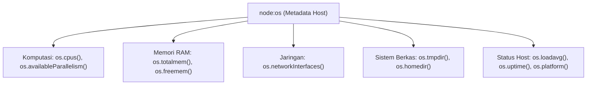

# OS

> Ringkasan
>
> - Fungsi: Menyediakan fungsi antarmuka untuk membaca informasi sistem operasi host, spesifikasi perangkat keras, kapasitas memori, dan konfigurasi jaringan.
> - Digunakan saat: Menghitung konkurensi worker CPU, memantau metrik beban kerja server, mengidentifikasi alamat IP lokal, dan menentukan jalur direktori sementara.
> - Aturan praktis: Prioritaskan `os.availableParallelism()` alih-alih `os.cpus().length` untuk penentuan alokasi proses di container; hindari mengandalkan `os.loadavg()` di platform Windows karena selalu mengembalikan nilai nol.

---

## Tujuan Belajar

- Mengidentifikasi arsitektur perangkat keras dan informasi platform sistem operasi melalui `node:os`.
- Menerapkan penghitungan kuota konkurensi CPU yang sadar batasan container menggunakan `os.availableParallelism()`.
- Menghitung persentase penggunaan memori RAM fisik pada mesin host (`os.totalmem()` dan `os.freemem()`).
- Membaca dan menafsirkan rata-rata beban antrean CPU sistem (_System Load Average_) untuk telemetri server.
- Mengekstrak alamat IP lokal melalui antarmuka jaringan serta mengelola direktori sementara yang portabel lintas platform.

---

## Konsep

> Runtime Node.js dapat dianalogikan sebagai seorang penyewa kamar di dalam sebuah gedung apartemen. Objek `process` mewakili penghuni kamar itu sendiri (barang bawaan dan aktivitas di dalam unit), sedangkan modul `node:os` adalah gedung apartemen beserta infrastrukturnya: luas total bangunan fisik (kapasitas RAM `os.totalmem()`), jumlah lift utama yang dapat dipakai (inti CPU `os.availableParallelism()`), kepadatan antrean lobi gedung (`os.loadavg()`), dan saluran kabel data yang menghubungkan gedung ke jaringan luar (`os.networkInterfaces()`).



---

## Referensi

| Item                           | Fungsi                                                                       | Catatan                                                              |
| :----------------------------- | :--------------------------------------------------------------------------- | :------------------------------------------------------------------- |
| **`os.platform()`**            | Mengembalikan nama platform sistem operasi tempat runtime berjalan           | Menghasilkan string seperti `'linux'`, `'darwin'`, atau `'win32'`    |
| **`os.arch()`**                | Mengembalikan arsitektur prosesor CPU host                                   | Menghasilkan string seperti `'x64'`, `'arm64'`, atau `'ia32'`        |
| **`os.availableParallelism()`**| Menghitung jumlah konkurensi CPU yang tersedia secara efektif untuk proses   | Sadar batasan cgroup container Docker dan Kubernetes                 |
| **`os.cpus()`**                | Mengembalikan larik objek informasi spesifikasi setiap inti CPU              | Memuat model prosesor, kecepatan clock (MHz), dan pembagian waktu    |
| **`os.totalmem()`**            | Mengembalikan total kapasitas memori RAM fisik sistem dalam satuan byte      | Bernilai tetap selama perangkat keras tidak diubah                   |
| **`os.freemem()`**             | Mengembalikan kapasitas memori RAM fisik yang sedang tidak terpakai          | Berubah dinamis sesuai alokasi memori sistem operasi host            |
| **`os.loadavg()`**             | Mengembalikan larik rata-rata beban antrean proses CPU Linux/macOS           | Berisi rata-rata beban 1, 5, dan 15 menit; selalu `[0,0,0]` di Windows |
| **`os.networkInterfaces()`**   | Mengembalikan daftar antarmuka jaringan aktif beserta detail alamat IP       | Memuat properti `family`, `address`, `netmask`, dan status internal  |
| **`os.tmpdir()`**              | Mengembalikan jalur absolut direktori penyimpanan sementara sistem operasi   | Mengembalikan `/tmp` di Linux dan folder AppData Temp di Windows     |
| **`os.homedir()`**             | Mengembalikan jalur direktori beranda pengguna yang sedang aktif             | Mengacu pada variabel lingkungan `HOME` atau `USERPROFILE`           |
| **`os.uptime()`**              | Mengembalikan durasi aktif komputer atau sistem operasi dalam satuan detik   | Berbeda dari `process.uptime()` yang hanya menghitung proses Node.js |

### `os.platform()`

Metode `os.platform()` mengembalikan string identitas sistem operasi tempat Node.js dieksekusi. Metode ini menjadi fondasi dalam menentukan cabang logika kode yang bergantung pada sistem operasi.

```javascript
import os from "node:os";

const namaPlatform = os.platform();
console.log(typeof namaPlatform);
// Output: string
console.log(["linux", "darwin", "win32"].includes(namaPlatform));
// Output: true
```

Kasus lain: Menentukan perintah shell atau pemisah baris baru berdasarkan hasil platform.

```javascript
import os from "node:os";

const isWindows = os.platform() === "win32";
console.log(typeof isWindows);
// Output: boolean
```

### `os.arch()`

Metode `os.arch()` mengembalikan arsitektur CPU tempat biner Node.js dikompilasi dan dijalankan. Metode ini umum dipakai saat mengunduh biner native C++ yang cocok dengan mesin server.

```javascript
import os from "node:os";

const arsitektur = os.arch();
console.log(typeof arsitektur);
// Output: string
console.log(["x64", "arm64", "ia32"].includes(arsitektur));
// Output: true
```

Kasus lain: Memvalidasi kecocokan arsitektur untuk sistem 64-bit sebelum menjalankan pustaka intensif.

```javascript
import os from "node:os";

const is64Bit = os.arch().includes("64");
console.log(is64Bit);
// Output: true
```

### `os.availableParallelism()`

Metode `os.availableParallelism()` mengembalikan jumlah kuota inti CPU yang benar-benar dialokasikan untuk proses saat ini. Metode ini memperhitungkan batasan kuota container (cgroups) pada Docker dan Kubernetes.

```javascript
import os from "node:os";

const kuotaWorker = os.availableParallelism();
console.log(typeof kuotaWorker);
// Output: number
console.log(kuotaWorker >= 1);
// Output: true
```

Kasus lain: Menentukan ukuran pool worker secara optimal tanpa melebihi jatah CPU yang diberikan orkestrator.

```javascript
import os from "node:os";

const workerOptimal = Math.max(1, os.availableParallelism());
console.log(Number.isInteger(workerOptimal));
// Output: true
```

### `os.cpus()`

Metode `os.cpus()` mengembalikan larik objek yang memuat rincian setiap inti prosesor, mencakup nama model, kecepatan clock dalam satuan MHz, dan durasi penggunaan CPU dalam berbagai mode.

```javascript
import os from "node:os";

const daftarCpu = os.cpus();
console.log(Array.isArray(daftarCpu));
// Output: true
console.log(daftarCpu.length > 0);
// Output: true
console.log(typeof daftarCpu[0].model);
// Output: string
```

Kasus lain: Menghitung kecepatan clock rata-rata dari seluruh inti prosesor yang terpasang.

```javascript
import os from "node:os";

const cpus = os.cpus();
const totalSpeed = cpus.reduce((acc, cpu) => acc + cpu.speed, 0);
const rataSpeed = totalSpeed / cpus.length;
console.log(rataSpeed > 0);
// Output: true
```

### `os.totalmem()`

Metode `os.totalmem()` mengembalikan jumlah total memori RAM fisik yang terpasang di sistem dalam satuan byte.

```javascript
import os from "node:os";

const totalByte = os.totalmem();
const totalGb = totalByte / (1024 ** 3);
console.log(typeof totalByte);
// Output: number
console.log(totalGb > 0);
// Output: true
```

Kasus lain: Memastikan kapasitas total selalu bernilai bilangan bulat positif.

```javascript
import os from "node:os";

console.log(Number.isSafeInteger(os.totalmem()));
// Output: true
```

### `os.freemem()`

Metode `os.freemem()` mengembalikan sisa kapasitas memori RAM fisik yang sedang tidak dialokasikan oleh sistem operasi dalam satuan byte.

```javascript
import os from "node:os";

const ramBebasByte = os.freemem();
console.log(typeof ramBebasByte);
// Output: number
console.log(ramBebasByte <= os.totalmem());
// Output: true
```

Kasus lain: Menghitung sisa RAM dalam gigabyte untuk keperluan pelaporan metrik berkala.

```javascript
import os from "node:os";

const ramBebasGb = os.freemem() / (1024 ** 3);
console.log(ramBebasGb >= 0);
// Output: true
```

### `os.loadavg()`

Metode `os.loadavg()` mengembalikan larik tiga elemen angka yang merepresentasikan rata-rata beban antrean proses CPU pada interval 1, 5, dan 15 menit terakhir pada sistem POSIX (Linux dan macOS).

```javascript
import os from "node:os";

const beban = os.loadavg();
console.log(Array.isArray(beban));
// Output: true
console.log(beban.length);
// Output: 3
```

Kasus lain: Pada lingkungan Windows, metode ini selalu mengembalikan larik bernilai nol `[0, 0, 0]` karena Windows tidak menerapkan metrik load average bergaya UNIX.

```javascript
import os from "node:os";

const [beban1m] = os.loadavg();
console.log(typeof beban1m);
// Output: number
```

### `os.networkInterfaces()`

Metode `os.networkInterfaces()` mengembalikan objek peta antarmuka jaringan yang menghubungkan host ke kartu jaringan fisik maupun virtual.

```javascript
import os from "node:os";

const kartuJaringan = os.networkInterfaces();
console.log(typeof kartuJaringan);
// Output: object
console.log(Object.keys(kartuJaringan).length > 0);
// Output: true
```

Kasus lain: Memfilter antarmuka loopback lokal (`127.0.0.1`) untuk mencari IP antarmuka eksternal.

```javascript
import os from "node:os";

const interfaces = os.networkInterfaces();
let ipDitemukan = false;

for (const nama of Object.keys(interfaces)) {
  for (const info of interfaces[nama] || []) {
    if (info.family === "IPv4") {
      ipDitemukan = true;
      break;
    }
  }
}
console.log(ipDitemukan);
// Output: true
```

### `os.tmpdir()`

Metode `os.tmpdir()` mengembalikan jalur absolut direktori sementara yang disediakan oleh sistem operasi untuk penulisan berkas jangka pendek.

```javascript
import os from "node:os";

const folderSementara = os.tmpdir();
console.log(typeof folderSementara);
// Output: string
console.log(folderSementara.length > 0);
// Output: true
```

Kasus lain: Jalur direktori sementara dijamin bebas dari tanda pemisah ganda di ujung jalur.

```javascript
import os from "node:os";

const pathBersih = os.tmpdir().replace(/[/\\]$/, "");
console.log(pathBersih.length > 0);
// Output: true
```

### `os.homedir()`

Metode `os.homedir()` mengembalikan jalur absolut menuju direktori beranda pengguna aktif tempat konfigurasi aplikasi tingkat pengguna biasanya disimpan.

```javascript
import os from "node:os";

const direktoriHome = os.homedir();
console.log(typeof direktoriHome);
// Output: string
console.log(direktoriHome.length > 0);
// Output: true
```

Kasus lain: Menggunakan direktori beranda untuk menentukan lokasi berkas konfigurasi pengguna global secara portabel.

```javascript
import os from "node:os";

const adaHome = os.homedir() !== "";
console.log(adaHome);
// Output: true
```

### `os.uptime()`

Metode `os.uptime()` mengembalikan bilangan angka yang menyatakan durasi waktu dalam satuan detik sejak sistem operasi host pertama kali dinyalakan.

```javascript
import os from "node:os";

const durasiHostDetik = os.uptime();
console.log(typeof durasiHostDetik);
// Output: number
console.log(durasiHostDetik > 0);
// Output: true
```

Kasus lain: Mengonversi waktu aktif mesin host ke dalam satuan jam untuk laporan uptime infrastruktur.

```javascript
import os from "node:os";

const durasiJam = os.uptime() / 3600;
console.log(durasiJam >= 0);
// Output: true
```

### Perbandingan: Penentuan Jumlah Inti CPU

| Aspek | `os.availableParallelism()` | `os.cpus().length` |
| :--- | :--- | :--- |
| **Konteks Komputasi** | Memperhitungkan batas alokasi cgroup container | Hanya membaca total inti fisik mesin host |
| **Lingkungan Docker/K8s** | Mengembalikan kuota container nyata (misal 2 core) | Mengembalikan jumlah total core fisik server induk (misal 64 core) |
| **Rekomendasi Skalabilitas** | Standar modern untuk penskalaan worker cluster | Hanya digunakan untuk audit perangkat keras murni |

---

## Kesalahan Umum

### Mengandalkan `os.loadavg()` pada Sistem Operasi Windows

Sistem operasi Windows tidak memiliki implementasi kernel untuk metrik UNIX Load Average, sehingga `os.loadavg()` selalu mengembalikan `[0, 0, 0]`.

```javascript
// Salah
const [load1m] = os.loadavg();
if (load1m > 2.0) {
  // Kondisi ini tidak akan pernah tercapai pada server Windows!
}
```

```javascript
// Benar
const [load1m] = os.loadavg();
if (os.platform() !== "win32" && load1m > 2.0) {
  // Peringatan beban hanya dievaluasi pada platform yang didukung
}
```

### Tertukar Antara `os.freemem()` dan Memori Aplikasi Node.js

`os.freemem()` mencerminkan sisa memori RAM seluruh sistem komputer, bukan memori yang tersisa bagi aplikasi Node.js itu sendiri.

```javascript
// Salah
// Mengira ini adalah sisa memori alokasi proses Node.js
const ramAplikasi = os.freemem();
```

```javascript
// Benar
import process from "node:process";
// Gunakan process.memoryUsage() untuk memantau konsumsi heap aplikasi
const heapAplikasi = process.memoryUsage().heapUsed;
```

### Menulis Hardcode Jalur `/tmp` untuk Berkas Sementara

Menulis string `/tmp` secara manual menyebabkan kegagalan operasi sistem berkas saat aplikasi dipindahkan ke lingkungan Windows.

```javascript
// Salah
const jalurUnggah = "/tmp/berkas-unggah.dat";
```

```javascript
// Benar
import path from "node:path";
const jalurUnggah = path.join(os.tmpdir(), "berkas-unggah.dat");
```

---

## Studi Kasus

Skenario: Membangun penyedia telemetri host mandiri (_host infrastructure telemetry_) yang mengukur pemakaian RAM fisik, mendeteksi alamat IPv4 lokal non-loopback, membaca platform serta batas kuota prosesor, dan menyusun laporan kesehatan server tanpa pustaka pihak ketiga.

```javascript
import os from "node:os";

class HostTelemetry {
  ambilRingkasanSistem() {
    const totalRam = os.totalmem();
    const ramBebas = os.freemem();
    const ramTerpakai = totalRam - ramBebas;
    const persentaseRam = ((ramTerpakai / totalRam) * 100).toFixed(2);

    const kuotaCore = os.availableParallelism();
    const [beban1m] = os.loadavg();

    return {
      host: os.hostname(),
      platform: os.platform(),
      arsitektur: os.arch(),
      kuotaCore,
      ipLokal: this.cariIpLokal(),
      ramTotalGb: Number((totalRam / 1024 ** 3).toFixed(2)),
      ramTerpakaiPersen: Number(persentaseRam),
      bebanTinggi: os.platform() !== "win32" ? beban1m > kuotaCore * 1.5 : false,
      uptimeJam: Number((os.uptime() / 3600).toFixed(2)),
    };
  }

  cariIpLokal() {
    const antarmuka = os.networkInterfaces();
    for (const nama of Object.keys(antarmuka)) {
      for (const jaringan of antarmuka[nama] || []) {
        if (jaringan.family === "IPv4" && !jaringan.internal) {
          return jaringan.address;
        }
      }
    }
    return "127.0.0.1";
  }
}

const telemetri = new HostTelemetry();
const ringkasan = telemetri.ambilRingkasanSistem();

console.log(typeof ringkasan.host === "string");
// Output: true
console.log(typeof ringkasan.platform === "string");
// Output: true
console.log(ringkasan.kuotaCore >= 1);
// Output: true
console.log(ringkasan.ramTotalGb > 0);
// Output: true
console.log(typeof ringkasan.ipLokal === "string");
// Output: true
```

Desain ini memanfaatkan modul inti `node:os` untuk mengekstraksi seluruh indikator perangkat keras dan jaringan secara komprehensif, aman lintas platform, serta siap diintegrasikan ke endpoint monitoring.

---

## Latihan Mandiri

### Soal 1 (Dasar)

Buat fungsi `hitungStatusRam()` yang menghitung penggunaan memori sistem host menggunakan `os.totalmem()` dan `os.freemem()`, kemudian mengembalikan objek berisi total RAM (GB), RAM bebas (GB), dan persentase RAM yang terpakai dengan format desimal dua angka di belakang koma.

Contoh masukan:

```javascript
hitungStatusRam();
```

Contoh keluaran yang diharapkan:

```javascript
{
  totalGb: 16.00,
  bebasGb: 9.50,
  terpakaiPersen: 40.63
}
```

Batasan: Gunakan modul bawaan `node:os`. Rumus konversi gigabyte menggunakan pembagi `1024 ** 3`.

### Soal 2 (Menengah)

Buat fungsi `daftarAdaptorAktif()` yang menyisir seluruh antarmuka jaringan dari `os.networkInterfaces()` dan mengembalikan larik objek ringkas yang hanya memuat antarmuka bertipe `IPv4` non-internal (bukan `127.0.0.1`). Setiap elemen larik wajib memuat properti `nama`, `ip`, dan `mac`.

Contoh masukan:

```javascript
daftarAdaptorAktif();
```

Contoh keluaran yang diharapkan:

```javascript
[
  {
    nama: 'eth0',
    ip: '192.168.1.10',
    mac: '00:1a:2b:3c:4d:5e'
  }
]
```

Batasan: Wajib memfilter hanya alamat dengan `family === 'IPv4'` dan `internal === false`. Jika tidak ada antarmuka yang cocok, kembalikan larik kosong `[]`.

### Soal 3 (Menantang)

Buat fungsi evaluator kelayakan beban kerja `evaluasiBebanServer(ambangBebanPersen)` yang menganalisis kemampuan komputasi mesin host sebelum menerima pekerjaan berat baru.

Ketentuan fungsional:

1. Ambil jumlah konkurensi CPU yang tersedia menggunakan `os.availableParallelism()`.
2. Periksa platform menggunakan `os.platform()`. Jika platform adalah `'win32'`, tetapkan status beban CPU sebagai `'TIDAK_TERSEDIA'` dan persentase beban sebagai `null`.
3. Jika platform bukan Windows, ambil metrik `loadavg()[0]` (1 menit terakhir), lalu hitung rasio persentase utilisasi terhadap kapasitas kuota CPU dengan rumus: `(beban1m / kuotaCore) * 100`.
4. Hitung sisa memori RAM bebas dalam persentase terhadap total RAM fisik.
5. Tentukan status penerimaan beban kerja:
   - Jika sisa RAM bebas kurang dari 10%, kembalikan `{ terimaTugas: false, alasan: 'Kapasitas RAM kritis' }`.
   - Pada platform non-Windows, jika utilisasi CPU melebihi `ambangBebanPersen`, kembalikan `{ terimaTugas: false, alasan: 'CPU kelebihan beban' }`.
   - Jika semua batas terpenuhi, kembalikan `{ terimaTugas: true, utilisasiCpuPersen: number, sisaRamPersen: number }`.

Contoh masukan 1 (Linux/macOS dengan beban aman):

```javascript
evaluasiBebanServer(80);
```

Contoh keluaran 1:

```javascript
{
  terimaTugas: true,
  utilisasiCpuPersen: 25.5,
  sisaRamPersen: 65.2
}
```

Contoh masukan 2 (Kondisi RAM kritis < 10%):

```javascript
evaluasiBebanServer(80);
```

Contoh keluaran 2:

```javascript
{
  terimaTugas: false,
  alasan: 'Kapasitas RAM kritis'
}
```

Batasan: Wajib menggabungkan `os.availableParallelism()`, `os.loadavg()`, `os.totalmem()`, `os.freemem()`, dan `os.platform()`. Tangani perbedaan arsitektur OS tanpa error.

---

## Navigasi

[Sebelumnya: Process](../03-process/README.md) | [Selanjutnya: Path](../05-path/README.md) | [Daftar Isi](../README.md)
