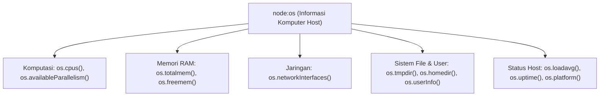

# OS

> Ringkasan
>
> - Fungsi: Membaca informasi sistem operasi host, spesifikasi perangkat keras komputer, kapasitas memori RAM, dan konfigurasi kartu jaringan.
> - Digunakan saat: Menentukan jumlah proses worker CPU, memantau beban kerja server, mencari alamat IP lokal, dan mencari lokasi folder file sementara.
> - Aturan praktis: Utamakan `os.availableParallelism()` daripada `os.cpus().length` untuk mengatur worker di container Docker; ingat bahwa `os.loadavg()` selalu bernilai nol di sistem operasi Windows.

---

## Tujuan Belajar

- Mengetahui arsitektur perangkat keras dan sistem operasi tempat aplikasi berjalan lewat `node:os`.
- Menghitung kuota inti CPU yang aman dan ramah container menggunakan `os.availableParallelism()`.
- Menghitung sisa dan persentase penggunaan memori RAM fisik pada komputer (`os.totalmem()` dan `os.freemem()`).
- Membaca rata-rata beban antrean CPU sistem (_System Load Average_) untuk memantau performa server.
- Mengambil alamat IP lokal dari kartu jaringan serta mencari lokasi folder penyimpanan sementara yang portabel.

---

## Konsep

> Bayangkan Node.js seperti seorang penyewa kamar di dalam sebuah gedung apartemen. Objek `process` adalah penghuni kamar itu sendiri (barang bawaan dan aktivitas di dalam unit), sedangkan modul `node:os` adalah gedung apartemen beserta seluruh fasilitasnya: luas bangunan fisik (kapasitas RAM `os.totalmem()`), jumlah lift yang tersedia untuk digunakan bersama (inti CPU `os.availableParallelism()`), kepadatan antrean di lobi gedung (`os.loadavg()`), dan kabel internet yang masuk ke gedung (`os.networkInterfaces()`).



---

## Referensi

| Item                            | Fungsi                                                               | Catatan                                                                |
| :------------------------------ | :------------------------------------------------------------------- | :--------------------------------------------------------------------- |
| **`os.platform()`**             | Mengetahui sistem operasi tempat aplikasi berjalan                   | Menghasilkan string seperti `'linux'`, `'darwin'`, atau `'win32'`      |
| **`os.arch()`**                 | Mengetahui arsitektur prosesor CPU komputer                          | Menghasilkan string seperti `'x64'`, `'arm64'`, atau `'ia32'`          |
| **`os.availableParallelism()`** | Menghitung jumlah inti CPU yang efektif dan aman untuk digunakan     | Sadar terhadap batasan kuota container Docker dan Kubernetes           |
| **`os.cpus()`**                 | Mengembalikan daftar informasi detail dari setiap inti CPU           | Berisi model prosesor, kecepatan (MHz), dan pembagian waktu            |
| **`os.totalmem()`**             | Mengembalikan total kapasitas memori RAM fisik dalam ukuran byte     | Bernilai tetap selama perangkat keras komputer tidak diubah            |
| **`os.freemem()`**              | Mengembalikan sisa kapasitas memori RAM fisik yang sedang menganggur | Nilainya berubah dinamis sesuai pemakaian sistem operasi host          |
| **`os.loadavg()`**              | Mengembalikan rata-rata beban antrean proses CPU Linux/macOS         | Berisi rata-rata beban 1, 5, dan 15 menit; selalu `[0,0,0]` di Windows |
| **`os.networkInterfaces()`**    | Mengembalikan daftar kartu jaringan aktif beserta detail alamat IP   | Memuat properti `family`, `address`, `netmask`, dan status internal    |
| **`os.tmpdir()`**               | Mengembalikan jalur folder sementara yang sah di sistem operasi      | Mengembalikan `/tmp` di Linux dan folder Temp AppData di Windows       |
| **`os.homedir()`**              | Mengembalikan jalur folder beranda pengguna yang sedang aktif        | Membaca variabel lingkungan `HOME` atau `USERPROFILE`                  |
| **`os.uptime()`**               | Mengembalikan berapa lama komputer atau server sudah menyala (detik) | Berbeda dari `process.uptime()` yang hanya menghitung aplikasi Node.js |
| **`os.userInfo()`**             | Mengembalikan informasi profil pengguna OS yang mengeksekusi proses  | Memuat username, homedir, shell, uid, dan gid sistem operasi           |

### `os.platform()`

Metode `os.platform()` mengembalikan nama sistem operasi tempat Node.js sedang berjalan. Metode ini sangat berguna untuk membedakan perlakuan kode antar-sistem operasi.

```javascript
import os from "node:os";

const platformName = os.platform();
console.log(typeof platformName);
// Output: string
console.log(["linux", "darwin", "win32"].includes(platformName));
// Output: true
```

Kasus lain: Menentukan perintah terminal atau tanda pemisah baris baru berdasarkan jenis platform.

```javascript
import os from "node:os";

const isWindows = os.platform() === "win32";
console.log(typeof isWindows);
// Output: boolean
```

### `os.arch()`

Metode `os.arch()` mengembalikan arsitektur prosesor CPU tempat Node.js berjalan. Fitur ini umum dipakai saat aplikasi perlu mengunduh biner native C++ yang cocok dengan mesin server.

```javascript
import os from "node:os";

const architecture = os.arch();
console.log(typeof architecture);
// Output: string
console.log(["x64", "arm64", "ia32"].includes(architecture));
// Output: true
```

Kasus lain: Memastikan apakah server berjalan pada sistem modern 64-bit sebelum memproses data besar.

```javascript
import os from "node:os";

const is64Bit = os.arch().includes("64");
console.log(is64Bit);
// Output: true
```

### `os.availableParallelism()`

Metode `os.availableParallelism()` menghitung berapa banyak inti prosesor CPU yang benar-benar boleh dipakai oleh aplikasi kamu. Metode ini otomatis sadar batasan alokasi CPU di lingkungan container Docker dan Kubernetes.

```javascript
import os from "node:os";

const workerQuota = os.availableParallelism();
console.log(typeof workerQuota);
// Output: number
console.log(workerQuota >= 1);
// Output: true
```

Kasus lain: Menentukan ukuran antrean worker agar pas tanpa melebihi jatah CPU yang diberikan oleh server.

```javascript
import os from "node:os";

const optimalWorkers = Math.max(1, os.availableParallelism());
console.log(Number.isInteger(optimalWorkers));
// Output: true
```

### `os.cpus()`

Metode `os.cpus()` mengembalikan array objek yang memuat rincian setiap inti prosesor, mulai dari nama model, kecepatan (MHz), hingga catatan waktu penggunaan CPU.

```javascript
import os from "node:os";

const cpuList = os.cpus();
console.log(Array.isArray(cpuList));
// Output: true
console.log(cpuList.length > 0);
// Output: true
console.log(typeof cpuList[0].model);
// Output: string
```

Kasus lain: Menghitung kecepatan rata-rata dari seluruh inti prosesor yang terpasang di komputer.

```javascript
import os from "node:os";

const cpus = os.cpus();
const totalSpeed = cpus.reduce((acc, cpu) => acc + cpu.speed, 0);
const averageSpeed = totalSpeed / cpus.length;
console.log(averageSpeed >= 0);
// Output: true
```

### `os.totalmem()`

Metode `os.totalmem()` mengembalikan jumlah total kapasitas memori RAM fisik yang terpasang di komputer dalam satuan byte.

```javascript
import os from "node:os";

const totalBytes = os.totalmem();
const totalGb = totalBytes / 1024 ** 3;
console.log(typeof totalBytes);
// Output: number
console.log(totalGb > 0);
// Output: true
```

Kasus lain: Memastikan nilai kapasitas RAM selalu berupa bilangan bulat positif yang aman.

```javascript
import os from "node:os";

console.log(Number.isSafeInteger(os.totalmem()));
// Output: true
```

### `os.freemem()`

Metode `os.freemem()` mengembalikan sisa kapasitas memori RAM fisik komputer yang saat ini sedang tidak terpakai dalam ukuran byte.

```javascript
import os from "node:os";

const freeRamBytes = os.freemem();
console.log(typeof freeRamBytes);
// Output: number
console.log(freeRamBytes <= os.totalmem());
// Output: true
```

Kasus lain: Menghitung sisa kapasitas RAM ke dalam satuan gigabyte agar mudah dibaca di dashboard pemantauan.

```javascript
import os from "node:os";

const freeRamGb = os.freemem() / 1024 ** 3;
console.log(freeRamGb >= 0);
// Output: true
```

### `os.loadavg()`

Metode `os.loadavg()` mengembalikan array berisi tiga angka yang menggambarkan rata-rata kepadatan antrean proses CPU selama 1, 5, dan 15 menit terakhir pada sistem POSIX (Linux dan macOS).

```javascript
import os from "node:os";

const loadAverage = os.loadavg();
console.log(Array.isArray(loadAverage));
// Output: true
console.log(loadAverage.length);
// Output: 3
```

Kasus lain: Di sistem operasi Windows, metode ini selalu mengembalikan angka nol `[0, 0, 0]` karena Windows memakai konsep pengukuran performa yang berbeda.

```javascript
import os from "node:os";

const [load1m] = os.loadavg();
console.log(typeof load1m);
// Output: number
```

### `os.networkInterfaces()`

Metode `os.networkInterfaces()` mengembalikan peta daftar kartu jaringan yang menghubungkan komputer kamu ke jaringan lokal maupun internet.

```javascript
import os from "node:os";

const networkCards = os.networkInterfaces();
console.log(typeof networkCards);
// Output: object
console.log(Object.keys(networkCards).length > 0);
// Output: true
```

Kasus lain: Menyaring antarmuka loopback lokal (`127.0.0.1`) untuk mencari alamat IP yang bisa dihubungi dari luar.

```javascript
import os from "node:os";

const interfaces = os.networkInterfaces();
let ipFound = false;

for (const name of Object.keys(interfaces)) {
  for (const info of interfaces[name] || []) {
    if (info.family === "IPv4") {
      ipFound = true;
      break;
    }
  }
}
console.log(ipFound);
// Output: true
```

### `os.tmpdir()`

Metode `os.tmpdir()` mengembalikan jalur folder penyimpanan sementara resmi dari sistem operasi tempat aplikasi bisa menyimpan file sementara dengan aman.

```javascript
import os from "node:os";

const tempDirectory = os.tmpdir();
console.log(typeof tempDirectory);
// Output: string
console.log(tempDirectory.length > 0);
// Output: true
```

Kasus lain: Memastikan jalur folder sementara bersih dari tanda garis miring ganda di ujung teks.

```javascript
import os from "node:os";

const cleanPath = os.tmpdir().replace(/[/\\]$/, "");
console.log(cleanPath.length > 0);
// Output: true
```

### `os.homedir()`

Metode `os.homedir()` mengembalikan jalur folder beranda pengguna aktif tempat file dan setelan pribadi biasanya disimpan.

```javascript
import os from "node:os";

const homeDirectory = os.homedir();
console.log(typeof homeDirectory);
// Output: string
console.log(homeDirectory.length > 0);
// Output: true
```

Kasus lain: Memeriksa ketersediaan folder beranda untuk menentukan lokasi penyimpanan file konfigurasi lokal secara aman.

```javascript
import os from "node:os";

const hasHome = os.homedir() !== "";
console.log(hasHome);
// Output: true
```

### `os.uptime()`

Metode `os.uptime()` mengembalikan angka yang menunjukkan berapa lama komputer atau server sudah menyala sejak tombol power ditekan (dalam satuan detik).

```javascript
import os from "node:os";

const hostUptimeSeconds = os.uptime();
console.log(typeof hostUptimeSeconds);
// Output: number
console.log(hostUptimeSeconds > 0);
// Output: true
```

Kasus lain: Mengubah catatan detik aktif komputer ke satuan jam agar lebih mudah dipahami manusia.

```javascript
import os from "node:os";

const uptimeHours = os.uptime() / 3600;
console.log(uptimeHours >= 0);
// Output: true
```

### `os.userInfo()`

Metode `os.userInfo()` mengembalikan data profil pengguna sistem operasi yang sedang mengeksekusi proses Node.js. Informasi ini meliputi `username`, `homedir`, `shell`, `uid` (User ID), dan `gid` (Group ID).

```javascript
import os from "node:os";

const user = os.userInfo();
console.log(typeof user.username);
// Output: string
console.log(typeof user.homedir);
// Output: string
console.log(typeof user.uid);
// Output: number
```

Kasus lain: Menangani potensi error saat program berjalan di lingkungan container Linux minimal (seperti Docker distroless tanpa entri `/etc/passwd`).

```javascript
import os from "node:os";

function getExecutingUser() {
  try {
    return os.userInfo().username;
  } catch {
    // Fallback jika database user OS tidak tersedia di container
    return process.env.USER || process.env.USERNAME || "unknown";
  }
}

console.log(typeof getExecutingUser());
// Output: string
```

### Perbandingan: Penentuan Jumlah Inti CPU

| Aspek                        | `os.availableParallelism()`                        | `os.cpus().length`                                    |
| :--------------------------- | :------------------------------------------------- | :---------------------------------------------------- |
| **Konteks Perhitungan**      | Memperhitungkan batas alokasi cgroup container     | Hanya membaca total inti fisik komputer induk         |
| **Lingkungan Docker/K8s**    | Mengembalikan jatah container asli (misal 2 core)  | Mengembalikan total inti server induk (misal 64 core) |
| **Rekomendasi Skalabilitas** | Standar modern untuk mengatur jumlah proses worker | Hanya digunakan untuk audit perangkat keras murni     |

---

## Kesalahan Umum

### Mengandalkan `os.loadavg()` pada Sistem Operasi Windows

Sistem operasi Windows tidak menerapkan metrik Load Average ala UNIX, sehingga `os.loadavg()` selalu mengembalikan `[0, 0, 0]`.

```javascript
// Salah
const [load1m] = os.loadavg();
if (load1m > 2.0) {
  // Peringatan ini tidak akan pernah menyala di server Windows!
}
```

```javascript
// Benar
const [load1m] = os.loadavg();
if (os.platform() !== "win32" && load1m > 2.0) {
  // Pengecekan beban hanya dievaluasi pada sistem yang mendukung
}
```

### Tertukar Antara `os.freemem()` dan Memori Aplikasi Node.js

`os.freemem()` menghitung sisa RAM seluruh komputer, bukan sisa memori yang bisa dialokasikan untuk aplikasi Node.js itu sendiri.

```javascript
// Salah
// Mengira ini adalah sisa memori untuk proses Node.js kita
const appMemory = os.freemem();
```

```javascript
// Benar
import process from "node:process";
// Gunakan process.memoryUsage() untuk memantau konsumsi heap aplikasi
const appHeap = process.memoryUsage().heapUsed;
```

### Menulis Hardcode Jalur `/tmp` untuk Berkas Sementara

Menulis teks `/tmp` secara manual akan menyebabkan aplikasi gagal saat dijalankan di server Windows.

```javascript
// Salah
// Menulis hardcode direktori Linux menyebabkan kegagalan saat dijalankan di Windows
const tempDirectory = "/tmp";
```

```javascript
// Benar
import os from "node:os";

// Gunakan os.tmpdir() yang secara otomatis mengembalikan folder sementara resmi sistem operasi host
const tempDirectory = os.tmpdir();
```

---

## Studi Kasus

Skenario: Membangun penyedia telemetri server mandiri (_host infrastructure telemetry_) yang mengukur pemakaian RAM fisik, mencari alamat IPv4 lokal yang aktif, membaca jenis sistem operasi dan kuota prosesor, serta menyusun laporan kesehatan server tanpa bantuan library luar.

```javascript
import os from "node:os";

class HostTelemetry {
  getSystemSummary() {
    const totalRam = os.totalmem();
    const freeRam = os.freemem();
    const usedRam = totalRam - freeRam;
    const ramPercentage = ((usedRam / totalRam) * 100).toFixed(2);

    const coreQuota = os.availableParallelism();
    const [load1m] = os.loadavg();

    return {
      host: os.hostname(),
      platform: os.platform(),
      architecture: os.arch(),
      coreQuota,
      localIp: this.findLocalIp(),
      ramTotalGb: Number((totalRam / 1024 ** 3).toFixed(2)),
      ramUsedPercentage: Number(ramPercentage),
      highLoad: os.platform() !== "win32" ? load1m > coreQuota * 1.5 : false,
      uptimeHours: Number((os.uptime() / 3600).toFixed(2)),
    };
  }

  findLocalIp() {
    const networkMap = os.networkInterfaces();
    for (const name of Object.keys(networkMap)) {
      for (const net of networkMap[name] || []) {
        if (net.family === "IPv4" && !net.internal) {
          return net.address;
        }
      }
    }
    return "127.0.0.1";
  }
}

const telemetry = new HostTelemetry();
const summary = telemetry.getSystemSummary();

console.log(typeof summary.host === "string");
// Output: true
console.log(typeof summary.platform === "string");
// Output: true
console.log(summary.coreQuota >= 1);
// Output: true
console.log(summary.ramTotalGb > 0);
// Output: true
console.log(typeof summary.localIp === "string");
// Output: true
```

Desain ini memanfaatkan modul inti `node:os` untuk membaca seluruh indikator perangkat keras dan jaringan secara komprehensif, aman lintas platform, serta siap dipasang pada endpoint monitoring.

---

## Latihan Mandiri

### Soal 1 (Dasar)

Buat fungsi `calculateRamStatus()` yang menghitung penggunaan memori komputer menggunakan `os.totalmem()` dan `os.freemem()`. Kembalikan objek berisi total RAM (GB), RAM bebas (GB), dan persentase RAM yang terpakai dengan format desimal dua angka di belakang koma.

Contoh input:

```javascript
calculateRamStatus();
```

Contoh output yang diharapkan:

```javascript
{
  totalGb: 16.00,
  freeGb: 9.50,
  usedPercentage: 40.63
}
```

Batasan: Gunakan modul bawaan `node:os`. Rumus konversi gigabyte menggunakan pembagi `1024 ** 3`.

### Soal 2 (Menengah)

Buat fungsi `getActiveAdapters()` yang menyisir seluruh antarmuka jaringan dari `os.networkInterfaces()` dan mengembalikan array objek ringkas yang hanya memuat kartu jaringan bertipe `IPv4` non-internal (bukan `127.0.0.1`). Setiap elemen di dalam array harus memiliki properti `name`, `ip`, dan `mac`.

Contoh input:

```javascript
getActiveAdapters();
```

Contoh output yang diharapkan:

```javascript
[
  {
    name: "eth0",
    ip: "192.168.1.10",
    mac: "00:1a:2b:3c:4d:5e",
  },
];
```

Batasan: Wajib memfilter hanya alamat dengan `family === 'IPv4'` dan `internal === false`. Jika tidak ada yang cocok, kembalikan array kosong `[]`.

### Soal 3 (Menantang)

Buat fungsi penilai kelayakan beban server `evaluateServerLoad(loadThresholdPercentage)` yang memeriksa kesiapan komputer host sebelum menerima tugas komputasi berat dengan aturan berikut:

1. Ambil jumlah kuota CPU yang tersedia menggunakan `os.availableParallelism()`.
2. Periksa platform menggunakan `os.platform()`. Jika platform adalah `'win32'`, tetapkan status beban CPU (`cpuStatus`) sebagai `'UNAVAILABLE'` dan persentase beban sebagai `null`. Jika selain Windows, tetapkan `cpuStatus` sebagai `'AVAILABLE'`.
3. Jika platform bukan Windows, ambil metrik `os.loadavg()[0]` (1 menit terakhir), lalu hitung persentase pemakaian CPU terhadap kuota inti dengan rumus: `(load1m / coreQuota) * 100`.
4. Hitung sisa memori RAM bebas dalam persentase terhadap total kapasitas RAM fisik.
5. Tentukan status penerimaan tugas:
   - Jika sisa RAM bebas kurang dari 10%, kembalikan `{ acceptTask: false, reason: 'Critical RAM capacity' }`.
   - Pada platform non-Windows, jika utilisasi CPU melebihi `loadThresholdPercentage`, kembalikan `{ acceptTask: false, reason: 'CPU overloaded' }`.
   - Jika semua batas aman terpenuhi, kembalikan `{ acceptTask: true, cpuStatus: string, cpuUsagePercentage: number | null, freeRamPercentage: number }`.

Contoh input 1 (Linux/macOS dengan beban aman):

```javascript
evaluateServerLoad(80);
```

Contoh output 1:

```javascript
{
  acceptTask: true,
  cpuStatus: "AVAILABLE",
  cpuUsagePercentage: 25.5,
  freeRamPercentage: 65.2
}
```

Contoh input 2 (Kondisi RAM kritis < 10%):

```javascript
evaluateServerLoad(80);
```

Contoh output 2:

```javascript
{
  acceptTask: false,
  reason: 'Critical RAM capacity'
}
```

Contoh input 3 (Platform Windows dengan RAM aman):

```javascript
evaluateServerLoad(80);
```

Contoh output 3:

```javascript
{
  acceptTask: true,
  cpuStatus: "UNAVAILABLE",
  cpuUsagePercentage: null,
  freeRamPercentage: 70.4
}
```

Batasan: Wajib menggabungkan `os.availableParallelism()`, `os.loadavg()`, `os.totalmem()`, `os.freemem()`, dan `os.platform()`. Tangani perbedaan arsitektur OS tanpa error.

---

## Navigasi

[Sebelumnya: Process](../03-process/README.md) | [Selanjutnya: Path](../05-path/README.md) | [Daftar Isi](../README.md)
