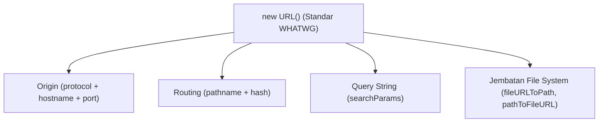

# URL

> Ringkasan
> - Tingkat: Fondasi
> - Fungsi: Mengurai, memvalidasi, dan memanipulasi alamat web berdasarkan standar WHATWG URL API.
> - Digunakan saat: Mengelola query string HTTP, menyusun endpoint API, konversi path lokal ke URL file, dan mencegah serangan open redirect.
> - Aturan praktis: Selalu gunakan class global `new URL()` standar daripada modul usang `url.parse()`; kelola query string memakai `url.searchParams` agar terhindar dari bug URL encoding manual.

## Cheat Sheet

| Tugas | Kode |
| :--- | :--- |
| Membuat objek URL standar | `const url = new URL("https://api.io/v1");` |
| Menggabungkan base URL dengan endpoint | `const url = new URL("/users", "https://api.io");` |
| Mengambil protokol dan host domain | `url.origin` |
| Mengambil rute path | `url.pathname` |
| Menetapkan satu nilai query parameter | `url.searchParams.set("page", "1");` |
| Menambahkan query parameter bernilai banyak | `url.searchParams.append("tag", "web");` |
| Mengubah URL `file://` menjadi path sistem | `fileURLToPath(import.meta.url)` |
| Mengubah path sistem menjadi objek URL `file://` | `pathToFileURL("./data/file.txt")` |

## Tujuan Belajar

- Mengurai komponen alamat web (protokol, host, port, path, query) memakai class WHATWG `URL`.
- Memanipulasi parameter query string secara dinamis dan aman via `URLSearchParams`.
- Mengonversi format URL `file://` ke path file sistem operasi memakai utilitas `node:url`.
- Mencegah celah keamanan _open redirect_ dan kesalahan parsing URL lama.

## Konsep

Bayangkan alamat URL seperti alamat surat fisik. Format alamat surat terdiri dari nama negara (protokol `https:`), kota dan kode pos (domain host `api.example.com`), nama gedung dan lantai (path `/v1/users`), serta instruksi tambahan untuk penerima (query parameters `?page=1&sort=desc`). Modul `node:url` bekerja seperti petugas kantor pos yang membedah setiap bagian amplop surat secara otomatis. Kamu tidak perlu membelah teks manual memakai `split("?")` atau `split("&")` yang rawan salah format spasi dan simbol khusus.



## Referensi

| Item | Fungsi | Catatan |
| :--- | :--- | :--- |
| `new URL(input, [base])` | Membuat instance objek URL terurai | Melempar `TypeError` bila format URL tidak valid |
| `url.origin` | Mengembalikan kombinasi protokol, domain, dan port | Bersifat read-only |
| `url.pathname` | Mengembalikan bagian jalur path setelah domain | Selalu diawali garis miring `/` |
| `url.searchParams` | Mengembalikan instance `URLSearchParams` | Mengelola query string secara otomatis ter-encode |
| `searchParams.get(name)` | Mengambil nilai pertama dari query parameter tertentu | Mengembalikan `null` bila parameter tidak ada |
| `searchParams.getAll(name)` | Mengambil seluruh nilai query parameter berulang | Mengembalikan array string `string[]` |
| `searchParams.set(name, value)` | Menetapkan atau menimpa nilai query parameter | Menghapus duplikasi nama parameter yang sama |
| `searchParams.append(name, value)` | Menambahkan nilai baru tanpa menghapus nilai sebelumnya | Berguna untuk array parameter seperti filter kategori |
| `fileURLToPath(url)` | Mengonversi URL berskema `file://` menjadi path OS | Menangani pemisah folder POSIX dan Windows |
| `pathToFileURL(path)` | Mengonversi path file sistem menjadi URL `file://` | Meng-encode spasi dan karakter khusus secara tepat |

### `new URL(input, [base])`

`new URL()` membuat objek URL terstruktur mengikuti standar WHATWG global yang kompatibel dengan browser modern.

Struktur parameter: `new URL(input, base)`
- `input` (string, wajib): string URL absolut atau jalur relatif.
- `base` (string atau URL, opsional): URL dasar tempat `input` relatif berpijak.

Nilai kembalian: instance objek `URL` baru (`URL`).

```javascript
const target = new URL("/v1/items?page=2", "https://api.example.com");

console.log(target.href);
// Output: https://api.example.com/v1/items?page=2
```

Kondisi khusus: Jika `input` adalah jalur relatif dan parameter `base` tidak diberikan, konstruktor melempar `TypeError [ERR_INVALID_URL]`.

### `url.origin`

`url.origin` mengembalikan gabungan protokol, domain host, dan nomor port tanpa jalur path atau query string.

Struktur parameter: properti instan tanpa pemanggilan fungsi.

Nilai kembalian: string identitas asal domain (`string`).

```javascript
const parsed = new URL("https://api.example.com:8443/data/users?active=true");

console.log(parsed.origin);
// Output: https://api.example.com:8443
```

Kondisi khusus: Untuk skema non-jaringan seperti `file://`, nilai `origin` adalah string `"null"`.

### `url.pathname`

`url.pathname` mengembalikan rute jalur resource dari URL setelah bagian host dan sebelum query string.

Struktur parameter: properti instan bertipe string.

Nilai kembalian: string rute direktori URL (`string`).

```javascript
const parsed = new URL("https://example.com/products/shoes/sneakers");

console.log(parsed.pathname);
// Output: /products/shoes/sneakers
```

Kondisi khusus: Mengubah nilai `url.pathname` secara langsung akan otomatis memperbarui nilai `url.href`.

### `url.searchParams`

`url.searchParams` adalah objek koleksi `URLSearchParams` yang merepresentasikan parameter query string pada URL.

Struktur parameter: properti instan bertipe `URLSearchParams`.

Nilai kembalian: instance `URLSearchParams`.

```javascript
const parsed = new URL("https://example.com?status=active");

console.log(parsed.searchParams instanceof URLSearchParams);
// Output: true
console.log(parsed.searchParams.get("status"));
// Output: active
```

Kondisi khusus: Mutasi pada `searchParams` (seperti `.set()` atau `.delete()`) otomatis mengubah properti `url.search` dan `url.href`.

### `searchParams.set()` dan `searchParams.append()`

`.set()` menetapkan nilai baru dan menghapus entri lama dengan nama yang sama, sedangkan `.append()` menambahkan nilai tanpa menghapus entri sebelumnya.

Struktur parameter: `searchParams.set(name, value)` dan `searchParams.append(name, value)`
- `name` (string, wajib): nama parameter query.
- `value` (string, wajib): nilai yang ingin disimpan.

Nilai kembalian: `undefined`.

```javascript
const params = new URLSearchParams();

params.set("category", "tech");
params.append("tag", "node");
params.append("tag", "web");

console.log(params.get("category"));
// Output: tech
console.log(params.getAll("tag").join(","));
// Output: node,web
```

Kondisi khusus: Semua nilai angka atau boolean yang di-pass otomatis diubah menjadi tipe string teks.

### `fileURLToPath(url)` dan `pathToFileURL(path)`

`fileURLToPath()` menerjemahkan skema `file://` menjadi path sistem lokal, sedangkan `pathToFileURL()` melakukan kebalikannya.

Struktur parameter: `fileURLToPath(url)` menerima string atau URL. `pathToFileURL(path)` menerima string path file.

Nilai kembalian: `fileURLToPath` menghasilkan string path lokal (`string`). `pathToFileURL` menghasilkan objek `URL`.

```javascript
import { fileURLToPath, pathToFileURL } from "node:url";

const localUrl = pathToFileURL("/app/data/sample.json");
console.log(localUrl.href.startsWith("file://"));
// Output: true

const diskPath = fileURLToPath(localUrl);
console.log(diskPath.endsWith("sample.json"));
// Output: true
```

Kondisi khusus: Melempar `TypeError` bila `fileURLToPath()` menerima URL dengan protokol selain `file:`.

## Kesalahan Umum

### Menggunakan URL Relatif Tanpa Memberikan Base URL

Memanggil `new URL("/dashboard")` tanpa origin dasar memicu error kegagalan konstruktor.

```javascript
// Salah
const target = new URL("/api/v1"); // TypeError: Invalid URL

// Benar
const target = new URL("/api/v1", "https://api.example.com");
```

### Mengabaikan Encoding Karakter Khusus pada Query String

Menggabungkan query string secara manual membuat spasi atau simbol ampersand (`&`) merusak struktur data.

```javascript
// Salah
const query = "?name=" + "John & Jane"; // Menghasilkan & yang memecah parameter

// Benar
const url = new URL("https://example.com/search");
url.searchParams.set("name", "John & Jane"); // Otomatis menjadi John+%26+Jane
```

## Studi Kasus

Membangun validator pengalihan alamat web (_safe redirect validator_) yang memastikan tujuan navigasi berasal dari domain terpercaya guna mencegah celah keamanan _open redirect_.

```javascript
class SafeRedirectValidator {
  constructor(allowedOrigins = []) {
    this.allowedOrigins = new Set(allowedOrigins);
  }

  createRedirectUrl(targetInput, sourceTracker = "auth") {
    let parsedUrl;
    try {
      parsedUrl = new URL(targetInput);
    } catch {
      throw new Error("Format URL tujuan tidak valid");
    }

    if (!this.allowedOrigins.has(parsedUrl.origin)) {
      throw new Error("Domain tujuan tidak diizinkan");
    }

    parsedUrl.searchParams.set("ref", sourceTracker);
    return parsedUrl.toString();
  }
}

const validator = new SafeRedirectValidator(["https://dashboard.example.com"]);

const safeTarget = validator.createRedirectUrl(
  "https://dashboard.example.com/home?tab=metrics",
  "login"
);
console.log(safeTarget);
// Output: https://dashboard.example.com/home?tab=metrics&ref=login

try {
  validator.createRedirectUrl("https://phishing.badsite.com/steal");
} catch (err) {
  console.log(err.message);
  // Output: Domain tujuan tidak diizinkan
}
```

Pola ini memanfaatkan `url.origin` untuk memvalidasi batas otoritas server, serta memanfaatkan `searchParams.set()` untuk menyisipkan parameter audit secara otomatis tanpa merusak query string yang sudah ada.

## Latihan Mandiri

Buat fungsi `buildApiUrl(baseUrl, endpoint, params = {})` untuk menyusun URL request HTTP secara dinamis.

- **Level 1 (Dasar):** Gabungkan `baseUrl` dan `endpoint` memakai `new URL(endpoint, baseUrl)`. Tambahkan setiap parameter dari objek `params` ke `searchParams` memakai `.set()`. Kembalikan URL utuh dalam format string.
- **Level 2 (Menengah):** Jika nilai properti pada `params` berupa array, tambahkan setiap elemen memakai `.append()`. Abaikan properti yang bernilai `null` atau `undefined`.
- **Level 3 (Menantang):** Validasi protokol URL. Jika protokol bukan `"https:"` atau `"http:"`, lempar `Error("Protokol URL tidak aman")`.

Contoh input dan output normal:

```javascript
const url = buildApiUrl("https://api.example.com", "/v1/search", {
  q: "nodejs",
  tags: ["backend", "javascript"],
  empty: null,
});

console.log(url);
// Output: https://api.example.com/v1/search?q=nodejs&tags=backend&tags=javascript
```

Contoh input dan penanganan error:

```javascript
try {
  buildApiUrl("ftp://files.example.com", "/download", {});
} catch (err) {
  console.log(err.message);
  // Output: Protokol URL tidak aman
}
```

Tanda selesai:
- [ ] Penggabungan base URL dan endpoint menghasilkan URL valid.
- [ ] Parameter bernilai tunggal diset dan bernilai array di-append ke `searchParams`.
- [ ] Nilai `null` dan `undefined` diabaikan dari query string.
- [ ] Protokol di luar `http:` dan `https:` melempar `Error`.

---

## Navigasi

[Sebelumnya: Path](../03-path/README.md) | [Selanjutnya: File System](../05-file-system/README.md) | [Daftar Isi](../README.md)
