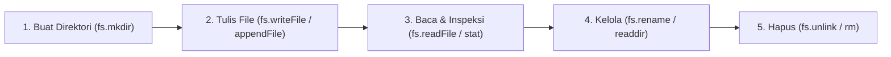

# File System

> Ringkasan
> - Tingkat: Fondasi
> - Fungsi: Mengelola operasi file dan direktori pada media penyimpanan fisik secara asynchronous berbasis Promise.
> - Digunakan saat: Membaca konfigurasi aplikasi, menyimpan upload data, menulis log transaksi, dan memindahkan atau menghapus file.
> - Aturan praktis: Selalu impor modul `node:fs/promises` daripada versi sinkron; jangan mengecek keberadaan file dengan `fs.access()` sebelum membacanya untuk menghindari bug race condition (TOCTOU).

## Cheat Sheet

| Tugas | Kode |
| :--- | :--- |
| Membuat folder bersarang | `await fs.mkdir("data/logs", { recursive: true });` |
| Menulis file baru | `await fs.writeFile("data/config.json", data, "utf-8");` |
| Membaca file teks | `const text = await fs.readFile("data/info.txt", "utf-8");` |
| Menambahkan teks ke akhir file | `await fs.appendFile("data/app.log", line, "utf-8");` |
| Membaca daftar file dalam folder | `const files = await fs.readdir("data/uploads");` |
| Menginspeksi ukuran & metadata file | `const stats = await fs.stat("data/info.txt");` |
| Mengganti nama atau memindahkan file | `await fs.rename("data/temp.txt", "data/target.txt");` |
| Menghapus satu file fisik | `await fs.unlink("data/temp.txt");` |
| Menghapus folder beserta isinya | `await fs.rm("data/temp", { recursive: true, force: true });` |

## Tujuan Belajar

- Memahami siklus manipulasi file menggunakan API Promise modern `node:fs/promises`.
- Menulis, membaca, dan memperbarui data file teks maupun biner secara asinkron.
- Mengelola direktori: pembuatan rekursif, pembacaan isi folder, dan penghapusan aman.
- Menerapkan pola penulisan atomik (_atomic write_) untuk menjaga keutuhan data saat listrik padam atau aplikasi crash.

## Konsep

Bayangkan hard disk komputer seperti lemari arsip fisik di kantor. Untuk menyimpan surat penting, kamu harus memastikan map wadahnya sudah ada (`fs.mkdir`), menulis isi dokumen ke kertas (`fs.writeFile`), atau menyisipkan lampiran baru di lembar belakang (`fs.appendFile`). Jika ingin membaca arsip lama, petugas membuka map dan membacakan isinya (`fs.readFile`). Di Node.js modern, kita menggunakan `node:fs/promises` agar proses pencarian dokumen di lemari arsip tidak menghentikan operasional meja resepsionis (Event Loop).



## Referensi

| Item | Fungsi | Catatan |
| :--- | :--- | :--- |
| `fs.mkdir(path, [options])` | Membuat direktori baru di disk | Gunakan `{ recursive: true }` untuk membuat folder bertingkat |
| `fs.writeFile(file, data, [options])` | Menulis data ke file (menimpa isi lama) | Menentukan encoding `"utf-8"` menghasilkan teks |
| `fs.readFile(path, [options])` | Membaca seluruh isi file ke memori | Mengembalikan string bila diberi encoding, atau Buffer |
| `fs.appendFile(path, data, [options])` | Menambahkan data ke baris paling akhir file | Otomatis membuat file baru jika file belum ada |
| `fs.readdir(path, [options])` | Membaca daftar nama file dan folder dalam direktori | Opsi `{ withFileTypes: true }` mengembalikan `Dirent[]` |
| `fs.stat(path)` | Memeriksa metadata file (ukuran byte, waktu modifikasi) | Menyediakan metode `.isFile()` dan `.isDirectory()` |
| `fs.rename(oldPath, newPath)` | Mengubah nama atau memindahkan lokasi file | Menjadi fondasi pola penulisan aman atomik |
| `fs.unlink(path)` | Menghapus satu file dari penyimpanan disk | Melempar error `ENOENT` bila file tidak ditemukan |
| `fs.rm(path, [options])` | Menghapus file atau folder beserta seluruh isinya | Gunakan `{ recursive: true, force: true }` untuk direktori |

### `fs.mkdir(path, [options])`

`fs.mkdir()` membuat direktori baru pada lokasi path yang ditentukan.

Struktur parameter: `fs.mkdir(path, options)`
- `path` (string, wajib): lokasi folder yang ingin dibuat.
- `options` (object, opsional): objek pengaturan seperti `{ recursive: true }`.

Nilai kembalian: `Promise<string | undefined>`. Mengembalikan path folder pertama yang dibuat jika `recursive: true`.

```javascript
import fs from "node:fs/promises";

await fs.mkdir("./data/logs/2026", { recursive: true });
console.log("Folder berhasil dibuat");
// Output: Folder berhasil dibuat
```

Kondisi khusus: Jika opsi `recursive` bernilai `false` (default) dan folder induknya belum ada, pemanggilan akan melempar error `ENOENT`.

### `fs.writeFile(file, data, [options])`

`fs.writeFile()` menulis data secara asinkron ke file target. Jika file sudah ada, seluruh isinya akan ditimpa.

Struktur parameter: `fs.writeFile(file, data, options)`
- `file` (string, wajib): path tujuan file.
- `data` (string atau Buffer, wajib): konten yang ingin ditulis.
- `options` (string atau object, opsional, default: `"utf-8"`): encoding teks atau pengaturan file flag.

Nilai kembalian: `Promise<void>`.

```javascript
import fs from "node:fs/promises";

await fs.writeFile("./data/hello.txt", "Halo Node.js", "utf-8");
console.log("File berhasil ditulis");
// Output: File berhasil ditulis
```

Kondisi khusus: Melempar error `ENOENT` jika folder induk dari path file yang dituju belum dibuat.

### `fs.readFile(path, [options])`

`fs.readFile()` membaca seluruh isi file target ke dalam memori.

Struktur parameter: `fs.readFile(path, options)`
- `path` (string, wajib): path lokasi file yang ingin dibaca.
- `options` (string atau object, opsional): encoding teks (misalnya `"utf-8"`).

Nilai kembalian: `Promise<string | Buffer>`. Mengembalikan string jika encoding ditentukan, atau objek `Buffer` biner jika dikosongkan.

```javascript
import fs from "node:fs/promises";

const content = await fs.readFile("./data/hello.txt", "utf-8");
console.log(content);
// Output: Halo Node.js
```

Kondisi khusus: Melempar error `ENOENT` jika file target tidak ditemukan pada penyimpanan disk.

### `fs.appendFile(path, data, [options])`

`fs.appendFile()` menyisipkan data baru di bagian akhir file tanpa menghapus konten lama.

Struktur parameter: `fs.appendFile(path, data, options)`
- `path` (string, wajib): path file target.
- `data` (string atau Buffer, wajib): konten yang akan ditambahkan.
- `options` (string atau object, opsional, default: `"utf-8"`): konfigurasi encoding teks.

Nilai kembalian: `Promise<void>`.

```javascript
import fs from "node:fs/promises";

await fs.appendFile("./data/hello.txt", "\nBaris baru", "utf-8");
console.log("Data berhasil ditambahkan");
// Output: Data berhasil ditambahkan
```

Kondisi khusus: Jika file belum ada, Node.js otomatis membuat file baru tersebut.

### `fs.readdir(path, [options])`

`fs.readdir()` membaca daftar nama file dan sub-folder yang berada di dalam suatu direktori.

Struktur parameter: `fs.readdir(path, options)`
- `path` (string, wajib): path direktori yang ingin diinspeksi.
- `options` (string atau object, opsional): opsi seperti `{ withFileTypes: true }`.

Nilai kembalian: `Promise<string[] | Dirent[]>`.

```javascript
import fs from "node:fs/promises";

const entries = await fs.readdir("./data");
console.log(Array.isArray(entries));
// Output: true
```

Kondisi khusus: Hasil array hanya berupa nama file relatif terhadap folder tersebut, bukan path absolut.

### `fs.stat(path)`

`fs.stat()` memeriksa status dan metadata fisik file seperti ukuran file dan waktu modifikasi.

Struktur parameter: `fs.stat(path)`
- `path` (string, wajib): path file atau folder yang ingin diinspeksi.

Nilai kembalian: `Promise<Stats>`. Instance objek statistik yang menyediakan properti `.size`, `.mtime`, serta metode `.isFile()` dan `.isDirectory()`.

```javascript
import fs from "node:fs/promises";

const stats = await fs.stat("./data/hello.txt");
console.log(stats.isFile());
// Output: true
console.log(stats.size > 0);
// Output: true
```

Kondisi khusus: Melempar error `ENOENT` bila path tidak ditemukan di hard disk.

### `fs.rename(oldPath, newPath)`

`fs.rename()` mengubah nama file atau memindahkan lokasi file dari `oldPath` ke `newPath`.

Struktur parameter: `fs.rename(oldPath, newPath)`
- `oldPath` (string, wajib): path file asal.
- `newPath` (string, wajib): path file tujuan baru.

Nilai kembalian: `Promise<void>`.

```javascript
import fs from "node:fs/promises";

await fs.rename("./data/hello.txt", "./data/greet.txt");
console.log("Nama file berhasil diubah");
// Output: Nama file berhasil diubah
```

Kondisi khusus: Jika `newPath` sudah ada sebelumnya, file target tersebut akan langsung ditimpa secara atomik pada sistem file POSIX.

### `fs.unlink(path)` dan `fs.rm(path, [options])`

`fs.unlink()` menghapus satu file tunggal. `fs.rm()` menghapus file atau folder secara fleksibel termasuk penghapusan rekursif.

Struktur parameter: `fs.unlink(path)` menerima path file. `fs.rm(path, options)` menerima opsi `{ recursive: true, force: true }`.

Nilai kembalian: `Promise<void>`.

```javascript
import fs from "node:fs/promises";

await fs.unlink("./data/greet.txt");
await fs.rm("./data/logs", { recursive: true, force: true });
console.log("Pembersihan selesai");
// Output: Pembersihan selesai
```

Kondisi khusus: Memanggil `fs.unlink()` pada direktori akan melempar error `EISDIR` (pada Linux/macOS) atau `EPERM` (pada Windows).

## Kesalahan Umum

### Membaca File Teks Tanpa Parameter Encoding

Jika tidak menyertakan encoding `"utf-8"`, `fs.readFile()` mengembalikan objek biner `Buffer`, bukan string teks.

```javascript
// Salah
const text = await fs.readFile("./data/note.txt");
console.log(typeof text); // 'object' (instance Buffer)

// Benar
const text = await fs.readFile("./data/note.txt", "utf-8");
console.log(typeof text); // 'string'
```

### Memeriksa Keberadaan File Sebelum Membaca (TOCTOU Race Condition)

Mengecek file via `fs.access()` lalu baru membacanya memicu kondisi rentan: file bisa saja dihapus oleh proses lain di antara kedua pemanggilan tersebut.

```javascript
// Salah (Time-of-Check to Time-of-Use)
try {
  await fs.access("./data/config.json");
  const data = await fs.readFile("./data/config.json", "utf-8");
} catch {}

// Benar: Langsung baca dan tangani error jika tidak ditemukan
try {
  const data = await fs.readFile("./data/config.json", "utf-8");
} catch (err) {
  if (err.code === "ENOENT") {
    // Tangani kondisi file belum ada
  }
}
```

## Studi Kasus

Menerapkan pola penulisan atomik (_atomic write_) untuk menyimpan konfigurasi data JSON. Data ditulis terlebih dahulu ke file sementara bertanda `.tmp`, lalu dipindahkan ke file utama memakai `fs.rename()` agar file utama tidak rusak bila server tiba-tiba mati di tengah penulisan.

```javascript
import fs from "node:fs/promises";
import path from "node:path";

async function atomicSaveJson(targetFilePath, data) {
  const targetDir = path.dirname(targetFilePath);
  await fs.mkdir(targetDir, { recursive: true });

  const tempFilePath = `${targetFilePath}.${Date.now()}.tmp`;
  const serializedContent = JSON.stringify(data, null, 2);

  await fs.writeFile(tempFilePath, serializedContent, "utf-8");
  await fs.rename(tempFilePath, targetFilePath);
}

const targetFile = "./data/config.json";
await atomicSaveJson(targetFile, { appName: "Handbook", version: "1.0.0" });

const savedContent = JSON.parse(await fs.readFile(targetFile, "utf-8"));
console.log(savedContent.appName);
// Output: Handbook
console.log(savedContent.version);
// Output: 1.0.0

await fs.unlink(targetFile);
```

Pola penulisan ini menjamin integritas file konfigurasi sistem. Operasi `fs.rename` bersifat atomik di tingkat sistem operasi, sehingga client tidak akan pernah membaca file yang terpotong setengah jadi saat proses penulisan terinterupsi.

## Latihan Mandiri

Buat fungsi `appendAuditLog(dirPath, filename, entry, options = {})` untuk mengelola pencatatan riwayat audit transaksi ke file disk.

- **Level 1 (Dasar):** Pastikan direktori `dirPath` sudah tersedia dengan `fs.mkdir(dirPath, { recursive: true })`. Gabungkan path lengkap file memakai `path.join()`. Tuliskan teks `entry` di baris baru memakai `fs.appendFile(filePath, entry + "\n", "utf-8")`. Kembalikan `{ success: true, filePath }`.
- **Level 2 (Menengah):** Periksa ukuran file log memakai `fs.stat(filePath)`. Jika ukuran file mencapai atau melebihi batas `options.maxBytes`, lakukan rotasi log dengan memindahkan file lama ke `${filename}.bak` memakai `fs.rename()`, baru kemudian tambahkan entri baru.
- **Level 3 (Menantang):** Jika `options.dryRun` bernilai `true`, jangan lakukan operasi penulisan file fisik apa pun ke disk dan langsung kembalikan `{ success: true, dryRun: true, filePath }`. Jika parameter `entry` bukan string atau string kosong, lempar `TypeError("Entri log harus berupa string non-kosong")`.

Contoh input dan output normal:

```javascript
const res = await appendAuditLog("data/logs", "audit.log", "LOGIN_SUCCESS: user_1");

console.log(res.success);
// Output: true
console.log(res.filePath.endsWith("audit.log"));
// Output: true
```

Contoh input dan penanganan error:

```javascript
try {
  await appendAuditLog("data/logs", "audit.log", "");
} catch (err) {
  console.log(err.message);
  // Output: Entri log harus berupa string non-kosong
}
```

Tanda selesai:
- [ ] Folder tujuan dibuat otomatis memakai opsi `recursive: true`.
- [ ] Data log ditambahkan di baris baru memakai `fs.appendFile()`.
- [ ] Rotasi file memindahkan file lama dengan `fs.rename()` saat kuota byte terlampaui.
- [ ] Entri log tidak valid melempar `TypeError`.

---

## Navigasi

[Sebelumnya: URL](../04-url/README.md) | [Selanjutnya: Events](../06-events/README.md) | [Daftar Isi](../README.md)
