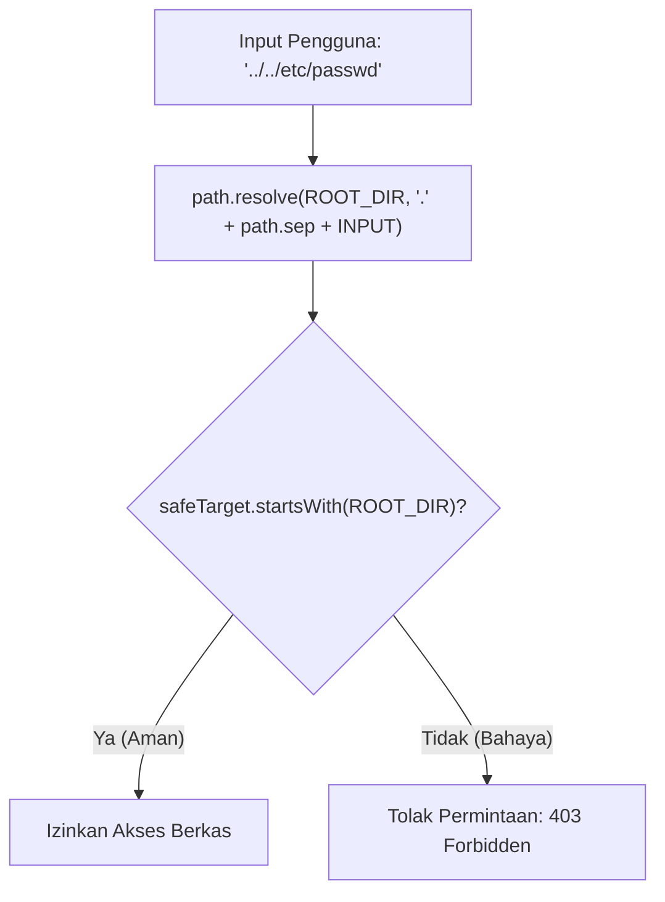

# Path

> Ringkasan
>
> - Fungsi: Membantu kita menyusun, merapikan, membedah bagian nama berkas, dan menentukan alamat folder yang aman di berbagai sistem operasi.
> - Digunakan saat: Menggabungkan jalur folder proyek, memvalidasi ekstensi berkas unggahan, menghitung navigasi impor relatif, dan melindungi server dari serangan intip folder (_path traversal_).
> - Aturan praktis: Jangan pernah menyambung alamat berkas dengan tanda tambah string (`+ '/'`); gunakan `path.posix` untuk kunci penyimpanan cloud dan selalu periksa batas folder aman menggunakan `.startsWith()`.

---

## Tujuan Belajar

- Memahami perbedaan tanda pemisah folder antara Linux/macOS (`/`) dan Windows (`\`).
- Membedakan cara kerja penggabungan jalur `path.join()` dengan kalkulasi jalur absolut `path.resolve()`.
- Mengambil bagian-bagian nama berkas menggunakan `path.basename()`, `path.dirname()`, dan `path.extname()`.
- Menghitung rute navigasi relatif antar-folder menggunakan `path.relative()`.
- Menerapkan pola keamanan untuk menangkal celah pembobolan folder _Path Traversal_ (CWE-22).

---

## Konsep

> Modul `node:path` bisa diibaratkan seperti papan penunjuk jalan dan pos satpam di sebuah kawasan perkantoran. Fungsi `path.join()` bertindak seperti petunjuk arah lokal ("dari lobi, naik ke lantai 2, belok ke ruang arsip"). Fungsi `path.resolve()` bekerja seperti titik koordinat GPS lengkap ("Jalan Merdeka No. 10, Menara Palma, Lantai 2, Ruang Arsip"). Pos satpam bertugas memeriksa pengunjung yang mencoba menyelinap keluar batas menggunakan tanda mundur (`..`) agar mereka tidak bisa membuka berkas rahasia di luar area yang diizinkan.



---

## Referensi

| Item                             | Fungsi                                                                    | Catatan                                                             |
| :------------------------------- | :------------------------------------------------------------------------ | :------------------------------------------------------------------ |
| **`path.join(...paths)`**        | Menggabungkan potongan jalur folder dan merapikan tanda `.` atau `..`     | Mempertahankan status relatif atau absolut sesuai potongan pertama  |
| **`path.resolve(...paths)`**     | Menghitung jalur absolut fisik lengkap dari kanan ke kiri                 | Selalu menghasilkan jalur absolut yang terikat pada `process.cwd()` |
| **`path.basename(path, [ext])`** | Mengambil nama berkas paling ujung dari string jalur                      | Bisa memotong ekstensi jika parameter kedua diisi                   |
| **`path.dirname(path)`**         | Mengambil jalur folder induk tempat berkas berada                         | Membuang nama berkas paling belakang                                |
| **`path.extname(path)`**         | Mengambil ekstensi berkas lengkap beserta tanda titiknya                  | Mengembalikan string kosong jika berkas tidak punya ekstensi        |
| **`path.relative(from, to)`**    | Menghitung rute navigasi relatif dari satu lokasi ke lokasi tujuan        | Sangat praktis saat menyusun baris kode impor modul otomatis        |
| **`path.normalize(path)`**       | Merapikan garis miring ganda dan tanda mundur yang berantakan             | Menyeragamkan format jalur tanpa mengubah status absolutnya         |
| **`path.isAbsolute(path)`**      | Mengecek apakah suatu jalur merupakan jalur absolut atau relatif          | Mengembalikan nilai boolean `true` atau `false`                     |
| **`path.parse(path)`**           | Membedah string jalur menjadi objek anatomi berkas                        | Menghasilkan objek `{ root, dir, base, ext, name }`                 |
| **`path.format(obj)`**           | Merakit kembali objek anatomi berkas menjadi satu string jalur utuh       | Merupakan kebalikan langsung dari `path.parse()`                    |
| **`path.posix`**                 | Memaksa seluruh operasi manipulasi jalur memakai garis miring POSIX (`/`) | Menjamin pemisah selalu berupa `/` untuk URL web dan AWS S3 Object  |

### `path.join(...paths)`

Metode `path.join()` menggabungkan potongan-potongan jalur menjadi satu string rapi dan otomatis membereskan tanda navigasi seperti `.` atau `..`. Metode ini tidak memaksakan jalur menjadi absolut jika potongan pertamanya memang relatif.

```javascript
import path from "node:path";

const resolvedPath = path.join(
  "/app",
  "src",
  "controllers",
  "..",
  "models",
  "user.js",
);
console.log(resolvedPath);
// Output: /app/src/models/user.js
```

Kasus lain: Menggabungkan beberapa string kosong akan menghasilkan tanda titik tunggal yang artinya folder saat ini.

```javascript
import path from "node:path";

const currentDir = path.join("", "");
console.log(currentDir);
// Output: .
```

### `path.resolve(...paths)`

Metode `path.resolve()` menyusun jalur absolut lengkap dengan membaca potongan dari kanan ke kiri. Jika belum menemukan tanda slash absolut, metode ini otomatis menyambungkannya ke folder kerja terminal kamu (`process.cwd()`).

```javascript
import path from "node:path";

const absolutePath = path.resolve("/var/log", "app", "server.log");
console.log(absolutePath);
// Output: /var/log/app/server.log
```

Kasus lain: Potongan jalur yang diawali tanda slash root di tengah argumen akan mereset seluruh potongan di sebelah kirinya.

```javascript
import path from "node:path";

const resetPath = path.resolve("folderA", "/folderB", "file.txt");
console.log(resetPath);
// Output: /folderB/file.txt
```

### `path.basename(path, [ext])`

Metode `path.basename()` mengambil nama file paling ujung dari suatu alamat jalur. Kamu juga bisa memberikan parameter kedua untuk langsung membuang ekstensinya.

```javascript
import path from "node:path";

const fullFile = path.basename("/var/www/uploads/avatar.png");
console.log(fullFile);
// Output: avatar.png

const baseName = path.basename("/var/www/uploads/avatar.png", ".png");
console.log(baseName);
// Output: avatar
```

Kasus lain: Tanda slash di ujung alamat folder akan diabaikan secara otomatis.

```javascript
import path from "node:path";

const folder = path.basename("/var/www/uploads/");
console.log(folder);
// Output: uploads
```

### `path.dirname(path)`

Metode `path.dirname()` mengembalikan lokasi folder induk tempat berkas berada dengan membuang nama berkas terakhir.

```javascript
import path from "node:path";

const parentDir = path.dirname("/var/www/uploads/avatar.png");
console.log(parentDir);
// Output: /var/www/uploads
```

Kasus lain: Memanggil `path.dirname()` pada direktori root utama akan mengembalikan tanda root yang sama.

```javascript
import path from "node:path";

const rootDir = path.dirname("/");
console.log(rootDir);
// Output: /
```

### `path.extname(path)`

Metode `path.extname()` mengambil ekstensi berkas mulai dari tanda titik terakhir pada nama berkas.

```javascript
import path from "node:path";

const extension = path.extname("financial-report.pdf");
console.log(extension);
// Output: .pdf
```

Kasus lain: Nama berkas tanpa titik atau file konfigurasi tersembunyi tanpa ekstensi lanjutan akan menghasilkan string kosong.

```javascript
import path from "node:path";

console.log(path.extname(".gitignore") === "");
// Output: true
console.log(path.extname("Dockerfile") === "");
// Output: true
```

### `path.relative(from, to)`

Metode `path.relative()` menghitung petunjuk rute navigasi relatif dari satu folder asal (`from`) menuju folder tujuan (`to`).

```javascript
import path from "node:path";

const relativePath = path.relative(
  "/app/src/controllers",
  "/app/assets/logo.png",
);
console.log(relativePath);
// Output: ../../assets/logo.png
```

Kasus lain: Jika kedua jalur menunjuk ke lokasi yang sama persis, hasilnya adalah string kosong.

```javascript
import path from "node:path";

const samePath = path.relative("/app/src", "/app/src");
console.log(samePath === "");
// Output: true
```

### `path.normalize(path)`

Metode `path.normalize()` merapikan tanda garis miring ganda dan menyelesaikan tanda mundur (`..`) pada string alamat yang berantakan.

```javascript
import path from "node:path";

const cleanPath = path.normalize("/var//log/../log/audit//app.log");
console.log(cleanPath);
// Output: /var/log/audit/app.log
```

Kasus lain: Format jalur relatif yang sengaja berisi tanda mundur tetap dipertahankan keutuhannya.

```javascript
import path from "node:path";

const relativePath = path.normalize("src/../dist/index.js");
console.log(relativePath);
// Output: dist/index.js
```

### `path.isAbsolute(path)`

Metode `path.isAbsolute()` memeriksa apakah sebuah string jalur merupakan jalur absolut di sistem operasi tempat aplikasi berjalan.

```javascript
import path from "node:path";

console.log(path.isAbsolute("/var/log"));
// Output: true
console.log(path.isAbsolute("./config.json"));
// Output: false
```

Kasus lain: Memeriksa string kosong akan selalu menghasilkan `false`.

```javascript
import path from "node:path";

console.log(path.isAbsolute(""));
// Output: false
```

### `path.parse(path)`

Metode `path.parse()` membedah string jalur menjadi objek struktur data yang rapi, memisahkan root, folder induk, nama lengkap, nama murni, dan ekstensinya.

```javascript
import path from "node:path";

const parsed = path.parse("/var/www/avatar.png");
console.log(parsed.dir);
// Output: /var/www
console.log(parsed.base);
// Output: avatar.png
console.log(parsed.name);
// Output: avatar
console.log(parsed.ext);
// Output: .png
```

Kasus lain: Membedah jalur relatif akan menghasilkan properti `root` berupa string kosong.

```javascript
import path from "node:path";

const parsedRelative = path.parse("data/users.json");
console.log(parsedRelative.root === "");
// Output: true
```

### `path.format(obj)`

Metode `path.format()` merakit kembali objek hasil bedahan berkas menjadi string alamat jalur yang utuh.

```javascript
import path from "node:path";

const formattedPath = path.format({
  dir: "/var/www",
  base: "avatar.webp",
});
console.log(formattedPath);
// Output: /var/www/avatar.webp
```

Kasus lain: Jika kamu tidak memberikan properti `base`, fungsi ini otomatis menggabungkan properti `name` dan `ext`.

```javascript
import path from "node:path";

const reconstructedPath = path.format({
  dir: "/opt/app",
  name: "server",
  ext: ".js",
});
console.log(reconstructedPath);
// Output: /opt/app/server.js
```

### `path.posix`

Objek `path.posix` menyediakan seluruh fitur modul `path` yang dipaksa menggunakan standar garis miring POSIX (`/`), baik saat dijalankan di Windows maupun Linux.

```javascript
import path from "node:path";

const s3Key = path.posix.join("uploads", "2026", "photo.png");
console.log(s3Key);
// Output: uploads/2026/photo.png
```

Kasus lain: Menggunakan `path.posix.normalize` untuk merapikan string URL web yang memuat backslash.

```javascript
import path from "node:path";

const urlPath = path.posix.normalize("assets/styles/main.css");
console.log(urlPath);
// Output: assets/styles/main.css
```

### Perbandingan: `path.join()` vs `path.resolve()`

| Karakteristik                         | `path.join()`                               | `path.resolve()`                              |
| :------------------------------------ | :------------------------------------------ | :-------------------------------------------- |
| **Bentuk Hasil**                      | Mengikuti input (bisa relatif atau absolut) | Selalu absolut (diawali `/` atau huruf drive) |
| **Keterikatan Folder Terminal**       | Tidak peduli di mana terminal berada        | Terikat ke `process.cwd()` jika input relatif |
| **Respon Tanda Slash Root di Tengah** | Dianggap potongan biasa tanpa mereset       | Mereset seluruh potongan di sebelah kirinya   |

---

## Kesalahan Umum

### Menyambung Jalur Berkas dengan Operator Tambah String

Menyambung jalur secara manual dengan tanda `+ '/'` sering menimbulkan garis miring ganda atau rusak saat aplikasi dijalankan di Windows.

```javascript
// Salah
const targetPath = parentFolder + "/" + fileName;
```

```javascript
// Benar
import path from "node:path";
const targetPath = path.join(parentFolder, fileName);
```

### Mengira `path.join()` Otomatis Aman dari Serangan Path Traversal

Metode `path.join()` hanya merapikan format titik mundur, bukan menjaga agar jalur tidak keluar dari folder aman aplikasi.

```javascript
// Salah
const publicDirectory = "/var/www/public";
const targetPath = path.join(publicDirectory, "../../etc/passwd");
// targetPath menjadi "/var/etc/passwd" yang membocorkan berkas rahasia sistem!
```

```javascript
// Benar
import path from "node:path";
const publicDirectory = "/var/www/public";
const safeTarget = path.resolve(
  publicDirectory,
  "." + path.sep + "../../etc/passwd",
);
const isSafe = safeTarget.startsWith(publicDirectory);
// isSafe bernilai false sehingga kita bisa langsung menolak request berbahaya ini
```

### Lupa Mengubah Ekstensi Menjadi Huruf Kecil Saat Validasi

Berkas dari kamera atau ponsel sering memiliki ekstensi huruf besar seperti `.JPG` atau `.PNG`, yang bisa gagal jika dicek menggunakan daftar ekstensi huruf kecil.

```javascript
// Salah
const ext = path.extname("photo.JPG");
const isValid = [".jpg", ".png"].includes(ext); // false
```

```javascript
// Benar
import path from "node:path";
const ext = path.extname("photo.JPG").toLowerCase();
const isValid = [".jpg", ".png"].includes(ext); // true
```

---

## Studi Kasus

Skenario: Membangun penyimpan berkas unggahan aman (_secure file upload handler_) yang memeriksa ekstensi dalam format huruf kecil, menolak upaya pembobolan folder _path traversal_, dan membuat kunci penyimpanan cloud POSIX yang cocok untuk protokol AWS S3.

```javascript
import path from "node:path";

class SecureStorage {
  constructor(rootDir) {
    this.rootDir = path.resolve(rootDir);
    this.allowedExtensions = new Set([".png", ".jpg", ".jpeg", ".pdf"]);
  }

  saveLocally(inputFileName, uniqueId) {
    const ext = path.extname(inputFileName).toLowerCase();

    if (!this.allowedExtensions.has(ext)) {
      return { success: false, reason: "File extension not allowed" };
    }

    const safeFileName = `${uniqueId}${ext}`;
    const absoluteTarget = path.resolve(
      this.rootDir,
      "." + path.sep + safeFileName,
    );

    if (!absoluteTarget.startsWith(this.rootDir)) {
      return { success: false, reason: "Path traversal attempt detected" };
    }

    return {
      success: true,
      localPath: absoluteTarget,
      cloudKey: path.posix.join("documents", "2026", safeFileName),
    };
  }
}

const storage = new SecureStorage("/var/data/uploads");

const validResult = storage.saveLocally("report.PDF", "uuid-1234");
console.log(validResult.success);
// Output: true
console.log(validResult.localPath.endsWith("uuid-1234.pdf"));
// Output: true
console.log(validResult.cloudKey);
// Output: documents/2026/uuid-1234.pdf

const invalidResult = storage.saveLocally("script.exe", "uuid-5678");
console.log(invalidResult.success);
// Output: false
console.log(invalidResult.reason);
// Output: File extension not allowed
```

Desain ini menggabungkan `path.resolve()`, `path.extname().toLowerCase()`, validasi batas `.startsWith()`, dan `path.posix.join()` untuk menjaga keamanan penyimpanan lokal maupun cloud tanpa memerlukan library tambahan.

---

## Latihan Mandiri

### Soal 1 (Dasar)

Buat fungsi `parseFileComponents(filePath)` yang menerima string alamat berkas dan mengembalikan objek ringkas berisi nama berkas lengkap (`base`), nama murni tanpa ekstensi (`name`), ekstensi dalam format huruf kecil (`ext`), dan nama folder induk (`dir`).

Contoh input:

```javascript
parseFileComponents("/var/log/audit/SERVER-PROD.LOG");
```

Contoh output yang diharapkan:

```javascript
{
  base: 'SERVER-PROD.LOG',
  name: 'SERVER-PROD',
  ext: '.log',
  dir: '/var/log/audit'
}
```

Batasan: Gunakan modul bawaan `node:path`. Nilai `ext` wajib diubah ke huruf kecil.

### Soal 2 (Menengah)

Buat fungsi `changeFileExtension(oldPath, newExtension)` yang menerima jalur berkas asal dan string ekstensi baru (misalnya `'.webp'`). Fungsi harus membedah jalur menggunakan `path.parse()`, memperbarui komponen ekstensi dengan nilai baru, dan menyusunnya kembali memakai `path.format()` tanpa merusak struktur folder asalnya.

Contoh input:

```javascript
changeFileExtension("/assets/images/banner.png", ".webp");
```

Contoh output yang diharapkan:

```javascript
/assets/images/banner.webp
```

Batasan: Wajib menggunakan `path.parse()` dan `path.format()`. Pastikan ekstensi baru selalu diawali tanda titik meskipun pengguna lupa menyertakannya.

### Soal 3 (Menantang)

Buat fungsi pelindung akses berkas `validateDownloadAccess(rootDir, userInput, allowedExtensions)` yang memeriksa permintaan unduhan file pengguna terhadap celah keamanan _Directory Traversal_ dengan aturan berikut:

1. Ubah `rootDir` menjadi alamat absolut lengkap menggunakan `path.resolve()`.
2. Jika `userInput` kosong, hanya berisi spasi, atau bukan string, kembalikan `{ allowed: false, statusCode: 400, message: 'Invalid file name' }`.
3. Susun target jalur aman menggunakan formula defensif: `path.resolve(absoluteRoot, '.' + path.sep + userInput)`.
4. Pastikan target hasil resolusi berada di dalam `absoluteRoot` menggunakan `.startsWith(absoluteRoot)`. Jika mencoba keluar dari batas folder, tolak dengan `{ allowed: false, statusCode: 403, message: 'Directory access denied' }`.
5. Ekstrak ekstensi berkas target dan periksa apakah termasuk dalam daftar `allowedExtensions` (pencocokan tidak boleh sensitif huruf besar/kecil). Jika tidak terdaftar, kembalikan `{ allowed: false, statusCode: 415, message: 'Unsupported file type' }`.
6. Jika seluruh uji keamanan lolos, kembalikan `{ allowed: true, statusCode: 200, absolutePath: string }`.

Contoh input 1 (Permintaan aman):

```javascript
validateDownloadAccess("/var/public", "reports/financial.pdf", [
  ".pdf",
  ".xlsx",
]);
```

Contoh output 1:

```javascript
{
  allowed: true,
  statusCode: 200,
  absolutePath: '/var/public/reports/financial.pdf'
}
```

Contoh input 2 (Upaya pembobolan traversal):

```javascript
validateDownloadAccess("/var/public", "../../etc/shadow", [".pdf"]);
```

Contoh output 2:

```javascript
{
  allowed: false,
  statusCode: 403,
  message: 'Directory access denied'
}
```

Contoh input 3 (Ekstensi ditolak):

```javascript
validateDownloadAccess("/var/public", "data.exe", [".pdf", ".xlsx"]);
```

Contoh output 3:

```javascript
{
  allowed: false,
  statusCode: 415,
  message: 'Unsupported file type'
}
```

Batasan: Dilarang menggunakan library pihak ketiga. Wajib menangani perbedaan tanda pemisah sistem operasi secara mandiri.

---

## Navigasi

[Sebelumnya: OS](../04-os/README.md) | [Selanjutnya: URL](../06-url/README.md) | [Daftar Isi](../README.md)
