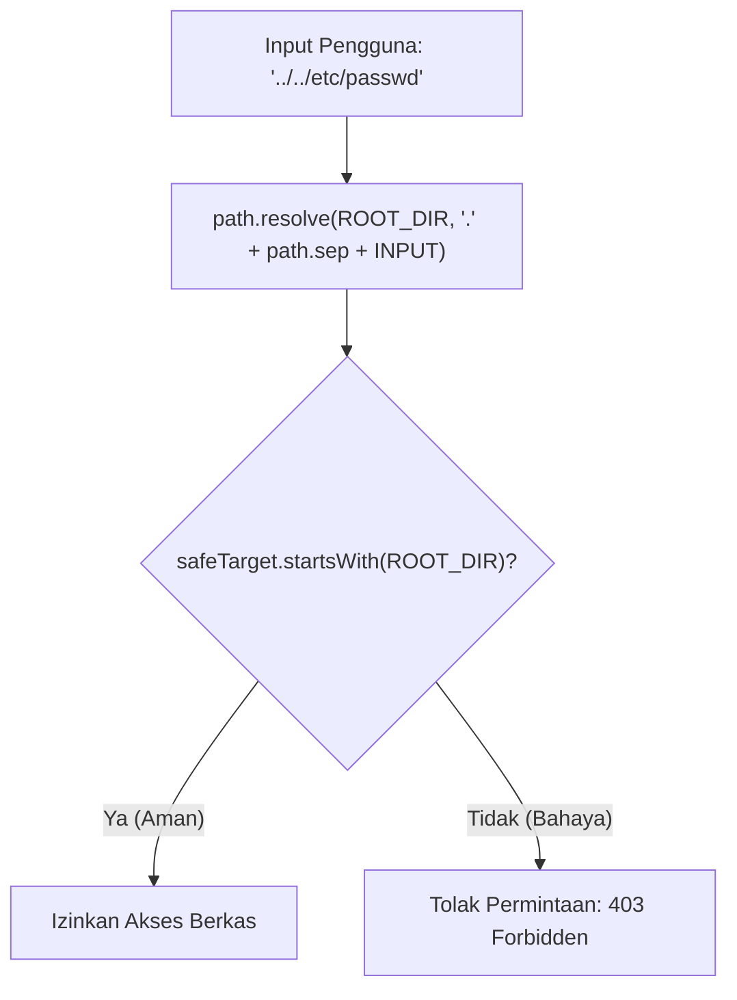

# Path

> Ringkasan
> - Fungsi: Menyediakan fungsi utilitas untuk memanipulasi, menormalisasi, mengekstrak komponen, dan menyelesaikan resolusi jalur sistem berkas lintas platform sistem operasi.
> - Digunakan saat: Menggabungkan jalur folder proyek, memvalidasi ekstensi unggahan berkas, menghitung navigasi impor relatif, dan memproteksi server dari serangan _path traversal_.
> - Aturan praktis: Jangan pernah menyambung segmen path secara manual dengan operator string plus; gunakan `path.posix` untuk kunci penyimpanan objek cloud dan selalu verifikasi batas keamanan jalur dengan `.startsWith()`.

---

## Tujuan Belajar

- Mengidentifikasi perbedaan karakter pemisah jalur direktori antara POSIX/Linux (`/`) dan Windows (`\`).
- Membedakan perilaku penggabungan jalur `path.join()` dengan resolusi absolut `path.resolve()`.
- Mengekstrak komponen anatomi berkas menggunakan `path.basename()`, `path.dirname()`, dan `path.extname()`.
- Menghitung jarak navigasi relatif antar-folder menggunakan `path.relative()`.
- Mengimplementasikan pola pertahanan terhadap celah keamanan siber _Path Traversal_ (CWE-22).

---

## Konsep

> Modul `node:path` dapat dianalogikan sebagai sistem penunjuk alamat dan pos gerbang keamanan di kawasan gedung perkantoran. Metode `path.join()` bertindak seperti petunjuk arah lokal ("dari lobi, naik ke lantai 2, belok ke ruang arsip"). Metode `path.resolve()` bekerja seperti koordinat satelit GPS absolut ("Jalan Merdeka No. 10, Menara Palma, Lantai 2, Ruang Arsip"). Pos gerbang keamanan bertugas memvalidasi pengunjung yang mencoba menyelundupkan tanda mundur keluar batas (`..`) agar tidak dapat menyusup ke instalasi penting di luar area yang diizinkan.



---

## Referensi

| Item | Fungsi | Catatan |
| :--- | :--- | :--- |
| **`path.join(...paths)`** | Menggabungkan segmen-segmen jalur dan merapikan segmen `.` atau `..` | Mempertahankan status relatif atau absolut sesuai segmen pembuka |
| **`path.resolve(...paths)`** | Mengkalkulasi jalur absolut fisik dari kanan ke kiri | Selalu menghasilkan jalur absolut yang terikat pada `process.cwd()` |
| **`path.basename(path, [ext])`** | Mengambil nama berkas terakhir dari string jalur | Dapat menghapus ekstensi jika argumen kedua diberikan |
| **`path.dirname(path)`** | Mengambil jalur direktori induk yang menaungi berkas | Membuang komponen nama berkas terakhir |
| **`path.extname(path)`** | Mengambil ekstensi berkas lengkap beserta tanda titiknya | Mengembalikan string kosong jika berkas tidak memiliki ekstensi |
| **`path.relative(from, to)`** | Menghitung langkah rute navigasi relatif dari satu lokasi ke lokasi tujuan | Berguna untuk menyusun baris pernyataan impor modul otomatis |
| **`path.normalize(path)`** | Merapikan tanda garis miring ganda dan segmen relatif pada string jalur | Menstandarkan representasi jalur tanpa mengubah status absolutnya |
| **`path.isAbsolute(path)`** | Memeriksa apakah suatu string jalur berstatus absolut atau relatif | Mengembalikan nilai boolean `true` atau `false` |
| **`path.parse(path)`** | Membedah string jalur menjadi objek struktur anatomi berkas | Menghasilkan objek `{ root, dir, base, ext, name }` |
| **`path.format(obj)`** | Menyusun kembali objek struktur anatomi berkas menjadi string jalur utuh | Operasi kebalikan dari `path.parse()` |
| **`path.posix`** | Memaksa seluruh operasi manipulasi jalur mengikuti standar POSIX (`/`) | Menjamin konsistensi pemisah slash untuk URL web dan AWS S3 Object |

### `path.join(...paths)`

Metode `path.join()` menggabungkan seluruh segmen jalur yang diberikan dan menormalisasi segmen navigasi seperti `.` atau `..`. Metode ini mempertahankan status jalur relatif jika segmen pertama tidak diawali slash absolut.

```javascript
import path from 'node:path';

const resolvedPath = path.join('/app', 'src', 'controllers', '..', 'models', 'user.js');
console.log(resolvedPath);
// Output: /app/src/models/user.js
```

Kasus lain: Menggabungkan beberapa segmen string kosong menghasilkan tanda titik tunggal yang merepresentasikan direktori saat ini.

```javascript
import path from 'node:path';

const currentDir = path.join('', '');
console.log(currentDir);
// Output: .
```

### `path.resolve(...paths)`

Metode `path.resolve()` memproses urutan jalur dari kanan ke kiri hingga menemukan jalur absolut. Jika seluruh parameter bersifat relatif, metode ini akan menyambungkannya ke direktori kerja terminal saat ini (`process.cwd()`).

```javascript
import path from 'node:path';

const absolutePath = path.resolve('/var/log', 'app', 'server.log');
console.log(absolutePath);
// Output: /var/log/app/server.log
```

Kasus lain: Segmen yang diawali tanda slash root di tengah parameter akan mereset seluruh segmen di sebelah kirinya.

```javascript
import path from 'node:path';

const resetPath = path.resolve('folderA', '/folderB', 'file.txt');
console.log(resetPath);
// Output: /folderB/file.txt
```

### `path.basename(path, [ext])`

Metode `path.basename()` mengekstrak segmen terakhir dari sebuah jalur berkas. Jika parameter kedua disertakan, ekstensi yang cocok akan dibuang dari hasil akhir.

```javascript
import path from 'node:path';

const fullFile = path.basename('/var/www/uploads/avatar.png');
console.log(fullFile);
// Output: avatar.png

const baseName = path.basename('/var/www/uploads/avatar.png', '.png');
console.log(baseName);
// Output: avatar
```

Kasus lain: Menghapus trailing slash sebelum membaca nama berkas terakhir secara otomatis.

```javascript
import path from 'node:path';

const folder = path.basename('/var/www/uploads/');
console.log(folder);
// Output: uploads
```

### `path.dirname(path)`

Metode `path.dirname()` mengembalikan jalur direktori induk tempat suatu berkas berada dengan membuang segmen nama berkas terakhir.

```javascript
import path from 'node:path';

const parentDir = path.dirname('/var/www/uploads/avatar.png');
console.log(parentDir);
// Output: /var/www/uploads
```

Kasus lain: Memanggil `path.dirname()` pada jalur akar mengembalikan tanda akar yang sama.

```javascript
import path from 'node:path';

const rootDir = path.dirname('/');
console.log(rootDir);
// Output: /
```

### `path.extname(path)`

Metode `path.extname()` mengekstrak ekstensi berkas mulai dari tanda titik terakhir pada komponen nama berkas.

```javascript
import path from 'node:path';

const extension = path.extname('financial-report.pdf');
console.log(extension);
// Output: .pdf
```

Kasus lain: Berkas tanpa titik atau berkas titik tersembunyi tanpa ekstensi lanjutan mengembalikan string kosong.

```javascript
import path from 'node:path';

console.log(path.extname('.gitignore') === '');
// Output: true
console.log(path.extname('Dockerfile') === '');
// Output: true
```

### `path.relative(from, to)`

Metode `path.relative()` menghitung jalur navigasi relatif dari direktori pangkal (`from`) menuju lokasi target (`to`).

```javascript
import path from 'node:path';

const relativePath = path.relative('/app/src/controllers', '/app/assets/logo.png');
console.log(relativePath);
// Output: ../../assets/logo.png
```

Kasus lain: Jika kedua jalur merujuk ke lokasi yang sama persis, metode ini mengembalikan string kosong.

```javascript
import path from 'node:path';

const samePath = path.relative('/app/src', '/app/src');
console.log(samePath === '');
// Output: true
```

### `path.normalize(path)`

Metode `path.normalize()` merapikan string jalur yang memuat pemisah ganda redundan dan menyelesaikan segmen relatif `.` atau `..`.

```javascript
import path from 'node:path';

const cleanPath = path.normalize('/var//log/../log/audit//app.log');
console.log(cleanPath);
// Output: /var/log/audit/app.log
```

Kasus lain: Jalur relatif yang memuat navigasi berlebih tetap dipertahankan format relatifnya.

```javascript
import path from 'node:path';

const relativePath = path.normalize('src/../dist/index.js');
console.log(relativePath);
// Output: dist/index.js
```

### `path.isAbsolute(path)`

Metode `path.isAbsolute()` memeriksa apakah suatu string jalur berstatus absolut terhadap sistem operasi aktif.

```javascript
import path from 'node:path';

console.log(path.isAbsolute('/var/log'));
// Output: true
console.log(path.isAbsolute('./config.json'));
// Output: false
```

Kasus lain: Memeriksa string kosong mengembalikan `false`.

```javascript
import path from 'node:path';

console.log(path.isAbsolute(''));
// Output: false
```

### `path.parse(path)`

Metode `path.parse()` membedah string jalur menjadi objek struktur data yang memisahkan bagian root, direktori, nama dasar, ekstensi, dan nama tanpa ekstensi.

```javascript
import path from 'node:path';

const parsed = path.parse('/var/www/avatar.png');
console.log(parsed.dir);
// Output: /var/www
console.log(parsed.base);
// Output: avatar.png
console.log(parsed.name);
// Output: avatar
console.log(parsed.ext);
// Output: .png
```

Kasus lain: Parsing jalur relatif menghasilkan properti `root` berupa string kosong.

```javascript
import path from 'node:path';

const parsedRelative = path.parse('data/users.json');
console.log(parsedRelative.root === '');
// Output: true
```

### `path.format(obj)`

Metode `path.format()` merekonstruksi objek komponen anatomi berkas kembali menjadi representasi string jalur yang utuh.

```javascript
import path from 'node:path';

const formattedPath = path.format({
  dir: '/var/www',
  base: 'avatar.webp',
});
console.log(formattedPath);
// Output: /var/www/avatar.webp
```

Kasus lain: Jika properti `base` tidak disediakan, fungsi akan menggabungkan properti `name` dan `ext`.

```javascript
import path from 'node:path';

const reconstructedPath = path.format({
  dir: '/opt/app',
  name: 'server',
  ext: '.js',
});
console.log(reconstructedPath);
// Output: /opt/app/server.js
```

### `path.posix`

Objek modul `path.posix` menyediakan seluruh antarmuka modul `path` yang dipaksa menggunakan standar pemisah slash POSIX (`/`), terlepas dari apakah aplikasi sedang berjalan di Windows atau Linux.

```javascript
import path from 'node:path';

const s3Key = path.posix.join('uploads', '2026', 'photo.png');
console.log(s3Key);
// Output: uploads/2026/photo.png
```

Kasus lain: Menggunakan `path.posix.normalize` untuk merapikan string URL web yang memuat backslash.

```javascript
import path from 'node:path';

const urlPath = path.posix.normalize('assets/styles/main.css');
console.log(urlPath);
// Output: assets/styles/main.css
```

### Perbandingan: `path.join()` vs `path.resolve()`

| Karakteristik | `path.join()` | `path.resolve()` |
| :--- | :--- | :--- |
| **Sifat Luaran** | Mengikuti masukan (relatif atau absolut) | Selalu absolut (dimulai `/` atau huruf drive) |
| **Keterikatan Direktori Kerja** | Tidak terikat pada `process.cwd()` | Terikat ke `process.cwd()` jika masukan relatif |
| **Reaksi Karakter Root di Tengah** | Dianggap sebagai segmen biasa tanpa mereset | Mereset seluruh segmen di sebelah kirinya |

---

## Kesalahan Umum

### Menyambung Jalur Berkas Menggunakan Operator String Plus

Menyambung jalur secara manual dengan tanda `+ '/'` menyebabkan inkonsistensi pemisah direktori dan kegagalan sistem berkas ketika dipindahkan ke Windows.

```javascript
// Salah
const targetPath = parentFolder + '/' + fileName;
```

```javascript
// Benar
import path from 'node:path';
const targetPath = path.join(parentFolder, fileName);
```

### Mengira `path.join()` Kebal Serangan Path Traversal

Metode `path.join()` hanya merapikan format titik mundur tanpa memvalidasi apakah hasil akhir telah keluar dari direktori publik yang diizinkan.

```javascript
// Salah
const publicDirectory = '/var/www/public';
const targetPath = path.join(publicDirectory, '../../etc/passwd');
// targetPath bernilai "/var/etc/passwd" yang membocorkan berkas sistem!
```

```javascript
// Benar
import path from 'node:path';
const publicDirectory = '/var/www/public';
const safeTarget = path.resolve(publicDirectory, '.' + path.sep + '../../etc/passwd');
const isSafe = safeTarget.startsWith(publicDirectory);
// isSafe bernilai false sehingga permintaan dapat ditolak
```

### Lupa Menormalkan Huruf Kecil pada Ekstensi Berkas

Ekstensi berkas dari kamera atau sistem operasi tertentu sering menggunakan huruf kapital seperti `.JPG` atau `.PNG` yang dapat menggagalkan validasi daftar putih.

```javascript
// Salah
const ext = path.extname('photo.JPG');
const isValid = ['.jpg', '.png'].includes(ext); // false
```

```javascript
// Benar
import path from 'node:path';
const ext = path.extname('photo.JPG').toLowerCase();
const isValid = ['.jpg', '.png'].includes(ext); // true
```

---

## Studi Kasus

Skenario: Membangun penyimpan berkas unggahan aman (_secure file upload handler_) yang memvalidasi ekstensi dalam format huruf kecil, mencegah eksploitasi _path traversal_, dan mengonstruksi kunci penyimpanan cloud POSIX yang kompatibel dengan protokol AWS S3.

```javascript
import path from 'node:path';

class SecureStorage {
  constructor(rootDir) {
    this.rootDir = path.resolve(rootDir);
    this.allowedExtensions = new Set(['.png', '.jpg', '.jpeg', '.pdf']);
  }

  saveLocally(inputFileName, uniqueId) {
    const ext = path.extname(inputFileName).toLowerCase();

    if (!this.allowedExtensions.has(ext)) {
      return { success: false, reason: 'File extension not allowed' };
    }

    const safeFileName = `${uniqueId}${ext}`;
    const absoluteTarget = path.resolve(this.rootDir, '.' + path.sep + safeFileName);

    if (!absoluteTarget.startsWith(this.rootDir)) {
      return { success: false, reason: 'Path traversal attempt detected' };
    }

    return {
      success: true,
      localPath: absoluteTarget,
      cloudKey: path.posix.join('documents', '2026', safeFileName),
    };
  }
}

const storage = new SecureStorage('/var/data/uploads');

const validResult = storage.saveLocally('report.PDF', 'uuid-1234');
console.log(validResult.success);
// Output: true
console.log(validResult.localPath.endsWith('uuid-1234.pdf'));
// Output: true
console.log(validResult.cloudKey);
// Output: documents/2026/uuid-1234.pdf

const invalidResult = storage.saveLocally('script.exe', 'uuid-5678');
console.log(invalidResult.success);
// Output: false
console.log(invalidResult.reason);
// Output: File extension not allowed
```

Desain ini menggunakan kombinasi `path.resolve()`, `path.extname().toLowerCase()`, pengecekan batasan `.startsWith()`, dan `path.posix.join()` untuk menjaga keamanan penyimpanan lokal maupun cloud tanpa pustaka tambahan.

---

## Latihan Mandiri

### Soal 1 (Dasar)

Buat fungsi `parseFileComponents(filePath)` yang menerima string jalur berkas dan mengembalikan objek ringkas berisi nama berkas lengkap (`base`), nama murni tanpa ekstensi (`name`), ekstensi dalam format huruf kecil (`ext`), dan nama direktori induk (`dir`).

Contoh masukan:
```javascript
parseFileComponents('/var/log/audit/SERVER-PROD.LOG');
```

Contoh keluaran yang diharapkan:
```javascript
{
  base: 'SERVER-PROD.LOG',
  name: 'SERVER-PROD',
  ext: '.log',
  dir: '/var/log/audit'
}
```

Batasan: Gunakan modul bawaan `node:path`. Nilai `ext` wajib dinormalkan ke huruf kecil.

### Soal 2 (Menengah)

Buat fungsi `changeFileExtension(oldPath, newExtension)` yang menerima jalur berkas asal dan string ekstensi baru (misalnya `'.webp'`). Fungsi ini wajib membedah jalur menggunakan `path.parse()`, memperbarui komponen ekstensi dengan ekstensi baru, dan merekonstruksinya kembali menggunakan `path.format()` tanpa menghilangkan struktur direktori asalnya.

Contoh masukan:
```javascript
changeFileExtension('/assets/images/banner.png', '.webp');
```

Contoh keluaran yang diharapkan:
```javascript
/assets/images/banner.webp
```

Batasan: Wajib menggunakan `path.parse()` dan `path.format()`. Pastikan ekstensi baru selalu diawali tanda titik jika pengguna lupa menyertakannya.

### Soal 3 (Menantang)

Buat fungsi pelindung berkas `validateDownloadAccess(rootDir, userInput, allowedExtensions)` yang memvalidasi permintaan unduhan berkas pengguna terhadap ancaman keamanan siber _Directory Traversal_.

Ketentuan fungsional:

1. Resolusikan `rootDir` menjadi jalur absolut utuh menggunakan `path.resolve()`.
2. Jika `userInput` kosong, hanya berisi spasi, atau bukan string, kembalikan `{ allowed: false, statusCode: 400, message: 'Invalid file name' }`.
3. Konstruksikan target jalur aman menggunakan pola resolusi defensif: `path.resolve(absoluteRoot, '.' + path.sep + userInput)`.
4. Periksa apakah target hasil resolusi berada di bawah `absoluteRoot` menggunakan `.startsWith(absoluteRoot)`. Jika berada di luar batas direktori, kembalikan `{ allowed: false, statusCode: 403, message: 'Directory access denied' }`.
5. Ekstrak ekstensi berkas target dan periksa apakah termasuk dalam larik `allowedExtensions` (pencocokan tidak boleh sensitif huruf kapital). Jika tidak terdaftar, kembalikan `{ allowed: false, statusCode: 415, message: 'Unsupported file type' }`.
6. Jika semua uji keamanan lolos, kembalikan `{ allowed: true, statusCode: 200, absolutePath: string }`.

Contoh masukan 1 (Permintaan aman):
```javascript
validateDownloadAccess('/var/public', 'reports/financial.pdf', ['.pdf', '.xlsx']);
```

Contoh keluaran 1:
```javascript
{
  allowed: true,
  statusCode: 200,
  absolutePath: '/var/public/reports/financial.pdf'
}
```

Contoh masukan 2 (Serangan Traversal):
```javascript
validateDownloadAccess('/var/public', '../../etc/shadow', ['.pdf']);
```

Contoh keluaran 2:
```javascript
{
  allowed: false,
  statusCode: 403,
  message: 'Directory access denied'
}
```

Contoh masukan 3 (Ekstensi tidak diizinkan):
```javascript
validateDownloadAccess('/var/public', 'data.exe', ['.pdf', '.xlsx']);
```

Contoh keluaran 3:
```javascript
{
  allowed: false,
  statusCode: 415,
  message: 'Unsupported file type'
}
```

Batasan: Dilarang menggunakan pustaka pihak ketiga. Wajib menangani perbedaan separator sistem operasi dan memastikan seluruh celah navigasi relatif ternetralisasi.

---

## Navigasi

[Sebelumnya: OS](../04-os/README.md) | [Selanjutnya: URL](../06-url/README.md) | [Daftar Isi](../README.md)
