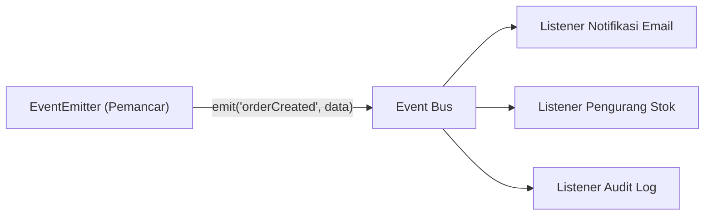

# Events

> Ringkasan
> - Tingkat: Fondasi
> - Fungsi: Mengimplementasikan pola arsitektur berbasis event (_Event-Driven Architecture_) menggunakan class bawaan `EventEmitter`.
> - Digunakan saat: Mengirim sinyal komunikasi antar bagian sistem, memantau perubahan status transaksi, dan membangun arsitektur pub-sub di dalam satu proses.
> - Aturan praktis: Selalu daftarkan listener untuk event `'error'` agar proses Node.js tidak mengalami crash; hapus listener yang tidak lagi terpakai untuk mencegah kebocoran memori.

## Cheat Sheet

| Tugas | Kode |
| :--- | :--- |
| Mendaftarkan listener permanen | `emitter.on("update", (val) => {});` |
| Mendaftarkan listener satu kali panggil | `emitter.once("ready", () => {});` |
| Memancarkan sinyal event beserta data | `emitter.emit("update", payload);` |
| Melepaskan satu listener tertentu | `emitter.off("update", handler);` |
| Menghapus seluruh listener event | `emitter.removeAllListeners("update");` |
| Menghitung jumlah listener aktif | `emitter.listenerCount("update");` |
| Mengatur ambang peringatan listener | `emitter.setMaxListeners(20);` |
| Menunggu event sekali via Promise | `await once(emitter, "ready");` |

## Tujuan Belajar

- Memahami cara kerja pola penerbit-pelanggan (_publisher-subscriber_) memakai `EventEmitter`.
- Mendaftarkan dan memancarkan data event memakai metode `on()`, `once()`, dan `emit()`.
- Mengelola siklus hidup listener dan mencegah memory leak dengan `off()` serta `removeAllListeners()`.
- Menangani event khusus `'error'` agar aplikasi server tetap stabil saat menghadapi kegagalan.

## Konsep

Bayangkan sebuah menara pengawas radio atau stasiun penyiaran. Stasiun radio memancarkan siaran ke udara (`emitter.emit`). Siapa pun yang menyalakan radionya dan menyetel frekuensi stasiun tersebut (`emitter.on`) akan langsung mendengar beritanya secara serentak. Stasiun pemancar tidak perlu tahu siapa saja pendengarnya dan berapa banyak radio yang menyala. Di Node.js, `EventEmitter` memungkinkan komponen aplikasi saling berkomunikasi tanpa harus saling terikat kaku (_decoupled_).



## Referensi

| Item | Fungsi | Catatan |
| :--- | :--- | :--- |
| `emitter.on(event, listener)` | Mendaftarkan listener yang berjalan setiap event dipancarkan | Listener dieksekusi secara sinkron berurutan |
| `emitter.once(event, listener)` | Mendaftarkan listener yang otomatis dilepas setelah satu kali dipicu | Mencegah penanganan ganda pada inisialisasi |
| `emitter.emit(event, ...args)` | Memancarkan sinyal event dan memicu semua listener terkait | Mengembalikan boolean `true` bila ada listener |
| `emitter.off(event, listener)` | Menghapus satu fungsi listener spesifik dari daftar antrean | Membutuhkan referensi fungsi yang sama persis |
| `emitter.removeAllListeners([event])` | Menghapus seluruh listener terdaftar pada suatu event | Berguna saat membersihkan objek saat teardown |
| `emitter.listenerCount(event)` | Menghitung banyaknya fungsi listener yang sedang aktif | Membantu diagnosa dan monitoring aplikasi |
| `emitter.setMaxListeners(n)` | Mengatur batas ambang peringatan kebocoran memori | Default: 10 listener per event |
| `events.once(emitter, event)` | Menunggu pemancaran event dalam bentuk Promise | Berguna pada perulangan alur asinkron |

### `emitter.on(event, listener)`

`emitter.on()` mendaftarkan fungsi listener ke urutan paling belakang dari daftar penangan event tertentu.

Struktur parameter: `emitter.on(event, listener)`
- `event` (string atau symbol, wajib): nama event yang dipantau.
- `listener` (function, wajib): fungsi yang akan dijalankan ketika event terpancar.

Nilai kembalian: instance `EventEmitter` sehingga mendukung pemanggilan berantai (_chaining_).

```javascript
import { EventEmitter } from "node:events";

const emitter = new EventEmitter();
let counter = 0;

emitter.on("tick", () => counter++);
emitter.emit("tick");
emitter.emit("tick");

console.log(counter);
// Output: 2
```

Kondisi khusus: Seluruh fungsi listener dipanggil secara sinkron sesuai urutan pendaftaran; listener lambat akan menahan eksekusi listener berikutnya.

### `emitter.once(event, listener)`

`emitter.once()` mendaftarkan fungsi listener satu kali pakai. Listener otomatis dihapus begitu event dipancarkan untuk pertama kali.

Struktur parameter: `emitter.once(event, listener)`
- `event` (string, wajib): nama event yang dipantau.
- `listener` (function, wajib): fungsi penangan satu kali pakai.

Nilai kembalian: instance `EventEmitter`.

```javascript
import { EventEmitter } from "node:events";

const emitter = new EventEmitter();
let calls = 0;

emitter.once("init", () => calls++);
emitter.emit("init");
emitter.emit("init");

console.log(calls);
// Output: 1
```

Kondisi khusus: Jika event tidak pernah dipancarkan, listener akan tetap berada di memori.

### `emitter.emit(event, ...args)`

`emitter.emit()` memancarkan event ke seluruh listener terdaftar dengan meneruskan argumen opsional yang diberikan.

Struktur parameter: `emitter.emit(event, ...args)`
- `event` (string, wajib): nama event yang ingin dipancarkan.
- `args` (any, opsional): parameter tambahan yang akan diteruskan ke fungsi listener.

Nilai kembalian: boolean `true` jika event memiliki minimal satu listener, atau `false` jika kosong (`boolean`).

```javascript
import { EventEmitter } from "node:events";

const emitter = new EventEmitter();
emitter.on("greet", (name) => console.log(`Halo ${name}`));

const hasListeners = emitter.emit("greet", "Budi");
// Output: Halo Budi
console.log(hasListeners);
// Output: true
```

Kondisi khusus: Jika nama event yang dipancarkan adalah `'error'` dan tidak ada satu pun listener yang menanganinya, Node.js otomatis melempar uncaught exception dan menghentikan proses.

### `emitter.off(event, listener)`

`emitter.off()` (alias dari `removeListener`) menghapus fungsi listener tertentu dari daftar penangan event.

Struktur parameter: `emitter.off(event, listener)`
- `event` (string, wajib): nama event yang ingin dilepaskan.
- `listener` (function, wajib): referensi fungsi yang didaftarkan sebelumnya.

Nilai kembalian: instance `EventEmitter`.

```javascript
import { EventEmitter } from "node:events";

const emitter = new EventEmitter();
const onData = () => console.log("Data masuk");

emitter.on("data", onData);
emitter.off("data", onData);

console.log(emitter.emit("data"));
// Output: false
```

Kondisi khusus: Melepas listener anonim (seperti `() => {}`) tidak akan berpengaruh karena referensi objek fungsinya berbeda di memori.

### `emitter.removeAllListeners([event])`

`emitter.removeAllListeners()` membersihkan seluruh listener yang terdaftar, baik pada event tertentu maupun seluruh event pada instance tersebut.

Struktur parameter: `emitter.removeAllListeners(event)`
- `event` (string, opsional): nama event spesifik yang ingin dibersihkan. Jika dikosongkan, seluruh event akan dihapus.

Nilai kembalian: instance `EventEmitter`.

```javascript
import { EventEmitter } from "node:events";

const emitter = new EventEmitter();
emitter.on("ping", () => {});
emitter.on("pong", () => {});

emitter.removeAllListeners("ping");
console.log(emitter.listenerCount("ping"));
// Output: 0
console.log(emitter.listenerCount("pong"));
// Output: 1
```

Kondisi khusus: Memanggil fungsi ini tanpa argumen akan menghapus seluruh listener termasuk listener internal yang mungkin dipasang modul lain.

### `events.once(emitter, event)`

Fungsi pembantu `once()` dari modul `node:events` mengembalikan sebuah Promise yang akan resolve saat emitter memancarkan event target.

Struktur parameter: `once(emitter, event)`
- `emitter` (EventEmitter, wajib): instance pemancar event.
- `event` (string, wajib): nama event yang ditunggu.

Nilai kembalian: `Promise<any[]>`. Mengembalikan array berisi seluruh argumen yang diteruskan saat event terpancar.

```javascript
import { EventEmitter, once } from "node:events";

const emitter = new EventEmitter();

setTimeout(() => emitter.emit("connected", "SERVER_OK"), 10);

const [status] = await once(emitter, "connected");
console.log(status);
// Output: SERVER_OK
```

Kondisi khusus: Jika emitter memancarkan event `'error'` saat Promise masih menunggu, Promise otomatis akan berstatus reject.

## Kesalahan Umum

### Memancarkan Event `'error'` Tanpa Menyiapkan Listener

Jika event `'error'` dipancarkan pada instance yang tidak memiliki listener penangan, Node.js langsung melempar uncaught error yang mematikan server.

```javascript
// Salah
const emitter = new EventEmitter();
emitter.emit("error", new Error("Koneksi database putus")); // Aplikasi crash

// Benar
const emitter = new EventEmitter();
emitter.on("error", (err) => {
  console.error("Tertangkap aman:", err.message);
});
emitter.emit("error", new Error("Koneksi database putus"));
```

### Mengira Bahwa `emit()` Berjalan Asinkron

Eksekusi listener pada `EventEmitter` berjalan sinkron satu per satu. Listener yang menjalankan komputasi berat akan menahan eksekusi kode setelah `emit()`.

```javascript
// Salah asumsi: mengira listener berjalan di latar belakang
const emitter = new EventEmitter();
emitter.on("task", () => {
  // Komputasi berat sinkron di sini akan memblokir alur utama
});
emitter.emit("task");
console.log("Selesai"); // Menunggu sampai fungsi di listener tuntas sepenuhnya
```

## Studi Kasus

Membangun pipa alur pesanan (_order processing pipeline_) yang mengoordinasikan status pesanan, pembayaran, dan pencatatan error antar komponen secara mandiri menggunakan `EventEmitter`.

```javascript
import { EventEmitter } from "node:events";

class OrderPipeline extends EventEmitter {
  processOrder(orderId, amount) {
    if (amount <= 0) {
      this.emit("error", new RangeError("Nominal pembayaran tidak valid"));
      return;
    }

    this.emit("orderCreated", { orderId, amount });
    this.emit("paymentReceived", { orderId, status: "PAID" });
  }
}

const pipeline = new OrderPipeline();

pipeline.on("orderCreated", (order) => {
  console.log(`Dibuat: ${order.orderId}`);
});

pipeline.on("paymentReceived", (order) => {
  console.log(`Status: ${order.status}`);
});

pipeline.on("error", (err) => {
  console.log(`Error: ${err.message}`);
});

pipeline.processOrder("ORD-1", 50000);
// Output:
// Dibuat: ORD-1
// Status: PAID

pipeline.processOrder("ORD-2", -10);
// Output:
// Error: Nominal pembayaran tidak valid
```

Pola arsitektur berbasis event ini memisahkan logika validasi bisnis dari modul notifikasi dan modul akuntansi, sehingga penambahan fitur baru di masa depan cukup dengan menambahkan listener baru tanpa mengubah kode utama pemrosesan order.

## Latihan Mandiri

Buat class `JobQueue` yang mewarisi `EventEmitter` untuk mengelola antrean pemrosesan tugas latar belakang.

- **Level 1 (Dasar):** Buat class `JobQueue` turunan `EventEmitter`. Sediakan metode `addJob(jobId, payload)` yang memancarkan event `"jobAdded"` dengan data `{ jobId, payload }`.
- **Level 2 (Menengah):** Sediakan metode `completeJob(jobId)` yang memancarkan event `"jobCompleted"` membawa nilai `jobId`. Pastikan notifikasi tugas selesai bisa ditangkap oleh consumer aplikasi.
- **Level 3 (Menantang):** Validasi parameter `jobId`. Jika `jobId` bukan string atau berupa string kosong, pancarkan event `"error"` yang membawa `new TypeError("ID pekerjaan tidak valid")`. Daftarkan listener error default agar proses aplikasi tidak berhenti mendadak saat terjadi error.

Contoh input dan output normal:

```javascript
const queue = new JobQueue();
queue.on("jobAdded", (job) => console.log("Job masuk:", job.jobId));
queue.on("jobCompleted", (jobId) => console.log("Job tuntas:", jobId));

queue.addJob("JOB-101", { task: "compress" });
queue.completeJob("JOB-101");
// Output:
// Job masuk: JOB-101
// Job tuntas: JOB-101
```

Contoh input dan penanganan error:

```javascript
const errorQueue = new JobQueue();
errorQueue.on("error", (err) => console.log("Tertangkap:", err.message));

errorQueue.addJob("", {});
// Output: Tertangkap: ID pekerjaan tidak valid
```

Tanda selesai:
- [ ] Class `JobQueue` mewarisi `EventEmitter` dan memancarkan event sesuai alur.
- [ ] Metode `completeJob` memicu notifikasi sukses penyelesaian tugas.
- [ ] ID pekerjaan yang tidak valid memancarkan event `"error"` tanpa mematikan proses runtime.

---

## Navigasi

[Sebelumnya: File System](../05-file-system/README.md) | [Selanjutnya: Buffer](../07-buffer/README.md) | [Daftar Isi](../README.md)
