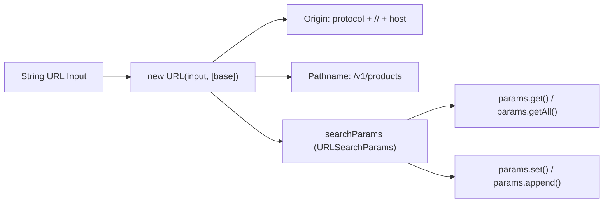

# URL

> Ringkasan
>
> - Fungsi: Membaca, memvalidasi, merakit, dan memanipulasi alamat web (URL) serta parameter kueri sesuai standar resmi WHATWG URL API.
> - Digunakan saat: Mengambil parameter pencarian di URL, menyambungkan endpoint API ke URL dasar, mencegah celah pengalihan berbahaya (_open redirect_), dan mengonversi format tautan berkas lokal.
> - Aturan praktis: Hindari fungsi lama `url.parse()` karena memiliki celah keamanan pemalsuan permintaan (SSRF); selalu gunakan kelas modern `URL` dan `URLSearchParams` yang langsung tersedia secara global.

---

## Tujuan Belajar

- Mengenal bagian-bagian penyusun URL standar WHATWG (`origin`, `protocol`, `host`, `pathname`, `search`).
- Mengatur parameter pencarian URL menggunakan metode praktis pada `URLSearchParams`.
- Memahami perbedaan saat memakai `.set()` versus `.append()` serta `.get()` versus `.getAll()`.
- Mengubah format URL berkas (`file://`) menjadi jalur sistem berkas lokal via `fileURLToPath` dan sebaliknya via `pathToFileURL`.
- Menerapkan pengalihan URL yang aman untuk menangkal celah manipulasi pengalihan (_Open Redirect_).

---

## Konsep

> Alamat URL bisa diibaratkan seperti alamat lengkap pada label pengiriman paket: `https://api.toko.com:8080/v1/produk?kategori=elektronik#stok`. Protokol (`https:`) adalah jenis armada kurir resmi yang digunakan. Nama host (`api.toko.com`) dan port (`:8080`) adalah alamat gedung pergudangan beserta nomor pintu masuknya. Jalur rute (`/v1/produk`) adalah lorong spesifik tempat barang diletakkan. Parameter kueri (`?kategori=elektronik`) adalah lembar catatan instruksi barang yang diminta. Tanda pagar (`#stok`) adalah pembatas catatan kecil bagi pembaca dokumen.



---

## Referensi

| Item                                   | Fungsi                                                         | Catatan                                                                     |
| :------------------------------------- | :------------------------------------------------------------- | :-------------------------------------------------------------------------- |
| **`new URL(input, [base])`**           | Membedah string alamat web menjadi objek URL standar WHATWG    | Melempar `TypeError` jika format URL salah atau titik basis tidak ada       |
| **`url.origin`**                       | Mengambil gabungan protokol, domain, dan nomor port            | Bersifat hanya-baca, sangat penting untuk memeriksa asal domain aman        |
| **`url.pathname`**                     | Mengambil jalur rute berkas yang selalu diawali garis miring   | Otomatis bernilai `'/'` jika tidak ada rute yang dituliskan                 |
| **`url.searchParams`**                 | Mengakses perkakas manipulasi parameter kueri secara dinamis   | Terhubung otomatis secara langsung dengan nilai `url.search` dan `url.href` |
| **`searchParams.get(name)`**           | Mengambil nilai pertama yang cocok dari nama parameter kueri   | Mengembalikan string nilai atau `null` jika parameter tidak ada             |
| **`searchParams.getAll(name)`**        | Mengambil seluruh nilai dari parameter yang namanya sama       | Mengembalikan array string untuk menangani filter multi-pilihan             |
| **`searchParams.set(name, value)`**    | Menetapkan nilai baru dan menghapus nilai duplikat sebelumnya  | Bersifat menimpa, cocok untuk memperbarui filter tunggal                    |
| **`searchParams.append(name, value)`** | Menambahkan nilai baru ke parameter tanpa menghapus nilai lama | Mempertahankan nilai lama untuk mendukung parameter berulang                |
| **`fileURLToPath(url)`**               | Mengubah format URL `file://` menjadi alamat folder lokal      | Menyesuaikan tanda pemisah sistem operasi secara otomatis                   |
| **`pathToFileURL(path)`**              | Mengubah alamat folder lokal absolut menjadi format `file://`  | Mengubah karakter spasi dan simbol khusus ke persen-encoding                |

### `new URL(input, [base])`

Konstruktor `new URL()` membedah string alamat web menjadi objek URL standar. Jika kamu memasukkan URL relatif, kamu wajib memberikan argumen kedua `base` sebagai patokan awal alamat.

```javascript
const targetUrl = new URL("/v1/users", "https://api.example.com");
console.log(targetUrl.href);
// Output: https://api.example.com/v1/users
```

Kasus lain: Melempar `TypeError` berkode `ERR_INVALID_URL` jika format teks yang dimasukkan bukan URL yang sah atau lupa mencantumkan alamat basisnya.

```javascript
try {
  new URL("path-without-base");
} catch (error) {
  console.log(error.code);
  // Output: ERR_INVALID_URL
}
```

### `url.origin`

Properti `url.origin` mengembalikan gabungan dari protokol, nama domain, dan port. Properti ini bersifat baca-saja dan sering digunakan untuk mengecek apakah domain pengirim permintaan aman sebelum diproses.

```javascript
const targetUrl = new URL("https://example.com:8080/catalog?page=1");
console.log(targetUrl.origin);
// Output: https://example.com:8080
```

Kasus lain: URL dengan skema khusus seperti `file:` atau `blob:` akan menghasilkan origin berupa teks `'null'`.

```javascript
const fileUrl = new URL("file:///app/index.js");
console.log(fileUrl.origin);
// Output: null
```

### `url.pathname`

Properti `url.pathname` menyimpan jalur folder atau rute endpoint pada URL. Properti ini dijamin selalu diawali garis miring `/`, meskipun kamu tidak menuliskan slash di akhir domain.

```javascript
const domainUrl = new URL("https://example.com");
console.log(domainUrl.pathname);
// Output: /
```

Kasus lain: Mengubah properti `pathname` akan langsung memperbarui alamat lengkap pada `url.href` secara otomatis.

```javascript
const targetUrl = new URL("https://example.com/start");
targetUrl.pathname = "/end";
console.log(targetUrl.href);
// Output: https://example.com/end
```

### `url.searchParams`

Properti `url.searchParams` mengembalikan objek pembantu `URLSearchParams` yang terhubung langsung dengan parameter kueri pada URL induknya.

```javascript
const targetUrl = new URL("https://api.example.com?sort=latest");
console.log(targetUrl.searchParams.get("sort"));
// Output: latest
```

Kasus lain: Menghapus semua parameter dari `searchParams` otomatis membersihkan tanda tanya `?` pada properti `search`.

```javascript
const targetUrl = new URL("https://api.example.com?sort=latest");
targetUrl.searchParams.delete("sort");
console.log(targetUrl.search === "");
// Output: true
```

### `searchParams.get(name)`

Metode `searchParams.get()` membaca nilai pertama yang cocok untuk parameter tertentu. Jika parameternya tidak ada di URL, metode ini mengembalikan `null`.

```javascript
const searchParams = new URLSearchParams("category=books&page=2");
console.log(searchParams.get("category"));
// Output: books
console.log(searchParams.get("price"));
// Output: null
```

Kasus lain: Mengambil parameter yang hanya berupa nama tanpa tanda sama dengan akan menghasilkan string kosong, bukan `null`.

```javascript
const searchParams = new URLSearchParams("active");
console.log(searchParams.get("active") === "");
// Output: true
```

### `searchParams.getAll(name)`

Metode `searchParams.getAll()` mengumpulkan seluruh nilai yang memiliki nama parameter sama ke dalam bentuk array string.

```javascript
const searchParams = new URLSearchParams("color=red&color=blue&color=green");
const colors = searchParams.getAll("color");

console.log(colors);
// Output: [ 'red', 'blue', 'green' ]
```

Kasus lain: Jika parameter yang dicari tidak ada, metode ini mengembalikan array kosong `[]` tanpa menimbulkan error.

```javascript
const searchParams = new URLSearchParams("color=red");
console.log(searchParams.getAll("size"));
// Output: []
```

### `searchParams.set(name, value)`

Metode `searchParams.set()` menetapkan nilai baru untuk suatu parameter. Jika parameter tersebut sebelumnya punya nilai ganda, metode ini akan membersihkan duplikatnya dan menyisakan satu nilai baru.

```javascript
const searchParams = new URLSearchParams("tag=js&tag=node");
searchParams.set("tag", "express");

console.log(searchParams.toString());
// Output: tag=express
```

Kasus lain: Menetapkan nilai yang berisi spasi atau simbol khusus otomatis diubah ke format encode URL yang sah.

```javascript
const searchParams = new URLSearchParams();
searchParams.set("query", "coffee & milk");
console.log(searchParams.toString());
// Output: query=coffee+%26+milk
```

### `searchParams.append(name, value)`

Metode `searchParams.append()` menambahkan nilai baru ke parameter kueri tanpa menghapus nilai-nilai lama yang sudah ada.

```javascript
const searchParams = new URLSearchParams("category=food");
searchParams.append("category", "beverages");

console.log(searchParams.toString());
// Output: category=food&category=beverages
```

Kasus lain: Menambahkan parameter berulang kali akan selalu mempertahankan urutan pemanggilannya.

```javascript
const searchParams = new URLSearchParams();
searchParams.append("number", "1");
searchParams.append("number", "2");
console.log(searchParams.getAll("number").join("-"));
// Output: 1-2
```

### `fileURLToPath(url)`

Fungsi `fileURLToPath()` dari `node:url` mengubah tautan berformat `file://` menjadi alamat folder lokal yang sesuai dengan sistem operasi komputer kamu.

```javascript
import { fileURLToPath } from "node:url";

const filePath = fileURLToPath("file:///var/log/audit.log");
console.log(filePath);
// Output: /var/log/audit.log
```

Kasus lain: Melempar `TypeError` berkode `ERR_INVALID_URL_SCHEME` jika URL yang dimasukkan bukan berprotokol `file:`.

```javascript
import { fileURLToPath } from "node:url";

try {
  fileURLToPath("https://example.com/app.js");
} catch (error) {
  console.log(error.code);
  // Output: ERR_INVALID_URL_SCHEME
}
```

### `pathToFileURL(path)`

Fungsi `pathToFileURL()` dari `node:url` mengubah alamat folder lokal absolut menjadi objek URL berformat `file://`.

```javascript
import { pathToFileURL } from "node:url";

const fileUrl = pathToFileURL("/var/log/audit.log");
console.log(fileUrl.href);
// Output: file:///var/log/audit.log
```

Kasus lain: Spasi atau simbol pada nama file otomatis diubah menjadi karakter persen-encoding agar aman dibaca browser.

```javascript
import { pathToFileURL } from "node:url";

const spacedUrl = pathToFileURL("/data/financial report.pdf");
console.log(spacedUrl.href.includes("financial%20report.pdf"));
// Output: true
```

### Perbandingan: Manipulasi Nilai Kueri

| Karakteristik             | `searchParams.set()`                         | `searchParams.append()`                              |
| :------------------------ | :------------------------------------------- | :--------------------------------------------------- |
| **Sifat Tindakan**        | Menimpa (Hanya menyisakan satu nilai)        | Menambah di bagian belakang                          |
| **Dampak Nilai Duplikat** | Menghapus seluruh duplikat lama              | Mempertahankan seluruh nilai sebelumnya              |
| **Contoh Penggunaan**     | Mengubah halaman pagination (misal `page=2`) | Menambah filter kategori ganda (misal `tag=a&tag=b`) |

---

## Kesalahan Umum

### Menggunakan URL Relatif pada `new URL()` Tanpa Alamat Basis

Membuat objek `new URL()` memakai jalur relatif tanpa menyertakan argumen basis kedua akan langsung memicu error runtime `ERR_INVALID_URL`.

```javascript
// Salah
const targetUrl = new URL("/api/users");
```

```javascript
// Benar
const targetUrl = new URL("/api/users", "https://api.example.com");
```

### Terjebak Pemotongan Jalur Akibat Garis Miring Pembuka (_Slash Truncation_)

Jika endpoint diawali tanda slash `/`, Node.js akan menganggapnya sebagai rute dari domain root dan membuang segmen sub-folder yang ada di base URL.

```javascript
// Salah
const baseUrl = "https://api.example.com/v1/auth";
const targetUrl = new URL("/login", baseUrl);
console.log(targetUrl.href);
// Hasilnya: "https://api.example.com/login" (segmen /v1/auth hilang!)
```

```javascript
// Benar
const baseUrl = "https://api.example.com/v1/auth/";
const targetUrl = new URL("login", baseUrl);
console.log(targetUrl.href);
// Hasilnya: "https://api.example.com/v1/auth/login"
```

### Menggunakan Modul Usang `url.parse()` yang Memiliki Celah Keamanan

Fungsi lama `url.parse()` memiliki kelemahan saat membedah karakter khusus di nama domain, yang bisa dimanipulasi peretas untuk membobol proteksi URL internal server.

```javascript
// Salah
import url from "node:url";
const parsed = url.parse("https://example.com/path");
```

```javascript
// Benar
const parsed = new URL("https://example.com/path");
```

---

## Studi Kasus

Skenario: Membangun pembuat permintaan API aman (_secure API client builder_) yang menyambungkan endpoint ke URL basis tanpa memotong jalur folder, mendukung parameter tunggal maupun array, mengurutkan parameter secara rapi, serta mencegah bahaya celah pengalihan luar (_Open Redirect_).

```javascript
class ApiRequestBuilder {
  constructor(trustedBaseUrl) {
    this.baseUrl = new URL(trustedBaseUrl);
  }

  buildUrl(endpoint, parameters = {}) {
    const cleanBase = this.baseUrl.href.endsWith("/")
      ? this.baseUrl.href
      : `${this.baseUrl.href}/`;
    const cleanEndpoint = endpoint.startsWith("/")
      ? endpoint.slice(1)
      : endpoint;

    const targetUrl = new URL(cleanEndpoint, cleanBase);

    for (const [key, value] of Object.entries(parameters)) {
      if (Array.isArray(value)) {
        for (const item of value) {
          targetUrl.searchParams.append(key, String(item));
        }
      } else if (value !== undefined && value !== null) {
        targetUrl.searchParams.set(key, String(value));
      }
    }

    targetUrl.searchParams.sort();
    return targetUrl;
  }

  validateSafeRedirect(userRedirectUrl) {
    try {
      const target = new URL(userRedirectUrl, this.baseUrl.origin);
      if (target.origin !== this.baseUrl.origin) {
        return { isSafe: false, redirectPath: "/dashboard" };
      }
      return { isSafe: true, redirectPath: target.pathname + target.search };
    } catch {
      return { isSafe: false, redirectPath: "/dashboard" };
    }
  }
}

const builder = new ApiRequestBuilder("https://api.example.com/v1");

const requestUrl = builder.buildUrl("users", {
  role: "admin",
  tags: ["nodejs", "security"],
});
console.log(requestUrl.pathname);
// Output: /v1/users
console.log(requestUrl.search);
// Output: ?role=admin&tags=nodejs&tags=security

const safeCheck = builder.validateSafeRedirect("/profile?tab=security");
console.log(safeCheck.isSafe);
// Output: true
console.log(safeCheck.redirectPath);
// Output: /profile?tab=security

const phishingCheck = builder.validateSafeRedirect(
  "https://malicious-site.com/login",
);
console.log(phishingCheck.isSafe);
// Output: false
console.log(phishingCheck.redirectPath);
// Output: /dashboard
```

Desain ini memanfaatkan kelas bawaan `URL` dan `URLSearchParams` dengan penanganan tanda garis miring defensif serta verifikasi pencocokan properti `origin` untuk memastikan keamanan rute aplikasi.

---

## Latihan Mandiri

### Soal 1 (Dasar)

Buat fungsi `parseDomainComponents(rawUrl)` yang menerima string URL lengkap dan mengembalikan objek ringkas berisi nama domain (`hostname`), nomor port (`port`), dan skema protokol (`protocol`). Jika nomor port tidak dituliskan secara eksplisit di URL, tentukan port bawaan (angka `80` untuk `'http:'`, dan angka `443` untuk `'https:'`).

Contoh input 1:

```javascript
parseDomainComponents("https://api.example.com:8443/v1");
```

Contoh output 1:

```javascript
{
  hostname: 'api.example.com',
  port: 8443,
  protocol: 'https:'
}
```

Contoh input 2:

```javascript
parseDomainComponents("https://example.com/home");
```

Contoh output 2:

```javascript
{
  hostname: 'example.com',
  port: 443,
  protocol: 'https:'
}
```

Batasan: Gunakan kelas `new URL()` bawaan. Nilai `port` pada objek output wajib bertipe data angka (`number`).

### Soal 2 (Menengah)

Buat fungsi `extractSearchParams(rawUrl)` yang menerima string URL lengkap dan mengekstrak parameter kuerinya ke dalam bentuk objek biasa. Jika suatu parameter muncul lebih dari satu kali, simpan seluruh nilainya dalam bentuk array string; jika hanya muncul satu kali, simpan sebagai string tunggal.

Contoh input:

```javascript
extractSearchParams(
  "https://shop.example.com/products?category=electronics&color=red&color=black&page=1",
);
```

Contoh output yang diharapkan:

```javascript
{
  category: 'electronics',
  color: ['red', 'black'],
  page: '1'
}
```

Batasan: Wajib memanfaatkan properti `url.searchParams`, metode `.getAll()`, dan iterasi bawaan `URLSearchParams` tanpa library eksternal.

### Soal 3 (Menantang)

Buat fungsi pembangun dan pemvalidasi URL webhook `buildWebhookUrl(baseUrl, route, queryParams, allowedDomains)` dengan aturan keamanan berikut:

1. Gabungkan `baseUrl` dan `route` secara aman tanpa memicu masalah pemotongan jalur (_slash truncation_), lalu hasilkan instance `URL`.
2. Validasi apakah `resultUrl.hostname` terdaftar di dalam array `allowedDomains`. Jika domain tidak terdaftar atau protokol bukan `'https:'`, kembalikan `{ success: false, reason: 'Domain or protocol not allowed' }`.
3. Tambahkan seluruh `queryParams` ke dalam `searchParams`. Jika nilainya berupa array, gunakan `.append()`. Jika berupa nilai tunggal, gunakan `.set()`. Abaikan nilai yang bernilai `null` atau `undefined`.
4. Urutkan seluruh parameter secara alfabetis menggunakan `searchParams.sort()`.
5. Hitung total panjang string URL akhir (`href.length`). Jika panjang URL melebihi batas 2048 karakter, batalkan dan kembalikan `{ success: false, reason: 'URL length exceeds maximum limit of 2048 characters' }`.
6. Jika semua syarat terpenuhi, kembalikan objek `{ success: true, fullUrl: string, paramCount: number }`.

Contoh input 1 (Sukses):

```javascript
buildWebhookUrl(
  "https://webhook.partner.com/api/v2",
  "transactions",
  { status: "success", tags: ["payment", "auto"] },
  ["webhook.partner.com"],
);
```

Contoh output 1:

```javascript
{
  success: true,
  fullUrl: 'https://webhook.partner.com/api/v2/transactions?status=success&tags=payment&tags=auto',
  paramCount: 3
}
```

Contoh input 2 (Domain Ditolak):

```javascript
buildWebhookUrl("https://webhook.attacker.com", "data", {}, [
  "webhook.partner.com",
]);
```

Contoh output 2:

```javascript
{
  success: false,
  reason: 'Domain or protocol not allowed'
}
```

Contoh input 3 (Protokol Tidak Aman HTTP):

```javascript
buildWebhookUrl("http://webhook.partner.com", "data", {}, [
  "webhook.partner.com",
]);
```

Contoh output 3:

```javascript
{
  success: false,
  reason: 'Domain or protocol not allowed'
}
```

Batasan: Wajib menggunakan `new URL()` dan `URLSearchParams`. Dilarang menggunakan library eksternal.

---

## Navigasi

[Sebelumnya: Path](../05-path/README.md) | [Selanjutnya: File System](../07-file-system/README.md) | [Daftar Isi](../README.md)
