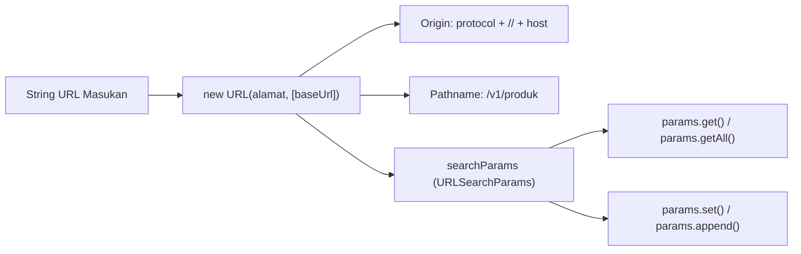

# URL

> Ringkasan
>
> - Fungsi: Mengurai, memvalidasi, menyusun, dan memanipulasi alamat web (URL) serta parameter kueri sesuai standar internasional WHATWG URL API.
> - Digunakan saat: Membaca parameter pencarian, menggabungkan endpoint API dengan basis URL, mencegah celah pengalihan berbahaya (_open redirect_), dan mengonversi format tautan berkas sistem.
> - Aturan praktis: Hindari penggunaan fungsi usang `url.parse()` karena memiliki kerentanan manipulasi keamanan (SSRF); gunakan kelas bawaan `URL` dan `URLSearchParams` yang tersedia secara global.

---

## Tujuan Belajar

- Mengidentifikasi komponen penyusun URL standar WHATWG (`origin`, `protocol`, `host`, `pathname`, `search`).
- Memanipulasi parameter string kueri menggunakan metode pada antarmuka `URLSearchParams`.
- Membedakan dampak penggunaan metode `.set()` versus `.append()` serta `.get()` versus `.getAll()`.
- Mengonversi format URL berkas (`file://`) ke jalur sistem berkas fisik menggunakan `fileURLToPath` dan sebaliknya dengan `pathToFileURL`.
- Mengimplementasikan pola pengalihan aman untuk mencegah eksploitasi kerentanan _Open Redirect_.

---

## Konsep

> Alamat URL dapat dianalogikan sebagai label pengiriman paket ekspres internasional: `https://api.toko.com:8080/v1/produk?kategori=elektronik#stok`. Komponen protokol (`https:`) adalah jenis armada kurir berizin resmi. Komponen nama host (`api.toko.com`) dan port (`:8080`) adalah alamat gedung pergudangan beserta nomor gerbang masuknya. Komponen jalur rute (`/v1/produk`) adalah nomor lorong rak tempat barang diletakkan. Komponen parameter kueri (`?kategori=elektronik`) adalah lembar spesifikasi instruksi pemilahan barang yang diminta. Fragmen pagar (`#stok`) adalah penanda tab catatan pada dokumen kerja kurir.



---

## Referensi

| Item                                 | Fungsi                                                                        | Catatan                                                               |
| :----------------------------------- | :---------------------------------------------------------------------------- | :-------------------------------------------------------------------- |
| **`new URL(input, [base])`**         | Mengurai string alamat web menjadi instance objek URL standar WHATWG          | Melempar `TypeError` jika format URL tidak valid atau basis hilang    |
| **`url.origin`**                     | Mengembalikan gabungan skema protokol, domain, dan nomor port                 | Bersifat hanya-baca, sangat krusial untuk validasi CORS dan keamanan  |
| **`url.pathname`**                   | Mengembalikan hierarki jalur rute berkas yang selalu diawali tanda slash      | Otomatis bernilai `'/'` jika tidak ada rute yang didefinisikan        |
| **`url.searchParams`**               | Mengakses instance utilitas untuk manipulasi kueri URL secara dinamis         | Terhubung secara reaktif dengan nilai `url.search` dan `url.href`     |
| **`searchParams.get(name)`**         | Mengambil nilai pertama yang cocok dengan nama parameter kueri                | Mengembalikan string nilai atau `null` jika parameter tidak ditemukan |
| **`searchParams.getAll(name)`**      | Mengambil seluruh nilai yang cocok dengan nama parameter kueri                | Mengembalikan larik string untuk menangani kueri multi-nilai          |
| **`searchParams.set(name, value)`**  | Menetapkan nilai baru dan menimpa seluruh entri nilai kunci sebelumnya        | Bersifat idempoten untuk memperbarui parameter tunggal                |
| **`searchParams.append(name, value)`**| Menambahkan pasangan kunci dan nilai baru ke dalam daftar kueri              | Mempertahankan nilai lama untuk mendukung parameter berulang          |
| **`fileURLToPath(url)`**             | Mengonversi URL format `file://` menjadi representasi jalur sistem berkas     | Menyesuaikan separator direktori sistem operasi aktif secara otomatis |
| **`pathToFileURL(path)`**            | Mengonversi jalur sistem berkas absolut menjadi URL format `file://`          | Mengodekan karakter spasi dan simbol khusus secara otomatis          |

### `new URL(input, [base])`

Konstruktor `new URL()` membedah string alamat web menjadi objek URL standar. Jika masukan berupa URL relatif, argumen kedua `base` wajib disertakan sebagai titik acuan resolusi.

```javascript
const tautan = new URL("/v1/pengguna", "https://api.contoh.com");
console.log(tautan.href);
// Output: https://api.contoh.com/v1/pengguna
```

Kasus lain: Melempar `TypeError` berkode `ERR_INVALID_URL` jika string masukan bukan merupakan format URL yang valid atau kekurangan basis.

```javascript
try {
  new URL("jalur-tanpa-basis");
} catch (error) {
  console.log(error.code);
  // Output: ERR_INVALID_URL
}
```

### `url.origin`

Properti `url.origin` mengembalikan kombinasi protokol, nama domain, dan port. Properti ini bersifat baca-saja dan sering digunakan untuk memverifikasi domain asal permintaan pada proteksi CORS atau pengalihan rute.

```javascript
const tautan = new URL("https://toko.com:8080/katalog?halaman=1");
console.log(tautan.origin);
// Output: https://toko.com:8080
```

Kasus lain: URL dengan protokol non-jaringan seperti `file:` atau `blob:` menghasilkan origin khusus atau string `'null'`.

```javascript
const berkasUrl = new URL("file:///app/index.js");
console.log(berkasUrl.origin);
// Output: null
```

### `url.pathname`

Properti `url.pathname` menyimpan jalur rute hierarki sumber daya. Properti ini selalu diawali garis miring pembuka `/`, bahkan jika URL masukan dibuat tanpa mencantumkan path spesifik.

```javascript
const urlDomain = new URL("https://contoh.com");
console.log(urlDomain.pathname);
// Output: /
```

Kasus lain: Mengubah nilai properti `pathname` akan memperbarui properti `href` secara otomatis seketika.

```javascript
const alamat = new URL("https://contoh.com/awal");
alamat.pathname = "/akhir";
console.log(alamat.href);
// Output: https://contoh.com/akhir
```

### `url.searchParams`

Properti `url.searchParams` mengembalikan objek instance `URLSearchParams` yang mengikat parameter kueri secara dua arah dengan URL induknya.

```javascript
const alamat = new URL("https://api.com?urutan=terbaru");
console.log(alamat.searchParams.get("urutan"));
// Output: terbaru
```

Kasus lain: Menghapus seluruh parameter dari `searchParams` otomatis membersihkan tanda tanya pada properti `search`.

```javascript
const alamat = new URL("https://api.com?urutan=terbaru");
alamat.searchParams.delete("urutan");
console.log(alamat.search);
// Output: 
```

### `searchParams.get(name)`

Metode `searchParams.get()` membaca nilai pertama yang terdaftar untuk parameter tertentu. Jika parameter tidak ditemukan pada kueri, metode ini mengembalikan `null`.

```javascript
const kueri = new URLSearchParams("kategori=buku&halaman=2");
console.log(kueri.get("kategori"));
// Output: buku
console.log(kueri.get("harga"));
// Output: null
```

Kasus lain: Mengambil parameter yang hanya memiliki nama tanpa tanda sama dengan menghasilkan string kosong, bukan `null`.

```javascript
const kueri = new URLSearchParams("aktif");
console.log(kueri.get("aktif"));
// Output: 
```

### `searchParams.getAll(name)`

Metode `searchParams.getAll()` mengumpulkan seluruh nilai yang memiliki nama parameter sama ke dalam bentuk larik string.

```javascript
const kueri = new URLSearchParams("warna=merah&warna=biru&warna=hijau");
const daftarWarna = kueri.getAll("warna");

console.log(daftarWarna);
// Output: [ 'merah', 'biru', 'hijau' ]
```

Kasus lain: Jika parameter yang diminta tidak ada, metode mengembalikan larik kosong tanpa galat.

```javascript
const kueri = new URLSearchParams("warna=merah");
console.log(kueri.getAll("ukuran"));
// Output: []
```

### `searchParams.set(name, value)`

Metode `searchParams.set()` menetapkan nilai baru untuk suatu parameter. Jika parameter tersebut sebelumnya memiliki beberapa nilai duplikat, metode ini akan menghapus seluruh duplikat dan menyisakan satu nilai baru.

```javascript
const kueri = new URLSearchParams("tag=js&tag=node");
kueri.set("tag", "express");

console.log(kueri.toString());
// Output: tag=express
```

Kasus lain: Menetapkan nilai yang memuat karakter khusus atau emoji otomatis disandikan ke format URL encoding.

```javascript
const kueri = new URLSearchParams();
kueri.set("cari", "kopi & susu");
console.log(kueri.toString());
// Output: cari=kopi+%26+susu
```

### `searchParams.append(name, value)`

Metode `searchParams.append()` menambahkan pasangan kunci dan nilai baru ke bagian akhir kueri tanpa menghapus nilai yang sudah ada sebelumnya.

```javascript
const kueri = new URLSearchParams("kategori=makanan");
kueri.append("kategori", "minuman");

console.log(kueri.toString());
// Output: kategori=makanan&kategori=minuman
```

Kasus lain: Menambahkan parameter berkali-kali mempertahankan urutan pendaftaran nilai sesuai waktu pemanggilan.

```javascript
const kueri = new URLSearchParams();
kueri.append("angka", "1");
kueri.append("angka", "2");
console.log(kueri.getAll("angka").join("-"));
// Output: 1-2
```

### `fileURLToPath(url)`

Fungsi `fileURLToPath()` mengonversi string atau instance URL berformat `file://` menjadi representasi jalur sistem berkas yang kompatibel dengan platform operasi aktif.

```javascript
import { fileURLToPath } from "node:url";

const jalur = fileURLToPath("file:///var/log/audit.log");
console.log(jalur);
// Output: /var/log/audit.log
```

Kasus lain: Melempar `TypeError` berkode `ERR_INVALID_URL_SCHEME` jika URL masukan tidak menggunakan protokol `file:`.

```javascript
import { fileURLToPath } from "node:url";

try {
  fileURLToPath("https://contoh.com/app.js");
} catch (error) {
  console.log(error.code);
  // Output: ERR_INVALID_URL_SCHEME
}
```

### `pathToFileURL(path)`

Fungsi `pathToFileURL()` mengonversi string jalur berkas absolut dari sistem operasi menjadi instance URL berformat `file://`.

```javascript
import { pathToFileURL } from "node:url";

const urlObjek = pathToFileURL("/var/log/audit.log");
console.log(urlObjek.href);
// Output: file:///var/log/audit.log
```

Kasus lain: Spasi dan karakter khusus pada nama berkas diubah secara otomatis menjadi bentuk persen-encoding.

```javascript
import { pathToFileURL } from "node:url";

const urlSpasi = pathToFileURL("/data/laporan keuangan.pdf");
console.log(urlSpasi.href.includes("laporan%20keuangan.pdf"));
// Output: true
```

### Perbandingan: Manipulasi Nilai Kueri

| Karakteristik | `searchParams.set()` | `searchParams.append()` |
| :--- | :--- | :--- |
| **Sifat Operasi** | Menimpa (Idempoten) | Menambah di akhir |
| **Dampak Nilai Duplikat** | Menghapus seluruh duplikat lama | Mempertahankan seluruh nilai sebelumnya |
| **Kasus Penggunaan Khas** | Memperbarui filter tunggal (misal `page=2`) | Menambah filter multi-pilihan (misal `tag=a&tag=b`) |

---

## Kesalahan Umum

### Menggunakan URL Relatif pada `new URL()` Tanpa Basis

Membuat objek `new URL()` dengan jalur relatif tanpa menyertakan argumen kedua memicu kegagalan fatal runtime `ERR_INVALID_URL`.

```javascript
// Salah
const tautan = new URL("/api/users");
```

```javascript
// Benar
const tautan = new URL("/api/users", "https://api.contoh.com");
```

### Terjebak Pemotongan Jalur Akibat Garis Miring Pembuka (*Slash Truncation*)

Jika endpoint relatif diawali garis miring `/`, resolusi URL akan memotong seluruh hierarki path pada base URL dan kembali langsung ke domain root.

```javascript
// Salah
const basis = "https://api.contoh.com/v1/auth";
const target = new URL("/masuk", basis);
console.log(target.href);
// Hasilnya: "https://api.contoh.com/masuk" (segmen /v1/auth hilang!)
```

```javascript
// Benar
const basis = "https://api.contoh.com/v1/auth/";
const target = new URL("masuk", basis);
console.log(target.href);
// Hasilnya: "https://api.contoh.com/v1/auth/masuk"
```

### Menggunakan Modul Usang `url.parse()` yang Rentan Celah SSRF

Fungsi lama `url.parse()` memiliki cacat perancangan penguraian karakter khusus hostname yang dapat dimanipulasi oleh penyerang untuk mengelabui filter firewall server.

```javascript
// Salah
import url from "node:url";
const terurai = url.parse("https://contoh.com/jalur");
```

```javascript
// Benar
const terurai = new URL("https://contoh.com/jalur");
```

---

## Studi Kasus

Skenario: Membangun pembangun permintaan API aman (_secure API client builder_) yang menyambungkan endpoint ke basis URL tanpa risiko pemotongan jalur, menangani parameter kueri skalar maupun larik, mengurutkan parameter kueri secara alfabetis untuk pembuatan tanda tangan HMAC, serta memvalidasi pengalihan agar kebal serangan _Open Redirect_.

```javascript
class ApiRequestBuilder {
  constructor(baseUrlTerpercaya) {
    this.baseUrl = new URL(baseUrlTerpercaya);
  }

  bangunUrl(endpoint, parameter = {}) {
    const basisBersih = this.baseUrl.href.endsWith("/")
      ? this.baseUrl.href
      : `${this.baseUrl.href}/`;
    const endpointBersih = endpoint.startsWith("/") ? endpoint.slice(1) : endpoint;

    const hasilUrl = new URL(endpointBersih, basisBersih);

    for (const [kunci, nilai] of Object.entries(parameter)) {
      if (Array.isArray(nilai)) {
        for (const item of nilai) {
          hasilUrl.searchParams.append(kunci, String(item));
        }
      } else if (nilai !== undefined && nilai !== null) {
        hasilUrl.searchParams.set(kunci, String(nilai));
      }
    }

    hasilUrl.searchParams.sort();
    return hasilUrl;
  }

  validasiRedirectAman(urlTujuanPengguna) {
    try {
      const target = new URL(urlTujuanPengguna, this.baseUrl.origin);
      if (target.origin !== this.baseUrl.origin) {
        return { aman: false, pengalihan: "/dashboard" };
      }
      return { aman: true, pengalihan: target.pathname + target.search };
    } catch {
      return { aman: false, pengalihan: "/dashboard" };
    }
  }
}

const builder = new ApiRequestBuilder("https://api.perusahaan.com/v1");

const urlPermintaan = builder.bangunUrl("pengguna", {
  peran: "admin",
  tag: ["nodejs", "security"],
});
console.log(urlPermintaan.pathname);
// Output: /v1/pengguna
console.log(urlPermintaan.search);
// Output: ?peran=admin&tag=nodejs&tag=security

const cekAman = builder.validasiRedirectAman("/profil?tab=keamanan");
console.log(cekAman.aman);
// Output: true
console.log(cekAman.pengalihan);
// Output: /profil?tab=keamanan

const cekPhishing = builder.validasiRedirectAman("https://situs-palsu.com/login");
console.log(cekPhishing.aman);
// Output: false
console.log(cekPhishing.pengalihan);
// Output: /dashboard
```

Desain ini memanfaatkan kelas bawaan `URL` dan `URLSearchParams` dengan normalisasi trailing slash defensif serta verifikasi pencocokan properti `origin` untuk memastikan integritas koneksi dan keamanan siber aplikasi.

---

## Latihan Mandiri

### Soal 1 (Dasar)

Buat fungsi `uraiKomponenDomain(urlTeks)` yang menerima string URL utuh dan mengembalikan objek ringkas berisi nama domain bersih (`hostname`), nomor port (`port`), dan skema protokol (`protocol`). Jika port tidak dicantumkan secara eksplisit, tentukan port bawaan (80 untuk `'http:'`, 443 untuk `'https:'`).

Contoh masukan 1:

```javascript
uraiKomponenDomain("https://api.contoh.com:8443/v1");
```

Contoh keluaran 1:

```javascript
{
  hostname: 'api.contoh.com',
  port: 8443,
  protocol: 'https:'
}
```

Contoh masukan 2:

```javascript
uraiKomponenDomain("https://contoh.com/beranda");
```

Contoh keluaran 2:

```javascript
{
  hostname: 'contoh.com',
  port: 443,
  protocol: 'https:'
}
```

Batasan: Gunakan kelas `new URL()` bawaan. Nomor port pada objek keluaran wajib bertipe data angka (`number`).

### Soal 2 (Menengah)

Buat fungsi `ekstrakFilterPencarian(urlTeks)` yang menerima sebuah string URL lengkap dan mengekstrak parameter kuerinya ke dalam bentuk objek biasa. Jika suatu parameter muncul lebih dari satu kali, simpan seluruh nilainya dalam bentuk larik string; jika hanya muncul satu kali, simpan sebagai string tunggal.

Contoh masukan:

```javascript
ekstrakFilterPencarian("https://toko.com/produk?kategori=elektronik&warna=merah&warna=hitam&halaman=1");
```

Contoh keluaran yang diharapkan:

```javascript
{
  kategori: 'elektronik',
  warna: ['merah', 'hitam'],
  halaman: '1'
}
```

Batasan: Wajib memanfaatkan properti `url.searchParams`, metode `.getAll()`, dan metode iterasi bawaan `URLSearchParams` tanpa pustaka eksternal.

### Soal 3 (Menantang)

Buat fungsi pembangun dan pemvalidasi URL webhook `siapkanWebhookUrl(basisUrl, rute, parameterKueri, daftarDomainDiizinkan)` dengan ketentuan keamanan ketat:

1. Periksa `basisUrl` dan `rute`. Gabungkan keduanya tanpa memicu pemotongan jalur (_slash truncation trap_) dan hasilkan objek instance `URL`.
2. Validasi apakah `hasilUrl.hostname` terdapat di dalam larik `daftarDomainDiizinkan`. Jika domain tidak terdaftar atau protokol bukan `'https:'`, kembalikan `{ sukses: false, alasan: 'Domain atau protokol webhook tidak diizinkan' }`.
3. Tambahkan seluruh `parameterKueri` ke dalam `searchParams`. Jika nilai berupa larik, gunakan `.append()`. Jika skalar, gunakan `.set()`. Abaikan nilai yang bernilai `null` atau `undefined`.
4. Urutkan seluruh parameter secara alfabetis menggunakan `searchParams.sort()`.
5. Hitung panjang total string URL akhir yang dihasilkan (`href.length`). Jika panjang URL melebihi batas 2048 karakter, batalkan dan kembalikan `{ sukses: false, alasan: 'Panjang URL melebihi batas maksimum 2048 karakter' }`.
6. Jika seluruh aturan terpenuhi, kembalikan objek `{ sukses: true, urlLengkap: string, parameterJumlah: number }`.

Contoh masukan 1 (Sukses):

```javascript
siapkanWebhookUrl(
  "https://webhook.mitra.com/api/v2",
  "transaksi",
  { status: "sukses", tag: ["pembayaran", "otomatis"] },
  ["webhook.mitra.com"]
);
```

Contoh keluaran 1:

```javascript
{
  sukses: true,
  urlLengkap: 'https://webhook.mitra.com/api/v2/transaksi?status=sukses&tag=pembayaran&tag=otomatis',
  parameterJumlah: 3
}
```

Contoh masukan 2 (Domain Ditolak):

```javascript
siapkanWebhookUrl(
  "https://webhook.penyusup.com",
  "data",
  {},
  ["webhook.mitra.com"]
);
```

Contoh keluaran 2:

```javascript
{
  sukses: false,
  alasan: 'Domain atau protokol webhook tidak diizinkan'
}
```

Contoh masukan 3 (Protokol Tidak Aman HTTP):

```javascript
siapkanWebhookUrl(
  "http://webhook.mitra.com",
  "data",
  {},
  ["webhook.mitra.com"]
);
```

Contoh keluaran 3:

```javascript
{
  sukses: false,
  alasan: 'Domain atau protokol webhook tidak diizinkan'
}
```

Batasan: Wajib menggunakan `new URL()` dan `URLSearchParams`. Dilarang menggunakan pustaka pembantu pihak ketiga.

---

## Navigasi

[Sebelumnya: Path](../05-path/README.md) | [Selanjutnya: File System](../07-file-system/README.md) | [Daftar Isi](../README.md)
