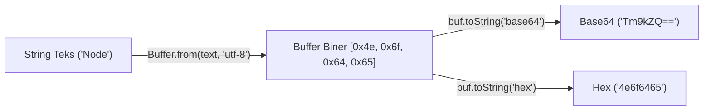

# Buffer

> Ringkasan
> - Tingkat: Fondasi
> - Fungsi: Mengelola dan memanipulasi data biner mentah secara langsung di luar memori heap V8.
> - Digunakan saat: Membaca file biner, paket jaringan TCP, hashing kriptografi, dan konversi format encoding data.
> - Aturan praktis: Selalu gunakan `Buffer.from()` atau `Buffer.alloc()`; hindari konstruktor usang `new Buffer()`; cantumkan encoding secara eksplisit.

## Cheat Sheet

| Tugas | Kode |
| :--- | :--- |
| Membuat buffer dari string/array | `const buf = Buffer.from("Node.js", "utf-8");` |
| Mengalokasikan buffer nol aman | `const buf = Buffer.alloc(10);` |
| Menggabungkan deretan buffer | `const merged = Buffer.concat([buf1, buf2]);` |
| Menghitung ukuran byte string UTF-8 | `Buffer.byteLength("Kopi €");` |
| Mengonversi buffer ke teks string | `buf.toString("utf-8");` |
| Mengonversi buffer ke string Hex | `buf.toString("hex");` |
| Mengonversi buffer ke string Base64 | `buf.toString("base64");` |
| Mengambil irisan byte referensi | `const slice = buf.subarray(0, 4);` |

## Tujuan Belajar

- Memahami arsitektur class `Buffer` dalam mengolah data biner mentah di runtime Node.js.
- Mengalokasikan memori buffer dengan aman memakai `Buffer.alloc()` dan `Buffer.from()`.
- Mengonversi data biner ke format teks dan encoding populer (UTF-8, Base64, Hex).
- Menggabungkan beberapa potongan buffer menjadi satu kesatuan utuh memakai `Buffer.concat()`.
- Menghitung ukuran fisik byte dan mengambil irisan byte lewat `subarray()`.

## Konsep

Bayangkan `Buffer` seperti ember penampung air dengan volume tertentu yang sudah dicetak sejak pabrik. Di browser, JavaScript awalnya hanya bertugas mengolah teks string. Namun di lingkungan backend, server harus berkomunikasi dengan dunia luar menggunakan deretan angka biner (byte `0` dan `1`) melalui kartu jaringan atau hard disk. Node.js menyediakan wadah memori tetap bernama `Buffer` (turunan dari `Uint8Array`) di luar heap V8. Data biner dari disk atau jaringan ditampung di wadah ini sebelum diterjemahkan ke teks atau dikirim ke modul lain.



## Referensi

| Item | Fungsi | Catatan |
| :--- | :--- | :--- |
| `Buffer.from(data, [encoding])` | Membuat instance buffer baru dari string, array angka, atau buffer lain | Mendukung encoding UTF-8, Base64, Hex, dan latin1 |
| `Buffer.alloc(size, [fill], [encoding])` | Mengalokasikan memori buffer baru dengan isi yang dinolkan | Lebih lambat sedikit dari allocUnsafe namun aman |
| `Buffer.allocUnsafe(size)` | Mengalokasikan memori buffer tanpa mengosongkan byte lama | Mengandung data sampah memori lama yang belum dibersihkan |
| `Buffer.concat(list, [totalLength])` | Menggabungkan beberapa instance buffer menjadi satu buffer utuh | Sangat umum dipakai saat mengumpulkan chunk stream |
| `Buffer.byteLength(string, [encoding])` | Menghitung ukuran fisik byte suatu string teks | Menghitung byte aktual, bukan sekadar jumlah huruf |
| `buf.toString([encoding], [start], [end])` | Menerjemahkan deretan byte biner menjadi string teks | Default encoding adalah `"utf-8"` |
| `buf.subarray([start], [end])` | Mengambil irisan data byte tanpa menyalin memori baru | Berbagi alokasi memori yang sama dengan buffer asal |
| `buf.copy(target, [targetStart], [sourceStart], [sourceEnd])` | Menyalin isi byte dari satu buffer ke buffer lain | Memerlukan buffer target yang sudah dialokasikan |

### `Buffer.from(data, [encoding])`

`Buffer.from()` membuat instance `Buffer` baru yang berisi salinan dari data yang diberikan (string, array integer, atau buffer lain).

Struktur parameter: `Buffer.from(data, encoding)`
- `data` (string, Array, atau Buffer, wajib): sumber data yang akan dimasukkan ke buffer.
- `encoding` (string, opsional, default: `"utf-8"`): jenis encoding teks yang digunakan jika input berupa string.

Nilai kembalian: instance `Buffer` baru (`Buffer`).

```javascript
import { Buffer } from "node:buffer";

const buf = Buffer.from("Node.js", "utf-8");
console.log(buf.length);
// Output: 7
console.log(buf.toString("hex"));
// Output: 4e6f64652e6a73
```

Kondisi khusus: Jangan gunakan string angka seperti `Buffer.from("100")` bila maksudmu adalah mengalokasikan 100 byte; gunakan `Buffer.alloc(100)` untuk kebutuhan alokasi ukuran.

### `Buffer.alloc(size, [fill], [encoding])`

`Buffer.alloc()` mengalokasikan ruang memori buffer berukuran tetap dan menginisialisasi seluruh isinya dengan nilai default `0` (atau nilai pengisi yang ditentukan).

Struktur parameter: `Buffer.alloc(size, fill, encoding)`
- `size` (number, wajib): jumlah byte yang ingin dialokasikan.
- `fill` (string, Buffer, atau number, opsional, default: `0`): nilai pengisi memori.
- `encoding` (string, opsional, default: `"utf-8"`): encoding jika fill berupa string.

Nilai kembalian: instance `Buffer` baru berukuran `size` (`Buffer`).

```javascript
import { Buffer } from "node:buffer";

const buf = Buffer.alloc(5);
console.log(buf.toString("hex"));
// Output: 0000000000
```

Kondisi khusus: Parameter `size` harus berupa bilangan bulat non-negatif dan tidak boleh melebihi batas `buffer.constants.MAX_LENGTH`.

### `Buffer.allocUnsafe(size)`

`Buffer.allocUnsafe()` mengalokasikan memori buffer dengan cepat tanpa membersihkan byte lama yang tersimpan di memori tersebut.

Struktur parameter: `Buffer.allocUnsafe(size)`
- `size` (number, wajib): jumlah byte yang ingin dialokasikan.

Nilai kembalian: instance `Buffer` baru (`Buffer`).

```javascript
import { Buffer } from "node:buffer";

const buf = Buffer.allocUnsafe(10);
console.log(buf.length);
// Output: 10
```

Kondisi khusus: Buffer ini berpotensi membocorkan data sensitif masa lalu (seperti potongan password atau token dari proses lain) jika langsung dikirim ke client tanpa ditimpa data baru.

### `Buffer.concat(list, [totalLength])`

`Buffer.concat()` menyatukan daftar array buffer menjadi satu instance buffer panjang.

Struktur parameter: `Buffer.concat(list, totalLength)`
- `list` (Buffer[] atau Uint8Array[], wajib): array berisi objek-objek buffer.
- `totalLength` (number, opsional): total panjang byte yang diharapkan.

Nilai kembalian: instance `Buffer` hasil penggabungan (`Buffer`).

```javascript
import { Buffer } from "node:buffer";

const part1 = Buffer.from("Node");
const part2 = Buffer.from(".js");
const combined = Buffer.concat([part1, part2]);

console.log(combined.toString("utf-8"));
// Output: Node.js
```

Kondisi khusus: Jika array `list` kosong, fungsi mengembalikan buffer baru dengan ukuran panjang `0`.

### `Buffer.byteLength(string, [encoding])`

`Buffer.byteLength()` mengembalikan panjang byte fisik aktual dari suatu string jika disimpan ke dalam memori.

Struktur parameter: `Buffer.byteLength(string, encoding)`
- `string` (string, Buffer, atau TypedArray, wajib): nilai yang ingin dihitung ukurannya.
- `encoding` (string, opsional, default: `"utf-8"`): jenis encoding teks.

Nilai kembalian: jumlah byte fisik (`number`).

```javascript
import { Buffer } from "node:buffer";

const text = "Cafe €";
console.log(text.length);
// Output: 6
console.log(Buffer.byteLength(text, "utf-8"));
// Output: 8
```

Kondisi khusus: Karakter emoji atau simbol non-Latin membutuhkan 2 hingga 4 byte per karakter di UTF-8, sehingga `string.length` tidak sama dengan `Buffer.byteLength`.

### `buf.toString([encoding], [start], [end])`

`buf.toString()` menerjemahkan data biner yang tersimpan di dalam buffer menjadi representasi teks sesuai format encoding yang diminta.

Struktur parameter: `buf.toString(encoding, start, end)`
- `encoding` (string, opsional, default: `"utf-8"`): format tujuan (`"utf-8"`, `"hex"`, `"base64"`, dll.).
- `start` (number, opsional, default: `0`): indeks byte awal pembacaan.
- `end` (number, opsional, default: `buf.length`): indeks byte akhir (eksklusif).

Nilai kembalian: string teks hasil terjemahan (`string`).

```javascript
import { Buffer } from "node:buffer";

const buf = Buffer.from("Hello");
console.log(buf.toString("base64"));
// Output: SGVsbG8=
console.log(buf.toString("hex"));
// Output: 48656c6c6f
```

Kondisi khusus: Jika urutan byte multibyte terpotong karena parameter `start` atau `end`, karakter pengganti tanda tanya akan muncul di hasil string.

### `buf.subarray([start], [end])`

`buf.subarray()` mengembalikan irisan buffer baru yang merujuk pada rentang memori yang sama dengan buffer aslinya tanpa alokasi memori tambahan.

Struktur parameter: `buf.subarray(start, end)`
- `start` (number, opsional, default: `0`): indeks byte awal.
- `end` (number, opsional, default: `buf.length`): indeks byte akhir.

Nilai kembalian: instance `Buffer` baru yang berbagi memori (`Buffer`).

```javascript
import { Buffer } from "node:buffer";

const original = Buffer.from([1, 2, 3, 4]);
const slice = original.subarray(1, 3);
slice[0] = 99;

console.log(original[1]);
// Output: 99
```

Kondisi khusus: Karena berbagi memori, mengubah nilai elemen pada buffer hasil irisan akan langsung mengubah nilai pada buffer aslinya.

## Kesalahan Umum

### Mengira `string.length` Sama dengan Ukuran Byte

Menghitung ukuran header HTTP `Content-Length` memakai `text.length` akan menyebabkan data terpotong saat teks memuat karakter emoji atau aksen.

```javascript
// Incorrect: text.length counts characters, not bytes
const text = "Hello World €";
const length = text.length; // 13 (characters)

// Correct: Buffer.byteLength measures physical byte size
import { Buffer } from "node:buffer";
const byteSize = Buffer.byteLength(text, "utf-8"); // 15 (bytes)
```

### Mengasumsikan `subarray()` Melakukan Kloning Memori Baru

Mengubah irisan byte yang dihasilkan `subarray()` akan merusak data pada objek buffer induk.

```javascript
// Incorrect assumption: expecting slice to be memory-isolated
const original = Buffer.from("Secret Data");
const slice = original.subarray(0, 4);
slice.fill(0); // Overwrites memory in original buffer to 0

// Correct: use Buffer.from(subarray) if isolated memory is needed
const isolatedCopy = Buffer.from(original.subarray(0, 4));
```

## Studi Kasus

Pendeteksian jenis file melalui verifikasi byte pembuka (_magic bytes / file signature_) untuk memvalidasi tipe konten file secara akurat tanpa bergantung pada ekstensi nama file.

```javascript
import { Buffer } from "node:buffer";

class FileSignatureValidator {
  detectType(buffer) {
    if (buffer.length < 4) {
      return "UNKNOWN";
    }

    const signature = buffer.subarray(0, 4).toString("hex").toLowerCase();

    if (signature.startsWith("89504e47")) {
      return "image/png";
    }
    if (signature.startsWith("ffd8ff")) {
      return "image/jpeg";
    }
    if (signature.startsWith("25504446")) {
      return "application/pdf";
    }

    return "UNKNOWN";
  }
}

const validator = new FileSignatureValidator();

const pngHeader = Buffer.from([0x89, 0x50, 0x4e, 0x47, 0x0d, 0x0a]);
console.log(validator.detectType(pngHeader));
// Output: image/png

const pdfHeader = Buffer.from("%PDF-1.7 header");
console.log(validator.detectType(pdfHeader));
// Output: application/pdf
```

Pola validasi signature ini diterapkan pada sistem backend untuk mengamankan fitur unggah file dari serangan penyamaran ekstensi (misalnya file eksekusi `.exe` yang sengaja diganti nama menjadi `.png`).

## Latihan Mandiri

Buat fungsi `parseNetworkPacket(buffer, options = {})` untuk membedah paket data biner jaringan.

- **Level 1 (Dasar):** Periksa ukuran minimal paket (minimal 2 byte). Ambil isi muatan paket (_payload_) memakai `buffer.subarray(2)` dan konversi ke string UTF-8. Kembalikan objek `{ success: true, payloadText, byteLength: buffer.length }`.
- **Level 2 (Menengah):** Dukung opsi format encoding teks `options.encoding` (`"utf-8"`, `"hex"`, `"base64"`). Konversi payload ke encoding yang diminta pengguna (default: `"utf-8"`).
- **Level 3 (Menantang):** Validasi header 2 byte pertama paket. Jika 2 byte pembuka bukan `0xAA 0x55` (hex `"aa55"`), lempar `Error("Invalid packet header")`. Jika panjang buffer kurang dari 2 byte, lempar `RangeError("Packet size too small")`.

Contoh input dan output normal:

```javascript
import { Buffer } from "node:buffer";

const packet = Buffer.concat([
  Buffer.from([0xaa, 0x55]),
  Buffer.from("Hello Node.js", "utf-8"),
]);

const res = parseNetworkPacket(packet, { encoding: "utf-8" });
console.log(res.success);
// Output: true
console.log(res.payloadText);
// Output: Hello Node.js
```

Contoh input dan penanganan error:

```javascript
try {
  parseNetworkPacket(Buffer.from([0x00, 0x01]));
} catch (err) {
  console.log(err.message);
  // Output: Invalid packet header
}
```

Tanda selesai:
- [ ] Parsing paket biner mengekstrak payload teks secara akurat.
- [ ] Konversi format encoding mendukung UTF-8, Hex, dan Base64.
- [ ] Header yang tidak cocok atau ukuran paket tidak memadai melempar error validasi.

---

## Navigasi

[Sebelumnya: Events](../06-events/README.md) | [Selanjutnya: Stream](../08-stream/README.md) | [Daftar Isi](../README.md)
