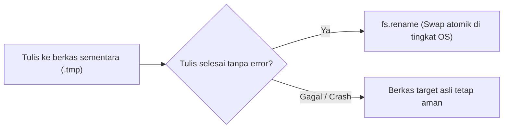

# File System

> Ringkasan
>
> - Fungsi: Mengelola berkas dan direktori lokal, mulai dari membaca, menulis, mengecek metadata, hingga menghapus berkas atau folder.
> - Digunakan saat: Menyimpan berkas unggahan, membaca konfigurasi aplikasi, mencatat log transaksi, atau mengatur folder penyimpanan data.
> - Aturan praktis: Selalu prioritaskan `node:fs/promises` agar operasi I/O tidak memblokir thread utama, terapkan pola penulisan atomik untuk data penting, dan gunakan stream untuk berkas besar di atas 50MB.

---

## Tujuan Belajar

- Membedakan karakteristik API _File System_ sinkron, callback, dan berbasis _promise_.
- Menggunakan metode utama `node:fs/promises` untuk mengelola berkas dan direktori.
- Membaca dan memeriksa metadata serta tipe entri direktori via `Dirent` dan `stat`.
- Menerapkan pola penulisan atomik (_atomic write_) agar berkas tidak rusak saat aplikasi terhenti mendadak.
- Mengidentifikasi dan menangani kode error sistem berkas seperti `ENOENT`, `EEXIST`, dan `EACCES`.

---

## Konsep

Operasi sistem berkas bisa dianalogikan seperti mengelola dokumen di dalam lemari arsip kantor. Saat kita menulis berkas baru (`writeFile`), itu mirip dengan mengganti seluruh isi map dokumen lama dengan kertas baru. Menambahkan catatan (`appendFile`) seperti menyelipkan lembaran tambahan di halaman paling belakang map tanpa merusak kertas yang sudah ada sebelumnya.

Lalu, bagaimana dengan penulisan atomik (_atomic write_)? Bayangkan kamu sedang menyiapkan draf kontrak penting. Daripada langsung menulis di atas map dokumen resmi, kamu menulis drafnya dulu di atas kertas terpisah (`.tmp`). Setelah semua isi draf selesai diperiksa dan dipastikan utuh tanpa coretan salah, barulah kamu menukar dokumen lama dengan dokumen baru dalam satu gerakan cepat. Jika di tengah jalan pulpenmu habis atau ada gangguan, dokumen resmi di lemari arsip tetap utuh dan aman.



---

## Referensi

| Item                  | Fungsi                                                   | Catatan                                                                                    |
| :-------------------- | :------------------------------------------------------- | :----------------------------------------------------------------------------------------- |
| **`fs.readFile()`**   | Membaca seluruh konten berkas ke memori                  | Menghasilkan string jika encoding ditentukan, atau `Buffer` jika encoding diabaikan        |
| **`fs.writeFile()`**  | Menulis data ke berkas dan menimpa isi lama              | Otomatis membuat berkas baru jika berkas target belum ada                                  |
| **`fs.appendFile()`** | Menambahkan data ke akhir berkas tanpa menimpa data lama | Sangat cocok untuk mencatat log transaksi aplikasi                                         |
| **`fs.mkdir()`**      | Membuat direktori baru di sistem penyimpanan             | Opsi `recursive: true` membuat subdirektori bertingkat secara otomatis                     |
| **`fs.readdir()`**    | Membaca daftar nama entri di dalam direktori             | Opsi `withFileTypes: true` mengembalikan array objek `Dirent` tanpa pembacaan I/O tambahan |
| **`fs.stat()`**       | Mengambil metadata teknis berkas atau direktori          | Menyediakan informasi ukuran byte, waktu modifikasi, serta method `isFile()`               |
| **`fs.access()`**     | Menguji keberadaan berkas dan izin akses proses          | Memeriksa izin menggunakan konstanta dari `node:fs.constants`                              |
| **`fs.copyFile()`**   | Menyalin berkas tunggal dari sumber ke tujuan            | Menimpa berkas tujuan secara default kecuali dibatasi flag khusus                          |
| **`fs.rename()`**     | Memindahkan atau mengganti nama berkas secara atomik     | Fondasi pola penulisan aman untuk mencegah korupsi data                                    |
| **`fs.unlink()`**     | Menghapus satu berkas reguler                            | Melempar error jika diterapkan pada sebuah direktori                                       |
| **`fs.rm()`**         | Menghapus berkas atau direktori secara fleksibel         | Opsi `recursive: true` dan `force: true` membersihkan folder bersarang                     |

### `fs.readFile()`

Fungsi `fs.readFile()` dipakai untuk membaca seluruh isi berkas ke dalam memori secara asinkron. Jika kita menyertakan parameter encoding (misalnya `'utf-8'`), hasilnya berupa string teks biasa yang siap dibaca.

```javascript
import fs from "node:fs/promises";
import path from "node:path";
import os from "node:os";

const filePath = path.join(os.tmpdir(), "user-profile.txt");
await fs.writeFile(filePath, "User: Alice Smith", "utf-8");

const content = await fs.readFile(filePath, "utf-8");
console.log(content);
// Output: User: Alice Smith

await fs.unlink(filePath);
```

Kasus lain: Jika kita membaca berkas tanpa menentukan encoding, Node.js akan mengembalikan data biner mentah dalam bentuk objek `Buffer`.

```javascript
import fs from "node:fs/promises";
import path from "node:path";
import os from "node:os";

const filePath = path.join(os.tmpdir(), "binary-data.txt");
await fs.writeFile(filePath, "Node", "utf-8");

const buffer = await fs.readFile(filePath);
console.log(Buffer.isBuffer(buffer), buffer.length);
// Output: true 4

await fs.unlink(filePath);
```

### `fs.writeFile()`

Fungsi `fs.writeFile()` berguna untuk menulis data ke sebuah berkas. Kalau berkasnya sudah ada, isinya akan langsung ditimpa dengan data baru. Jika berkasnya belum ada, Node.js otomatis membuatnya untukmu.

```javascript
import fs from "node:fs/promises";
import path from "node:path";
import os from "node:os";

const filePath = path.join(os.tmpdir(), "app-config.json");
const payload = JSON.stringify({ port: 3000, env: "production" });

await fs.writeFile(filePath, payload, "utf-8");
const content = await fs.readFile(filePath, "utf-8");
console.log(content);
// Output: {"port":3000,"env":"production"}

await fs.unlink(filePath);
```

Kasus lain: Menggunakan opsi eksklusif `{ flag: 'wx' }` untuk memastikan penulisan hanya berhasil jika berkas belum ada di disk. Jika berkas sudah ada, operasi akan gagal dengan error `EEXIST`.

```javascript
import fs from "node:fs/promises";
import path from "node:path";
import os from "node:os";

const lockFile = path.join(os.tmpdir(), "app.lock");
await fs.writeFile(lockFile, "lock-1", "utf-8");

try {
  await fs.writeFile(lockFile, "lock-2", { flag: "wx" });
} catch (error) {
  console.log(error.code);
  // Output: EEXIST
}

await fs.unlink(lockFile);
```

### `fs.appendFile()`

Fungsi `fs.appendFile()` menambahkan data ke bagian paling akhir berkas tanpa menghapus isi yang sudah ada. Berkas tujuan otomatis dibuat jika sebelumnya belum ada.

```javascript
import fs from "node:fs/promises";
import path from "node:path";
import os from "node:os";

const logFile = path.join(os.tmpdir(), "activity.log");
await fs.writeFile(logFile, "LINE 1\n", "utf-8");
await fs.appendFile(logFile, "LINE 2\n", "utf-8");

const content = await fs.readFile(logFile, "utf-8");
console.log(content.trim());
// Output: LINE 1
// LINE 2

await fs.unlink(logFile);
```

Kasus lain: Menambahkan catatan baru ke berkas yang belum pernah dibuat sebelumnya.

```javascript
import fs from "node:fs/promises";
import path from "node:path";
import os from "node:os";

const newLogFile = path.join(os.tmpdir(), "new-audit.log");
await fs.appendFile(newLogFile, "First entry", "utf-8");

const content = await fs.readFile(newLogFile, "utf-8");
console.log(content);
// Output: First entry

await fs.unlink(newLogFile);
```

### `fs.mkdir()`

Fungsi `fs.mkdir()` digunakan untuk membuat folder atau direktori baru. Opsi `{ recursive: true }` memungkinkan kita membuat seluruh susunan folder bertingkat sekaligus tanpa memicu error jika folder tersebut sudah ada.

```javascript
import fs from "node:fs/promises";
import path from "node:path";
import os from "node:os";

const targetDir = path.join(os.tmpdir(), "app-cache", "session", "tokens");
await fs.mkdir(targetDir, { recursive: true });

const stats = await fs.stat(targetDir);
console.log(stats.isDirectory());
// Output: true

await fs.rm(path.join(os.tmpdir(), "app-cache"), {
  recursive: true,
  force: true,
});
```

Kasus lain: Membuat folder yang sudah ada tanpa opsi `recursive: true` akan menghasilkan kode error `EEXIST`.

```javascript
import fs from "node:fs/promises";
import path from "node:path";
import os from "node:os";

const targetDir = path.join(os.tmpdir(), "test-folder");
await fs.mkdir(targetDir, { recursive: true });

try {
  await fs.mkdir(targetDir);
} catch (error) {
  console.log(error.code);
  // Output: EEXIST
}

await fs.rm(targetDir, { recursive: true, force: true });
```

### `fs.readdir()`

Fungsi `fs.readdir()` membaca daftar entri yang ada di dalam sebuah direktori. Dengan menambahkan opsi `{ withFileTypes: true }`, kita memperoleh daftar objek `Dirent` untuk langsung memeriksa apakah suatu entri merupakan berkas atau direktori.

```javascript
import fs from "node:fs/promises";
import path from "node:path";
import os from "node:os";

const rootDir = path.join(os.tmpdir(), "test-readdir");
await fs.mkdir(rootDir, { recursive: true });
await fs.writeFile(path.join(rootDir, "document.txt"), "test", "utf-8");
await fs.mkdir(path.join(rootDir, "subfolder"), { recursive: true });

const entries = await fs.readdir(rootDir, { withFileTypes: true });
for (const entry of entries) {
  console.log(`${entry.name}: ${entry.isDirectory() ? "directory" : "file"}`);
}
// Output: document.txt: file
// subfolder: directory

await fs.rm(rootDir, { recursive: true, force: true });
```

Kasus lain: Membaca direktori tanpa opsi `withFileTypes` yang menghasilkan array berisi string nama-nama entri saja.

```javascript
import fs from "node:fs/promises";
import path from "node:path";
import os from "node:os";

const rootDir = path.join(os.tmpdir(), "test-string-entries");
await fs.mkdir(rootDir, { recursive: true });
await fs.writeFile(path.join(rootDir, "file-a.txt"), "", "utf-8");

const entryNames = await fs.readdir(rootDir);
console.log(entryNames);
// Output: [ 'file-a.txt' ]

await fs.rm(rootDir, { recursive: true, force: true });
```

### `fs.stat()`

Fungsi `fs.stat()` mengambil metadata lengkap sebuah berkas atau direktori, seperti ukuran dalam satuan byte, waktu pembuatan, waktu perubahan terakhir, serta metode pengecekan tipe entri.

```javascript
import fs from "node:fs/promises";
import path from "node:path";
import os from "node:os";

const filePath = path.join(os.tmpdir(), "metadata-sample.txt");
await fs.writeFile(filePath, "Hello World", "utf-8");

const stats = await fs.stat(filePath);
console.log(stats.isFile(), stats.size);
// Output: true 11

await fs.unlink(filePath);
```

Kasus lain: Memeriksa jalur yang tidak ada di sistem berkas akan menghasilkan kode error `ENOENT`.

```javascript
import fs from "node:fs/promises";

try {
  await fs.stat("/path/does/not/exist.bin");
} catch (error) {
  console.log(error.code);
  // Output: ENOENT
}
```

### `fs.access()`

Fungsi `fs.access()` digunakan untuk memeriksa apakah suatu berkas ada dan apakah aplikasi kita memiliki izin akses tertentu tanpa harus membuka berkas tersebut secara langsung. Fungsi ini menerima konstanta mode dari `node:fs.constants`.

```javascript
import fs from "node:fs/promises";
import { constants } from "node:fs";
import path from "node:path";
import os from "node:os";

const filePath = path.join(os.tmpdir(), "check-access.txt");
await fs.writeFile(filePath, "content", "utf-8");

let isWritable = false;
try {
  await fs.access(filePath, constants.F_OK | constants.W_OK);
  isWritable = true;
} catch {
  isWritable = false;
}

console.log(isWritable);
// Output: true

await fs.unlink(filePath);
```

Kasus lain: Menguji izin akses pada berkas yang tidak ada di sistem penyimpanan.

```javascript
import fs from "node:fs/promises";
import { constants } from "node:fs";

try {
  await fs.access("/path/does/not/exist.txt", constants.F_OK);
} catch (error) {
  console.log(error.code);
  // Output: ENOENT
}
```

### `fs.copyFile()`

Fungsi `fs.copyFile()` menyalin satu berkas dari lokasi sumber ke lokasi tujuan secara asinkron. Berkas tujuan akan langsung ditimpa jika sudah ada di disk.

```javascript
import fs from "node:fs/promises";
import path from "node:path";
import os from "node:os";

const sourcePath = path.join(os.tmpdir(), "source-file.txt");
const destinationPath = path.join(os.tmpdir(), "target-file.txt");

await fs.writeFile(sourcePath, "Original Data", "utf-8");
await fs.copyFile(sourcePath, destinationPath);

const content = await fs.readFile(destinationPath, "utf-8");
console.log(content);
// Output: Original Data

await fs.unlink(sourcePath);
await fs.unlink(destinationPath);
```

Kasus lain: Mencegah penimpaan berkas tujuan dengan menyertakan flag `constants.COPYFILE_EXCL`.

```javascript
import fs from "node:fs/promises";
import { constants } from "node:fs";
import path from "node:path";
import os from "node:os";

const sourcePath = path.join(os.tmpdir(), "source.txt");
const destinationPath = path.join(os.tmpdir(), "destination.txt");

await fs.writeFile(sourcePath, "A", "utf-8");
await fs.writeFile(destinationPath, "B", "utf-8");

try {
  await fs.copyFile(sourcePath, destinationPath, constants.COPYFILE_EXCL);
} catch (error) {
  console.log(error.code);
  // Output: EEXIST
}

await fs.unlink(sourcePath);
await fs.unlink(destinationPath);
```

### `fs.rename()`

Fungsi `fs.rename()` digunakan untuk memindahkan atau mengganti nama berkas maupun direktori. Di tingkat sistem operasi, pemindahan dalam sistem penyimpanan yang sama berlangsung secara atomik (seketika).

```javascript
import fs from "node:fs/promises";
import path from "node:path";
import os from "node:os";

const tempPath = path.join(os.tmpdir(), "draft.tmp");
const targetPath = path.join(os.tmpdir(), "report.txt");

await fs.writeFile(tempPath, "Final Report", "utf-8");
await fs.rename(tempPath, targetPath);

const content = await fs.readFile(targetPath, "utf-8");
console.log(content);
// Output: Final Report

await fs.unlink(targetPath);
```

Kasus lain: Mengganti nama berkas asal yang tidak ditemukan di disk akan melempar kode error `ENOENT`.

```javascript
import fs from "node:fs/promises";

try {
  await fs.rename("/source/nonexistent.tmp", "/target/report.txt");
} catch (error) {
  console.log(error.code);
  // Output: ENOENT
}
```

### `fs.unlink()`

Fungsi `fs.unlink()` digunakan untuk menghapus satu berkas reguler dari sistem penyimpanan. Fungsi ini akan menghasilkan error jika dijalankan pada sebuah direktori.

```javascript
import fs from "node:fs/promises";
import path from "node:path";
import os from "node:os";

const targetPath = path.join(os.tmpdir(), "remove-me.txt");
await fs.writeFile(targetPath, "temporary", "utf-8");

await fs.unlink(targetPath);

let fileExists = true;
try {
  await fs.stat(targetPath);
} catch {
  fileExists = false;
}
console.log(fileExists);
// Output: false
```

Kasus lain: Menjalankan `fs.unlink()` pada sebuah folder akan memicu kode error `EISDIR` atau `EPERM`.

```javascript
import fs from "node:fs/promises";
import path from "node:path";
import os from "node:os";

const targetDir = path.join(os.tmpdir(), "unlink-folder");
await fs.mkdir(targetDir, { recursive: true });

try {
  await fs.unlink(targetDir);
} catch (error) {
  console.log(["EISDIR", "EPERM"].includes(error.code));
  // Output: true
}

await fs.rm(targetDir, { recursive: true, force: true });
```

### `fs.rm()`

Fungsi `fs.rm()` adalah solusi modern untuk menghapus berkas atau direktori secara fleksibel dan aman, termasuk menghapus folder beserta seluruh isinya sekaligus.

```javascript
import fs from "node:fs/promises";
import path from "node:path";
import os from "node:os";

const nestedDir = path.join(os.tmpdir(), "nested-folder", "child");
await fs.mkdir(nestedDir, { recursive: true });
await fs.writeFile(path.join(nestedDir, "data.txt"), "hello", "utf-8");

await fs.rm(path.join(os.tmpdir(), "nested-folder"), {
  recursive: true,
  force: true,
});

let dirExists = true;
try {
  await fs.stat(path.join(os.tmpdir(), "nested-folder"));
} catch {
  dirExists = false;
}
console.log(dirExists);
// Output: false
```

Kasus lain: Menggunakan opsi `force: true` saat menghapus target yang tidak ada tidak akan melempar error sama sekali.

```javascript
import fs from "node:fs/promises";

await fs.rm("/path/definitely/does/not/exist/99999", {
  force: true,
  recursive: true,
});
console.log("Safe deletion complete");
// Output: Safe deletion complete
```

### Perbandingan: Tiga Generasi API File System

| Karakteristik         | Synchronous (`node:fs`)                   | Callback (`node:fs`)                  | Promises (`node:fs/promises`)          |
| :-------------------- | :---------------------------------------- | :------------------------------------ | :------------------------------------- |
| **Gaya Sintaks**      | `fs.readFileSync()`                       | `fs.readFile(path, cb)`               | `await fs.readFile(path)`              |
| **Dampak Event Loop** | Memblokir thread utama hingga I/O selesai | Bersifat non-blocking dengan callback | Bersifat non-blocking berbasis Promise |
| **Penanganan Error**  | Blok `try...catch` biasa                  | Argumen pertama callback (`err`)      | Blok `try...catch` pada `async/await`  |
| **Kasus Penggunaan**  | Skrip awal CLI sederhana                  | Kode warisan (_legacy_)               | Standar aplikasi backend modern        |

### Kamus Kode Error Sistem Berkas

| Kode Error   | Kepanjangan          | Arti dan Penyebab                                                        |
| :----------- | :------------------- | :----------------------------------------------------------------------- |
| **`ENOENT`** | _Error No Entry_     | Berkas atau direktori target tidak ditemukan pada jalur yang ditentukan  |
| **`EEXIST`** | _Error Exists_       | Target berkas atau direktori sudah ada di sistem                         |
| **`EACCES`** | _Error Access_       | Izin akses ditolak oleh sistem operasi untuk membaca atau menulis berkas |
| **`EISDIR`** | _Error Is Directory_ | Operasi mengharapkan berkas, tetapi target merupakan direktori           |
| **`ENOSPC`** | _Error No Space_     | Kapasitas ruang penyimpanan perangkat keras telah penuh                  |

---

## Kesalahan Umum

### Membaca Berkas Tanpa Menentukan Parameter Encoding

Saat kita memanggil `readFile` tanpa menyebutkan format encoding, Node.js tidak otomatis menghasilkan string teks, melainkan data biner mentah berupa objek `Buffer`.

```javascript
// Salah
import fs from "node:fs/promises";

const raw = await fs.readFile("config.json");
console.log(typeof raw); // Objek Buffer
```

```javascript
// Benar
import fs from "node:fs/promises";

const raw = await fs.readFile("config.json", "utf-8");
const data = JSON.parse(raw);
```

### Mengecek Eksistensi Berkas Sebelum Membaca (TOCTOU Race Condition)

Mengecek keberadaan berkas sebelum membacanya membuka celah _race condition_ (_Time-of-Check to Time-of-Use_). Dalam jeda mikrodetik antara pengecekan dan pembacaan, proses lain bisa saja menghapus berkas tersebut sehingga aplikasi tetap gagal.

```javascript
// Salah
import fs from "node:fs/promises";

try {
  await fs.access("data.json");
  const content = await fs.readFile("data.json", "utf-8");
} catch {
  // Rentan terhadap race condition jika berkas dihapus sebelum readFile dieksekusi
}
```

```javascript
// Benar
import fs from "node:fs/promises";

try {
  const content = await fs.readFile("data.json", "utf-8");
} catch (error) {
  if (error.code === "ENOENT") {
    // Tangani langsung jika berkas memang belum ada
  }
}
```

### Menggunakan API Sinkron di Dalam Handler Server

Memanggil fungsi sinkron yang berakhiran `Sync` di dalam server akan menghentikan eksekusi thread utama. Akibatnya, seluruh pengguna lain harus mengantre hingga proses I/O berkas selesai.

```javascript
// Salah
import fs from "node:fs";

function handleRequest() {
  const content = fs.readFileSync("report.pdf");
  return content;
}
```

```javascript
// Benar
import fs from "node:fs/promises";

async function handleRequest() {
  const content = await fs.readFile("report.pdf");
  return content;
}
```

---

## Studi Kasus

Skenario: Membangun pengelola konfigurasi aplikasi (`ConfigManager`) yang mendukung nilai cadangan (_fallback default_) serta penulisan atomik aman (_atomic write_) agar berkas konfigurasi tidak rusak saat server mati mendadak.

```javascript
import fs from "node:fs/promises";
import path from "node:path";
import os from "node:os";

class ConfigManager {
  constructor(filePath, defaultConfig = {}) {
    this.filePath = filePath;
    this.defaultConfig = defaultConfig;
  }

  async read() {
    try {
      const raw = await fs.readFile(this.filePath, "utf-8");
      return JSON.parse(raw);
    } catch (error) {
      if (error.code === "ENOENT") {
        return { ...this.defaultConfig };
      }
      throw error;
    }
  }

  async writeSafe(data) {
    const dir = path.dirname(this.filePath);
    await fs.mkdir(dir, { recursive: true });

    const tempPath = `${this.filePath}.${Date.now()}-${Math.random().toString(36).slice(2)}.tmp`;
    const serialized = JSON.stringify(data, null, 2);

    await fs.writeFile(tempPath, serialized, "utf-8");
    await fs.rename(tempPath, this.filePath);
  }
}

const configDir = path.join(os.tmpdir(), "app-config-" + Date.now());
const targetPath = path.join(configDir, "settings.json");
const manager = new ConfigManager(targetPath, { theme: "dark", port: 8080 });

const initialConfig = await manager.read();
console.log(initialConfig);
// Output: { theme: 'dark', port: 8080 }

await manager.writeSafe({ theme: "light", port: 3000 });
const updatedConfig = await manager.read();
console.log(updatedConfig);
// Output: { theme: 'light', port: 3000 }

await fs.rm(configDir, { recursive: true, force: true });
```

Pola ini menggabungkan `fs.writeFile` ke berkas sementara dengan `fs.rename` atomik. Berkat cara ini, proses penulisan tidak akan meninggalkan berkas separuh jadi jika aplikasi terputus di tengah jalan. Penanganan error `ENOENT` pada metode pembacaan memastikan aplikasi tetap berjalan mulus menggunakan konfigurasi awal saat berkas belum sempat dibuat.

---

## Latihan Mandiri

### Soal 1 (Dasar)

Buat fungsi `ensureDirectory(dirPath)` yang memanfaatkan `fs.mkdir` untuk memastikan sebuah folder beserta seluruh subfolder di dalamnya sudah tersedia di disk, lalu mengembalikan nilai boolean `true`.

Contoh input:

```javascript
await ensureDirectory("storage/reports/2026");
```

Contoh output yang diharapkan:

```javascript
true;
```

Batasan: Gunakan modul `node:fs/promises` dengan opsi rekursif tanpa memicu error jika folder tersebut sudah ada.

### Soal 2 (Menengah)

Buat fungsi `getDirectoryStats(dirPath)` yang membaca isi satu tingkat direktori menggunakan `fs.readdir` dengan opsi `withFileTypes: true`. Fungsi ini harus mengembalikan objek yang merangkum jumlah berkas reguler (`totalFiles`), jumlah subfolder (`totalDirectories`), dan akumulasi ukuran seluruh berkas dalam satuan byte (`totalSizeBytes`) menggunakan `fs.stat`.

Contoh input (pada folder berisi 2 berkas dengan total ukuran 150 byte dan 1 subfolder):

```javascript
await getDirectoryStats("data/documents");
```

Contoh output yang diharapkan:

```javascript
{
  totalFiles: 2,
  totalDirectories: 1,
  totalSizeBytes: 150
}
```

Batasan: Hanya periksa entri pada tingkat pertama (tanpa rekursi), dan lemparkan error jika jalur yang diberikan bukan folder yang valid.

### Soal 3 (Menantang)

Buat fungsi pembersih berkas lama `cleanExpiredArchives(dirPath, maxAgeSeconds)`. Fungsi ini bertugas memeriksa isi direktori, mengabaikan subfolder, mengecek properti `mtimeMs` pada berkas reguler menggunakan `fs.stat`, lalu menghapus berkas yang usianya sudah melewati batas waktu menggunakan `fs.unlink`.

Ketentuan penanganan kasus tepi:

- Jika direktori target tidak ditemukan (`ENOENT`), fungsi tidak boleh crash dan harus mengembalikan `{ success: false, reason: 'Directory not found', deletedCount: 0, deletedFiles: [] }`.
- Entri berupa subfolder harus dilewati tanpa dihapus atau memicu error.
- Kembalikan daftar nama berkas yang berhasil dihapus beserta jumlah totalnya saat pembersihan selesai.

Contoh input:

```javascript
await cleanExpiredArchives("var/log/archives", 86400);
```

Contoh output yang diharapkan:

```javascript
{
  success: true,
  deletedCount: 2,
  deletedFiles: [ 'audit-old.log', 'session-expired.tmp' ]
}
```

Batasan: Dilarang menggunakan library eksternal pihak ketiga. Gunakan `node:fs/promises` dan tangani kemungkinan error dengan blok `try...catch`.

---

## Navigasi

[Sebelumnya: URL](../06-url/README.md) | [Selanjutnya: Events](../08-events/README.md) | [Daftar Isi](../README.md)
