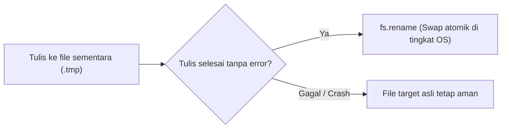

# File System

> Ringkasan
>
> - Fungsi: Mengelola file dan direktori lokal, mulai dari membuat folder/direktori, menulis file, membaca konten, mengecek metadata, hingga menghapus file atau direktori.
> - Digunakan saat: Menyimpan file unggahan, membaca konfigurasi aplikasi, mencatat log transaksi, atau mengatur folder penyimpanan data.
> - Aturan praktis: Selalu prioritaskan `node:fs/promises` agar operasi I/O tidak memblokir thread utama, terapkan pola penulisan atomik untuk data penting, dan gunakan stream untuk file besar di atas 50MB.

---

## Tujuan Belajar

- Membedakan karakteristik API _File System_ sinkron, callback, dan berbasis _promise_.
- Menggunakan metode utama `node:fs/promises` untuk mengelola file dan direktori.
- Membaca dan memeriksa metadata serta tipe entri direktori via `Dirent` dan `stat`.
- Menerapkan pola penulisan atomik (_atomic write_) agar file tidak rusak saat aplikasi terhenti mendadak.
- Mengidentifikasi dan menangani kode error file system seperti `ENOENT`, `EEXIST`, dan `EACCES`.

---

## Konsep

Operasi file system di komputer dapat dianalogikan seperti mengelola dokumen di dalam lemari arsip kantor:

1. **Membuat Map/Folder (`fs.mkdir`)**: Sebelum menaruh dokumen penting, kita menyiapkan map atau folder arsip terlebih dahulu. Map ini berfungsi murni sebagai wadah pengelompokan. Perlu dipahami bahwa `fs.mkdir()` hanya membuat folder/direktori, bukan file dokumen (_file_).
2. **Menulis File Dokumen (`fs.writeFile`)**: Setelah folder wadah tersedia, barulah kita menulis dan memasukkan lembaran dokumen baru ke dalamnya. Jika dokumen target belum ada, sistem otomatis membuatnya. Namun jika file sudah ada sebelumnya, isi dokumen lama akan langsung ditimpa (_overwrite_).
3. **Membaca File Dokumen (`fs.readFile`)**: Saat isi dokumen dibutuhkan kembali, kita membuka map arsip dan membaca lembaran tersebut ke dalam memori aplikasi.
4. **Menambahkan Catatan (`fs.appendFile`)**: Jika kita ingin menambahkan catatan tambahan di bagian paling belakang tanpa menghapus isi yang sudah tertulis, kita menyelipkan lembaran baru di akhir map.
5. **Inspeksi, Modifikasi, dan Pembersihan**: Lemari arsip dapat kita jelajahi daftar isinya (`fs.readdir`), kita cek tanggal dan ukuran fisiknya (`fs.stat`), kita periksa izin aksesnya (`fs.access`), kita gandakan (`fs.copyFile`), kita ganti nama (`fs.rename`), hingga kita musnahkan dokumen atau map yang sudah usang (`fs.unlink` dan `fs.rm`).

### Pola Penulisan Atomik (_Atomic Write_)

Bagaimana jika komputer tiba-tiba mati saat proses penulisan dokumen berlangsung? Jika kita langsung menimpa file resmi di disk, file bisa rusak (_corrupted_) dan separuh isi dokumen hilang.

Solusinya adalah menerapkan pola penulisan atomik (_atomic write_). Bayangkan kamu sedang merevisi draf kontrak penting. Alih-alih mencoret-coret langsung map dokumen asli, kamu menulis draf revisi lengkap di atas kertas sementara (`.tmp`). Setelah draf dipastikan utuh dan selesai tanpa error, barulah kamu menggantikan file lama dengan draf baru dalam satu gerakan cepat dan seketika via `fs.rename`.



### Tiga Generasi API File System

Node.js menyediakan tiga generasi pendekatan untuk berinteraksi dengan file system:

| Karakteristik         | Synchronous (`node:fs`)                   | Callback (`node:fs`)                  | Promises (`node:fs/promises`)          |
| :-------------------- | :---------------------------------------- | :------------------------------------ | :------------------------------------- |
| **Gaya Sintaks**      | `fs.readFileSync()`                       | `fs.readFile(path, cb)`               | `await fs.readFile(path)`              |
| **Dampak Event Loop** | Memblokir thread utama hingga I/O selesai | Bersifat non-blocking dengan callback | Bersifat non-blocking berbasis Promise |
| **Penanganan Error**  | Blok `try...catch` biasa                  | Argumen pertama callback (`err`)      | Blok `try...catch` pada `async/await`  |
| **Kasus Penggunaan**  | Skrip awal CLI sederhana                  | Kode warisan (_legacy_)               | Standar aplikasi backend modern        |

### Kamus Kode Error File System

Saat operasi I/O gagal, Node.js melempar objek `Error` dengan properti `error.code` standar sistem operasi:

| Kode Error   | Kepanjangan          | Arti dan Penyebab                                                      |
| :----------- | :------------------- | :--------------------------------------------------------------------- |
| **`ENOENT`** | _Error No Entry_     | File atau direktori target tidak ditemukan pada jalur yang ditentukan  |
| **`EEXIST`** | _Error Exists_       | Target file atau direktori sudah ada di sistem                         |
| **`EACCES`** | _Error Access_       | Izin akses ditolak oleh sistem operasi untuk membaca atau menulis file |
| **`EISDIR`** | _Error Is Directory_ | Operasi mengharapkan file, tetapi target merupakan direktori           |
| **`ENOSPC`** | _Error No Space_     | Kapasitas ruang penyimpanan perangkat keras telah penuh                |

---

## Referensi

| Item                  | Fungsi                                                 | Catatan                                                                                    |
| :-------------------- | :----------------------------------------------------- | :----------------------------------------------------------------------------------------- |
| **`fs.mkdir()`**      | Membuat direktori baru di sistem penyimpanan           | Opsi `recursive: true` membuat subdirektori bertingkat secara otomatis                     |
| **`fs.writeFile()`**  | Menulis data ke file dan menimpa isi lama              | Otomatis membuat file baru jika file target belum ada                                      |
| **`fs.readFile()`**   | Membaca seluruh konten file ke memori                  | Menghasilkan string jika encoding ditentukan, atau `Buffer` jika encoding diabaikan        |
| **`fs.appendFile()`** | Menambahkan data ke akhir file tanpa menimpa data lama | Sangat cocok untuk mencatat log transaksi aplikasi                                         |
| **`fs.readdir()`**    | Membaca daftar nama entri di dalam direktori           | Opsi `withFileTypes: true` mengembalikan array objek `Dirent` tanpa pembacaan I/O tambahan |
| **`fs.stat()`**       | Mengambil metadata teknis file atau direktori          | Menyediakan informasi ukuran byte, waktu modifikasi, serta method `isFile()`               |
| **`fs.access()`**     | Menguji keberadaan file dan izin akses proses          | Memeriksa izin menggunakan konstanta dari `node:fs.constants`                              |
| **`fs.copyFile()`**   | Menyalin file tunggal dari sumber ke tujuan            | Menimpa file tujuan secara default kecuali dibatasi flag khusus                            |
| **`fs.rename()`**     | Memindahkan atau mengganti nama file secara atomik     | Fondasi pola penulisan aman untuk mencegah korupsi data                                    |
| **`fs.unlink()`**     | Menghapus satu file reguler                            | Melempar error jika diterapkan pada sebuah direktori                                       |
| **`fs.rm()`**         | Menghapus file atau direktori secara fleksibel         | Opsi `recursive: true` dan `force: true` membersihkan folder bersarang                     |

> **Catatan:** Pada contoh kode modul ini, jalur file ditulis menggunakan nama file langsung (seperti `"user-profile.txt"` atau `"app-config.json"`) agar alur kodenya mudah dibaca dan dipahami. Pada aplikasi skala produksi atau pengujian otomatis (_automated testing_), pembuatan file uji coba/sementara sangat direkomendasikan memanfaatkan folder temporary bawaan sistem operasi melalui `os.tmpdir()` dari modul `node:os`. Tujuannya agar file sementara tidak mengotori repositori proyek dan otomatis dibersihkan oleh sistem operasi saat komputer di-_restart_:
>
> ```javascript
> import fs from "node:fs/promises";
> import path from "node:path";
> import os from "node:os";
>
> const tempFile = path.join(os.tmpdir(), "temp-cache.json");
> await fs.writeFile(tempFile, JSON.stringify({ cached: true }), "utf-8");
> ```

### `fs.mkdir()`

Fungsi `fs.mkdir()` digunakan khusus untuk membuat folder atau direktori baru (bukan untuk membuat file). Opsi `{ recursive: true }` memungkinkan kita membuat seluruh susunan folder bertingkat sekaligus dan mengembalikan jalur direktori pertama yang berhasil dibuat tanpa memicu error jika folder sudah ada.

```javascript
import fs from "node:fs/promises";
import path from "node:path";

const targetDir = path.join("app-cache", "session", "tokens");
const createdPath = await fs.mkdir(targetDir, { recursive: true });

console.log(createdPath);
// Output: app-cache

await fs.rm("app-cache", {
  recursive: true,
  force: true,
});
```

Kasus lain: Membuat folder yang sudah ada tanpa opsi `recursive: true` akan menghasilkan kode error `EEXIST`.

```javascript
import fs from "node:fs/promises";

await fs.mkdir("test-folder", { recursive: true });

try {
  await fs.mkdir("test-folder");
} catch (error) {
  console.log(error.code);
  // Output: EEXIST
}

await fs.rm("test-folder", { recursive: true, force: true });
```

### `fs.writeFile()`

Fungsi `fs.writeFile()` berguna untuk menulis data ke sebuah file. Kalau filenya sudah ada, isinya akan langsung ditimpa dengan data baru. Jika filenya belum ada, Node.js otomatis membuatnya. Operasi asinkron ini mengembalikan nilai `undefined` saat penulisan ke disk berhasil diselesaikan.

```javascript
import fs from "node:fs/promises";

const payload = JSON.stringify({ port: 3000, env: "production" });
const result = await fs.writeFile("app-config.json", payload, "utf-8");

console.log(result);
// Output: undefined

await fs.unlink("app-config.json");
```

Kasus lain: Menggunakan opsi eksklusif `{ flag: 'wx' }` untuk memastikan penulisan hanya berhasil jika file belum ada di disk. Jika file sudah ada, operasi akan gagal dengan error `EEXIST`.

```javascript
import fs from "node:fs/promises";

await fs.writeFile("app.lock", "lock-1", "utf-8");

try {
  await fs.writeFile("app.lock", "lock-2", { flag: "wx" });
} catch (error) {
  console.log(error.code);
  // Output: EEXIST
}

await fs.unlink("app.lock");
```

### `fs.readFile()`

Fungsi `fs.readFile()` dipakai untuk membaca seluruh isi file ke dalam memori secara asinkron. Jika kita menyertakan parameter encoding (misalnya `'utf-8'`), hasilnya berupa string teks biasa yang siap dibaca.

```javascript
import fs from "node:fs/promises";

await fs.writeFile("user-profile.txt", "User: Alice Smith", "utf-8");

const content = await fs.readFile("user-profile.txt", "utf-8");
console.log(content);
// Output: User: Alice Smith

await fs.unlink("user-profile.txt");
```

Kasus lain: Jika kita membaca file tanpa menentukan encoding, Node.js akan mengembalikan data biner mentah dalam bentuk objek `Buffer`.

```javascript
import fs from "node:fs/promises";

await fs.writeFile("binary-data.txt", "Node", "utf-8");

const buffer = await fs.readFile("binary-data.txt");
console.log(Buffer.isBuffer(buffer), buffer.length);
// Output: true 4

await fs.unlink("binary-data.txt");
```

### `fs.appendFile()`

Fungsi `fs.appendFile()` menambahkan data ke bagian paling akhir file tanpa menghapus isi yang sudah ada. File tujuan otomatis dibuat jika sebelumnya belum ada.

```javascript
import fs from "node:fs/promises";

await fs.writeFile("activity.log", "LINE 1\n", "utf-8");
await fs.appendFile("activity.log", "LINE 2\n", "utf-8");

const content = await fs.readFile("activity.log", "utf-8");
console.log(content.trim());
// Output: LINE 1
// LINE 2

await fs.unlink("activity.log");
```

Kasus lain: Menambahkan catatan baru ke file yang belum pernah dibuat sebelumnya.

```javascript
import fs from "node:fs/promises";

await fs.appendFile("new-audit.log", "First entry", "utf-8");

const content = await fs.readFile("new-audit.log", "utf-8");
console.log(content);
// Output: First entry

await fs.unlink("new-audit.log");
```

### `fs.readdir()`

Fungsi `fs.readdir()` membaca daftar entri yang ada di dalam sebuah direktori. Dengan menambahkan opsi `{ withFileTypes: true }`, kita memperoleh daftar objek `Dirent` untuk langsung memeriksa apakah suatu entri merupakan file atau direktori.

```javascript
import fs from "node:fs/promises";
import path from "node:path";

await fs.mkdir("test-readdir", { recursive: true });
await fs.writeFile(path.join("test-readdir", "document.txt"), "test", "utf-8");
await fs.mkdir(path.join("test-readdir", "subfolder"), { recursive: true });

const entries = await fs.readdir("test-readdir", { withFileTypes: true });
for (const entry of entries) {
  console.log(`${entry.name}: ${entry.isDirectory() ? "directory" : "file"}`);
}
// Output: document.txt: file
// subfolder: directory

await fs.rm("test-readdir", { recursive: true, force: true });
```

Kasus lain: Membaca direktori tanpa opsi `withFileTypes` yang menghasilkan array berisi string nama-nama entri saja.

```javascript
import fs from "node:fs/promises";
import path from "node:path";

await fs.mkdir("test-string-entries", { recursive: true });
await fs.writeFile(path.join("test-string-entries", "file-a.txt"), "", "utf-8");

const entryNames = await fs.readdir("test-string-entries");
console.log(entryNames);
// Output: [ 'file-a.txt' ]

await fs.rm("test-string-entries", { recursive: true, force: true });
```

### `fs.stat()`

Fungsi `fs.stat()` mengambil metadata lengkap sebuah file atau direktori, seperti ukuran dalam satuan byte, waktu pembuatan, waktu perubahan terakhir, serta metode pengecekan tipe entri.

```javascript
import fs from "node:fs/promises";

await fs.writeFile("metadata-sample.txt", "Hello World", "utf-8");

const stats = await fs.stat("metadata-sample.txt");
console.log(stats.isFile(), stats.size);
// Output: true 11

await fs.unlink("metadata-sample.txt");
```

Kasus lain: Memeriksa jalur yang tidak ada di file system akan menghasilkan kode error `ENOENT`.

```javascript
import fs from "node:fs/promises";

try {
  await fs.stat("/path/does/not/exist.bin");
} catch (error) {
  console.log(error.code);
  // Output: ENOENT
}
```

### `fs.access()`

Fungsi `fs.access()` digunakan untuk memeriksa apakah suatu file ada dan apakah aplikasi kita memiliki izin akses tertentu tanpa harus membuka file tersebut secara langsung. Fungsi ini menerima konstanta mode dari `node:fs.constants`.

```javascript
import fs from "node:fs/promises";
import { constants } from "node:fs";

await fs.writeFile("check-access.txt", "content", "utf-8");

let isWritable = false;
try {
  await fs.access("check-access.txt", constants.F_OK | constants.W_OK);
  isWritable = true;
} catch {
  isWritable = false;
}

console.log(isWritable);
// Output: true

await fs.unlink("check-access.txt");
```

Kasus lain: Menguji izin akses pada file yang tidak ada di sistem penyimpanan.

```javascript
import fs from "node:fs/promises";
import { constants } from "node:fs";

try {
  await fs.access("/path/does/not/exist.txt", constants.F_OK);
} catch (error) {
  console.log(error.code);
  // Output: ENOENT
}
```

### `fs.copyFile()`

Fungsi `fs.copyFile()` menyalin satu file dari lokasi sumber ke lokasi tujuan secara asinkron. File tujuan akan langsung ditimpa jika sudah ada di disk.

```javascript
import fs from "node:fs/promises";

await fs.writeFile("source-file.txt", "Original Data", "utf-8");
await fs.copyFile("source-file.txt", "target-file.txt");

const content = await fs.readFile("target-file.txt", "utf-8");
console.log(content);
// Output: Original Data

await fs.unlink("source-file.txt");
await fs.unlink("target-file.txt");
```

Kasus lain: Mencegah penimpaan file tujuan dengan menyertakan flag `constants.COPYFILE_EXCL`.

```javascript
import fs from "node:fs/promises";
import { constants } from "node:fs";

await fs.writeFile("source.txt", "A", "utf-8");
await fs.writeFile("destination.txt", "B", "utf-8");

try {
  await fs.copyFile("source.txt", "destination.txt", constants.COPYFILE_EXCL);
} catch (error) {
  console.log(error.code);
  // Output: EEXIST
}

await fs.unlink("source.txt");
await fs.unlink("destination.txt");
```

### `fs.rename()`

Fungsi `fs.rename()` digunakan untuk memindahkan atau mengganti nama file maupun direktori. Di tingkat sistem operasi, pemindahan dalam sistem penyimpanan yang sama berlangsung secara atomik (seketika).

```javascript
import fs from "node:fs/promises";

await fs.writeFile("draft.tmp", "Final Report", "utf-8");
await fs.rename("draft.tmp", "report.txt");

const content = await fs.readFile("report.txt", "utf-8");
console.log(content);
// Output: Final Report

await fs.unlink("report.txt");
```

Kasus lain: Mengganti nama file asal yang tidak ditemukan di disk akan melempar kode error `ENOENT`.

```javascript
import fs from "node:fs/promises";

try {
  await fs.rename("/source/nonexistent.tmp", "/target/report.txt");
} catch (error) {
  console.log(error.code);
  // Output: ENOENT
}
```

### `fs.unlink()`

Fungsi `fs.unlink()` digunakan untuk menghapus satu file reguler dari sistem penyimpanan. Fungsi ini akan menghasilkan error jika dijalankan pada sebuah direktori.

```javascript
import fs from "node:fs/promises";

await fs.writeFile("remove-me.txt", "temporary", "utf-8");

await fs.unlink("remove-me.txt");

let fileExists = true;
try {
  await fs.stat("remove-me.txt");
} catch {
  fileExists = false;
}
console.log(fileExists);
// Output: false
```

Kasus lain: Menjalankan `fs.unlink()` pada sebuah folder akan memicu kode error `EISDIR` atau `EPERM`.

```javascript
import fs from "node:fs/promises";

await fs.mkdir("unlink-folder", { recursive: true });

try {
  await fs.unlink("unlink-folder");
} catch (error) {
  console.log(["EISDIR", "EPERM"].includes(error.code));
  // Output: true
}

await fs.rm("unlink-folder", { recursive: true, force: true });
```

### `fs.rm()`

Fungsi `fs.rm()` adalah solusi modern untuk menghapus file atau direktori secara fleksibel dan aman, termasuk menghapus folder beserta seluruh isinya sekaligus.

```javascript
import fs from "node:fs/promises";
import path from "node:path";

const nestedDir = path.join("nested-folder", "child");
await fs.mkdir(nestedDir, { recursive: true });
await fs.writeFile(path.join(nestedDir, "data.txt"), "hello", "utf-8");

await fs.rm("nested-folder", {
  recursive: true,
  force: true,
});

let dirExists = true;
try {
  await fs.stat("nested-folder");
} catch {
  dirExists = false;
}
console.log(dirExists);
// Output: false
```

Kasus lain: Menggunakan opsi `force: true` saat menghapus target yang tidak ada tidak akan melempar error sama sekali.

```javascript
import fs from "node:fs/promises";

await fs.rm("/path/definitely/does/not/exist/99999", {
  force: true,
  recursive: true,
});
console.log("Safe deletion complete");
// Output: Safe deletion complete
```

---

## Kesalahan Umum

### Membaca File Tanpa Menentukan Parameter Encoding

Saat kita memanggil `readFile` tanpa menyebutkan format encoding, Node.js tidak otomatis menghasilkan string teks, melainkan data biner mentah berupa objek `Buffer`.

```javascript
// Salah
import fs from "node:fs/promises";

const raw = await fs.readFile("config.json");
console.log(typeof raw); // Objek Buffer
```

```javascript
// Benar
import fs from "node:fs/promises";

const raw = await fs.readFile("config.json", "utf-8");
const data = JSON.parse(raw);
```

### Mengecek Eksistensi File Sebelum Membaca (TOCTOU Race Condition)

Mengecek keberadaan file sebelum membacanya membuka celah _race condition_ (_Time-of-Check to Time-of-Use_). Dalam jeda mikrodetik antara pengecekan dan pembacaan, proses lain bisa saja menghapus file tersebut sehingga aplikasi tetap gagal.

```javascript
// Salah
import fs from "node:fs/promises";

try {
  await fs.access("data.json");
  const content = await fs.readFile("data.json", "utf-8");
} catch {
  // Rentan terhadap race condition jika file dihapus sebelum readFile dieksekusi
}
```

```javascript
// Benar
import fs from "node:fs/promises";

try {
  const content = await fs.readFile("data.json", "utf-8");
} catch (error) {
  if (error.code === "ENOENT") {
    // Tangani langsung jika file memang belum ada
  }
}
```

### Menggunakan API Sinkron di Dalam Handler Server

Memanggil fungsi sinkron yang berakhiran `Sync` di dalam server akan menghentikan eksekusi thread utama. Akibatnya, seluruh pengguna lain harus mengantre hingga proses I/O file selesai.

```javascript
// Salah
import fs from "node:fs";

function handleRequest() {
  const content = fs.readFileSync("report.pdf");
  return content;
}
```

```javascript
// Benar
import fs from "node:fs/promises";

async function handleRequest() {
  const content = await fs.readFile("report.pdf");
  return content;
}
```

---

## Studi Kasus

Skenario: Membangun pengelola konfigurasi aplikasi (`ConfigManager`) yang mendukung nilai cadangan (_fallback default_) serta penulisan atomik aman (_atomic write_) agar file konfigurasi tidak rusak saat server mati mendadak.

```javascript
import fs from "node:fs/promises";
import path from "node:path";

class ConfigManager {
  constructor(filePath, defaultConfig = {}) {
    this.filePath = filePath;
    this.defaultConfig = defaultConfig;
  }

  async read() {
    try {
      const raw = await fs.readFile(this.filePath, "utf-8");
      return JSON.parse(raw);
    } catch (error) {
      if (error.code === "ENOENT") {
        return { ...this.defaultConfig };
      }
      throw error;
    }
  }

  async writeSafe(data) {
    const dir = path.dirname(this.filePath);
    await fs.mkdir(dir, { recursive: true });

    const tempPath = `${this.filePath}.${Date.now()}-${Math.random().toString(36).slice(2)}.tmp`;
    const serialized = JSON.stringify(data, null, 2);

    await fs.writeFile(tempPath, serialized, "utf-8");
    await fs.rename(tempPath, this.filePath);
  }
}

const configDir = path.join("app-config-" + Date.now());
const targetPath = path.join(configDir, "settings.json");
const manager = new ConfigManager(targetPath, { theme: "dark", port: 8080 });

const initialConfig = await manager.read();
console.log(initialConfig);
// Output: { theme: 'dark', port: 8080 }

await manager.writeSafe({ theme: "light", port: 3000 });
const updatedConfig = await manager.read();
console.log(updatedConfig);
// Output: { theme: 'light', port: 3000 }

await fs.rm(configDir, { recursive: true, force: true });
```

Pola ini menggabungkan `fs.writeFile` ke file sementara dengan `fs.rename` atomik. Berkat cara ini, proses penulisan tidak akan meninggalkan file separuh jadi jika aplikasi terputus di tengah jalan. Penanganan error `ENOENT` pada metode pembacaan memastikan aplikasi tetap berjalan mulus menggunakan konfigurasi awal saat file belum sempat dibuat.

---

## Latihan Mandiri

### Soal 1 (Dasar)

Buat fungsi `ensureDirectory(dirPath)` yang memanfaatkan `fs.mkdir` untuk memastikan sebuah folder beserta seluruh subfolder di dalamnya sudah tersedia di disk, lalu mengembalikan nilai boolean `true`.

Contoh input:

```javascript
await ensureDirectory("data/reports/2026");
```

Contoh output yang diharapkan:

```javascript
true;
```

Batasan: Gunakan modul `node:fs/promises` dengan opsi rekursif tanpa memicu error jika folder tersebut sudah ada.

### Soal 2 (Menengah)

Buat fungsi `getDirectoryStats(dirPath)` yang membaca isi satu tingkat direktori menggunakan `fs.readdir` dengan opsi `withFileTypes: true`. Fungsi ini harus mengembalikan objek yang merangkum jumlah file reguler (`totalFiles`), jumlah subfolder (`totalDirectories`), dan akumulasi ukuran seluruh file dalam satuan byte (`totalSizeBytes`) menggunakan `fs.stat`.

Ketentuan penanganan kasus tepi:

- Jika jalur yang diberikan bukan direktori (misalnya berupa file reguler), lemparkan error dengan pesan `'Target path is not a directory'`.
- Hanya periksa entri pada tingkat pertama (tanpa rekursi).

Contoh input normal:

> **Kondisi Pengujian:** Contoh ini mengasumsikan folder `"data/documents"` telah dibuat terlebih dahulu dengan isi 2 file sembarang (total 150 byte) dan 1 subfolder sebagai data uji coba.

```javascript
await getDirectoryStats("data/documents");
```

Contoh output yang diharapkan:

```javascript
{
  totalFiles: 2,
  totalDirectories: 1,
  totalSizeBytes: 150
}
```

Contoh input error (target adalah file reguler):

```javascript
try {
  await getDirectoryStats("data/temp.txt");
} catch (error) {
  console.log(error.message);
  // Output: Target path is not a directory
}
```

Batasan: Gunakan modul `node:fs/promises` dan pastikan validasi tipe direktori dilakukan sebelum membaca entri.

### Soal 3 (Menantang)

Buat fungsi pembersih file lama `cleanExpiredArchives(dirPath, maxAgeSeconds)`. Fungsi ini bertugas memeriksa isi direktori, mengabaikan subfolder, menghitung usia file menggunakan properti `stat.mtimeMs` dengan rumus `(Date.now() - stat.mtimeMs) / 1000`, lalu menghapus file yang usianya melebihi `maxAgeSeconds` menggunakan `fs.unlink`.

Ketentuan penanganan kasus:

- Jika direktori target tidak ditemukan (`ENOENT`), fungsi tidak boleh crash dan harus mengembalikan `{ success: false, reason: 'Directory not found', deletedCount: 0, deletedFiles: [] }`.
- Entri berupa subfolder harus dilewati tanpa dihapus atau memicu error.
- Properti `deletedFiles` berisi daftar string nama file saja (`entry.name`), bukan path lengkap.

Contoh input normal:

> **Kondisi Pengujian:** Contoh ini mengasumsikan folder `"data/archives"` telah dibuat dan diisi beberapa file dummy yang sebagian filenya telah melewati batas usia kedaluwarsa.

```javascript
await cleanExpiredArchives("data/archives", 86400);
```

Contoh output normal:

```javascript
{
  success: true,
  deletedCount: 2,
  deletedFiles: [ 'audit-old.log', 'session-expired.tmp' ]
}
```

Contoh input saat direktori tidak ditemukan:

```javascript
await cleanExpiredArchives("data/folder-tidak-ada", 86400);
```

Contoh output saat direktori tidak ditemukan:

```javascript
{
  success: false,
  reason: 'Directory not found',
  deletedCount: 0,
  deletedFiles: []
}
```

Batasan: Dilarang menggunakan library eksternal pihak ketiga. Gunakan `node:fs/promises` dan tangani error pembacaan folder menggunakan blok `try...catch`.

---

## Navigasi

[Sebelumnya: URL](../06-url/README.md) | [Selanjutnya: Events](../08-events/README.md) | [Daftar Isi](../README.md)
