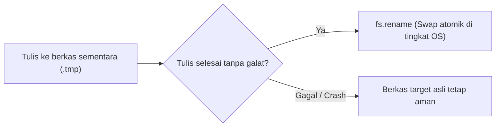

# File System

> Ringkasan
>
> - Fungsi: Mengelola manipulasi berkas dan direktori lokal seperti pembacaan, penulisan, inspeksi metadata, dan penghapusan.
> - Digunakan saat: Menyimpan berkas unggahan, membaca konfigurasi aplikasi, mencatat log transaksi, atau mengelola direktori penyimpanan.
> - Aturan praktis: Selalu prioritaskan `node:fs/promises` untuk operasi non-blocking, terapkan pola penulisan atomik untuk data penting, dan gunakan stream untuk berkas besar di atas 50MB.

---

## Tujuan Belajar

- Membedakan karakteristik API _File System_ sinkron, callback, dan berbasis _promise_.
- Menggunakan metode utama `node:fs/promises` untuk operasi berkas dan direktori.
- Membaca dan menginspeksi metadata serta tipe entri direktori via `Dirent` dan `stat`.
- Menerapkan pola penulisan atomik (_atomic write_) untuk mencegah korupsi data saat terjadi kegagalan proses.
- Mengidentifikasi dan menangani kode galat sistem berkas seperti `ENOENT`, `EEXIST`, dan `EACCES`.

---

## Konsep

> Operasi sistem berkas dianalogikan seperti pengelolaan lemari arsip kantor hukum. Menulis berkas baru (`writeFile`) serupa dengan mengganti seluruh isi map dokumen dengan lembaran baru. Menambahkan catatan (`appendFile`) seperti menyelipkan lembaran tambahan di bagian belakang map tanpa merusak halaman lama. Penulisan atomik (_atomic write_) bekerja seperti menyusun draf dokumen di meja terpisah (`.tmp`), lalu menukarnya ke map arsip resmi dalam satu gerakan instan setelah draf diverifikasi utuh.



---

## Referensi

| Item | Fungsi | Catatan |
| :--- | :----- | :------ |
| **`fs.readFile()`** | Membaca seluruh konten berkas ke memori | Mengembalikan string jika encoding ditentukan, atau `Buffer` jika diabaikan |
| **`fs.writeFile()`** | Menulis data ke berkas dan menimpa isi lama | Otomatis membuat berkas baru jika target belum ada |
| **`fs.appendFile()`** | Menambahkan data ke akhir berkas tanpa menimpa data lama | Cocok untuk pencatatan log transaksi berkelanjutan |
| **`fs.mkdir()`** | Membuat direktori baru pada sistem berkas | Opsi `recursive: true` membuat subdirektori bertingkat secara otomatis |
| **`fs.readdir()`** | Membaca daftar nama entri di dalam direktori | Opsi `withFileTypes: true` mengembalikan array objek `Dirent` tanpa I/O tambahan |
| **`fs.stat()`** | Mengambil metadata teknis berkas atau direktori | Menyediakan informasi ukuran byte, waktu modifikasi, serta method `isFile()` |
| **`fs.access()`** | Menguji keberadaan berkas dan izin akses proses | Menggunakan flag izin dari `node:fs.constants` seperti `F_OK` dan `W_OK` |
| **`fs.copyFile()`** | Menyalin berkas tunggal dari sumber ke tujuan | Menimpa berkas tujuan secara default kecuali dibatasi flag khusus |
| **`fs.rename()`** | Memindahkan atau mengganti nama berkas secara atomik | Menjadi fondasi pola penulisan aman untuk mencegah korupsi data |
| **`fs.unlink()`** | Menghapus satu berkas reguler | Melempar galat `EISDIR` jika target yang dihapus berupa direktori |
| **`fs.rm()`** | Menghapus berkas atau direktori secara fleksibel | Opsi `recursive: true` dan `force: true` membersihkan folder bersarang |

### `fs.readFile()`

Metode `fs.readFile()` digunakan untuk membaca seluruh isi berkas ke dalam memori secara asinkron. Jika parameter encoding diberikan (misalnya `'utf-8'`), metode ini mengembalikan string teks.

```javascript
import fs from "node:fs/promises";
import path from "node:path";
import os from "node:os";

const target = path.join(os.tmpdir(), "data-pengguna.txt");
await fs.writeFile(target, "Nama: Joko Santoso", "utf-8");

const isi = await fs.readFile(target, "utf-8");
console.log(isi);
// Output: Nama: Joko Santoso

await fs.unlink(target);
```

Kasus lain: Membaca berkas tanpa menentukan encoding menghasilkan representasi biner mentah berupa objek `Buffer`.

```javascript
import fs from "node:fs/promises";
import path from "node:path";
import os from "node:os";

const target = path.join(os.tmpdir(), "biner.txt");
await fs.writeFile(target, "Node", "utf-8");

const buffer = await fs.readFile(target);
console.log(Buffer.isBuffer(buffer), buffer.length);
// Output: true 4

await fs.unlink(target);
```

### `fs.writeFile()`

Metode `fs.writeFile()` menulis data baru ke sebuah berkas secara asinkron. Jika berkas sudah ada sebelumnya, isi berkas akan langsung ditimpa dan diganti dengan data baru.

```javascript
import fs from "node:fs/promises";
import path from "node:path";
import os from "node:os";

const target = path.join(os.tmpdir(), "konfigurasi.json");
const data = JSON.stringify({ port: 3000, env: "production" });

await fs.writeFile(target, data, "utf-8");
const isi = await fs.readFile(target, "utf-8");
console.log(isi);
// Output: {"port":3000,"env":"production"}

await fs.unlink(target);
```

Kasus lain: Menggunakan flag eksklusif `'wx'` untuk memastikan penulisan hanya berhasil jika berkas belum ada, dan melempar galat `EEXIST` jika sudah ada.

```javascript
import fs from "node:fs/promises";
import path from "node:path";
import os from "node:os";

const target = path.join(os.tmpdir(), "kunci.lock");
await fs.writeFile(target, "kunci-1", "utf-8");

try {
  await fs.writeFile(target, "kunci-2", { flag: "wx" });
} catch (error) {
  console.log(error.code);
  // Output: EEXIST
}

await fs.unlink(target);
```

### `fs.appendFile()`

Metode `fs.appendFile()` menambahkan konten data ke baris paling akhir berkas tanpa menghapus isi yang sudah ada. Berkas target akan dibuat secara otomatis jika belum tersedia di disk.

```javascript
import fs from "node:fs/promises";
import path from "node:path";
import os from "node:os";

const target = path.join(os.tmpdir(), "aktivitas.log");
await fs.writeFile(target, "BARIS 1\n", "utf-8");
await fs.appendFile(target, "BARIS 2\n", "utf-8");

const isi = await fs.readFile(target, "utf-8");
console.log(isi.trim());
// Output: BARIS 1
// BARIS 2

await fs.unlink(target);
```

Kasus lain: Menambahkan catatan log pada berkas yang belum pernah dibuat sebelumnya.

```javascript
import fs from "node:fs/promises";
import path from "node:path";
import os from "node:os";

const target = path.join(os.tmpdir(), "log-baru.log");
await fs.appendFile(target, "Entri pertama", "utf-8");

const isi = await fs.readFile(target, "utf-8");
console.log(isi);
// Output: Entri pertama

await fs.unlink(target);
```

### `fs.mkdir()`

Metode `fs.mkdir()` membuat direktori baru di dalam sistem penyimpanan. Opsi `{ recursive: true }` memungkinkan pembuatan seluruh jalur direktori bersarang tanpa melempar galat jika direktori sudah ada.

```javascript
import fs from "node:fs/promises";
import path from "node:path";
import os from "node:os";

const targetDir = path.join(os.tmpdir(), "app-cache", "sesi", "token");
await fs.mkdir(targetDir, { recursive: true });

const info = await fs.stat(targetDir);
console.log(info.isDirectory());
// Output: true

await fs.rm(path.join(os.tmpdir(), "app-cache"), { recursive: true, force: true });
```

Kasus lain: Membuat direktori yang sudah ada tanpa opsi `recursive: true` sehingga melempar galat sistem operasi `EEXIST`.

```javascript
import fs from "node:fs/promises";
import path from "node:path";
import os from "node:os";

const targetDir = path.join(os.tmpdir(), "folder-uji");
await fs.mkdir(targetDir, { recursive: true });

try {
  await fs.mkdir(targetDir);
} catch (error) {
  console.log(error.code);
  // Output: EEXIST
}

await fs.rm(targetDir, { recursive: true, force: true });
```

### `fs.readdir()`

Metode `fs.readdir()` membaca daftar entri yang terdapat di dalam sebuah direktori. Memberikan opsi `{ withFileTypes: true }` mengembalikan array objek `Dirent` untuk mendeteksi jenis entri secara langsung.

```javascript
import fs from "node:fs/promises";
import path from "node:path";
import os from "node:os";

const root = path.join(os.tmpdir(), "tes-readdir");
await fs.mkdir(root, { recursive: true });
await fs.writeFile(path.join(root, "dokumen.txt"), "tes", "utf-8");
await fs.mkdir(path.join(root, "subfolder"), { recursive: true });

const entriList = await fs.readdir(root, { withFileTypes: true });
for (const entri of entriList) {
  console.log(`${entri.name}: ${entri.isDirectory() ? "folder" : "berkas"}`);
}
// Output: dokumen.txt: berkas
// subfolder: folder

await fs.rm(root, { recursive: true, force: true });
```

Kasus lain: Membaca direktori tanpa opsi `withFileTypes` yang mengembalikan array berisi string nama entri saja.

```javascript
import fs from "node:fs/promises";
import path from "node:path";
import os from "node:os";

const root = path.join(os.tmpdir(), "tes-string");
await fs.mkdir(root, { recursive: true });
await fs.writeFile(path.join(root, "a.txt"), "", "utf-8");

const namaEntri = await fs.readdir(root);
console.log(namaEntri);
// Output: [ 'a.txt' ]

await fs.rm(root, { recursive: true, force: true });
```

### `fs.stat()`

Metode `fs.stat()` mengambil metadata teknis sebuah berkas atau direktori. Objek hasil memuat ukuran dalam byte, waktu pembuatan, waktu modifikasi terakhir, serta fungsi verifikasi tipe.

```javascript
import fs from "node:fs/promises";
import path from "node:path";
import os from "node:os";

const target = path.join(os.tmpdir(), "metadata.txt");
await fs.writeFile(target, "Hello World", "utf-8");

const stats = await fs.stat(target);
console.log(stats.isFile(), stats.size);
// Output: true 11

await fs.unlink(target);
```

Kasus lain: Menginspeksi path yang tidak ada di sistem berkas sehingga menghasilkan kode galat `ENOENT`.

```javascript
import fs from "node:fs/promises";

try {
  await fs.stat("/jalur/fiktif/data.bin");
} catch (error) {
  console.log(error.code);
  // Output: ENOENT
}
```

### `fs.access()`

Metode `fs.access()` digunakan untuk menguji keberadaan berkas serta hak izin akses proses tanpa perlu membuka berkas secara nyata. Metode ini menerima konstanta mode dari `node:fs.constants`.

```javascript
import fs from "node:fs/promises";
import { constants } from "node:fs";
import path from "node:path";
import os from "node:os";

const target = path.join(os.tmpdir(), "cek-akses.txt");
await fs.writeFile(target, "konten", "utf-8");

let bisaDitulis = false;
try {
  await fs.access(target, constants.F_OK | constants.W_OK);
  bisaDitulis = true;
} catch {
  bisaDitulis = false;
}

console.log(bisaDitulis);
// Output: true

await fs.unlink(target);
```

Kasus lain: Menguji izin akses pada berkas yang tidak terdaftar di sistem berkas.

```javascript
import fs from "node:fs/promises";
import { constants } from "node:fs";

try {
  await fs.access("/berkas/tidak/ada.txt", constants.F_OK);
} catch (error) {
  console.log(error.code);
  // Output: ENOENT
}
```

### `fs.copyFile()`

Metode `fs.copyFile()` menyalin satu berkas tunggal dari jalur sumber ke jalur tujuan secara asinkron. Isi berkas tujuan akan langsung ditimpa jika sudah ada di disk.

```javascript
import fs from "node:fs/promises";
import path from "node:path";
import os from "node:os";

const sumber = path.join(os.tmpdir(), "asli.txt");
const tujuan = path.join(os.tmpdir(), "salinan.txt");

await fs.writeFile(sumber, "Data Asli", "utf-8");
await fs.copyFile(sumber, tujuan);

const isi = await fs.readFile(tujuan, "utf-8");
console.log(isi);
// Output: Data Asli

await fs.unlink(sumber);
await fs.unlink(tujuan);
```

Kasus lain: Mencegah penimpaan berkas tujuan dengan menyertakan flag `constants.COPYFILE_EXCL`.

```javascript
import fs from "node:fs/promises";
import { constants } from "node:fs";
import path from "node:path";
import os from "node:os";

const sumber = path.join(os.tmpdir(), "sumber.txt");
const tujuan = path.join(os.tmpdir(), "tujuan.txt");

await fs.writeFile(sumber, "A", "utf-8");
await fs.writeFile(tujuan, "B", "utf-8");

try {
  await fs.copyFile(sumber, tujuan, constants.COPYFILE_EXCL);
} catch (error) {
  console.log(error.code);
  // Output: EEXIST
}

await fs.unlink(sumber);
await fs.unlink(tujuan);
```

### `fs.rename()`

Metode `fs.rename()` memindahkan atau mengganti nama berkas/direktori. Di tingkat sistem operasi, operasi pemindahan dalam sistem berkas yang sama bersifat atomik.

```javascript
import fs from "node:fs/promises";
import path from "node:path";
import os from "node:os";

const jalurAwal = path.join(os.tmpdir(), "draf.tmp");
const jalurAkhir = path.join(os.tmpdir(), "laporan.txt");

await fs.writeFile(jalurAwal, "Laporan Selesai", "utf-8");
await fs.rename(jalurAwal, jalurAkhir);

const isi = await fs.readFile(jalurAkhir, "utf-8");
console.log(isi);
// Output: Laporan Selesai

await fs.unlink(jalurAkhir);
```

Kasus lain: Mengganti nama berkas asal yang tidak ditemukan sehingga melempar galat `ENOENT`.

```javascript
import fs from "node:fs/promises";

try {
  await fs.rename("/asal/kosong.tmp", "/tujuan/laporan.txt");
} catch (error) {
  console.log(error.code);
  // Output: ENOENT
}
```

### `fs.unlink()`

Metode `fs.unlink()` digunakan untuk menghapus satu berkas reguler dari sistem penyimpanan. Metode ini akan gagal dan melempar galat jika diterapkan pada sebuah direktori.

```javascript
import fs from "node:fs/promises";
import path from "node:path";
import os from "node:os";

const target = path.join(os.tmpdir(), "hapus-saya.txt");
await fs.writeFile(target, "sementara", "utf-8");

await fs.unlink(target);

let berkasAda = true;
try {
  await fs.stat(target);
} catch {
  berkasAda = false;
}
console.log(berkasAda);
// Output: false
```

Kasus lain: Menjalankan `fs.unlink()` pada direktori memicu kode galat sistem operasi `EISDIR` atau `EPERM`.

```javascript
import fs from "node:fs/promises";
import path from "node:path";
import os from "node:os";

const targetDir = path.join(os.tmpdir(), "folder-unlink");
await fs.mkdir(targetDir, { recursive: true });

try {
  await fs.unlink(targetDir);
} catch (error) {
  console.log(["EISDIR", "EPERM"].includes(error.code));
  // Output: true
}

await fs.rm(targetDir, { recursive: true, force: true });
```

### `fs.rm()`

Metode `fs.rm()` menghapus berkas atau direktori secara rekursif dan aman. Metode ini menjadi pengganti modern untuk `rmdir` guna menghapus folder beserta seluruh isinya.

```javascript
import fs from "node:fs/promises";
import path from "node:path";
import os from "node:os";

const targetDir = path.join(os.tmpdir(), "folder-bersarang", "anak");
await fs.mkdir(targetDir, { recursive: true });
await fs.writeFile(path.join(targetDir, "file.txt"), "data", "utf-8");

await fs.rm(path.join(os.tmpdir(), "folder-bersarang"), {
  recursive: true,
  force: true,
});

let folderAda = true;
try {
  await fs.stat(path.join(os.tmpdir(), "folder-bersarang"));
} catch {
  folderAda = false;
}
console.log(folderAda);
// Output: false
```

Kasus lain: Menggunakan opsi `force: true` saat menghapus target yang tidak ada tidak akan memicu galat.

```javascript
import fs from "node:fs/promises";

await fs.rm("/path/pasti/tidak/ada/12345", { force: true, recursive: true });
console.log("Penghapusan aman selesai");
// Output: Penghapusan aman selesai
```

### Perbandingan: Tiga Generasi API File System

| Karakteristik | Synchronous (`node:fs`) | Callback (`node:fs`) | Promises (`node:fs/promises`) |
| :--- | :--- | :--- | :--- |
| **Gaya Sintaks** | `fs.readFileSync()` | `fs.readFile(path, cb)` | `await fs.readFile(path)` |
| **Dampak Event Loop** | Memblokir thread utama hingga I/O selesai | Non-blocking berbasis callback | Non-blocking berbasis Promise |
| **Penanganan Galat** | Blok `try...catch` biasa | Argumen pertama callback (`err`) | Blok `try...catch` pada `async/await` |
| **Kasus Penggunaan** | Skrip inisialisasi awal CLI sederhana | Kode warisan (_legacy_) | Standar aplikasi backend modern |

### Kamus Kode Galat Sistem Berkas

| Kode Galat | Kepanjangan | Arti dan Penyebab |
| :--- | :--- | :--- |
| **`ENOENT`** | _Error No Entry_ | Berkas atau direktori target tidak ditemukan pada jalur yang ditentukan |
| **`EEXIST`** | _Error Exists_ | Target berkas atau direktori sudah ada di sistem |
| **`EACCES`** | _Error Access_ | Hak akses ditolak oleh sistem operasi untuk membaca atau menulis berkas |
| **`EISDIR`** | _Error Is Directory_ | Operasi mengharapkan berkas, tetapi target merupakan direktori |
| **`ENOSPC`** | _Error No Space_ | Kapasitas media penyimpanan perangkat keras telah habis |

---

## Kesalahan Umum

### Membaca Berkas Tanpa Menentukan Parameter Encoding

Mengabaikan opsi encoding saat memanggil `readFile` mengembalikan instance `Buffer` biner mentah alih-alih string teks.

```javascript
// Salah
import fs from "node:fs/promises";

const raw = await fs.readFile("konfigurasi.json");
console.log(typeof raw); // Objek Buffer
```

```javascript
// Benar
import fs from "node:fs/promises";

const raw = await fs.readFile("konfigurasi.json", "utf-8");
const data = JSON.parse(raw);
```

### Menguji Eksistensi Berkas Sebelum Membaca (TOCTOU Race Condition)

Pengecekan keberadaan berkas sebelum pembacaan membuka celah perubahan status berkas di antara jeda mikrodetik kedua operasi.

```javascript
// Salah
import fs from "node:fs/promises";

try {
  await fs.access("data.json");
  const isi = await fs.readFile("data.json", "utf-8");
} catch {
  // Rentan terhadap race condition jika berkas dihapus sebelum readFile
}
```

```javascript
// Benar
import fs from "node:fs/promises";

try {
  const isi = await fs.readFile("data.json", "utf-8");
} catch (error) {
  if (error.code === "ENOENT") {
    // Tangani kondisi berkas belum tersedia secara langsung
  }
}
```

### Menggunakan API Sinkron di Dalam Handler Server

Pemanggilan fungsi berakhiran `Sync` di dalam rute penanganan permintaan menghentikan eksekusi thread utama sehingga memblokir pengguna lain.

```javascript
// Salah
import fs from "node:fs";

function handleRequest() {
  const konten = fs.readFileSync("laporan.pdf");
  return konten;
}
```

```javascript
// Benar
import fs from "node:fs/promises";

async function handleRequest() {
  const konten = await fs.readFile("laporan.pdf");
  return konten;
}
```

---

## Studi Kasus

Skenario: Membangun manajer konfigurasi aplikasi dengan dukungan fallback default dan penulisan atomik aman (_atomic write_) untuk mencegah kerusakan berkas saat aplikasi terhenti mendadak.

```javascript
import fs from "node:fs/promises";
import path from "node:path";
import os from "node:os";

class ConfigManager {
  constructor(filePath, defaultConfig = {}) {
    this.filePath = filePath;
    this.defaultConfig = defaultConfig;
  }

  async read() {
    try {
      const raw = await fs.readFile(this.filePath, "utf-8");
      return JSON.parse(raw);
    } catch (error) {
      if (error.code === "ENOENT") {
        return { ...this.defaultConfig };
      }
      throw error;
    }
  }

  async writeSafe(data) {
    const dir = path.dirname(this.filePath);
    await fs.mkdir(dir, { recursive: true });

    const tempPath = `${this.filePath}.${Date.now()}-${Math.random().toString(36).slice(2)}.tmp`;
    const serialized = JSON.stringify(data, null, 2);

    await fs.writeFile(tempPath, serialized, "utf-8");
    await fs.rename(tempPath, this.filePath);
  }
}

const configDir = path.join(os.tmpdir(), "app-config-" + Date.now());
const targetPath = path.join(configDir, "settings.json");
const manager = new ConfigManager(targetPath, { tema: "gelap", port: 8080 });

const configAwal = await manager.read();
console.log(configAwal);
// Output: { tema: 'gelap', port: 8080 }

await manager.writeSafe({ tema: "terang", port: 3000 });
const configBaru = await manager.read();
console.log(configBaru);
// Output: { tema: 'terang', port: 3000 }

await fs.rm(configDir, { recursive: true, force: true });
```

Desain ini menggunakan kombinasi `fs.writeFile` ke berkas sementara dan `fs.rename` atomik agar operasi penulisan tidak meninggalkan berkas setengah jadi jika proses terputus di tengah jalan. Penanganan galat `ENOENT` pada metode pembacaan memastikan aplikasi tetap berjalan dengan konfigurasi awal saat berkas belum pernah dibuat.

---

## Latihan Mandiri

### Soal 1 (Dasar)

Buat fungsi `pastikanDirektori(jalurFolder)` yang memanfaatkan `fs.mkdir` untuk memastikan sebuah direktori dan seluruh subfolder bersarangnya telah tersedia di disk, lalu mengembalikan nilai boolean `true`.

Contoh masukan:

```javascript
await pastikanDirektori("penyimpanan/laporan/2026");
```

Contoh keluaran yang diharapkan:

```javascript
true
```

Batasan: Wajib menggunakan `node:fs/promises` dengan opsi rekursif tanpa memicu galat jika folder sudah ada.

### Soal 2 (Menengah)

Buat fungsi `hitungStatistikDirektori(jalurFolder)` yang memindai isi satu tingkat direktori menggunakan `fs.readdir` dengan opsi `withFileTypes: true`. Fungsi ini wajib mengembalikan objek yang merangkum jumlah berkas reguler (`totalBerkas`), jumlah subfolder (`totalFolder`), dan total akumulasi ukuran seluruh berkas reguler dalam satuan byte (`totalUkuranByte`) menggunakan `fs.stat`.

Contoh masukan (pada folder dengan 2 berkas berukuran total 150 byte dan 1 subfolder):

```javascript
await hitungStatistikDirektori("data/dokumen");
```

Contoh keluaran yang diharapkan:

```javascript
{
  totalBerkas: 2,
  totalFolder: 1,
  totalUkuranByte: 150
}
```

Batasan: Hanya menghitung entri pada tingkat pertama (tanpa rekursi), serta lemparkan galat jika jalur yang diberikan bukan direktori yang valid.

### Soal 3 (Menantang)

Buat fungsi pembersih berkas kedaluwarsa `bersihkanArsipKadaluarsa(jalurFolder, batasUsiaDetik)`. Fungsi ini wajib menelusuri isi direktori tanpa dependensi eksternal, mengabaikan entri subdirektori, mengevaluasi properti `mtimeMs` berkas reguler via `fs.stat`, lalu menghapus berkas yang usianya melebihi batas waktu menggunakan `fs.unlink`.

Ketentuan penanganan kasus tepi:
- Jika direktori target tidak ditemukan (`ENOENT`), fungsi tidak boleh crash dan harus mengembalikan `{ status: 'gagal', alasan: 'Direktori tidak ditemukan', dihapus: 0, daftarBerkas: [] }`.
- Entri berupa subdirektori harus dilewati tanpa dihapus atau memicu galat.
- Kembalikan daftar nama berkas yang berhasil dihapus beserta jumlah totalnya saat pembersihan berhasil.

Contoh masukan:

```javascript
await bersihkanArsipKadaluarsa("var/log/arsip", 86400);
```

Contoh keluaran yang diharapkan:

```javascript
{
  status: 'selesai',
  dihapus: 2,
  daftarBerkas: [ 'audit-lama.log', 'sesi-kadaluarsa.tmp' ]
}
```

Batasan: Dilarang menggunakan paket pihak ketiga dari NPM. Wajib menggunakan `node:fs/promises` dan menangani potensi galat menggunakan blok `try...catch`.

---

## Navigasi

[Sebelumnya: URL](../06-url/README.md) | [Selanjutnya: Events](../08-events/README.md) | [Daftar Isi](../README.md)
