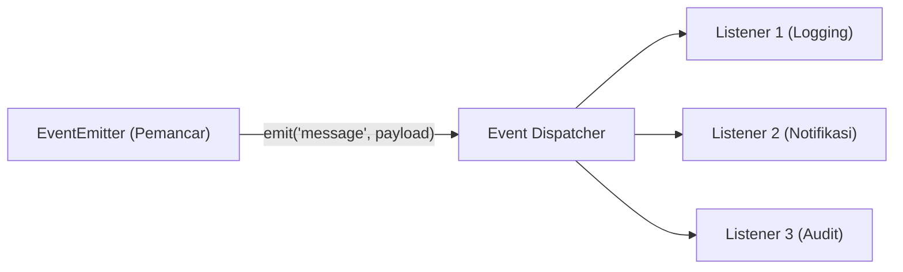

# Events

> Ringkasan
>
> - Fungsi: Mengembangkan arsitektur berbasis peristiwa (_event-driven architecture_) menggunakan objek pemancar sinyal dan penerima yang saling terpisah.
> - Digunakan saat: Mengomunikasikan status antar-modul tanpa ikatan erat (_loose coupling_), mengelola sistem notifikasi, memantau alur proses asinkron, dan menerapkan pola _observer_.
> - Aturan praktis: Selalu sediakan listener untuk event `'error'` agar aplikasi tidak mendadak mati (_crash_), serta lepas listener yang sudah selesai digunakan agar terhindar dari kebocoran memori (_memory leak_).

---

## Tujuan Belajar

- Memahami cara kerja pola desain _Observer_ yang mendasari berbagai modul inti di Node.js.
- Mendaftarkan dan mencopot fungsi listener menggunakan metode `on`, `once`, `off`, dan `removeAllListeners`.
- Memancarkan sinyal peristiwa beserta data payload secara teratur lewat metode `emit`.
- Mengontrol ambang batas maksimal listener dan mencegah penumpukan fungsi di memori.
- Menangani event khusus `'error'` dan menyelaraskan penantian event ke dalam alur Promise menggunakan utilitas `once()`.

---

## Konsep

Pola kerja `EventEmitter` bisa kita bayangkan seperti stasiun radio dan radio penerima di rumah kita. Stasiun pemancar (`emitter`) menyiarkan siaran pada frekuensi tertentu (`emit`), tanpa perlu tahu siapa saja listener-nya atau ada berapa banyak perangkat yang sedang menyala.

Di sisi lain, setiap radio yang menyetel saluran pada frekuensi yang cocok (`on`) akan langsung menangkap dan memutar siaran tersebut seketika. Apabila listener mematikan radio atau berpindah gelombang (`off`), perangkat tersebut tidak akan lagi merespons siaran dari stasiun pemancar tadi.



---

## Referensi

| Item                               | Fungsi                                                                   | Catatan                                                                             |
| :--------------------------------- | :----------------------------------------------------------------------- | :---------------------------------------------------------------------------------- |
| **`emitter.on()`**                 | Mendaftarkan fungsi listener yang selalu menyala untuk event tertentu    | Alias dari `addListener()`, dipanggil berulang kali setiap kali event dipancarkan   |
| **`emitter.once()`**               | Mendaftarkan listener yang hanya dieksekusi satu kali                    | Otomatis dilepas setelah event pertama kali terpancar                               |
| **`emitter.emit()`**               | Memancarkan sinyal event dan memanggil semua listener-nya secara sinkron | Mengembalikan nilai boolean `true` jika memiliki listener, atau `false` jika kosong |
| **`emitter.off()`**                | Mencopot fungsi listener tertentu dari daftar event                      | Alias dari `removeListener()`, membutuhkan referensi fungsi yang sama persis        |
| **`emitter.removeAllListeners()`** | Menghapus semua listener dari satu event tertentu atau seluruh event     | Sangat praktis saat membersihkan sumber daya sebelum objek dibuang                  |
| **`emitter.listenerCount()`**      | Menghitung total listener yang sedang aktif mendengarkan event tertentu  | Berguna untuk proses audit diagnostik dan pemantauan alokasi memori                 |
| **`emitter.setMaxListeners()`**    | Menyesuaikan batas peringatan jumlah listener pada satu objek            | Nilai bawaannya 10 untuk mendeteksi kemungkinan penumpukan memori                   |
| **`events.once()`**                | Mengubah penantian sebuah event menjadi Promise yang bisa di-`await`     | Fungsi utilitas praktis dari modul `node:events`                                    |

### `emitter.on()`

Metode `emitter.on()` digunakan untuk mendaftarkan fungsi listener (_listener_) yang akan dipanggil berulang kali setiap kali event tertentu dipancarkan oleh objek tersebut.

```javascript
import { EventEmitter } from "node:events";

const station = new EventEmitter();
const history = [];

station.on("broadcast", (message) => {
  history.push(message);
});

station.emit("broadcast", "Morning Edition");
station.emit("broadcast", "Noon Edition");

console.log(history);
// Output: [ 'Morning Edition', 'Noon Edition' ]
```

Kasus lain: Jika kita mendaftarkan beberapa listener pada event yang sama, semua listener akan dipanggil berurutan sesuai urutan pendaftarannya.

```javascript
import { EventEmitter } from "node:events";

const queue = new EventEmitter();
const results = [];

queue.on("task", () => results.push("Step 1"));
queue.on("task", () => results.push("Step 2"));

queue.emit("task");
console.log(results);
// Output: [ 'Step 1', 'Step 2' ]
```

### `emitter.once()`

Metode `emitter.once()` mendaftarkan fungsi listener yang hanya akan merespons satu kali saja. Begitu event pertama kali terpancar, fungsi listener langsung dilepaskan secara otomatis.

```javascript
import { EventEmitter } from "node:events";

const server = new EventEmitter();
let loginCount = 0;

server.once("firstLogin", (user) => {
  loginCount += 1;
  console.log(`Welcome ${user}`);
});

server.emit("firstLogin", "Alice");
// Output: Welcome Alice

server.emit("firstLogin", "Bob");
console.log(loginCount);
// Output: 1
```

Kasus lain: Pemancaran event berikutnya setelah pemanggilan pertama akan diabaikan dengan aman tanpa memicu error.

```javascript
import { EventEmitter } from "node:events";

const toggle = new EventEmitter();
let counter = 0;

toggle.once("activate", () => counter++);
toggle.emit("activate");
toggle.emit("activate");

console.log(counter);
// Output: 1
```

### `emitter.emit()`

Metode `emitter.emit()` memancarkan nama event tertentu ke seluruh listener terdaftar dan mengeksekusinya secara sinkron bersama data pendukung yang kita kirimkan.

```javascript
import { EventEmitter } from "node:events";

const paymentProcessor = new EventEmitter();

paymentProcessor.on("success", (id, amount) => {
  console.log(`Invoice ${id}: USD ${amount}`);
});

const hasListeners = paymentProcessor.emit("success", "INV-001", 500);
// Output: Invoice INV-001: USD 500

console.log(hasListeners);
// Output: true
```

Kasus lain: Jika kita memancarkan event yang belum memiliki listener sama sekali, metode ini mengembalikan nilai boolean `false`.

```javascript
import { EventEmitter } from "node:events";

const emitter = new EventEmitter();
const delivered = emitter.emit("unhandledEvent", "payload");

console.log(delivered);
// Output: false
```

### `emitter.off()`

Metode `emitter.off()` digunakan untuk mencopot fungsi listener tertentu dari daftar langganan event. Fungsi yang ingin dilepas harus menunjuk ke referensi memori yang sama persis dengan fungsi saat didaftarkan.

```javascript
import { EventEmitter } from "node:events";

const system = new EventEmitter();
const messages = [];

const logger = (text) => messages.push(text);

system.on("log", logger);
system.emit("log", "Activity 1");

system.off("log", logger);
system.emit("log", "Activity 2");

console.log(messages);
// Output: [ 'Activity 1' ]
```

Kasus lain: Melepas listener menggunakan fungsi panah anonim baru tidak akan berhasil karena alamat memorinya berbeda, sehingga listener asli tetap aktif.

```javascript
import { EventEmitter } from "node:events";

const system = new EventEmitter();
let counter = 0;

system.on("click", () => counter++);
system.off("click", () => counter++);

system.emit("click");
console.log(counter);
// Output: 1
```

### `emitter.removeAllListeners()`

Metode `emitter.removeAllListeners()` menghapus seluruh listener dari suatu nama event tertentu, atau menyapu bersih semua listener dari semua event sekaligus jika dipanggil tanpa menyertakan argumen.

```javascript
import { EventEmitter } from "node:events";

const channel = new EventEmitter();

channel.on("temperature", () => {});
channel.on("temperature", () => {});
channel.on("humidity", () => {});

channel.removeAllListeners("temperature");

console.log(channel.listenerCount("temperature"));
// Output: 0
console.log(channel.listenerCount("humidity"));
// Output: 1
```

Kasus lain: Memanggil metode ini tanpa argumen akan membersihkan semua listener di seluruh event.

```javascript
import { EventEmitter } from "node:events";

const channel = new EventEmitter();
channel.on("ping", () => {});
channel.on("pong", () => {});

channel.removeAllListeners();
console.log(channel.eventNames().length);
// Output: 0
```

### `emitter.listenerCount()`

Metode `emitter.listenerCount()` mengembalikan angka yang menunjukkan jumlah listener yang sedang aktif mendengarkan suatu event tertentu.

```javascript
import { EventEmitter } from "node:events";

const audit = new EventEmitter();
audit.on("transaction", () => {});
audit.on("transaction", () => {});

const total = audit.listenerCount("transaction");
console.log(total);
// Output: 2
```

Kasus lain: Menghitung listener pada event yang belum pernah dibuat akan menghasilkan nilai 0.

```javascript
import { EventEmitter } from "node:events";

const audit = new EventEmitter();
console.log(audit.listenerCount("unknownEvent"));
// Output: 0
```

### `emitter.setMaxListeners()`

Secara bawaan, jika ada lebih dari 10 listener pada satu event, Node.js akan menampilkan peringatan di terminal untuk mencegah kebocoran memori. Kita bisa menaikkan atau menurunkan batas ini menggunakan `emitter.setMaxListeners()`.

```javascript
import { EventEmitter } from "node:events";

const dispatcher = new EventEmitter();
dispatcher.setMaxListeners(25);

console.log(dispatcher.getMaxListeners());
// Output: 25
```

Kasus lain: Mengisi nilai 0 akan menonaktifkan peringatan kuota listener secara keseluruhan (tanpa batas).

```javascript
import { EventEmitter } from "node:events";

const unlimited = new EventEmitter();
unlimited.setMaxListeners(0);

console.log(unlimited.getMaxListeners());
// Output: 0
```

### `events.once()`

Fungsi pembantu `once()` dari modul `node:events` memungkinkan kita menunggu terjadinya suatu event menggunakan Promise, sehingga alur kodenya bisa dipadukan secara rapi dengan kata kunci `await`.

```javascript
import { EventEmitter, once } from "node:events";

const uploader = new EventEmitter();

setTimeout(() => {
  uploader.emit("complete", { status: "success", filename: "image.png" });
}, 10);

const [result] = await once(uploader, "complete");
console.log(result.status, result.filename);
// Output: success image.png
```

Kasus lain: Kita juga bisa membatalkan penantian event dengan memanfaatkan `AbortSignal`, yang akan melempar error `AbortError` jika sinyal pembatalan aktif.

```javascript
import { EventEmitter, once } from "node:events";

const emitter = new EventEmitter();
const ac = new AbortController();
ac.abort();

try {
  await once(emitter, "data", { signal: ac.signal });
} catch (error) {
  console.log(error.name);
  // Output: AbortError
}
```

---

## Kesalahan Umum

### Memancarkan Event 'error' Tanpa Mendaftarkan Listener

Event bernama `'error'` memiliki perlakuan khusus di Node.js. Jika event ini terpancar tanpa ada fungsi listener yang menangani, Node.js akan menganggapnya sebagai pengecualian tak terduga (_uncaught exception_) dan langsung menghentikan aplikasi secara paksa.

```javascript
// Salah
import { EventEmitter } from "node:events";

const emitter = new EventEmitter();
emitter.emit("error", new Error("Connection failed"));
```

```javascript
// Benar
import { EventEmitter } from "node:events";

const emitter = new EventEmitter();
emitter.on("error", (err) => {
  console.log("Handled:", err.message);
});
emitter.emit("error", new Error("Connection failed"));
```

### Mengira Bahwa `emit()` Berjalan Asinkron

Metode `emit()` sebenarnya mengeksekusi semua fungsi listener secara sinkron dan berurutan. Artinya, `emit()` tidak akan otomatis menunggu fungsi `async` di dalam listener selesai berjalan.

```javascript
// Salah
import { EventEmitter } from "node:events";

const emitter = new EventEmitter();
emitter.on("save", async () => {
  await new Promise((resolve) => setTimeout(resolve, 100));
});
await emitter.emit("save");
```

```javascript
// Benar
import { EventEmitter } from "node:events";

const emitter = new EventEmitter();
const taskQueue = [];

emitter.on("save", (tasks) => {
  tasks.push(new Promise((resolve) => setTimeout(resolve, 10)));
});

emitter.emit("save", taskQueue);
await Promise.all(taskQueue);
```

### Mendaftarkan Listener Berulang Kali Tanpa Membersihkannya

Jika kita mendaftarkan listener di dalam fungsi penangan request server tanpa pernah mencopotnya dengan `off()`, jumlah listener akan terus menumpuk di memori pada setiap request yang masuk, hingga akhirnya memicu peringatan kebocoran memori.

```javascript
// Salah
import { EventEmitter } from "node:events";

const bus = new EventEmitter();
function handleRequest() {
  bus.on("complete", () => {});
}
```

```javascript
// Benar
import { EventEmitter } from "node:events";

const bus = new EventEmitter();
function handleRequest() {
  const onComplete = () => {};
  bus.on("complete", onComplete);
  bus.off("complete", onComplete);
}
```

---

## Studi Kasus

Skenario: Membangun sistem alur kerja pemrosesan pesanan toko daring berbasis `EventEmitter` yang mengoordinasikan pencatatan audit, pengiriman konfirmasi, dan penanganan error secara terpisah tanpa saling bergantung erat.

```javascript
import { EventEmitter } from "node:events";

class OrderProcessor extends EventEmitter {
  processOrder(order) {
    if (!order.id || order.total <= 0) {
      this.emit("error", new Error("Invalid order payload"));
      return;
    }

    this.emit("created", order);
    this.emit("success", {
      id: order.id,
      timestamp: "2026-10-12T00:00:00.000Z",
    });
  }
}

const processor = new OrderProcessor();
const auditLogs = [];

processor.on("error", (err) => {
  console.log("Handled error:", err.message);
});

processor.on("created", (order) => {
  auditLogs.push(`Order ${order.id} with total ${order.total}`);
});

processor.once("success", (summary) => {
  console.log(`Confirmation email sent for order ${summary.id}`);
});

processor.processOrder({ id: "ORD-99", total: 150000 });
// Output: Confirmation email sent for order ORD-99

processor.processOrder({ id: "ORD-INVALID", total: 0 });
// Output: Handled error: Invalid order payload

console.log(auditLogs);
// Output: [ 'Order ORD-99 with total 150000' ]
```

Arsitektur ini memisahkan logika utama validasi transaksi dari aksi tambahan seperti pengiriman email dan pencatatan audit. Melalui pola event ini, kita bisa menambahkan aksi-aksi baru di masa depan secara leluasa tanpa perlu mengubah logika inti di dalam kelas `OrderProcessor`.

---

## Latihan Mandiri

### Soal 1 (Dasar)

Buat kelas `AlarmSystem` yang mewarisi `EventEmitter`. Kelas ini memiliki metode `trigger(location)` yang memancarkan event `'alarm'` dengan payload berupa objek `{ location, timestamp: '2026-10-12T00:00:00.000Z' }`.

Contoh input:

```javascript
const alarm = new AlarmSystem();
alarm.on("alarm", (info) => console.log(info.location));
alarm.trigger("Warehouse B");
```

Contoh output yang diharapkan:

```javascript
// Warehouse B
```

Batasan: Gunakan sintaks pewarisan kelas `extends EventEmitter` dari modul `node:events`.

### Soal 2 (Menengah)

Buat kelas `DownloadQueue` yang mewarisi `EventEmitter`. Kelas ini memiliki metode `addTask(filename)` dan `execute()`. Saat `execute()` dipanggil, kelas harus memancarkan event `'progress'` untuk setiap berkas yang sedang diproses, serta memancarkan event `'complete'` di akhir dengan menyertakan array berisi daftar seluruh berkas yang berhasil dituntaskan.

Contoh input:

```javascript
const queue = new DownloadQueue();
queue.addTask("photo.jpg");
queue.addTask("archive.zip");

queue.on("progress", (filename) => console.log("Processing:", filename));
queue.on("complete", (files) => console.log("Total files:", files.length));

queue.execute();
```

Contoh output yang diharapkan:

```javascript
// Processing: photo.jpg
// Processing: archive.zip
// Total files: 2
```

Batasan: Gunakan `EventEmitter` dan hindari mengubah struktur array data input dari luar.

### Soal 3 (Menantang)

Buat kelas `ReliableTaskEmitter` yang mengelola eksekusi tugas bertahap dengan mekanisme percobaan ulang (_retry_) otomatis saat terjadi kegagalan.

Ketentuan metode `runTask(taskName, taskFn, maxRetries = 3)`:

- Memancarkan event `'retry'` setiap kali percobaan dijalankan ulang beserta nomor putarannya.
- Jika fungsi tugas melempar error, tangkap error tersebut secara internal dan coba kembali sampai mencapai batas `maxRetries`.
- Jika percobaan berhasil sebelum batas terlewati, pancarkan event `'success'` bersama nilai hasil eksekusi dan segera hentikan perulangan.
- Jika seluruh kuota percobaan habis dan tugas masih gagal, pancarkan event `'error'` dengan menyertakan pesan error akhir (pastikan listener `'error'` terdaftar agar aplikasi tidak crash).

Contoh input 1 (kasus sukses setelah retry):

```javascript
const emitter = new ReliableTaskEmitter();
let count = 0;

emitter.on("success", (result) => console.log("Result:", result));
await emitter.runTask("calculation", async () => {
  count++;
  if (count < 2) throw new Error("Temporary failure");
  return 42;
});
```

Contoh output 1:

```javascript
// Result: 42
```

Contoh input 2 (kasus gagal hingga kuota habis):

```javascript
const emitter = new ReliableTaskEmitter();
emitter.on("error", (err) => console.log("Fatal error:", err.message));

await emitter.runTask(
  "network",
  async () => {
    throw new Error("Server unreachable");
  },
  2,
);
```

Contoh output 2:

```javascript
// Fatal error: Server unreachable
```

Batasan: Dilarang menggunakan library eksternal pihak ketiga. Terapkan penanganan error yang aman pada event `'error'` tanpa menyebabkan runtime terhenti mendadak.

---

## Navigasi

[Sebelumnya: File System](../07-file-system/README.md) | [Selanjutnya: Buffer](../09-buffer/README.md) | [Daftar Isi](../README.md)
