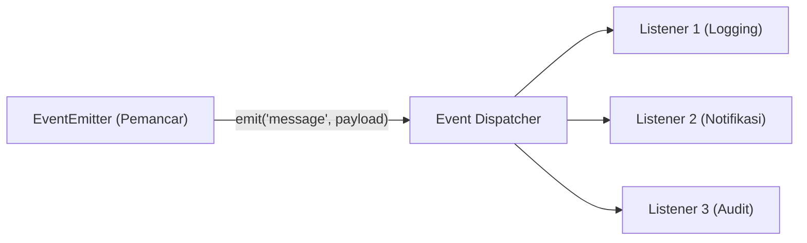

# Events

> Ringkasan
> - Fungsi: Membangun arsitektur berbasis peristiwa (_event-driven architecture_) melalui objek yang memancarkan sinyal dan meresponsnya secara terpisah.
> - Digunakan saat: Mengomunikasikan status antar-modul tanpa kopling ketat, menangani notifikasi sistem, pelacakan proses asinkron, dan perancangan pola _observer_.
> - Aturan praktis: Selalu sediakan pendengar untuk event `'error'` guna mencegah proses terhenti paksa, dan bersihkan pendengar yang tidak lagi dipakai agar terhindar dari kebocoran memori.

---

## Tujuan Belajar

- Memahami pola desain _Observer_ yang mendasari modul-modul inti di Node.js.
- Menerapkan pendaftaran dan pelepasan pendengar menggunakan metode `on`, `once`, `off`, dan `removeAllListeners`.
- Memancarkan event beserta data payload secara terstruktur via `emit`.
- Mengendalikan batas maksimum pendengar dan menganalisis potensi kebocoran memori.
- Menangani event khusus `'error'` dan mengintegrasikan event ke dalam alur Promise melalui utilitas `once()`.

---

## Konsep

> Pola `EventEmitter` dianalogikan seperti stasiun pemancar radio dan pesawat penerima. Stasiun radio (`emitter`) menyiarkan sinyal pada frekuensi tertentu (`emit`) tanpa perlu mengetahui siapa saja atau berapa banyak perangkat yang sedang mendengarkan. Pesawat radio pendengar (`listener`) yang menyetel frekuensi yang sama (`on`) akan langsung menerima siaran tersebut dan memproses pesan secara seketika. Jika saluran dimatikan (`off`), penerima tidak lagi memproses sinyal dari frekuensi itu.



---

## Referensi

| Item | Fungsi | Catatan |
| :--- | :----- | :------ |
| **`emitter.on()`** | Mendaftarkan fungsi pendengar untuk event tertentu secara persisten | Alias dari metode `addListener()`, dipanggil setiap kali event dipancarkan |
| **`emitter.once()`** | Mendaftarkan pendengar yang hanya dieksekusi satu kali | Otomatis dilepas setelah event pertama kali dipancarkan |
| **`emitter.emit()`** | Memancarkan event dan mengeksekusi pendengar secara sinkron | Mengembalikan nilai boolean `true` jika memiliki pendengar, `false` jika tidak |
| **`emitter.off()`** | Menghapus satu fungsi pendengar tertentu dari antrean event | Alias dari metode `removeListener()`, membutuhkan referensi fungsi yang sama |
| **`emitter.removeAllListeners()`** | Menghapus seluruh pendengar dari suatu event atau semua event | Digunakan saat pembersihan sumber daya sebelum objek dibuang |
| **`emitter.listenerCount()`** | Menghitung jumlah pendengar aktif pada event tertentu | Membantu audit diagnostik dan pemantauan alokasi memori |
| **`emitter.setMaxListeners()`** | Mengatur batas peringatan jumlah pendengar pada satu instance | Nilai bawaan adalah 10 untuk mendeteksi potensi kebocoran memori |
| **`events.once()`** | Mengubah penantian event menjadi Promise yang dapat di-await | Fungsi pembantu statis dari modul `node:events` |

### `emitter.on()`

Metode `emitter.on()` digunakan untuk mendaftarkan fungsi pendengar yang akan terus dijalankan setiap kali event yang ditentukan dipancarkan oleh sistem.

```javascript
import { EventEmitter } from 'node:events';

const station = new EventEmitter();
const history = [];

station.on('broadcast', (message) => {
  history.push(message);
});

station.emit('broadcast', 'Morning Edition');
station.emit('broadcast', 'Noon Edition');

console.log(history);
// Output: [ 'Morning Edition', 'Noon Edition' ]
```

Kasus lain: Mendaftarkan beberapa pendengar pada event yang sama akan dieksekusi secara berurutan sesuai urutan pendaftaran.

```javascript
import { EventEmitter } from 'node:events';

const queue = new EventEmitter();
const results = [];

queue.on('task', () => results.push('Step 1'));
queue.on('task', () => results.push('Step 2'));

queue.emit('task');
console.log(results);
// Output: [ 'Step 1', 'Step 2' ]
```

### `emitter.once()`

Metode `emitter.once()` mendaftarkan fungsi pendengar yang hanya dieksekusi satu kali saat event pertama kali dipancarkan, kemudian pendengar tersebut langsung dilepaskan secara otomatis.

```javascript
import { EventEmitter } from 'node:events';

const server = new EventEmitter();
let loginCount = 0;

server.once('firstLogin', (user) => {
  loginCount += 1;
  console.log(`Welcome ${user}`);
});

server.emit('firstLogin', 'Alice');
// Output: Welcome Alice

server.emit('firstLogin', 'Bob');
console.log(loginCount);
// Output: 1
```

Kasus lain: Pemancaran event berikutnya setelah pemanggilan pertama diabaikan secara aman tanpa memicu galat.

```javascript
import { EventEmitter } from 'node:events';

const toggle = new EventEmitter();
let counter = 0;

toggle.once('activate', () => counter++);
toggle.emit('activate');
toggle.emit('activate');

console.log(counter);
// Output: 1
```

### `emitter.emit()`

Metode `emitter.emit()` memancarkan nama event tertentu dan mengeksekusi semua pendengar terdaftar secara sinkron bersama argumen payload yang disertakan.

```javascript
import { EventEmitter } from 'node:events';

const paymentProcessor = new EventEmitter();

paymentProcessor.on('success', (id, amount) => {
  console.log(`Invoice ${id}: USD ${amount}`);
});

const hasListeners = paymentProcessor.emit('success', 'INV-001', 500);
// Output: Invoice INV-001: USD 500

console.log(hasListeners);
// Output: true
```

Kasus lain: Memancarkan event yang tidak memiliki pendengar mengembalikan nilai boolean `false`.

```javascript
import { EventEmitter } from 'node:events';

const emitter = new EventEmitter();
const delivered = emitter.emit('unhandledEvent', 'payload');

console.log(delivered);
// Output: false
```

### `emitter.off()`

Metode `emitter.off()` melepaskan fungsi pendengar tertentu dari daftar langganan event. Fungsi yang dilepas harus merujuk pada referensi memori yang sama persis saat didaftarkan.

```javascript
import { EventEmitter } from 'node:events';

const system = new EventEmitter();
const messages = [];

const logger = (text) => messages.push(text);

system.on('log', logger);
system.emit('log', 'Activity 1');

system.off('log', logger);
system.emit('log', 'Activity 2');

console.log(messages);
// Output: [ 'Activity 1' ]
```

Kasus lain: Melepas pendengar menggunakan fungsi panah anonim baru tidak akan mencocokkan referensi asli sehingga listener lama tetap aktif.

```javascript
import { EventEmitter } from 'node:events';

const system = new EventEmitter();
let counter = 0;

system.on('click', () => counter++);
system.off('click', () => counter++);

system.emit('click');
console.log(counter);
// Output: 1
```

### `emitter.removeAllListeners()`

Metode `emitter.removeAllListeners()` menghapus semua pendengar yang terdaftar pada satu nama event, atau menghapus seluruh pendengar dari setiap event jika dipanggil tanpa argumen.

```javascript
import { EventEmitter } from 'node:events';

const channel = new EventEmitter();

channel.on('temperature', () => {});
channel.on('temperature', () => {});
channel.on('humidity', () => {});

channel.removeAllListeners('temperature');

console.log(channel.listenerCount('temperature'));
// Output: 0
console.log(channel.listenerCount('humidity'));
// Output: 1
```

Kasus lain: Memanggil metode ini tanpa argumen menghapus seluruh pendengar dari semua event yang ada.

```javascript
import { EventEmitter } from 'node:events';

const channel = new EventEmitter();
channel.on('ping', () => {});
channel.on('pong', () => {});

channel.removeAllListeners();
console.log(channel.eventNames().length);
// Output: 0
```

### `emitter.listenerCount()`

Metode `emitter.listenerCount()` mengembalikan angka integer yang menunjukkan total pendengar yang saat ini terdaftar pada sebuah nama event.

```javascript
import { EventEmitter } from 'node:events';

const audit = new EventEmitter();
audit.on('transaction', () => {});
audit.on('transaction', () => {});

const total = audit.listenerCount('transaction');
console.log(total);
// Output: 2
```

Kasus lain: Menghitung pendengar pada event yang belum pernah dibuat menghasilkan nilai 0.

```javascript
import { EventEmitter } from 'node:events';

const audit = new EventEmitter();
console.log(audit.listenerCount('unknownEvent'));
// Output: 0
```

### `emitter.setMaxListeners()`

Metode `emitter.setMaxListeners()` mengubah batas peringatan jumlah pendengar maksimum pada satu instance. Jika jumlah pendengar melebihi batas ini, Node.js mencetak peringatan potensi kebocoran memori.

```javascript
import { EventEmitter } from 'node:events';

const dispatcher = new EventEmitter();
dispatcher.setMaxListeners(25);

console.log(dispatcher.getMaxListeners());
// Output: 25
```

Kasus lain: Menetapkan batas menjadi 0 menonaktifkan peringatan kuota pendengar tanpa batas.

```javascript
import { EventEmitter } from 'node:events';

const unlimited = new EventEmitter();
unlimited.setMaxListeners(0);

console.log(unlimited.getMaxListeners());
// Output: 0
```

### `events.once()`

Fungsi utilitas `once()` dari modul `node:events` mengonversi penantian suatu event menjadi Promise sehingga proses pemanggilan dapat diselaraskan menggunakan kata kunci `await`.

```javascript
import { EventEmitter, once } from 'node:events';

const uploader = new EventEmitter();

setTimeout(() => {
  uploader.emit('complete', { status: 'success', filename: 'image.png' });
}, 10);

const [result] = await once(uploader, 'complete');
console.log(result.status, result.filename);
// Output: success image.png
```

Kasus lain: Membatalkan penantian event menggunakan `AbortSignal` yang melempar galat `AbortError`.

```javascript
import { EventEmitter, once } from 'node:events';

const emitter = new EventEmitter();
const ac = new AbortController();
ac.abort();

try {
  await once(emitter, 'data', { signal: ac.signal });
} catch (error) {
  console.log(error.name);
  // Output: AbortError
}
```

---

## Kesalahan Umum

### Memancarkan Event 'error' Tanpa Mendaftarkan Pendengar

Memancarkan event bernama `'error'` tanpa ada listener yang mendengarkan menyebabkan Node.js menganggapnya sebagai pengecualian yang tidak tertangani dan menghentikan proses aplikasi.

```javascript
// Salah
import { EventEmitter } from 'node:events';

const emitter = new EventEmitter();
emitter.emit('error', new Error('Connection failed'));
```

```javascript
// Benar
import { EventEmitter } from 'node:events';

const emitter = new EventEmitter();
emitter.on('error', (err) => {
  console.log('Handled:', err.message);
});
emitter.emit('error', new Error('Connection failed'));
```

### Mengasumsikan Bahwa `emit()` Berjalan Secara Asinkron

Metode `emit()` mengeksekusi semua listener secara sinkron dan berurutan, sehingga tidak menunggu Promise di dalam fungsi listener selesai.

```javascript
// Salah
import { EventEmitter } from 'node:events';

const emitter = new EventEmitter();
emitter.on('save', async () => {
  await new Promise((resolve) => setTimeout(resolve, 100));
});
await emitter.emit('save');
```

```javascript
// Benar
import { EventEmitter } from 'node:events';

const emitter = new EventEmitter();
const taskQueue = [];

emitter.on('save', (tasks) => {
  tasks.push(new Promise((resolve) => setTimeout(resolve, 10)));
});

emitter.emit('save', taskQueue);
await Promise.all(taskQueue);
```

### Menambahkan Pendengar Berulang Tanpa Membersihkannya

Mendaftarkan listener di dalam fungsi penanganan rute tanpa pernah memanggil `off` menumpuk referensi fungsi di memori hingga memicu peringatan kebocoran memori.

```javascript
// Salah
import { EventEmitter } from 'node:events';

const bus = new EventEmitter();
function handleRequest() {
  bus.on('complete', () => {});
}
```

```javascript
// Benar
import { EventEmitter } from 'node:events';

const bus = new EventEmitter();
function handleRequest() {
  const onComplete = () => {};
  bus.on('complete', onComplete);
  bus.off('complete', onComplete);
}
```

---

## Studi Kasus

Skenario: Membangun sistem alur kerja pemrosesan pesanan belanja berbasis `EventEmitter` yang mengoordinasikan audit, konfirmasi, dan penanganan galat secara terisolasi tanpa kopling erat.

```javascript
import { EventEmitter } from 'node:events';

class OrderProcessor extends EventEmitter {
  processOrder(order) {
    if (!order.id || order.total <= 0) {
      this.emit('error', new Error('Invalid order payload'));
      return;
    }

    this.emit('created', order);
    this.emit('success', { id: order.id, timestamp: '2026-10-12T00:00:00.000Z' });
  }
}

const processor = new OrderProcessor();
const auditLogs = [];

processor.on('error', (err) => {
  console.log('Handled error:', err.message);
});

processor.on('created', (order) => {
  auditLogs.push(`Order ${order.id} with total ${order.total}`);
});

processor.once('success', (summary) => {
  console.log(`Confirmation email sent for order ${summary.id}`);
});

processor.processOrder({ id: 'ORD-99', total: 150000 });
// Output: Confirmation email sent for order ORD-99

processor.processOrder({ id: 'ORD-INVALID', total: 0 });
// Output: Handled error: Invalid order payload

console.log(auditLogs);
// Output: [ 'Order ORD-99 with total 150000' ]
```

Desain ini memisahkan logika bisnis validasi pesanan dari aksi sampingan seperti pengiriman notifikasi dan pencatatan riwayat audit. Pemisahan berbasis event ini memungkinkan penambahan modul pendengar baru di masa mendatang tanpa perlu memodifikasi logika inti kelas `OrderProcessor`.

---

## Latihan Mandiri

### Soal 1 (Dasar)

Buat kelas `AlarmSystem` yang mewarisi `EventEmitter`. Kelas ini memiliki metode `trigger(location)` yang memancarkan event `'alarm'` dengan payload berupa objek `{ location, timestamp: '2026-10-12T00:00:00.000Z' }`.

Contoh masukan:

```javascript
const alarm = new AlarmSystem();
alarm.on('alarm', (info) => console.log(info.location));
alarm.trigger('Warehouse B');
```

Contoh keluaran yang diharapkan:

```javascript
// Warehouse B
```

Batasan: Wajib menggunakan sintaks pewarisan kelas `extends EventEmitter` dari modul `node:events`.

### Soal 2 (Menengah)

Buat kelas `DownloadQueue` yang mewarisi `EventEmitter`. Kelas ini memiliki metode `addTask(filename)` dan `execute()`. Saat `execute()` dipanggil, kelas memancarkan event `'progress'` untuk setiap berkas yang diproses, dan memancarkan event `'complete'` di akhir bersama array berisi daftar seluruh berkas yang telah tuntas.

Contoh masukan:

```javascript
const queue = new DownloadQueue();
queue.addTask('photo.jpg');
queue.addTask('archive.zip');

queue.on('progress', (filename) => console.log('Processing:', filename));
queue.on('complete', (files) => console.log('Total files:', files.length));

queue.execute();
```

Contoh keluaran yang diharapkan:

```javascript
// Processing: photo.jpg
// Processing: archive.zip
// Total files: 2
```

Batasan: Wajib menggunakan `EventEmitter`, dan dilarang memutasikan array masukan luar.

### Soal 3 (Menantang)

Buat kelas `ReliableTaskEmitter` yang mengelola eksekusi tugas bertahap dengan mekanisme percobaan ulang (_retry_) terpadu.

Metode `runTask(taskName, taskFn, maxRetries = 3)`:
- Memancarkan event `'retry'` setiap kali percobaan dieksekusi dengan nomor putaran percobaan.
- Jika fungsi tugas melempar galat, tangkap secara internal dan coba kembali hingga mencapai batas `maxRetries`.
- Jika percobaan berhasil sebelum batas terlampaui, pancarkan event `'success'` bersama hasil eksekusi dan hentikan iterasi.
- Jika seluruh batas percobaan terlampaui dan tugas tetap gagal, pancarkan event `'error'` dengan pesan galat akhir (wajib dipasang pendengar `'error'` agar proses tidak crash).

Contoh masukan 1:

```javascript
const emitter = new ReliableTaskEmitter();
let count = 0;

emitter.on('success', (result) => console.log('Result:', result));
await emitter.runTask('calculation', async () => {
  count++;
  if (count < 2) throw new Error('Temporary failure');
  return 42;
});
```

Contoh keluaran 1:

```javascript
// Result: 42
```

Contoh masukan 2:

```javascript
const emitter = new ReliableTaskEmitter();
emitter.on('error', (err) => console.log('Fatal error:', err.message));

await emitter.runTask('network', async () => {
  throw new Error('Server unreachable');
}, 2);
```

Contoh keluaran 2:

```javascript
// Fatal error: Server unreachable
```

Batasan: Dilarang menggunakan pustaka eksternal. Wajib mengimplementasikan penanganan galat aman pada event `'error'` tanpa membiarkan runtime terhenti paksa.

---

## Navigasi

[Sebelumnya: File System](../07-file-system/README.md) | [Selanjutnya: Buffer](../09-buffer/README.md) | [Daftar Isi](../README.md)
