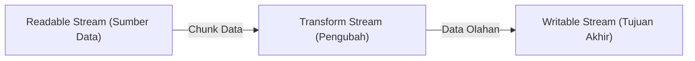

# Stream

> Ringkasan
>
> - Tingkat: Fondasi
> - Fungsi: Mengolah dan mentransfer stream data besar secara bertahap sepotong demi sepotong (chunk) tanpa membebani memori RAM.
> - Digunakan saat: Membaca file berukuran gigabyte, mengompresi data, mengalirkan respons HTTP, dan mengolah log real-time.
> - Aturan praktis: Selalu gunakan `pipeline()` dari `node:stream/promises` daripada `.pipe()` lama untuk mencegah kebocoran memori akibat stream yang tidak tertutup saat terjadi error.

## Cheat Sheet

| Tugas                                         | Kode                                                                  |
| :-------------------------------------------- | :-------------------------------------------------------------------- |
| Membuat readable stream dari array/iterable   | `const src = Readable.from(["halo", "dunia"]);`                       |
| Membuat writable stream penampung data        | `const dest = new Writable({ write(c, e, cb) { cb(); } });`           |
| Membuat transform stream pengubah data        | `const tf = new Transform({ transform(c, e, cb) { cb(null, c); } });` |
| Mengalirkan stream aman dengan auto cleanup   | `await pipeline(source, transform, dest);`                            |
| Menunggu stream tuntas atau error via Promise | `await finished(stream);`                                             |
| Menulis data potongan ke writable stream      | `const canWriteMore = writable.write(chunk);`                         |
| Menutup writable stream                        | `writable.end();`                                                     |

## Tujuan Belajar

- Memahami konsep dasar pemrosesan data berbasis stream dan manajemen memori.
- Membedakan empat tipe stream: Readable, Writable, Duplex, dan Transform.
- Mengubah dan memanipulasi data yang sedang mengalir menggunakan `Transform`.
- Mengendalikan tekanan balik (_backpressure_) dan mengalirkan data secara aman memakai `pipeline()`.

## Konsep

Bayangkan kamu ingin memindahkan air dari bak mandi besar ke kolam taman. Cara pertama adalah menampung seluruh air ke dalam satu ember raksasa berukuran 200 liter sekaligus; ember ini sangat berat dan bisa membuat lantai patah (analogi memuat file raksasa ke RAM dengan `fs.readFile` yang berujung `JavaScript heap out of memory`). Cara kedua adalah menggunakan selang air. Air mengalir sedikit demi sedikit secara kontinu dari keran (Readable) melalui filter penyaring (Transform) menuju kolam (Writable). Memori yang dibutuhkan sangat kecil karena aplikasi hanya menampung beberapa kilobyte data di dalam selang pada satu waktu.



## Referensi

| Item                              | Fungsi                                                         | Catatan                                                    |
| :-------------------------------- | :------------------------------------------------------------- | :--------------------------------------------------------- |
| `Readable`                        | Class stream untuk membaca data dari suatu sumber              | Mendukung iterasi asinkron `for await...of`                |
| `Writable`                        | Class stream untuk menampung atau menulis data ke tujuan       | Memancarkan event `'drain'` saat buffer internal kosong    |
| `Transform`                       | Stream dua arah yang memodifikasi data yang lewat              | Input dan output tidak harus berukuran sama                |
| `pipeline(...streams, [options])` | Menghubungkan antar stream dengan penanganan error dan cleanup | Tersedia versi Promise di `node:stream/promises`           |
| `finished(stream, [options])`     | Mendeteksi kapan stream selesai dibaca atau mengalami error    | Tersedia versi Promise di `node:stream/promises`           |
| `writable.write(chunk)`           | Menuliskan satu potongan data ke dalam stream                  | Mengembalikan `false` bila buffer mencapai batas kapasitas |
| `writable.end([chunk])`           | Memberi sinyal bahwa tidak ada lagi data yang akan ditulis     | Menutup stream dan memancarkan event `'finish'`            |

### `Readable`

`Readable` merepresentasikan sumber data yang dapat dikonsumsi secara bertahap.

Struktur parameter: `new Readable(options)` atau pembantu statis `Readable.from(iterable)`

- `iterable` (Array atau AsyncIterable, wajib): sumber data yang akan dialirkan.

Nilai kembalian: instance stream pembacaan (`Readable`).

```javascript
import { Readable } from "node:stream";

const stream = Readable.from(["Hello ", "World"]);
let result = "";

for await (const chunk of stream) {
  result += chunk;
}

console.log(result);
// Output: Hello World
```

Kondisi khusus: Stream yang dijeda terlalu lama tanpa ada yang membaca data dapat menumpuk buffer internal di memori jika sumber terus memompa data.

### `Writable`

`Writable` adalah tujuan akhir tempat data dialirkan dan disimpan (seperti file disk, terminal, atau koneksi socket).

Struktur parameter: `new Writable(options)`

- `options` (object, wajib): objek opsi yang mengimplementasikan metode `write(chunk, encoding, callback)`.

Nilai kembalian: instance stream penulisan (`Writable`).

```javascript
import { Writable } from "node:stream";

const chunks = [];
const customWritable = new Writable({
  write(chunk, encoding, callback) {
    chunks.push(chunk.toString());
    callback();
  },
});

customWritable.write("Chunk 1");
customWritable.end();

console.log(chunks.join(""));
// Output: Chunk 1
```

Kondisi khusus: Menulis data setelah metode `.end()` dipanggil akan melempar error `ERR_STREAM_WRITE_AFTER_END`.

### `Transform`

`Transform` adalah jenis stream Duplex khusus yang menerima data masuk, mengolahnya secara langsung, lalu menghasilkan output baru.

Struktur parameter: `new Transform(options)`

- `options` (object, wajib): objek konfigurasi yang mengimplementasikan metode `transform(chunk, encoding, callback)`.

Nilai kembalian: instance stream transformasi (`Transform`).

```javascript
import { Transform } from "node:stream";

const upperTransform = new Transform({
  transform(chunk, encoding, callback) {
    callback(null, chunk.toString().toUpperCase());
  },
});

upperTransform.on("data", (chunk) => {
  console.log(chunk.toString());
});

upperTransform.write("node");
upperTransform.end();
// Output: NODE
```

Kondisi khusus: Selalu panggil fungsi `callback(err, data)` di dalam metode `transform` agar alur stream tidak menggantung.

### `pipeline(...streams, [options])`

`pipeline()` dari modul `node:stream/promises` menyambungkan beberapa stream sekaligus, meneruskan error secara transparan, dan otomatis menghancurkan stream jika salah satu titik pipa gagal.

Struktur parameter: `pipeline(...streams, options)`

- `streams` (Stream[], wajib): barisan stream dimulai dari Readable hingga Writable.
- `options` (object, opsional): opsi konfigurasi seperti `{ signal }` untuk pembatalan.

Nilai kembalian: `Promise<void>`.

```javascript
import { Readable, Writable, Transform } from "node:stream";
import { pipeline } from "node:stream/promises";

const source = Readable.from(["learn", "stream"]);
const upper = new Transform({
  transform(chunk, enc, cb) {
    cb(null, chunk.toString().toUpperCase() + " ");
  },
});

let output = "";
const dest = new Writable({
  write(chunk, enc, cb) {
    output += chunk.toString();
    cb();
  },
});

await pipeline(source, upper, dest);
console.log(output.trim());
// Output: LEARN STREAM
```

Kondisi khusus: Jika salah satu stream melempar error, seluruh stream yang terhubung dalam pipa akan otomatis ditutup sehingga mencegah kebocoran sumber daya OS.

### `writable.write()` dan `writable.end()`

`.write()` menyalurkan satu potongan data ke stream, sedangkan `.end()` menutup stream penulisan tersebut.

Struktur parameter: `writable.write(chunk, [encoding], [callback])` dan `writable.end([chunk], [encoding], [callback])`.

Nilai kembalian: `.write()` mengembalikan boolean `true` jika buffer internal masih mampu menampung data, atau `false` jika buffer sudah penuh (terjadi tekanan balik / backpressure).

```javascript
import { Writable } from "node:stream";

const writer = new Writable({
  write(chunk, enc, cb) {
    cb();
  },
});

const canAcceptMore = writer.write("data chunk");
console.log(canAcceptMore);
// Output: true

writer.end();
```

Kondisi khusus: Jika `.write()` mengembalikan `false`, produsen data harus berhenti menulis sementara dan menunggu hingga event `'drain'` dipancarkan.

## Kesalahan Umum

### Memakai `.pipe()` Lama Tanpa Penanganan Error

Metode `readable.pipe(writable)` bawaan lama tidak meneruskan error dari stream sumber ke stream tujuan, sehingga memicu stream menggantung tanpa tertutup.

```javascript
// Incorrect
readable.pipe(transform).pipe(writable); // Leaks file descriptors on error

// Correct
import { pipeline } from "node:stream/promises";
await pipeline(readable, transform, writable); // Automatically cleans up and propagates errors
```

### Mengabaikan Sinyal Tekanan Balik (Backpressure)

Memompa data secara membabi buta saat `.write()` mengembalikan `false` akan memaksa Node.js menimbun data di memori heap hingga aplikasi crash kehabisan RAM.

```javascript
// Incorrect
while (hasMoreData()) {
  writable.write(data); // Uncontrolled RAM spike if consumer is slow
}

// Correct
// Use pipeline() or wait for the 'drain' event before writing more data
```

## Studi Kasus

Membangun filter baris teks berbasis stream untuk menyaring log aplikasi berukuran besar berdasarkan kata kunci tertentu secara efisien tanpa menghabiskan memori.

```javascript
import { Readable, Writable, Transform } from "node:stream";
import { pipeline } from "node:stream/promises";

class KeywordFilter extends Transform {
  constructor(keyword) {
    super();
    this.keyword = keyword;
  }

  _transform(chunk, encoding, callback) {
    const text = chunk.toString();
    if (text.includes(this.keyword)) {
      this.push(text);
    }
    callback();
  }
}

const sourceLogs = Readable.from([
  "INFO: Server active\n",
  "ERROR: Database down\n",
  "DEBUG: Cache hit\n",
]);

const collectedErrors = [];
const destination = new Writable({
  write(chunk, encoding, callback) {
    collectedErrors.push(chunk.toString().trim());
    callback();
  },
});

await pipeline(sourceLogs, new KeywordFilter("ERROR"), destination);

console.log(collectedErrors.length);
// Output: 1
console.log(collectedErrors[0]);
// Output: ERROR: Database down
```

Arsitektur stream ini mampu memproses file log berukuran puluhan gigabyte secara stabil, karena setiap baris teks langsung diproses dan dibuang dari memori begitu diteruskan ke stream berikutnya.

## Latihan Mandiri

Buat fungsi `processDataStream(inputStream, transformFn, outputStream, options = {})` untuk mengalirkan data melalui saluran transformasi asinkron.

- **Level 1 (Dasar):** Buat instance `Transform` yang memodifikasi setiap potongan data `chunk` memakai fungsi `transformFn(chunk)`. Hubungkan `inputStream` ke transformer dan `outputStream` memakai `pipeline()` dari `node:stream/promises`.
- **Level 2 (Menengah):** Hitung metrik pemrosesan selama stream berjalan: jumlah potongan data (`processedChunks`) dan total ukuran byte yang diproses (`totalBytes`). Kembalikan objek `{ processedChunks, totalBytes }`.
- **Level 3 (Menantang):** Dukung opsi `options.signal` (`AbortSignal`). Jika sinyal pembatalan aktif di tengah streaming, tangkap pembatalan tersebut dan lempar `Error("Stream pipeline aborted")`.

Contoh input dan output normal:

```javascript
const source = Readable.from(["first message", "second message"]);
let outputData = [];
const dest = new Writable({
  write(chunk, enc, cb) {
    outputData.push(chunk.toString());
    cb();
  },
});

const stats = await processDataStream(
  source,
  (c) => c.toString().toUpperCase(),
  dest,
);

console.log(outputData.join(", "));
// Output: FIRST MESSAGE, SECOND MESSAGE
console.log(stats.processedChunks);
// Output: 2
console.log(stats.totalBytes > 0);
// Output: true
```

Contoh input dan penanganan error:

```javascript
const source = Readable.from(["line 1", "line 2"]);
const dest = new Writable({
  write(c, e, cb) {
    cb();
  },
});
const controller = new AbortController();
controller.abort();

try {
  await processDataStream(source, (c) => c, dest, {
    signal: controller.signal,
  });
} catch (err) {
  console.log(err.message);
  // Output: Stream pipeline aborted
}
```

Tanda selesai:

- [ ] Stream data dari readable diteruskan ke writable melalui transform memakai `pipeline()`.
- [ ] Statistik jumlah potongan chunk dan total byte dihitung dengan tepat.
- [ ] Sinyal pembatalan `AbortController` menghentikan pemrosesan stream dan melempar `Error`.

---

## Navigasi

[Sebelumnya: Buffer](../07-buffer/README.md) | [Selanjutnya: Timer](../09-timer/README.md) | [Daftar Isi](../README.md)
