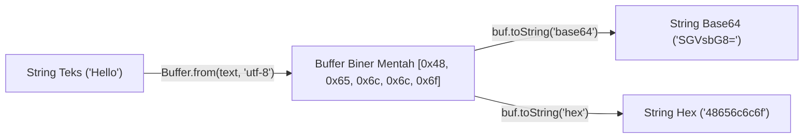

# Buffer

> Ringkasan
> - Fungsi: Mengelola dan memanipulasi aliran data biner mentah pada alokasi memori C++ di luar heap mesin V8.
> - Digunakan saat: Membaca berkas biner, mentransfer paket protokol jaringan TCP, melakukan enkripsi kriptografi, dan konversi format _encoding_.
> - Aturan praktis: Selalu gunakan metode pabrik modern seperti `Buffer.from()` atau `Buffer.alloc()`, hindari pemanggilan konstruktor usang `new Buffer()`, dan tentukan _encoding_ secara eksplisit.

---

## Tujuan Belajar

- Memahami peran kelas `Buffer` dalam menangani data biner mentah pada runtime Node.js.
- Mengalokasikan memori buffer secara aman menggunakan `Buffer.alloc()` dan `Buffer.from()`.
- Mengonversi data biner ke berbagai format _encoding_ seperti UTF-8, Base64, dan Hex.
- Menggabungkan beberapa segmen buffer menjadi satu kesatuan via `Buffer.concat()`.
- Menghitung ukuran byte aktual menggunakan `Buffer.byteLength()` dan memanipulasi irisan byte via `subarray()`.

---

## Konsep

> `Buffer` dianalogikan seperti wadah ember penampung air berukuran tetap. JavaScript standar pada awalnya dirancang khusus untuk memproses teks, sedangkan aliran data dari perangkat keras jaringan atau disk masuk dalam bentuk partikel biner mentah (arus byte `0` dan `1`). Node.js menyediakan ember `Buffer` dengan kapasitas byte yang dikunci sejak awal alokasi. Partikel biner tersebut ditampung sementara sebelum diterjemahkan menjadi teks atau diteruskan ke komponen sistem lainnya.



---

## Referensi

| Item | Fungsi | Catatan |
| :--- | :----- | :------ |
| **`Buffer.from()`** | Membuat instance buffer baru dari string, array, atau buffer lain | Mendukung decoding UTF-8, Base64, Hex, dan latin1 |
| **`Buffer.alloc()`** | Mengalokasikan memori berukuran tetap yang telah diisi nilai nol | Menjamin keamanan alokasi dengan menghapus sisa data memori |
| **`Buffer.allocUnsafe()`** | Mengalokasikan memori tanpa inisialisasi isi nol | Berjalan lebih cepat namun berisiko memuat residu memori lama |
| **`buf.toString()`** | Mengonversi byte biner di dalam buffer menjadi representasi string | Menerima parameter encoding seperti `'utf-8'`, `'base64'`, atau `'hex'` |
| **`Buffer.concat()`** | Menggabungkan array beberapa buffer menjadi satu buffer baru | Membantu rekonstruksi paket data yang diterima bertahap |
| **`Buffer.isBuffer()`** | Memeriksa apakah suatu objek merupakan instance dari `Buffer` | Mengembalikan nilai boolean tanpa melempar galat |
| **`Buffer.byteLength()`** | Menghitung jumlah byte fisik aktual dari string teks | Menghasilkan nilai berbeda dari `string.length` pada karakter multibyte |
| **`buf.subarray()`** | Mengambil irisan referensi byte tanpa mengalokasikan memori baru | Berbagi alokasi memori yang sama dengan buffer induknya |

### `Buffer.from()`

Metode `Buffer.from()` membuat instance `Buffer` baru yang disalin dari string, array integer byte, atau buffer lain.

```javascript
import { Buffer } from 'node:buffer';

const buf = Buffer.from('Hello Node', 'utf-8');
console.log(buf.length);
// Output: 10
console.log(buf[0]);
// Output: 72
```

Kasus lain: Membuat buffer dari array bilangan integer 8-bit (rentang nilai 0 hingga 255).

```javascript
import { Buffer } from 'node:buffer';

const byteList = Buffer.from([65, 66, 67]);
console.log(byteList.toString('utf-8'));
// Output: ABC
```

### `Buffer.alloc()`

Metode `Buffer.alloc()` mengalokasikan blok memori berukuran tetap yang seluruh nilainya diinisialisasi dengan angka nol (`0x00`).

```javascript
import { Buffer } from 'node:buffer';

const emptyBuf = Buffer.alloc(4);
console.log(emptyBuf);
// Output: <Buffer 00 00 00 00>
```

Kasus lain: Mengisi alokasi memori awal dengan nilai byte kustom yang ditentukan.

```javascript
import { Buffer } from 'node:buffer';

const filledBuf = Buffer.alloc(3, 0xff);
console.log(filledBuf.toString('hex'));
// Output: ffffff
```

### `Buffer.allocUnsafe()`

Metode `Buffer.allocUnsafe()` mengalokasikan memori tanpa membersihkan data lama yang tertinggal di blok memori tersebut, sehingga proses alokasi berjalan sangat cepat.

```javascript
import { Buffer } from 'node:buffer';

const fastBuf = Buffer.allocUnsafe(4);
fastBuf.fill(0);
console.log(fastBuf.length);
// Output: 4
```

Kasus lain: Memberikan nilai ukuran negatif memicu galat `RangeError`.

```javascript
import { Buffer } from 'node:buffer';

try {
  Buffer.allocUnsafe(-1);
} catch (error) {
  console.log(error.name);
  // Output: RangeError
}
```

### `buf.toString()`

Metode `buf.toString()` mendekode representasi byte biner di dalam buffer menjadi teks string dengan format _encoding_ yang dipilih.

```javascript
import { Buffer } from 'node:buffer';

const buf = Buffer.from('NodeJS', 'utf-8');

console.log(buf.toString('hex'));
// Output: 4e6f64654a53
console.log(buf.toString('base64'));
// Output: Tm9kZUpT
```

Kasus lain: Menentukan indeks awal dan akhir potongan byte saat mengekspor ke format string.

```javascript
import { Buffer } from 'node:buffer';

const buf = Buffer.from('NodeJS', 'utf-8');
console.log(buf.toString('utf-8', 0, 4));
// Output: Node
```

### `Buffer.concat()`

Metode `Buffer.concat()` menggabungkan beberapa instance buffer di dalam array menjadi satu instance buffer utuh yang berkelanjutan.

```javascript
import { Buffer } from 'node:buffer';

const partA = Buffer.from('Left ');
const partB = Buffer.from('Right');
const combined = Buffer.concat([partA, partB]);

console.log(combined.toString('utf-8'));
// Output: Left Right
```

Kasus lain: Menggabungkan array kosong menghasilkan buffer baru dengan panjang 0 byte.

```javascript
import { Buffer } from 'node:buffer';

const emptyBuf = Buffer.concat([]);
console.log(emptyBuf.length);
// Output: 0
```

### `Buffer.isBuffer()`

Metode `Buffer.isBuffer()` memvalidasi apakah variabel yang diuji merupakan instance resmi dari objek `Buffer`.

```javascript
import { Buffer } from 'node:buffer';

const binaryData = Buffer.alloc(2);
const textData = 'not a buffer';

console.log(Buffer.isBuffer(binaryData));
// Output: true
console.log(Buffer.isBuffer(textData));
// Output: false
```

Kasus lain: Menguji nilai `null` atau `undefined` menghasilkan nilai boolean `false`.

```javascript
import { Buffer } from 'node:buffer';

console.log(Buffer.isBuffer(null));
// Output: false
```

### `Buffer.byteLength()`

Metode `Buffer.byteLength()` menghitung jumlah byte fisik aktual yang dibutuhkan untuk menyimpan sebuah string teks pada _encoding_ tertentu.

```javascript
import { Buffer } from 'node:buffer';

const text = 'Café';
console.log(text.length);
// Output: 4
console.log(Buffer.byteLength(text, 'utf-8'));
// Output: 5
```

Kasus lain: Menghitung panjang byte fisik dari representasi heksadesimal.

```javascript
import { Buffer } from 'node:buffer';

const hexLength = Buffer.byteLength('4e6f6465', 'hex');
console.log(hexLength);
// Output: 4
```

### `buf.subarray()`

Metode `buf.subarray()` mengembalikan irisan view dari buffer tanpa menduplikasi memori fisik yang dialokasikan.

```javascript
import { Buffer } from 'node:buffer';

const original = Buffer.from('Node Library', 'utf-8');
const slice = original.subarray(0, 4);

console.log(slice.toString('utf-8'));
// Output: Node
```

Kasus lain: Mengubah byte di dalam hasil `subarray` akan langsung mengubah buffer sumber karena keduanya berbagi alamat memori yang sama.

```javascript
import { Buffer } from 'node:buffer';

const parent = Buffer.from('abc', 'utf-8');
const child = parent.subarray(0, 1);
child[0] = 120;

console.log(parent.toString('utf-8'));
// Output: xbc
```

---

## Kesalahan Umum

### Menggunakan Konstruktor Usang `new Buffer()`

Menginisialisasi buffer menggunakan kata kunci `new Buffer()` telah dinyatakan kedaluwarsa dan menimbulkan celah keamanan memori.

```javascript
// Salah
const buf = new Buffer(10);
```

```javascript
// Benar
import { Buffer } from 'node:buffer';

const buf = Buffer.alloc(10);
```

### Menyamakan `string.length` dengan Ukuran Byte Memori

Properti `length` pada string menghitung unit kode karakter UTF-16, bukan jumlah byte fisik pada format UTF-8.

```javascript
// Salah
import { Buffer } from 'node:buffer';

const title = 'Café';
const allocated = Buffer.alloc(title.length);
allocated.write(title);
```

```javascript
// Benar
import { Buffer } from 'node:buffer';

const title = 'Café';
const allocated = Buffer.alloc(Buffer.byteLength(title, 'utf-8'));
allocated.write(title);
```

### Mengabaikan Risiko Kebocoran Data pada `Buffer.allocUnsafe()`

Memori hasil alokasi tidak aman yang tidak segera ditimpa berisiko mengekspos potongan data rahasia dari proses lain ke klien.

```javascript
// Salah
import { Buffer } from 'node:buffer';

const buf = Buffer.allocUnsafe(64);
// Dikirim langsung tanpa ditimpa atau dibersihkan
```

```javascript
// Benar
import { Buffer } from 'node:buffer';

const buf = Buffer.alloc(64);
```

---

## Studi Kasus

Skenario: Membangun pengurai header otentikasi HTTP Basic Authentication yang mendekode token Base64, mengekstrak identitas kredensial pengguna, dan menangani format tidak valid tanpa modul eksternal.

```javascript
import { Buffer } from 'node:buffer';

function parseBasicAuth(header) {
  if (typeof header !== 'string' || !header.startsWith('Basic ')) {
    return { valid: false, reason: 'Invalid header format' };
  }

  const base64Part = header.slice(6).trim();
  if (base64Part.length === 0) {
    return { valid: false, reason: 'Empty credentials' };
  }

  const rawBytes = Buffer.from(base64Part, 'base64');
  const decoded = rawBytes.toString('utf-8');

  const delimiterIndex = decoded.indexOf(':');
  if (delimiterIndex === -1) {
    return { valid: false, reason: 'Missing colon delimiter' };
  }

  const username = decoded.slice(0, delimiterIndex);
  const password = decoded.slice(delimiterIndex + 1);

  return { valid: true, username, password };
}

const validHeader = 'Basic ' + Buffer.from('admin:secret123').toString('base64');
const validResult = parseBasicAuth(validHeader);
console.log(validResult);
// Output: { valid: true, username: 'admin', password: 'secret123' }

const invalidHeader = parseBasicAuth('Basic ');
console.log(invalidHeader);
// Output: { valid: false, reason: 'Empty credentials' }
```

Desain ini memanfaatkan metode `Buffer.from(..., 'base64')` dan `toString('utf-8')` bawaan runtime untuk melakukan konversi decoding token secara efisien di memori native tanpa membutuhkan pustaka pihak ketiga.

---

## Latihan Mandiri

### Soal 1 (Dasar)

Buat fungsi `convertTextToHex(text)` yang menerima string teks dan mengembalikan representasi string heksadesimalnya menggunakan modul `node:buffer`.

Contoh masukan:

```javascript
convertTextToHex('Node');
```

Contoh keluaran yang diharapkan:

```javascript
'4e6f6465'
```

Batasan: Wajib menggunakan `Buffer.from()` dengan encoding UTF-8 dan diekspor ke format `'hex'`.

### Soal 2 (Menengah)

Buat fungsi `concatBinaryPackets(stringList)` yang menerima array string teks, mengonversi masing-masing teks menjadi buffer dengan pembatas karakter baris baru (`0x0A`) di akhir setiap elemen, lalu menggabungkan seluruh potongan tersebut menjadi satu instance `Buffer` tunggal menggunakan `Buffer.concat()`.

Contoh masukan:

```javascript
concatBinaryPackets(['Alpha', 'Beta']);
```

Contoh keluaran yang diharapkan:

```javascript
<Buffer 41 6c 70 68 61 0a 42 65 74 61 0a>
```

Batasan: Wajib menggunakan metode `Buffer.concat()` dan mengembalikan instance `Buffer` murni.

### Soal 3 (Menantang)

Buat fungsi dekoder bingkai biner jaringan `parseDataFrame(bufferInput)`.

Struktur format bingkai data biner:
- Byte 0 (1 byte): Kode tipe data (`1` = Teks Biasa, `2` = Dokumen JSON).
- Byte 1 sampai 2 (2 byte): Ukuran panjang data payload dalam format integer 16-bit big-endian (`readUInt16BE(1)`).
- Byte 3 sampai `3 + payloadLength`: Konten isi payload data.

Ketentuan penanganan kasus tepi:
- Jika panjang buffer kurang dari 3 byte, kembalikan `{ success: false, reason: 'Insufficient header length' }`.
- Jika panjang total buffer kurang dari `3 + payloadLength`, kembalikan `{ success: false, reason: 'Truncated payload data' }`.
- Jika kode tipe bernilai `1`, dekode payload menjadi string UTF-8: `{ success: true, type: 'TEXT', payload: '...' }`.
- Jika kode tipe bernilai `2`, dekode payload dan parse JSON: `{ success: true, type: 'JSON', payload: { ... } }`. Jika sintaks JSON rusak, kembalikan `{ success: false, reason: 'Malformed JSON payload' }`.
- Jika kode tipe bukan `1` atau `2`, kembalikan `{ success: false, reason: 'Unknown data type' }`.

Contoh masukan:

```javascript
const payload = Buffer.from(JSON.stringify({ status: 'active' }), 'utf-8');
const frame = Buffer.alloc(3 + payload.length);
frame[0] = 2;
frame.writeUInt16BE(payload.length, 1);
payload.copy(frame, 3);

parseDataFrame(frame);
```

Contoh keluaran yang diharapkan:

```javascript
{
  success: true,
  type: 'JSON',
  payload: { status: 'active' }
}
```

Batasan: Dilarang menggunakan dependensi eksternal dari NPM. Wajib menangani seluruh validasi ukuran byte dan pencegahan error secara mandiri.

---

## Navigasi

[Sebelumnya: Events](../08-events/README.md) | [Selanjutnya: Stream](../10-stream/README.md) | [Daftar Isi](../README.md)
