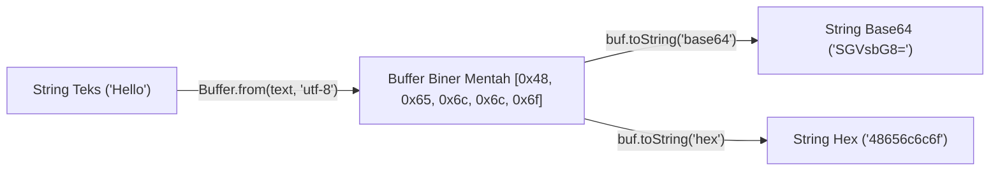

# Buffer

> Ringkasan
>
> - Fungsi: Mengelola dan memanipulasi aliran data biner mentah langsung pada alokasi memori C++ di luar memori heap V8.
> - Digunakan saat: Membaca berkas biner (seperti gambar atau audio), mentransfer paket data jaringan TCP, mengolah enkripsi kriptografi, dan mengubah format encoding data.
> - Aturan praktis: Selalu gunakan metode modern seperti `Buffer.from()` atau `Buffer.alloc()`, tinggalkan konstruktor usang `new Buffer()`, serta cantumkan encoding secara jelas.

---

## Tujuan Belajar

- Memahami peran kelas `Buffer` dalam mengolah data biner mentah di runtime Node.js.
- Mengalokasikan memori buffer dengan aman menggunakan `Buffer.alloc()` dan `Buffer.from()`.
- Mengonversi data biner ke format teks dan encoding populer seperti UTF-8, Base64, dan Hex.
- Menggabungkan beberapa potongan buffer menjadi satu kesatuan utuh lewat `Buffer.concat()`.
- Menghitung ukuran fisik byte yang sebenarnya dengan `Buffer.byteLength()` serta mengambil irisan byte lewat `subarray()`.

---

## Konsep

Kita bisa membayangkan `Buffer` seperti ember penampung air dengan ukuran yang sudah ditentukan sejak awal. Pada awalnya, JavaScript di browser hanya dirancang untuk mengolah teks string. Namun, saat bekerja di sisi server, komputer dan jaringan berkomunikasi menggunakan aliran partikel biner mentah (deretan angka `0` dan `1`).

Node.js menyediakan wadah bernama `Buffer` dengan kapasitas byte yang terkunci sejak pertama kali dibuat. Aliran data biner yang masuk dari internet atau berkas disk akan ditampung sementara di dalam ember memori ini sebelum kita terjemahkan menjadi teks yang bisa dibaca manusia, disimpan ke database, atau dikirimkan ke modul lainnya.



---

## Referensi

| Item                       | Fungsi                                                                  | Catatan                                                              |
| :------------------------- | :---------------------------------------------------------------------- | :------------------------------------------------------------------- |
| **`Buffer.from()`**        | Membuat instance buffer baru dari string, array angka, atau buffer lain | Mendukung decoding UTF-8, Base64, Hex, dan latin1                    |
| **`Buffer.alloc()`**       | Menyiapkan blok memori berukuran tetap yang sudah diisi angka nol       | Aman digunakan karena membersihkan sisa data memori lama             |
| **`Buffer.allocUnsafe()`** | Mengalokasikan memori cepat tanpa membersihkan isi awalnya              | Prosesnya sangat cepat namun berisiko menyimpan sisa memori lama     |
| **`buf.toString()`**       | Mengubah byte biner di dalam buffer menjadi teks string                 | Menerima opsi encoding seperti `'utf-8'`, `'base64'`, atau `'hex'`   |
| **`Buffer.concat()`**      | Menggabungkan susunan beberapa buffer menjadi satu buffer baru          | Membantu merangkai kembali paket data yang diterima bertahap         |
| **`Buffer.isBuffer()`**    | Memastikan apakah suatu variabel merupakan instance dari `Buffer`       | Mengembalikan nilai boolean `true` atau `false` dengan aman          |
| **`Buffer.byteLength()`**  | Menghitung jumlah ukuran byte fisik aktual dari string teks             | Menghasilkan nilai berbeda dari `string.length` pada karakter khusus |
| **`buf.subarray()`**       | Mengambil potongan referensi byte tanpa menyalin memori baru            | Berbagi memori yang sama persis dengan buffer sumber aslinya         |

### `Buffer.from()`

Fungsi `Buffer.from()` digunakan untuk membuat instance `Buffer` baru dengan menyalin data dari string teks, array angka byte, maupun objek buffer lainnya.

```javascript
import { Buffer } from "node:buffer";

const buf = Buffer.from("Hello Node", "utf-8");
console.log(buf.length);
// Output: 10
console.log(buf[0]);
// Output: 72
```

Kasus lain: Membuat buffer dari kumpulan angka integer 8-bit (dalam rentang nilai 0 sampai 255).

```javascript
import { Buffer } from "node:buffer";

const byteList = Buffer.from([65, 66, 67]);
console.log(byteList.toString("utf-8"));
// Output: ABC
```

### `Buffer.alloc()`

Fungsi `Buffer.alloc()` menyiapkan blok memori dengan ukuran tetap dan secara otomatis mengisi seluruh nilainya dengan angka nol (`0x00`) agar bersih dan aman.

```javascript
import { Buffer } from "node:buffer";

const emptyBuf = Buffer.alloc(4);
console.log(emptyBuf);
// Output: <Buffer 00 00 00 00>
```

Kasus lain: Mengisi alokasi memori baru dengan nilai byte kustom yang kita tentukan sendiri.

```javascript
import { Buffer } from "node:buffer";

const filledBuf = Buffer.alloc(3, 0xff);
console.log(filledBuf.toString("hex"));
// Output: ffffff
```

### `Buffer.allocUnsafe()`

Fungsi `Buffer.allocUnsafe()` menyiapkan alokasi memori baru tanpa membersihkan data lama yang tertinggal di blok memori tersebut. Cara ini membuat alokasi berjalan sangat cepat, namun kita harus berhati-hati agar tidak membocorkan data lama.

```javascript
import { Buffer } from "node:buffer";

const fastBuf = Buffer.allocUnsafe(4);
fastBuf.fill(0);
console.log(fastBuf.length);
// Output: 4
```

Kasus lain: Memberikan ukuran angka negatif akan memicu error `RangeError`.

```javascript
import { Buffer } from "node:buffer";

try {
  Buffer.allocUnsafe(-1);
} catch (error) {
  console.log(error.name);
  // Output: RangeError
}
```

### `buf.toString()`

Metode `buf.toString()` menerjemahkan deretan byte biner di dalam buffer menjadi teks string biasa menggunakan format encoding yang kita tentukan.

```javascript
import { Buffer } from "node:buffer";

const buf = Buffer.from("NodeJS", "utf-8");

console.log(buf.toString("hex"));
// Output: 4e6f64654a53
console.log(buf.toString("base64"));
// Output: Tm9kZUpT
```

Kasus lain: Mengambil sebagian potongan byte teks dengan menentukan batas indeks awal dan indeks akhir.

```javascript
import { Buffer } from "node:buffer";

const buf = Buffer.from("NodeJS", "utf-8");
console.log(buf.toString("utf-8", 0, 4));
// Output: Node
```

### `Buffer.concat()`

Fungsi `Buffer.concat()` menyatukan beberapa objek buffer yang tersimpan di dalam sebuah array menjadi satu kesatuan buffer panjang.

```javascript
import { Buffer } from "node:buffer";

const partA = Buffer.from("Left ");
const partB = Buffer.from("Right");
const combined = Buffer.concat([partA, partB]);

console.log(combined.toString("utf-8"));
// Output: Left Right
```

Kasus lain: Menggabungkan array kosong menghasilkan objek buffer baru dengan panjang 0 byte.

```javascript
import { Buffer } from "node:buffer";

const emptyBuf = Buffer.concat([]);
console.log(emptyBuf.length);
// Output: 0
```

### `Buffer.isBuffer()`

Fungsi `Buffer.isBuffer()` dipakai untuk memastikan apakah sebuah variabel benar-benar berupa instance resmi dari objek `Buffer`.

```javascript
import { Buffer } from "node:buffer";

const binaryData = Buffer.alloc(2);
const textData = "not a buffer";

console.log(Buffer.isBuffer(binaryData));
// Output: true
console.log(Buffer.isBuffer(textData));
// Output: false
```

Kasus lain: Memeriksa nilai seperti `null` atau `undefined` akan mengembalikan nilai boolean `false` tanpa menimbulkan error.

```javascript
import { Buffer } from "node:buffer";

console.log(Buffer.isBuffer(null));
// Output: false
```

### `Buffer.byteLength()`

Fungsi `Buffer.byteLength()` menghitung jumlah byte fisik sesungguhnya yang diperlukan untuk menyimpan sebuah string teks pada encoding tertentu.

```javascript
import { Buffer } from "node:buffer";

const text = "Café";
console.log(text.length);
// Output: 4
console.log(Buffer.byteLength(text, "utf-8"));
// Output: 5
```

Kasus lain: Menghitung panjang ukuran byte fisik dari teks berformat heksadesimal.

```javascript
import { Buffer } from "node:buffer";

const hexLength = Buffer.byteLength("4e6f6465", "hex");
console.log(hexLength);
// Output: 4
```

### `buf.subarray()`

Metode `buf.subarray()` menghasilkan potongan pandangan (_view_) dari suatu buffer tanpa membuat alokasi memori fisik baru.

```javascript
import { Buffer } from "node:buffer";

const original = Buffer.from("Node Library", "utf-8");
const slice = original.subarray(0, 4);

console.log(slice.toString("utf-8"));
// Output: Node
```

Kasus lain: Karena berbagi alamat memori yang sama, jika kita mengubah nilai byte pada hasil `subarray`, isi dari buffer induknya juga akan ikut berubah.

```javascript
import { Buffer } from "node:buffer";

const parent = Buffer.from("abc", "utf-8");
const child = parent.subarray(0, 1);
child[0] = 120;

console.log(parent.toString("utf-8"));
// Output: xbc
```

---

## Kesalahan Umum

### Memakai Sintaks Konstruktor Lama `new Buffer()`

Membuat buffer menggunakan perintah `new Buffer()` sudah lama ditinggalkan dan berisiko terhadap celah keamanan memori karena perilaku inisialisasinya yang tidak konsisten.

```javascript
// Salah
const buf = new Buffer(10);
```

```javascript
// Benar
import { Buffer } from "node:buffer";

const buf = Buffer.alloc(10);
```

### Menyamakan `string.length` dengan Ukuran Byte Memori

Properti `length` pada teks string menghitung jumlah karakter visual atau kode UTF-16, bukan jumlah byte fisik yang sebenarnya saat disimpan ke dalam format UTF-8 (misalnya huruf beraksen atau emoji membutuhkan lebih dari 1 byte).

```javascript
// Salah
import { Buffer } from "node:buffer";

const title = "Café";
const allocated = Buffer.alloc(title.length);
allocated.write(title);
```

```javascript
// Benar
import { Buffer } from "node:buffer";

const title = "Café";
const allocated = Buffer.alloc(Buffer.byteLength(title, "utf-8"));
allocated.write(title);
```

### Membiarkan Residu Memori pada `Buffer.allocUnsafe()`

Menggunakan alokasi cepat yang tidak aman dan langsung mengirimkannya ke jaringan berisiko membocorkan data rahasia dari proses aplikasi lain yang sempat tersimpan di blok memori tersebut.

```javascript
// Salah
import { Buffer } from "node:buffer";

const buf = Buffer.allocUnsafe(64);
// Langsung dikirim tanpa ditimpa atau dibersihkan isinya
```

```javascript
// Benar
import { Buffer } from "node:buffer";

const buf = Buffer.alloc(64);
```

---

## Studi Kasus

Skenario: Membangun fungsi pengurai header otorisasi HTTP Basic Authentication yang mendekode token Base64, memisahkan username serta password pengguna, dan menangani format yang tidak sesuai secara aman tanpa library luar.

```javascript
import { Buffer } from "node:buffer";

function parseBasicAuth(header) {
  if (typeof header !== "string" || !header.startsWith("Basic ")) {
    return { valid: false, reason: "Invalid header format" };
  }

  const base64Part = header.slice(6).trim();
  if (base64Part.length === 0) {
    return { valid: false, reason: "Empty credentials" };
  }

  const rawBytes = Buffer.from(base64Part, "base64");
  const decoded = rawBytes.toString("utf-8");

  const delimiterIndex = decoded.indexOf(":");
  if (delimiterIndex === -1) {
    return { valid: false, reason: "Missing colon delimiter" };
  }

  const username = decoded.slice(0, delimiterIndex);
  const password = decoded.slice(delimiterIndex + 1);

  return { valid: true, username, password };
}

const validHeader =
  "Basic " + Buffer.from("admin:secret123").toString("base64");
const validResult = parseBasicAuth(validHeader);
console.log(validResult);
// Output: { valid: true, username: 'admin', password: 'secret123' }

const invalidHeader = parseBasicAuth("Basic ");
console.log(invalidHeader);
// Output: { valid: false, reason: 'Empty credentials' }
```

Pendekatan ini mengandalkan `Buffer.from(..., 'base64')` dan `toString('utf-8')` bawaan Node.js untuk mendekode token secara cepat langsung di tingkat memori tanpa perlu mengunduh modul tambahan dari luar.

---

## Latihan Mandiri

### Soal 1 (Dasar)

Buat fungsi `convertTextToHex(text)` yang menerima string teks dan mengembalikan representasi string heksadesimalnya menggunakan modul `node:buffer`.

Contoh input:

```javascript
convertTextToHex("Node");
```

Contoh output yang diharapkan:

```javascript
"4e6f6465";
```

Batasan: Gunakan `Buffer.from()` dengan format UTF-8 dan ekspor hasilnya ke format `'hex'`.

### Soal 2 (Menengah)

Buat fungsi `concatBinaryPackets(stringList)` yang menerima daftar array string teks, mengonversi setiap teks menjadi buffer dengan menyertakan karakter baris baru (`0x0A`) di akhir setiap elemen, lalu menyatukan seluruh potongan tersebut menjadi satu instance `Buffer` menggunakan `Buffer.concat()`.

Contoh input:

```javascript
concatBinaryPackets(["Alpha", "Beta"]);
```

Contoh output yang diharapkan:

```javascript
<Buffer 41 6c 70 68 61 0a 42 65 74 61 0a>
```

Batasan: Gunakan fungsi `Buffer.concat()` dan pastikan nilai kembalian berupa instance `Buffer` murni.

### Soal 3 (Menantang)

Buat fungsi pengurai bingkai biner jaringan `parseDataFrame(bufferInput)`.

Struktur format bingkai data biner:

- Byte 0 (1 byte): Kode penanda tipe data (`1` = Teks Biasa, `2` = Dokumen JSON).
- Byte 1 sampai 2 (2 byte): Ukuran panjang data payload dalam format bilangan integer 16-bit big-endian (`readUInt16BE(1)`).
- Byte 3 sampai `3 + payloadLength`: Konten data payload yang sebenarnya.

Ketentuan penanganan kasus tepi:

- Jika ukuran panjang buffer kurang dari 3 byte, kembalikan `{ success: false, reason: 'Insufficient header length' }`.
- Jika panjang buffer keseluruhan kurang dari `3 + payloadLength`, kembalikan `{ success: false, reason: 'Truncated payload data' }`.
- Jika kode tipe bernilai `1`, dekode isi payload menjadi string UTF-8: `{ success: true, type: 'TEXT', payload: '...' }`.
- Jika kode tipe bernilai `2`, dekode isi payload dan parse ke objek JSON: `{ success: true, type: 'JSON', payload: { ... } }`. Jika sintaks JSON tidak valid, kembalikan `{ success: false, reason: 'Malformed JSON payload' }`.
- Jika kode tipe bukan bernilai `1` atau `2`, kembalikan `{ success: false, reason: 'Unknown data type' }`.

Contoh input:

```javascript
const payload = Buffer.from(JSON.stringify({ status: "active" }), "utf-8");
const frame = Buffer.alloc(3 + payload.length);
frame[0] = 2;
frame.writeUInt16BE(payload.length, 1);
payload.copy(frame, 3);

parseDataFrame(frame);
```

Contoh output yang diharapkan:

```javascript
{
  success: true,
  type: 'JSON',
  payload: { status: 'active' }
}
```

Batasan: Dilarang menggunakan paket eksternal dari NPM. Lakukan seluruh pengecekan ukuran byte dan penanganan error secara mandiri.

---

## Navigasi

[Sebelumnya: Events](../08-events/README.md) | [Selanjutnya: Stream](../10-stream/README.md) | [Daftar Isi](../README.md)
