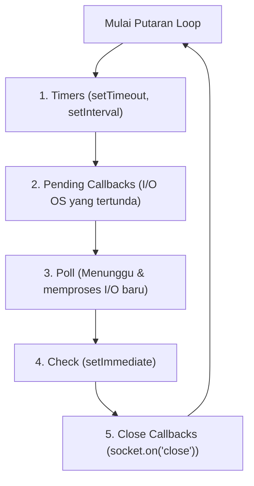

# Timer

> Ringkasan
> - Tingkat: Fondasi
> - Fungsi: Mengatur penjadwalan eksekusi kode di masa depan serta memahami perputaran siklus Event Loop Libuv.
> - Digunakan saat: Memberi jeda waktu eksekusi, membatasi durasi panggilan jaringan (timeout), perulangan berkala, dan mencegah pemblokiran thread utama.
> - Aturan praktis: Selalu prioritaskan `node:timers/promises` dengan `async/await` daripada callback bersarang; batalkan timer yang tidak lagi diperlukan memakai `clearTimeout()` atau `AbortController`.

## Cheat Sheet

| Tugas | Kode |
| :--- | :--- |
| Jeda waktu berbasis Promise | `await setTimeout(1000);` |
| Mengembalikan nilai setelah jeda | `const res = await setTimeout(500, "data");` |
| Menjadwalkan tugas di fase Check | `await setImmediate("selesai");` |
| Menjalankan timer interval berkala | `const id = setInterval(() => {}, 1000);` |
| Menghentikan timer berkala | `clearInterval(id);` |
| Menyerahkan giliran eksekusi Event Loop | `await scheduler.yield();` |

## Tujuan Belajar

- Memahami arsitektur Event Loop Libuv dan fase-fase eksekusinya.
- Membedakan prioritas tugas mikro (_microtask_) dengan giliran antrean timer (_macrotask_).
- Menggunakan modul modern `node:timers/promises` untuk menulis kode jeda yang bersih.
- Mengatur batas waktu eksekusi fungsi dan pola coba ulang (_retry_) dengan exponential backoff.

## Konsep

Bayangkan sebuah dapur restoran cepat saji dengan satu koki utama (Event Loop). Koki tidak diam menunggu microwave memanaskan makanan selama 5 menit. Ia menyetel pengatur waktu (Timer), lalu beralih meracik burger pesanan berikutnya (menangani I/O dan request). Ketika alarm microwave berbunyi, koki menyelesaikan langkah yang sedang ia pegang, memeriksa antrean alarm di mejanya, baru kemudian mengambil makanan tersebut. Jika koki memotong bawang secara manual tanpa henti selama 10 menit (komputasi CPU berat sinkron), microwave yang sudah berbunyi pun tidak akan sempat disentuh dan seluruh pesanan pelanggan lain akan tertahan.



> **Catatan:** Di sela-sela perpindahan setiap fase di atas, Node.js selalu menghabiskan seluruh antrean Microtask (`process.nextTick` dan penyelesaian Promise) terlebih dahulu sebelum melangkah ke fase berikutnya.

## Referensi

| Item | Fungsi | Catatan |
| :--- | :--- | :--- |
| `setTimeout([delay], [value], [options])` | Menunda eksekusi kode selama durasi milidetik | Tersedia varian Promise di `node:timers/promises` |
| `setInterval([delay], [value], [options])` | Menjalankan kode berulang setiap interval tertentu | Menghasilkan async iterable di varian Promise |
| `setImmediate([value], [options])` | Menjalankan kode tepat di fase Check Event Loop | Berjalan setelah fase Poll I/O selesai |
| `clearTimeout(timeoutId)` | Membatalkan timer penundaan berbasis callback | Mencegah fungsi callback terpanggil |
| `clearInterval(intervalId)` | Menghentikan perulangan timer berbasis callback | Mencegah memory leak dan timer tanpa henti |
| `scheduler.yield()` | Menyerahkan kendali thread sejenak ke Event Loop | Memecah komputasi berat agar server tetap responsif |

### `setTimeout([delay], [value], [options])`

`setTimeout` menunda eksekusi kode hingga durasi milidetik tertentu terlampaui. Modul `node:timers/promises` menyediakan versi Promise yang bisa langsung di-`await`.

Struktur parameter: `setTimeout(delay, value, options)`
- `delay` (number, opsional, default: `1`): durasi penundaan dalam satuan milidetik.
- `value` (any, opsional): nilai yang akan di-resolve oleh Promise.
- `options` (object, opsional): objek pengaturan seperti `{ signal: AbortSignal }`.

Nilai kembalian: `Promise<any>` pada versi promises, atau objek `Timeout` pada versi callback.

```javascript
import { setTimeout } from "node:timers/promises";

const result = await setTimeout(50, "Operation complete");
console.log(result);
// Output: Operation complete
```

Kondisi khusus: Durasi minimum aktual di runtime adalah 1 milidetik; memberikan angka `0` atau negatif otomatis dianggap `1`.

### `setImmediate([value], [options])`

`setImmediate` menjadwalkan eksekusi tepat setelah fase Poll I/O selesai (pada fase Check dari Event Loop).

Struktur parameter: `setImmediate(value, options)`
- `value` (any, opsional): nilai kembalian Promise.
- `options` (object, opsional): objek opsi pembatalan `{ signal }`.

Nilai kembalian: `Promise<any>` pada `node:timers/promises`.

```javascript
import { setImmediate } from "node:timers/promises";

let status = "start";
const promise = setImmediate("finished");
status = "running";

const res = await promise;
console.log(status);
// Output: running
console.log(res);
// Output: finished
```

Kondisi khusus: Jika dipanggil di dalam siklus I/O (seperti di dalam handler `fs.readFile`), `setImmediate` selalu dieksekusi lebih dulu daripada `setTimeout(0)`.

### `setInterval([delay], [value], [options])`

`setInterval` menjalankan eksekusi kode secara berulang setiap kali durasi interval waktu tercapai.

Struktur parameter: `setInterval(delay, value, options)`.

Nilai kembalian: `AsyncIterable` pada versi `node:timers/promises`, atau objek `Timeout` pada callback.

```javascript
import { setInterval } from "node:timers/promises";

let count = 0;
const interval = setInterval(10, "tick");

for await (const val of interval) {
  count++;
  if (count === 3) break; // Automatically stops and cleans up the timer
}

console.log(count);
// Output: 3
```

Kondisi khusus: Pada perulangan `for await...of`, memanggil `break` otomatis menghentikan timer di latar belakang tanpa memerlukan pembatalan manual.

### `clearTimeout(timeoutId)` dan `clearInterval(intervalId)`

Membersihkan pengatur waktu aktif versi callback agar callback tidak dijalankan dan tidak menahan proses Node.js berhenti.

Struktur parameter: `clearTimeout(id)` dan `clearInterval(id)` menerima objek ID timer yang dikembalikan saat pembuatan.

Nilai kembalian: `undefined`.

```javascript
let runs = 0;
const id = setInterval(() => runs++, 50);

clearInterval(id);
console.log(runs);
// Output: 0
```

Kondisi khusus: Meneruskan variabel bernilai `undefined` atau `null` ke `clearTimeout()` tidak menimbulkan error (dilewati secara aman).

### `scheduler.yield()`

`scheduler.yield()` mengembalikan eksekusi sejenak ke Event Loop sebelum melanjutkan baris kode berikutnya, memungkinkan event I/O lain disisipkan di antara loop panjang.

Struktur parameter: `scheduler.yield()` tanpa argumen.

Nilai kembalian: `Promise<void>`.

```javascript
import { scheduler } from "node:timers/promises";

let completed = false;
queueMicrotask(() => { completed = true; });

await scheduler.yield();
console.log(completed);
// Output: true
```

Kondisi khusus: Fitur ini tersedia di Node.js modern untuk memecah proses CPU bound menjadi potongan-potongan kecil (_chunking_).

## Kesalahan Umum

### Memblokir Event Loop dengan Operasi Sinkron

Menjalankan perulangan komputasi berat secara sinkron membekukan seluruh server; timer dan request jaringan baru tidak bisa dilayani sama sekali.

```javascript
// Incorrect: Thread completely freezes during the loop
const target = Date.now() + 2000;
while (Date.now() < target) {} // 100% CPU, Event Loop halts

// Correct: Use non-blocking timer pause so Event Loop can breathe
import { setTimeout } from "node:timers/promises";
await setTimeout(2000);
```

### Lupa Membatalkan `setInterval`

`setInterval` versi callback yang tidak dibatalkan via `clearInterval()` akan terus berjalan tanpa henti dan menahan aplikasi Node.js keluar dari terminal.

```javascript
// Incorrect
setInterval(() => {
  pollExternalService();
}, 5000); // Prevents Node.js process from exiting gracefully

// Correct
const timerId = setInterval(() => {
  pollExternalService();
}, 5000);
process.on("SIGINT", () => clearInterval(timerId));
```

## Studi Kasus

Membangun mekanisme coba ulang otomatis (_retry with exponential backoff_) untuk menangani kegagalan panggilan layanan pihak ketiga secara asinkron.

```javascript
import { setTimeout } from "node:timers/promises";

async function retryWithBackoff(taskFn, maxRetries = 3, baseDelayMs = 20) {
  let delay = baseDelayMs;

  for (let attempt = 1; attempt <= maxRetries; attempt++) {
    try {
      return await taskFn(attempt);
    } catch (err) {
      if (attempt === maxRetries) {
        throw err;
      }
      await setTimeout(delay);
      delay *= 2; // Double delay for subsequent retry
    }
  }
}

let attempts = 0;
const result = await retryWithBackoff(async (attempt) => {
  attempts++;
  if (attempt < 3) {
    throw new Error("Service busy");
  }
  return `Success on attempt ${attempt}`;
});

console.log(result);
// Output: Success on attempt 3
console.log(attempts);
// Output: 3
```

Pola backoff ini mencegah server membanjiri downstream API yang sedang down dengan request baru, sekaligus memberikan waktu bagi sistem target untuk pulih secara bertahap.

## Latihan Mandiri

Buat fungsi `withTimeout(asyncFn, timeoutMs, options = {})` untuk membatasi durasi maksimal eksekusi fungsi asynchronous.

- **Level 1 (Dasar):** Jalankan `asyncFn()` berdampingan dengan timer `setTimeout()` memakai `Promise.race()`. Jika `asyncFn` selesai sebelum `timeoutMs`, kembalikan nilainya. Jika timer habis lebih dulu, lempar `Error("Operation timeout exceeded")`.
- **Level 2 (Menengah):** Pakai `AbortController` untuk membatalkan timer penunggu saat `asyncFn` selesai lebih dulu, agar Event Loop tidak tertahan oleh timer yang masih aktif.
- **Level 3 (Menantang):** Dukung opsi `options.fallbackValue`. Jika timeout terjadi dan `options.fallbackValue` didefinisikan (bukan `undefined`), kembalikan nilai tersebut alih-alih melempar error. Jika `timeoutMs` bukan angka bernilai positif, lempar `RangeError("Timeout duration must be positive")`.

Contoh input dan output normal:

```javascript
const res = await withTimeout(async () => "Data fetched successfully", 100);

console.log(res);
// Output: Data fetched successfully
```

Contoh input dan penanganan timeout dengan fallback:

```javascript
import { setTimeout } from "node:timers/promises";

const slowTask = async () => {
  await setTimeout(100);
  return "Slow data";
};

const fallbackRes = await withTimeout(slowTask, 10, { fallbackValue: "Default fallback value" });
console.log(fallbackRes);
// Output: Default fallback value
```

Contoh input dan penanganan error:

```javascript
try {
  await withTimeout(async () => {}, -10);
} catch (err) {
  console.log(err.message);
  // Output: Timeout duration must be positive
}
```

Tanda selesai:
- [ ] Operasi yang selesai sebelum batas waktu mengembalikan hasil dengan benar.
- [ ] Timer dibatalkan memakai `AbortController` saat operasi utama berhasil tuntas lebih dulu.
- [ ] Opsi `fallbackValue` mengembalikan nilai pengganti saat terjadi timeout.
- [ ] Durasi timeout negatif atau nol melempar `RangeError`.

---

## Navigasi

[Sebelumnya: Stream](../08-stream/README.md) | [Selanjutnya: HTTP](../10-http/README.md) | [Daftar Isi](../README.md)
