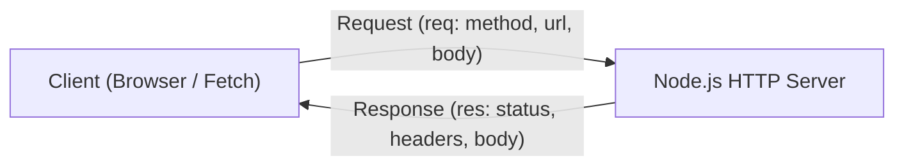

# HTTP

> Ringkasan
> - Tingkat: Fondasi
> - Fungsi: Membangun server web native dan melakukan request HTTP/HTTPS menggunakan standar modern `fetch()`.
> - Digunakan saat: Membuat RESTful API tanpa dependensi eksternal, web service ringan, reverse proxy dasar, dan client consumer HTTP.
> - Aturan praktis: Selalu panggil `res.end()` di setiap percabangan rute agar client tidak menggantung; gunakan `fetch()` native daripada modul callback `http.request()`.

## Cheat Sheet

| Tugas | Kode |
| :--- | :--- |
| Membuat instance HTTP server | `const srv = http.createServer((req, res) => {});` |
| Mendengarkan koneksi pada port | `srv.listen(3000, () => {});` |
| Membaca method dan path request | `const { method, url } = req;` |
| Mengirim status code dan header | `res.writeHead(200, { "Content-Type": "application/json" });` |
| Mengirim body dan menutup response | `res.end(JSON.stringify(data));` |
| Menghentikan server dari menerima request baru | `srv.close();` |
| Mengirim request client asinkron | `const res = await fetch("https://api.io/items");` |
| Membatasi waktu request client | `fetch(url, { signal: AbortSignal.timeout(5000) });` |

## Tujuan Belajar

- Memahami siklus hidup Request dan Response pada arsitektur HTTP native Node.js.
- Membaca body request masuk secara streaming memakai perulangan `for await...of`.
- Mengatur status code, header MIME type, dan payload JSON pada objek `res`.
- Mengonsumsi endpoint HTTP eksternal menggunakan fungsi bawaan `fetch()`.

## Konsep

Bayangkan HTTP server seperti loket tiket di stasiun kereta. Setiap pelanggan yang datang membawa formulir permintaan tiket (`IncomingMessage / req`). Formulir itu berisi tujuan perjalanan (`req.url`), jenis transaksi (`req.method` seperti GET atau POST), dan data pelengkap (`req.headers`). Petugas loket memproses formulir tersebut, mencetak tiket, stempel status validasi, dan menyerahkan tanda terima kembali ke pelanggan (`ServerResponse / res`). Setelah tiket diserahkan, petugas menutup jendela loket tanda transaksi selesai (`res.end()`). Jika petugas lupa menutup transaksi, pelanggan akan berdiri mematung di depan loket menunggu tanpa kepastian.



## Referensi

| Item | Fungsi | Catatan |
| :--- | :--- | :--- |
| `http.createServer([options], [listener])` | Membuat instance web server HTTP baru | Listener otomatis menerima parameter `req` dan `res` |
| `server.listen([port], [host], [cb])` | Mengaktifkan server untuk mulai menerima koneksi masuk | Gunakan port `0` untuk memilih port bebas acak |
| `req.method` & `req.url` | Properti informasi method HTTP dan path string request | `req.url` berisi pathname beserta query string |
| `res.writeHead(status, [headers])` | Mengirimkan kode status HTTP dan header response | Wajib dipanggil sebelum potongan body dikirim |
| `res.end(data, cb)` | Menutup response stream dan mengirim data payload | Setiap request wajib ditutup dengan metode ini |
| `server.close([callback])` | Menghentikan server agar tidak menerima koneksi baru | Menunggu koneksi aktif selesai sebelum berhenti |
| `fetch(input, [init])` | Fungsi global standar untuk memanggil HTTP endpoint | Mengembalikan Promise yang resolve ke objek Response |
| `AbortSignal.timeout(ms)` | Membuat sinyal pembatalan otomatis setelah jeda waktu | Standar praktis mencegah request client macet |

### `http.createServer([options], [requestListener])`

`http.createServer()` menginstansiasi server HTTP yang siap merespons request masuk melalui fungsi callback listener.

Struktur parameter: `http.createServer(options, requestListener)`
- `options` (object, opsional): konfigurasi server.
- `requestListener` (function, wajib): fungsi penangan dengan argumen `(req, res)`.

Nilai kembalian: instance `http.Server`.

```javascript
import http from "node:http";

const server = http.createServer((req, res) => {
  res.writeHead(200, { "Content-Type": "text/plain" });
  res.end("Server active");
});

console.log(server instanceof http.Server);
// Output: true
```

Kondisi khusus: Handler `requestListener` otomatis dipasangkan ke event `'request'` pada server instance.

### `server.listen([port], [host], [callback])`

`server.listen()` mengikat server ke port dan host tertentu untuk mulai mendengarkan lalu lintas jaringan.

Struktur parameter: `server.listen(port, host, callback)`
- `port` (number, opsional, default: `0`): nomor port server. Port `0` otomatis memakai port sistem yang kosong.
- `callback` (function, opsional): fungsi yang dipanggil saat server siap menerima request.

Nilai kembalian: instance `http.Server`.

```javascript
import http from "node:http";

const server = http.createServer((req, res) => res.end());
server.listen(0, () => {
  const address = server.address();
  console.log(address.port > 0);
  server.close();
});
// Output: true
```

Kondisi khusus: Melempar error `EADDRINUSE` jika nomor port yang dipilih sedang dipakai aplikasi lain.

### `req.method` dan `req.url`

Properti pada `IncomingMessage` yang mendeskripsikan jenis tindakan HTTP dan alamat URI tujuan.

Struktur parameter: properti string read-only pada instance `req`.

Nilai kembalian: `string`.

```javascript
import http from "node:http";

const server = http.createServer((req, res) => {
  console.log(req.method);
  console.log(req.url);
  res.end();
});

server.listen(0, async () => {
  const port = server.address().port;
  await fetch(`http://localhost:${port}/api/users?active=1`);
  server.close();
});
// Output:
// GET
// /api/users?active=1
```

Kondisi khusus: Nilai `req.url` tidak menyertakan nama protokol atau domain host; gunakan `new URL(req.url, 'http://localhost')` untuk mengurainya.

### `res.writeHead(statusCode, [statusMessage], [headers])`

`res.writeHead()` mengirimkan baris status HTTP dan header respons secara eksplisit ke client.

Struktur parameter: `res.writeHead(statusCode, statusMessage, headers)`
- `statusCode` (number, wajib): 3 digit kode status HTTP (misal: 200, 201, 404, 500).
- `headers` (object, opsional): pasangan kunci-nilai header HTTP respons.

Nilai kembalian: instance `ServerResponse`.

```javascript
import http from "node:http";

const server = http.createServer((req, res) => {
  res.writeHead(201, { "Content-Type": "application/json" });
  res.end(JSON.stringify({ created: true }));
});

server.listen(0, async () => {
  const port = server.address().port;
  const res = await fetch(`http://localhost:${port}/`);
  console.log(res.status);
  console.log(res.headers.get("content-type"));
  server.close();
});
// Output:
// 201
// application/json
```

Kondisi khusus: Memanggil `writeHead()` setelah data body terkirim akan melempar error `ERR_HTTP_HEADERS_SENT`.

### `res.end([data], [encoding], [callback])`

`res.end()` menandakan seluruh header dan body response sudah selesai dikirim ke client.

Struktur parameter: `res.end(data, encoding, callback)`
- `data` (string atau Buffer, opsional): potongan data terakhir yang ingin dikirim sebelum koneksi ditutup.

Nilai kembalian: instance `ServerResponse`.

```javascript
import http from "node:http";

const server = http.createServer((req, res) => {
  res.end("Data finished");
});

server.listen(0, async () => {
  const port = server.address().port;
  const text = await (await fetch(`http://localhost:${port}/`)).text();
  console.log(text);
  server.close();
});
// Output: Data finished
```

Kondisi khusus: Selalu panggil `res.end()` di setiap jalur percabangan kode; jika tidak, browser atau client akan terus menunggu hingga timeout.

### `fetch(input, [init])`

`fetch()` adalah fungsi bawaan global Node.js modern untuk melakukan permintaan HTTP client secara asinkron berbasis Promise.

Struktur parameter: `fetch(input, init)`
- `input` (string atau URL, wajib): alamat endpoint tujuan.
- `init` (object, opsional): opsi request seperti `{ method, headers, body, signal }`.

Nilai kembalian: `Promise<Response>`.

```javascript
const signal = AbortSignal.timeout(2000);
console.log(signal instanceof AbortSignal);
// Output: true
```

Kondisi khusus: `fetch()` hanya berstatus reject jika terjadi kegagalan jaringan fisik atau DNS; status HTTP 404 atau 500 tetap resolve dan harus dicek lewat `res.ok`.

## Kesalahan Umum

### Lupa Memanggil `res.end()` pada Salah Satu Cabang Logika

Jika alur rute percabangan lupa memanggil `res.end()`, koneksi client akan menggantung sampai batas waktu koneksi habis.

```javascript
// Incorrect
if (req.url === "/api") {
  res.writeHead(200);
  res.write("OK");
  // Missing res.end() -> client hangs forever
}

// Correct
if (req.url === "/api") {
  res.writeHead(200);
  res.end("OK");
}
```

### Mengabaikan Status `res.ok` pada Pemanggilan `fetch()`

`fetch()` tidak melempar error saat server mengembalikan error 404 atau 500.

```javascript
// Incorrect: Assuming fetch automatically throws on HTTP error status
const res = await fetch("https://api.example.com/not-found");
const data = await res.json(); // Tries parsing HTML error page leading to JSON parse error

// Correct
const res = await fetch("https://api.example.com/not-found");
if (!res.ok) {
  throw new Error(`HTTP Error: ${res.status}`);
}
```

## Studi Kasus

Membangun router RESTful API produk sederhana berbasis HTTP native yang menangani endpoint `GET` untuk membaca data dan `POST` untuk menerima body payload JSON.

```javascript
import http from "node:http";

function createServer() {
  const products = [{ id: 1, name: "Keyboard", price: 150000 }];

  return http.createServer(async (req, res) => {
    const url = new URL(req.url, `http://${req.headers.host}`);

    if (req.method === "GET" && url.pathname === "/products") {
      res.writeHead(200, { "Content-Type": "application/json" });
      res.end(JSON.stringify(products));
      return;
    }

    if (req.method === "POST" && url.pathname === "/products") {
      let body = "";
      for await (const chunk of req) {
        body += chunk;
      }

      try {
        const item = JSON.parse(body);
        item.id = products.length + 1;
        products.push(item);

        res.writeHead(201, { "Content-Type": "application/json" });
        res.end(JSON.stringify({ success: true, item }));
      } catch {
        res.writeHead(400, { "Content-Type": "application/json" });
        res.end(JSON.stringify({ error: "Invalid JSON" }));
      }
      return;
    }

    res.writeHead(404, { "Content-Type": "application/json" });
    res.end(JSON.stringify({ error: "Route not found" }));
  });
}

const srv = createServer();
srv.listen(0, async () => {
  const port = srv.address().port;
  const base = `http://localhost:${port}`;

  const getRes = await fetch(`${base}/products`);
  console.log(getRes.status);
  // Output: 200

  const postRes = await fetch(`${base}/products`, {
    method: "POST",
    headers: { "Content-Type": "application/json" },
    body: JSON.stringify({ name: "Mouse", price: 75000 }),
  });
  console.log(postRes.status);
  // Output: 201

  srv.close();
});
```

Pola server native ini mengonsumsi body request menggunakan streaming `for await...of`, memvalidasi sintaks JSON secara aman dengan penanganan status 400, serta memastikan setiap cabang response memiliki header `Content-Type` yang tepat.

## Latihan Mandiri

Buat fungsi `createProductServer(initialProducts = [])` untuk membuat HTTP server REST API produk sederhana.

- **Level 1 (Dasar):** Buat instance server dengan `http.createServer`. Tangani route `GET /products` untuk mengembalikan seluruh item array produk dalam format JSON dengan status `200`. Jika path atau method tidak cocok, kembalikan status `404` dengan JSON `{ error: "Not Found" }`.
- **Level 2 (Menengah):** Tangani route `POST /products`. Baca body request yang masuk secara streaming menggunakan perulangan `for await...of`, parse body JSON tersebut, tetapkan properti `id: Date.now()`, simpan item baru ke array produk, dan kembalikan status `201` dengan JSON `{ success: true, product: item }`.
- **Level 3 (Menantang):** Jika payload JSON pada request `POST` rusak atau tidak bisa diurai, tangkap error tersebut dan kembalikan status `400` dengan JSON `{ error: "Invalid JSON format" }`.

Contoh input dan output normal:

```javascript
const server = createProductServer([{ id: 1, name: "Book", price: 50000 }]);

server.listen(0, async () => {
  const port = server.address().port;
  const res = await fetch(`http://localhost:${port}/products`);
  const products = await res.json();

  console.log(res.status);
  // Output: 200
  console.log(products[0].name);
  // Output: Book
  server.close();
});
```

Contoh input dan penanganan error:

```javascript
const server = createProductServer();

server.listen(0, async () => {
  const port = server.address().port;
  const res = await fetch(`http://localhost:${port}/products`, {
    method: "POST",
    headers: { "Content-Type": "application/json" },
    body: "INVALID_JSON",
  });
  const data = await res.json();

  console.log(res.status);
  // Output: 400
  console.log(data.error);
  // Output: Invalid JSON format
  server.close();
});
```

Tanda selesai:
- [ ] Route `GET /products` mengembalikan daftar produk dengan header `application/json`.
- [ ] Route `POST /products` membaca body stream dan merespons status `201`.
- [ ] Route yang tidak ditemukan menghasilkan status `404`.
- [ ] Format JSON yang tidak valid pada request POST dibalas dengan status `400`.

---

## Navigasi

[Sebelumnya: Timer](../09-timer/README.md) | [Selanjutnya: Util](../11-util/README.md) | [Daftar Isi](../README.md)
