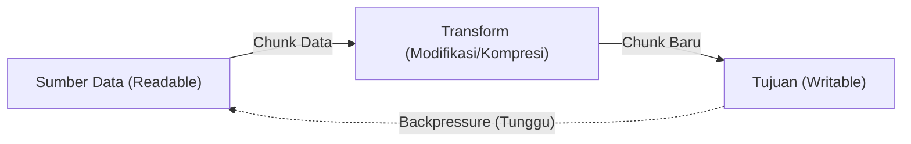

# Stream

> Ringkasan
>
> - Fungsi: Memproses aliran data secara bertahap dalam potongan-potongan kecil (_chunks_) tanpa memuat seluruh berkas ke memori RAM sekaligus.
> - Digunakan saat: Menangani berkas berukuran besar, transfer data jaringan HTTP/TCP, pemrosesan log streaming, dan kompresi data.
> - Aturan praktis: Selalu gunakan `pipeline` dari `node:stream/promises` alih-alih `pipe()` manual untuk menjamin pembersihan sumber daya dan penanganan galat otomatis, serta kendalikan fenomena _backpressure_.

---

## Tujuan Belajar

- Memahami konsep streaming dan efisiensi memori yang dihasilkan dibandingkan pembacaan data sekaligus.
- Membedakan empat jenis utama stream: _Readable_, _Writable_, _Duplex_, dan _Transform_.
- Membaca dan menulis data chunk menggunakan iterasi asinkron `for await...of` dan metode `write()`.
- Mengendalikan fenomena tekanan balik (_backpressure_) menggunakan event `drain`.
- Menyambungkan pipa stream secara aman menggunakan utilitas `pipeline` dari `node:stream/promises`.

---

## Konsep

> Menangani data dianalogikan seperti menonton film berdurasi panjang. Pendekatan tanpa stream (`readFile`) mewajibkan pengunduhan seluruh berkas film (misalnya 4 GB) ke dalam RAM sebelum detik pertama film dapat diputar. Sebaliknya, streaming hanya mengambil beberapa megabyte pertama (_chunk_), langsung memutarnya di layar, dan terus mengalirkan potongan berikutnya di latar belakang. Konsumsi memori tetap stabil dan kecil meskipun ukuran total data mencapai puluhan gigabyte.



---

## Referensi

| Item | Fungsi | Catatan |
| :--- | :----- | :------ |
| **`Readable`** | Aliran data sumber yang hanya dapat dibaca | Mendukung pembacaan via event `data` atau perulangan `for await...of` |
| **`Writable`** | Aliran data tujuan tempat data ditulis | Menerima data chunk via `write()` dan ditutup dengan `end()` |
| **`Transform`** | Aliran duplex yang memodifikasi atau menyaring data saat melintas | Mengimplementasikan method internal `_transform` untuk memproses chunk |
| **`pipeline()`** | Menghubungkan beberapa stream secara aman berbasis Promise | Otomatis membersihkan dan menutup semua stream jika terjadi galat di tengah jalan |
| **`finished()`** | Memantau kapan suatu stream selesai diproses atau tertutup | Mengembalikan Promise yang diselesaikan saat stream ditutup |
| **`writable.write()`** | Menulis potongan chunk data ke dalam antrean writable stream | Mengembalikan nilai boolean `false` jika internal buffer telah penuh |
| **`writable.end()`** | Menandai bahwa tidak ada lagi data yang akan ditulis ke stream | Memancarkan event `finish` setelah seluruh data dalam antrean selesai dibilas |

### `Readable`

Kelas `Readable` merepresentasikan sumber data yang dapat dikonsumsi secara bertahap. Metode statis `Readable.from()` mempermudah pembuatan stream pembacaan dari iterable atau array.

```javascript
import { Readable } from "node:stream";

const sumber = Readable.from(["Baris 1\n", "Baris 2\n"]);
const kumpulan = [];

for await (const chunk of sumber) {
  kumpulan.push(chunk);
}

console.log(kumpulan.join("").trim());
// Output: Baris 1
// Baris 2
```

Kasus lain: Menangani pembacaan stream dari sumber kosong menghasilkan nol iterasi tanpa memicu galat.

```javascript
import { Readable } from "node:stream";

const kosong = Readable.from([]);
let totalChunk = 0;

for await (const chunk of kosong) {
  totalChunk++;
}

console.log(totalChunk);
// Output: 0
```

### `Writable`

Kelas `Writable` merepresentasikan tujuan akhir tempat data dialirkan dan disimpan, seperti penulisan berkas atau respons jaringan.

```javascript
import { Writable } from "node:stream";

const hasil = [];
const penerima = new Writable({
  write(chunk, encoding, callback) {
    hasil.push(chunk.toString());
    callback();
  }
});

penerima.write("Potongan A");
penerima.write("Potongan B");
penerima.end();

penerima.on("finish", () => {
  console.log(hasil.join(" - "));
});
// Output: Potongan A - Potongan B
```

Kasus lain: Menulis ke stream yang telah ditutup memicu galat `ERR_STREAM_WRITE_AFTER_END`.

```javascript
import { Writable } from "node:stream";

const w = new Writable({ write(c, e, cb) { cb(); } });
w.end();

try {
  w.write("data baru");
} catch (error) {
  console.log(error.code);
  // Output: ERR_STREAM_WRITE_AFTER_END
}
```

### `Transform`

Kelas `Transform` adalah jenis stream khusus yang menerima data masukan, melakukan manipulasi komputasi secara langsung, lalu menghasilkan keluaran data baru.

```javascript
import { Transform } from "node:stream";

const kapital = new Transform({
  transform(chunk, encoding, callback) {
    callback(null, chunk.toString().toUpperCase());
  }
});

kapital.on("data", (data) => {
  console.log(data.toString());
});

kapital.write("halo stream");
kapital.end();
// Output: HALO STREAM
```

Kasus lain: Meneruskan galat di dalam proses transformasi melalui callback pertama `callback(error)`.

```javascript
import { Transform } from "node:stream";

const validator = new Transform({
  transform(chunk, enc, cb) {
    if (chunk.toString().includes("terlarang")) {
      cb(new Error("Kata terlarang ditemukan"));
    } else {
      cb(null, chunk);
    }
  }
});

validator.on("error", (err) => {
  console.log(err.message);
});

validator.write("kata terlarang di sini");
// Output: Kata terlarang ditemukan
```

### `pipeline()`

Fungsi `pipeline()` dari `node:stream/promises` mengalirkan data melewati rangkaian stream dan menangani penutupan serta pembersihan memori jika terjadi kegagalan.

```javascript
import { Readable, Writable, Transform } from "node:stream";
import { pipeline } from "node:stream/promises";

const sumber = Readable.from(["kopi", "teh"]);
const filter = new Transform({
  transform(chunk, enc, cb) {
    cb(null, `[${chunk}]`);
  }
});

let hasil = "";
const tujuan = new Writable({
  write(chunk, enc, cb) {
    hasil += chunk.toString();
    cb();
  }
});

await pipeline(sumber, filter, tujuan);
console.log(hasil);
// Output: [kopi][teh]
```

Kasus lain: Menangani galat di tengah aliran pipa, di mana semua stream di dalam rantai otomatis dihancurkan.

```javascript
import { Readable, Writable } from "node:stream";
import { pipeline } from "node:stream/promises";

const rusak = new Readable({
  read() {
    this.destroy(new Error("Koneksi sumber terputus"));
  }
});

const tujuan = new Writable({ write(c, e, cb) { cb(); } });

try {
  await pipeline(rusak, tujuan);
} catch (error) {
  console.log(error.message);
  // Output: Koneksi sumber terputus
}
```

### `finished()`

Fungsi `finished()` dari `node:stream/promises` memberikan sinyal Promise saat suatu stream telah menyelesaikan seluruh siklusnya atau ditutup secara tuntas.

```javascript
import { Readable } from "node:stream";
import { finished } from "node:stream/promises";

const sumber = Readable.from(["data 1", "data 2"]);
sumber.resume();

await finished(sumber);
console.log("Stream selesai diproses");
// Output: Stream selesai diproses
```

Kasus lain: Menangkap penutupan abnormal ketika stream dihancurkan bersama objek galat sebelum selesai.

```javascript
import { Readable } from "node:stream";
import { finished } from "node:stream/promises";

const sumber = new Readable({
  read() {
    this.destroy(new Error("Batal"));
  }
});

try {
  await finished(sumber);
} catch (error) {
  console.log(error.message);
  // Output: Batal
}
```

### `writable.write()`

Metode `writable.write()` menyuntikkan potongan data ke dalam stream. Metode ini mengembalikan `false` jika kapasitas penampung internal telah mencapai batas ambang (`highWaterMark`).

```javascript
import { Writable } from "node:stream";

const w = new Writable({
  highWaterMark: 10,
  write(chunk, enc, cb) {
    setTimeout(cb, 10);
  }
});

const muatLangsung = w.write("1234567890123");
console.log(muatLangsung);
// Output: false

w.on("drain", () => {
  console.log("Buffer kosong kembali");
  w.end();
});
// Output: Buffer kosong kembali
```

Kasus lain: Menulis data kecil di bawah kapasitas ambang mengembalikan nilai `true`.

```javascript
import { Writable } from "node:stream";

const w = new Writable({
  highWaterMark: 100,
  write(chunk, enc, cb) { cb(); }
});

const muat = w.write("singkat");
console.log(muat);
// Output: true

w.end();
```

### `writable.end()`

Metode `writable.end()` menandakan akhir dari pengiriman data, memastikan seluruh potongan yang tersisa dalam antrean ditulis tuntas sebelum stream ditutup.

```javascript
import { Writable } from "node:stream";
import { finished } from "node:stream/promises";

const output = [];
const w = new Writable({
  write(chunk, enc, cb) {
    output.push(chunk.toString());
    cb();
  }
});

w.write("data");
w.end("akhir");
await finished(w);

console.log(output.join(" - "));
// Output: data - akhir
```

Kasus lain: Memanggil `end()` tanpa parameter data apa pun untuk sekadar menutup antrean.

```javascript
import { Writable } from "node:stream";
import { finished } from "node:stream/promises";

const w = new Writable({ write(c, e, cb) { cb(); } });
w.end();
await finished(w);

console.log("Penutupan selesai");
// Output: Penutupan selesai
```

### Perbandingan: Empat Jenis Stream di Node.js

| Jenis Stream | Arah Aliran Data | Contoh Implementasi Bawaan |
| :--- | :--- | :--- |
| **Readable** | Hanya membaca dari sumber data | `fs.createReadStream()`, `Readable.from()` |
| **Writable** | Hanya menulis ke tujuan data | `fs.createWriteStream()`, `process.stdout` |
| **Duplex** | Membaca dan menulis secara independen | `net.Socket` (koneksi dua arah TCP) |
| **Transform** | Membaca, memodifikasi data, lalu menulis hasil | `zlib.createGzip()`, `crypto.createCipheriv()` |

---

## Kesalahan Umum

### Mengabaikan Tekanan Balik (Backpressure) Saat Menulis Data

Memanggil `writer.write()` secara terus-menerus tanpa memeriksa nilai kembalian boolean dapat menyebabkan penumpukan memori RAM tak terbatas jika kecepatan produsen melampaui konsumen.

```javascript
// Salah
import { Writable } from "node:stream";

const w = new Writable({ write(c, e, cb) { setTimeout(cb, 100); } });
for (let i = 0; i < 100_000; i++) {
  w.write("data"); // Memori membengkak karena buffer internal meluap
}
```

```javascript
// Benar
import { Writable } from "node:stream";
import { once } from "node:events";

const w = new Writable({ write(c, e, cb) { setTimeout(cb, 10); } });
for (let i = 0; i < 100; i++) {
  const muat = w.write("data");
  if (!muat) {
    await once(w, "drain"); // Berhenti sementara hingga buffer kosong kembali
  }
}
```

### Menggunakan `readable.pipe(writable)` Manual Tanpa Penanganan Galat

Penggunaan `.pipe()` biasa tidak menutup atau membebaskan deskriptor stream tujuan secara otomatis apabila stream sumber melempar galat.

```javascript
// Salah
readable.pipe(writable);
// Jika readable melempar galat, writable tetap terbuka dan memicu kebocoran memori
```

```javascript
// Benar
import { pipeline } from "node:stream/promises";

await pipeline(readable, writable);
// Menutup seluruh stream secara otomatis jika terjadi galat pada salah satunya
```

### Tidak Menghancurkan Stream Saat Terjadi Pembatalan Operasi

Mengabaikan pemanggilan `destroy()` ketika klien membatalkan koneksi menyebabkan operasi pembacaan disk atau jaringan tetap berjalan sia-sia di latar belakang.

```javascript
// Salah
stream.on("close", () => {
  // Tidak membatalkan pembacaan aktif pada stream sumber
});
```

```javascript
// Benar
stream.destroy();
// Menghentikan aliran data dan membebaskan alokasi sumber daya sistem seketika
```

---

## Studi Kasus

Skenario: Membangun saluran pemrosesan berkas log berbasis teks berformat CSV menjadi baris data terfilter menggunakan kelas `Transform` dan utilitas `pipeline` dari `node:stream/promises`.

```javascript
import { Readable, Writable, Transform } from "node:stream";
import { pipeline } from "node:stream/promises";

class CsvLogFilterTransform extends Transform {
  constructor(levelTarget) {
    super({ objectMode: true });
    this.levelTarget = levelTarget;
  }

  _transform(chunk, encoding, callback) {
    const baris = chunk.toString().trim().split("\n");
    for (const item of baris) {
      if (!item) continue;
      const [waktu, level, pesan] = item.split(",");
      if (level === this.levelTarget) {
        this.push(JSON.stringify({ waktu, level, pesan }) + "\n");
      }
    }
    callback();
  }
}

const csvData = [
  "2026-10-12T00:00:00Z,INFO,Server aktif\n",
  "2026-10-12T00:01:00Z,ERROR,Koneksi DB gagal\n",
  "2026-10-12T00:02:00Z,INFO,Health check oke\n",
  "2026-10-12T00:03:00Z,ERROR,Timeout gateway\n",
];

const sumber = Readable.from(csvData);
const filterError = new CsvLogFilterTransform("ERROR");
const hasilLog = [];

const tujuan = new Writable({
  write(chunk, encoding, callback) {
    hasilLog.push(chunk.toString().trim());
    callback();
  }
});

await pipeline(sumber, filterError, tujuan);
console.log(hasilLog);
// Output: [
//   '{"waktu":"2026-10-12T00:01:00Z","level":"ERROR","pesan":"Koneksi DB gagal"}',
//   '{"waktu":"2026-10-12T00:03:00Z","level":"ERROR","pesan":"Timeout gateway"}'
// ]
```

Desain ini memproses data secara bertahap potongan demi potongan tanpa harus mengumpulkan seluruh isi teks berkas log ke dalam variabel string raksasa. Penggunaan `pipeline` menjamin pembersihan sumber daya stream secara otomatis apabila terjadi pengecualian saat proses transformasi berlangsung.

---

## Latihan Mandiri

### Soal 1 (Dasar)

Buat fungsi `hitungUkuranStream(readableStream)` yang menerima instance `Readable`, membaca seluruh potongan data chunk menggunakan perulangan asinkron `for await...of`, lalu mengembalikan total ukuran seluruh chunk dalam satuan byte.

Contoh masukan:

```javascript
import { Readable } from "node:stream";

const stream = Readable.from(["Halo ", "Dunia"]);
await hitungUkuranStream(stream);
```

Contoh keluaran yang diharapkan:

```javascript
10
```

Batasan: Dilarang menggabungkan seluruh potongan menjadi satu string besar di memori; akumulasikan ukuran byte secara bertahap menggunakan properti `length` pada buffer chunk.

### Soal 2 (Menengah)

Buat kelas `PrefixTransform` yang mewarisi `Transform` dari `node:stream`. Kelas ini menerima parameter awalan string `prefix` pada konstruktornya (misalnya `"[AUDIT] "`). Setiap baris teks yang mengalir melalui stream harus disematkan awalan tersebut sebelum diteruskan ke saluran tujuan.

Contoh masukan:

```javascript
import { Readable, Writable } from "node:stream";
import { pipeline } from "node:stream/promises";

const sumber = Readable.from(["Server aktif\nKoneksi dibuat\n"]);
const hasil = [];
const tujuan = new Writable({
  write(chunk, enc, cb) {
    hasil.push(chunk.toString());
    cb();
  }
});

await pipeline(sumber, new PrefixTransform("[AUDIT] "), tujuan);
console.log(hasil.join(""));
```

Contoh keluaran yang diharapkan:

```javascript
// [AUDIT] Server aktif
// [AUDIT] Koneksi dibuat
```

Batasan: Wajib menggunakan `Transform` stream native dari modul `node:stream`.

### Soal 3 (Menantang)

Buat fungsi penyalinan terkontrol `salinStreamTerkontrol(readable, writable, jedaMs = 20)`.

Fungsi ini wajib:
- Membaca chunk dari `readable` secara bertahap.
- Menulis chunk ke `writable` menggunakan `writable.write(chunk)`.
- Jika `write()` mengembalikan `false` (indikasi buffer tujuan penuh akibat _backpressure_), fungsi harus menunda penulisan berikutnya hingga event `'drain'` dipancarkan.
- Memberikan jeda waktu `jedaMs` milidetik di antara pengiriman setiap chunk untuk membatasi beban I/O.
- Memanggil `writable.end()` setelah seluruh data `readable` habis dibaca, serta menunggu penyelesaian akhir melalui fungsi utilitas `finished` dari `node:stream/promises`.
- Jika terjadi galat pada `readable` atau `writable`, hancurkan kedua stream via `.destroy(error)` dan lemparkan galat tersebut ke fungsi pemanggil.

Contoh masukan:

```javascript
import { Readable, Writable } from "node:stream";

const sumber = Readable.from(["paket-1", "paket-2", "paket-3"]);
const hasil = [];
const tujuan = new Writable({
  highWaterMark: 10,
  write(chunk, enc, cb) {
    hasil.push(chunk.toString());
    cb();
  }
});

const statistik = await salinStreamTerkontrol(sumber, tujuan, 10);
console.log(statistik);
```

Contoh keluaran yang diharapkan:

```javascript
{
  sukses: true,
  totalChunk: 3
}
```

Batasan: Dilarang menggunakan paket pihak ketiga dari NPM. Wajib menangani event `'drain'` dan penyelesaian `finished` secara asinkron.

---

## Navigasi

[Sebelumnya: Buffer](../09-buffer/README.md) | [Selanjutnya: Timer](../11-timer/README.md) | [Daftar Isi](../README.md)
