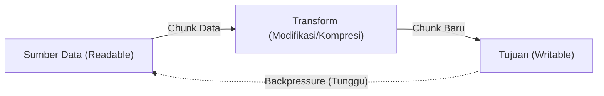

# Stream

> Ringkasan
>
> - Fungsi: Memproses aliran data secara bertahap dalam potongan-potongan kecil (_chunks_) tanpa perlu memuat seluruh isi berkas ke memori RAM sekaligus.
> - Digunakan saat: Menangani berkas berukuran raksasa, transfer data jaringan HTTP/TCP, pemrosesan log berkelanjutan, dan kompresi data.
> - Aturan praktis: Selalu gunakan `pipeline` dari `node:stream/promises` daripada `pipe()` biasa agar pembersihan sumber daya dan penanganan error berjalan otomatis, serta selalu kendalikan tekanan balik (_backpressure_).

---

## Tujuan Belajar

- Memahami konsep streaming dan keuntungan efisiensi memori dibanding membaca seluruh data sekaligus.
- Mengenal empat jenis utama stream: _Readable_, _Writable_, _Duplex_, dan _Transform_.
- Membaca dan menulis potongan data (_chunk_) menggunakan perulangan asinkron `for await...of` dan metode `write()`.
- Mengendalikan tekanan balik (_backpressure_) menggunakan event `drain`.
- Menghubungkan rantai stream secara aman menggunakan utilitas `pipeline` dari `node:stream/promises`.

---

## Konsep

Kita bisa membayangkan stream seperti perbedaan antara mengunduh film utuh dengan menontonnya secara streaming di internet. Jika tanpa stream (`readFile`), kita harus menunggu seluruh berkas film (misalnya berukuran 4 GB) terunduh lengkap ke dalam memori RAM komputer sebelum detik pertama film bisa diputar di layar.

Sebaliknya dengan streaming, aplikasi hanya mengambil beberapa megabyte awal (_chunk_), langsung memutarnya di layar, dan terus mengalirkan potongan-potongan berikutnya di latar belakang sambil film berjalan. Penggunaan memori RAM aplikasi akan tetap rendah dan stabil, meskipun data yang diproses mencapai puluhan gigabyte.



---

## Referensi

| Item                   | Fungsi                                                           | Catatan                                                                           |
| :--------------------- | :--------------------------------------------------------------- | :-------------------------------------------------------------------------------- |
| **`Readable`**         | Aliran sumber data yang bisa dibaca                              | Mendukung pembacaan lewat event `data` atau perulangan `for await...of`           |
| **`Writable`**         | Aliran tujuan tempat data dialirkan dan disimpan                 | Menerima data chunk lewat `write()` dan diakhiri dengan `end()`                   |
| **`Transform`**        | Aliran duplex yang memodifikasi data saat melintas               | Memanfaatkan fungsi internal `_transform` untuk mengolah data chunk               |
| **`pipeline()`**       | Menghubungkan beberapa aliran stream berbasis Promise            | Otomatis membersihkan dan menutup semua stream jika terjadi error di tengah jalan |
| **`finished()`**       | Memberi tahu kapan suatu stream selesai mengalir atau tertutup   | Mengembalikan Promise yang selesai saat siklus stream tuntas                      |
| **`writable.write()`** | Mengirimkan potongan data chunk ke dalam antrean writable stream | Menghasilkan nilai boolean `false` jika penampung internal stream sedang penuh    |
| **`writable.end()`**   | Menandai bahwa pengiriman data ke stream sudah selesai           | Memancarkan event `finish` setelah semua data di antrean selesai diproses         |

### `Readable`

Kelas `Readable` merepresentasikan sumber data yang dapat kita baca sedikit demi sedikit secara bertahap. Metode praktis `Readable.from()` mempermudah kita membuat aliran baca dari sebuah array data atau objek iterable.

```javascript
import { Readable } from "node:stream";

const source = Readable.from(["Line 1\n", "Line 2\n"]);
const chunks = [];

for await (const chunk of source) {
  chunks.push(chunk);
}

console.log(chunks.join("").trim());
// Output: Line 1
// Line 2
```

Kasus lain: Membaca stream dari sumber yang kosong akan langsung selesai tanpa pengulangan dan tanpa menghasilkan error.

```javascript
import { Readable } from "node:stream";

const emptySource = Readable.from([]);
let totalChunks = 0;

for await (const chunk of emptySource) {
  totalChunks++;
}

console.log(totalChunks);
// Output: 0
```

### `Writable`

Kelas `Writable` merepresentasikan tujuan akhir tempat data dialirkan, misalnya penulisan berkas ke penyimpanan atau pengiriman respons jaringan.

```javascript
import { Writable } from "node:stream";

const chunks = [];
const destination = new Writable({
  write(chunk, encoding, callback) {
    chunks.push(chunk.toString());
    callback();
  },
});

destination.write("Chunk A");
destination.write("Chunk B");
destination.end();

destination.on("finish", () => {
  console.log(chunks.join(" - "));
});
// Output: Chunk A - Chunk B
```

Kasus lain: Menulis data ke stream yang sudah ditutup akan memicu event `'error'` dengan kode `ERR_STREAM_WRITE_AFTER_END`.

```javascript
import { Writable } from "node:stream";

const writer = new Writable({
  write(chunk, encoding, callback) {
    callback();
  },
});

writer.end();
writer.on("error", (err) => {
  console.log(err.code);
});

writer.write("new data");
// Output: ERR_STREAM_WRITE_AFTER_END
```

### `Transform`

Kelas `Transform` adalah jenis stream khusus yang menerima data input, mengolah atau memodifikasi datanya di tengah jalan, lalu mengalirkan data baru ke saluran berikutnya.

```javascript
import { Transform } from "node:stream";

const uppercase = new Transform({
  transform(chunk, encoding, callback) {
    callback(null, chunk.toString().toUpperCase());
  },
});

uppercase.on("data", (data) => {
  console.log(data.toString());
});

uppercase.write("hello stream");
uppercase.end();
// Output: HELLO STREAM
```

Kasus lain: Meneruskan error di tengah proses transformasi dengan memanggil parameter pertama callback `callback(error)`.

```javascript
import { Transform } from "node:stream";

const validator = new Transform({
  transform(chunk, encoding, callback) {
    if (chunk.toString().includes("forbidden")) {
      callback(new Error("Forbidden word detected"));
    } else {
      callback(null, chunk);
    }
  },
});

validator.on("error", (err) => {
  console.log(err.message);
});

validator.write("forbidden word here");
// Output: Forbidden word detected
```

### `pipeline()`

Fungsi `pipeline()` dari modul `node:stream/promises` mengalirkan data melewati rantai beberapa stream secara aman, serta otomatis menutup seluruh stream jika terjadi gangguan di tengah jalan.

```javascript
import { Readable, Writable, Transform } from "node:stream";
import { pipeline } from "node:stream/promises";

const source = Readable.from(["coffee", "tea"]);
const formatter = new Transform({
  transform(chunk, encoding, callback) {
    callback(null, `[${chunk}]`);
  },
});

let result = "";
const destination = new Writable({
  write(chunk, encoding, callback) {
    result += chunk.toString();
    callback();
  },
});

await pipeline(source, formatter, destination);
console.log(result);
// Output: [coffee][tea]
```

Kasus lain: Menangani error di tengah alur pipa, di mana semua stream di dalam rantai otomatis dihancurkan dan dibersihkan dari memori.

```javascript
import { Readable, Writable } from "node:stream";
import { pipeline } from "node:stream/promises";

const brokenSource = new Readable({
  read() {
    this.destroy(new Error("Source connection lost"));
  },
});

const destination = new Writable({
  write(chunk, encoding, callback) {
    callback();
  },
});

try {
  await pipeline(brokenSource, destination);
} catch (error) {
  console.log(error.message);
  // Output: Source connection lost
}
```

### `finished()`

Fungsi `finished()` dari modul `node:stream/promises` memberi tahu kita lewat Promise saat suatu stream telah menyelesaikan seluruh tugasnya atau ditutup dengan tuntas.

```javascript
import { Readable } from "node:stream";
import { finished } from "node:stream/promises";

const source = Readable.from(["data 1", "data 2"]);
source.resume();

await finished(source);
console.log("Stream finished processing");
// Output: Stream finished processing
```

Kasus lain: Menangkap kondisi saat stream dipaksa berhenti atau dihancurkan bersama objek error sebelum selesai.

```javascript
import { Readable } from "node:stream";
import { finished } from "node:stream/promises";

const source = new Readable({
  read() {},
});

source.destroy(new Error("Cancelled"));

try {
  await finished(source);
} catch (error) {
  console.log(error.message);
  // Output: Cancelled
}
```

### `writable.write()`

Metode `writable.write()` digunakan untuk mengirimkan potongan data ke dalam stream. Metode ini mengembalikan nilai boolean `false` jika penampung internalnya sudah mencapai batas ambang maksimal (`highWaterMark`), yang berarti pengirim harus menunggu sejenak.

```javascript
import { Writable } from "node:stream";

const writer = new Writable({
  highWaterMark: 10,
  write(chunk, encoding, callback) {
    setTimeout(callback, 10);
  },
});

const canAcceptMore = writer.write("1234567890123");
console.log(canAcceptMore);
// Output: false

writer.on("drain", () => {
  console.log("Buffer drained");
  writer.end();
});
// Output: Buffer drained
```

Kasus lain: Menulis data kecil di bawah batas kapasitas ambang akan langsung mengembalikan nilai boolean `true`.

```javascript
import { Writable } from "node:stream";

const writer = new Writable({
  highWaterMark: 100,
  write(chunk, encoding, callback) {
    callback();
  },
});

const canAcceptMore = writer.write("short");
console.log(canAcceptMore);
// Output: true

writer.end();
```

### `writable.end()`

Metode `writable.end()` menandakan bahwa seluruh data sudah selesai dikirimkan, memastikan sisa data di antrean tertulis tuntas sebelum stream benar-benar ditutup.

```javascript
import { Writable } from "node:stream";
import { finished } from "node:stream/promises";

const output = [];
const writer = new Writable({
  write(chunk, encoding, callback) {
    output.push(chunk.toString());
    callback();
  },
});

writer.write("data");
writer.end("final");
await finished(writer);

console.log(output.join(" - "));
// Output: data - final
```

Kasus lain: Memanggil `end()` tanpa menyertakan data baru hanya untuk menutup antrean penulisan.

```javascript
import { Writable } from "node:stream";
import { finished } from "node:stream/promises";

const writer = new Writable({
  write(chunk, encoding, callback) {
    callback();
  },
});

writer.end();
await finished(writer);

console.log("Shutdown complete");
// Output: Shutdown complete
```

### Perbandingan: Empat Jenis Stream di Node.js

| Jenis Stream  | Arah Aliran Data                                        | Contoh Penggunaan Nyata                        |
| :------------ | :------------------------------------------------------ | :--------------------------------------------- |
| **Readable**  | Hanya membaca dari sumber data                          | `fs.createReadStream()`, `Readable.from()`     |
| **Writable**  | Hanya menulis ke tujuan data                            | `fs.createWriteStream()`, `process.stdout`     |
| **Duplex**    | Membaca dan menulis secara mandiri dua arah             | `net.Socket` (koneksi dua arah TCP)            |
| **Transform** | Membaca, mengubah isi data, lalu mengalirkan hasil baru | `zlib.createGzip()`, `crypto.createCipheriv()` |

---

## Kesalahan Umum

### Mengabaikan Tekanan Balik (Backpressure) Saat Menulis Data

Memanggil `writer.write()` terus-menerus tanpa memedulikan nilai kembalian `false` bisa membuat memori RAM melonjak drastis tanpa batas jika pengirim data jauh lebih cepat daripada penerima data.

```javascript
// Salah
import { Writable } from "node:stream";

const writer = new Writable({
  write(chunk, encoding, callback) {
    setTimeout(callback, 100);
  },
});

for (let i = 0; i < 100_000; i++) {
  writer.write("data"); // Memori membengkak karena penampung internal meluap
}
```

```javascript
// Benar
import { Writable } from "node:stream";
import { once } from "node:events";

const writer = new Writable({
  write(chunk, encoding, callback) {
    setTimeout(callback, 10);
  },
});

for (let i = 0; i < 100; i++) {
  const canAccept = writer.write("data");
  if (!canAccept) {
    await once(writer, "drain"); // Berhenti sejenak sampai penampung kosong kembali
  }
}
```

### Menggunakan `readable.pipe(writable)` Manual Tanpa Penanganan Error

Menyambungkan aliran dengan `.pipe()` biasa tidak otomatis menutup stream tujuan jika stream sumber mengalami error di tengah jalan, sehingga rawan memicu kebocoran memori atau koneksi menggantung.

```javascript
// Salah
readable.pipe(writable);
// Jika readable melempar error, writable tetap menggantung terbuka
```

```javascript
// Benar
import { pipeline } from "node:stream/promises";

await pipeline(readable, writable);
// Menutup seluruh saluran stream secara otomatis jika terjadi error di salah satunya
```

### Lupa Menghancurkan Stream Saat Operasi Dibatalkan

Jika koneksi klien terputus mendadak tetapi kita lupa memanggil `destroy()`, proses pembacaan berkas atau jaringan akan terus berjalan sia-sia di latar belakang.

```javascript
// Salah
stream.on("close", () => {
  // Tidak membatalkan pembacaan aktif pada stream sumber
});
```

```javascript
// Benar
stream.destroy();
// Menghentikan aliran data dan membebaskan sumber daya memori seketika
```

---

## Studi Kasus

Skenario: Membangun saluran pemrosesan berkas log berformat CSV untuk menyaring pesan error secara bertahap menggunakan kelas `Transform` dan fungsi `pipeline` dari `node:stream/promises`.

```javascript
import { Readable, Writable, Transform } from "node:stream";
import { pipeline } from "node:stream/promises";

class CsvLogFilterTransform extends Transform {
  constructor(targetLevel) {
    super({ objectMode: true });
    this.targetLevel = targetLevel;
  }

  _transform(chunk, encoding, callback) {
    const lines = chunk.toString().trim().split("\n");
    for (const line of lines) {
      if (!line) continue;
      const [timestamp, level, message] = line.split(",");
      if (level === this.targetLevel) {
        this.push(JSON.stringify({ timestamp, level, message }) + "\n");
      }
    }
    callback();
  }
}

const csvData = [
  "2026-10-12T00:00:00Z,INFO,Server running\n",
  "2026-10-12T00:01:00Z,ERROR,Database connection failed\n",
  "2026-10-12T00:02:00Z,INFO,Health check passed\n",
  "2026-10-12T00:03:00Z,ERROR,Gateway timeout\n",
];

const source = Readable.from(csvData);
const errorFilter = new CsvLogFilterTransform("ERROR");
const filteredLogs = [];

const destination = new Writable({
  write(chunk, encoding, callback) {
    filteredLogs.push(chunk.toString().trim());
    callback();
  },
});

await pipeline(source, errorFilter, destination);
console.log(filteredLogs);
// Output: [
//   '{"timestamp":"2026-10-12T00:01:00Z","level":"ERROR","message":"Database connection failed"}',
//   '{"timestamp":"2026-10-12T00:03:00Z","level":"ERROR","message":"Gateway timeout"}'
// ]
```

Dengan arsitektur ini, data log disaring baris demi baris secara bertahap tanpa perlu menampung seluruh teks dokumen ke dalam variabel string raksasa di memori. Penggunaan `pipeline` juga memastikan seluruh aliran ditutup dengan bersih jika sewaktu-waktu terjadi error pada proses transformasi.

---

## Latihan Mandiri

### Soal 1 (Dasar)

Buat fungsi `countStreamSize(readableStream)` yang menerima instance `Readable`, membaca seluruh potongan data chunk menggunakan perulangan asinkron `for await...of`, lalu mengembalikan total ukuran seluruh data dalam satuan byte.

Contoh input:

```javascript
import { Readable } from "node:stream";

const stream = Readable.from(["Hello ", "World"]);
await countStreamSize(stream);
```

Contoh output yang diharapkan:

```javascript
11;
```

Batasan: Hindari menggabungkan seluruh potongan data menjadi string besar di memori. Hitung akumulasi ukuran byte secara bertahap menggunakan properti `length` pada buffer chunk.

### Soal 2 (Menengah)

Buat kelas `PrefixTransform` yang mewarisi `Transform` dari `node:stream`. Kelas ini menerima parameter awalan string `prefix` pada konstruktornya (misalnya `"[AUDIT] "`). Setiap baris teks yang mengalir melalui stream harus disematkan awalan tersebut sebelum dialirkan ke tujuan berikutnya.

Contoh input:

```javascript
import { Readable, Writable } from "node:stream";
import { pipeline } from "node:stream/promises";

const source = Readable.from(["Server running\nConnection established\n"]);
const results = [];
const destination = new Writable({
  write(chunk, encoding, callback) {
    results.push(chunk.toString());
    callback();
  },
});

await pipeline(source, new PrefixTransform("[AUDIT] "), destination);
console.log(results.join(""));
```

Contoh output yang diharapkan:

```javascript
// [AUDIT] Server running
// [AUDIT] Connection established
```

Batasan: Gunakan kelas `Transform` bawaan dari modul `node:stream`.

### Soal 3 (Menantang)

Buat fungsi pengiriman data terkontrol `copyStreamThrottled(readable, writable, delayMs = 20)`.

Ketentuan fungsional:

- Membaca potongan chunk dari `readable` secara bertahap.
- Menulis chunk ke `writable` menggunakan `writable.write(chunk)`.
- Jika pemanggilan `write()` menghasilkan nilai `false` (tanda bahwa buffer tujuan sedang penuh karena _backpressure_), tunda pengiriman berikutnya hingga event `'drain'` dipancarkan.
- Berikan jeda waktu `delayMs` milidetik di antara pengiriman setiap chunk untuk meratakan beban kerja I/O.
- Panggil `writable.end()` setelah seluruh data `readable` selesai dialirkan, dan tunggu konfirmasi selesai melalui fungsi utilitas `finished` dari `node:stream/promises`.
- Jika terjadi error pada `readable` maupun `writable`, hancurkan kedua stream lewat `.destroy(error)` dan teruskan error tersebut ke pemanggil fungsi.
- Jika seluruh proses streaming berhasil tanpa kendala, kembalikan objek statistik `{ success: true, totalChunks: number }`.

Contoh input:

```javascript
import { Readable, Writable } from "node:stream";

const source = Readable.from(["packet-1", "packet-2", "packet-3"]);
const destination = new Writable({
  highWaterMark: 10,
  write(chunk, encoding, callback) {
    callback();
  },
});

const stats = await copyStreamThrottled(source, destination, 10);
console.log(stats);
```

Contoh output yang diharapkan:

```javascript
{
  success: true,
  totalChunks: 3
}
```

Batasan: Dilarang memakai modul luar dari NPM. Kelola event `'drain'` dan penyelesaian `finished` secara mandiri.

---

## Navigasi

[Sebelumnya: Buffer](../09-buffer/README.md) | [Selanjutnya: Timer](../11-timer/README.md) | [Daftar Isi](../README.md)
