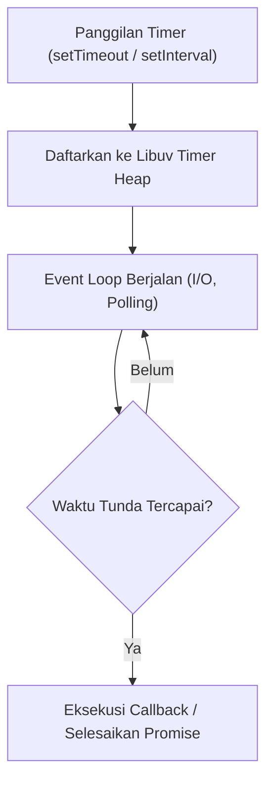

# Timer

> Ringkasan
>
> - Fungsi: Mengatur penjadwalan eksekusi kode tertunda, pengulangan berkala, dan jeda asinkron non-blocking pada runtime Node.js.
> - Digunakan saat: Menjadwalkan tugas latar belakang, membatasi durasi operasi, menerapkan jeda percobaan ulang, atau iterasi interval waktu.
> - Aturan praktis: Prioritaskan modul `node:timers/promises` bersama kata kunci `await` untuk sintaks linier, dan selalu batalkan timer menggunakan pembatalan yang tepat agar tidak menahan proses.

---

## Tujuan Belajar

- Memahami konsep antrean penundaan pada siklus Event Loop Node.js.
- Membedakan timer berbasis callback tradisional dan API modern `node:timers/promises`.
- Menggunakan `setTimeout` dan `setInterval` berbasis Promise untuk jeda asinkron dan iterasi berkala.
- Menghentikan atau membatalkan penundaan asinkron secara aman menggunakan `AbortController`.
- Menjadwalkan tugas segera pada fase berikutnya menggunakan `setImmediate` dan `scheduler.yield()`.

---

## Konsep

> Event Loop dan timer dianalogikan seperti kasir pemesanan restoran cepat saji. Kasir melayani satu pelanggan pada satu waktu. Jika ada pesanan yang membutuhkan waktu masak lima menit (`setTimeout`), kasir tidak berdiri diam menunggu masakan matang, melainkan memberikan nomor antrean kepada pelanggan dan langsung melayani pelanggan berikutnya. Saat alarm dapur berdering menandakan masakan siap, kasir memanggil nomor antrean tersebut di sela-sela pergantian giliran tanpa menghentikan arus antrean utama.



---

## Referensi

| Item                    | Fungsi                                                                 | Catatan                                                                          |
| :---------------------- | :--------------------------------------------------------------------- | :------------------------------------------------------------------------------- |
| **`setTimeout()`**      | Menunda eksekusi kode selama durasi waktu tertentu dalam milidetik     | Versi `node:timers/promises` mengembalikan Promise yang dapat di-await           |
| **`setInterval()`**     | Menjalankan eksekusi secara berulang dengan interval waktu tetap       | Versi `node:timers/promises` mengembalikan async iterable untuk `for await...of` |
| **`setImmediate()`**    | Menjadwalkan eksekusi segera setelah fase polling I/O saat ini selesai | Memecah komputasi panjang agar tidak memblokir Event Loop                        |
| **`clearTimeout()`**    | Membatalkan timer penundaan `setTimeout` sebelum waktu habis           | Mencegah pemanggilan fungsi dan membebaskan alokasi handle timer                 |
| **`clearInterval()`**   | Menghentikan pengulangan berkala dari instance `setInterval`           | Wajib dipanggil untuk mencegah proses Node.js menggantung tanpa henti            |
| **`scheduler.yield()`** | Menyerahkan giliran eksekusi sementara ke thread utama                 | Fitur modern `node:timers/promises` untuk membagi prioritas giliran kerja        |

### `setTimeout()`

Fungsi `setTimeout()` dari modul `node:timers/promises` menunda kelanjutan eksekusi kode selama durasi milidetik yang ditentukan tanpa memerlukan pembungkus Promise manual.

```javascript
import { setTimeout } from "node:timers/promises";

console.log("Mulai tunggu");
const hasil = await setTimeout(50, "selesai");

console.log(hasil);
// Output: Mulai tunggu
// selesai
```

Kasus lain: Membatalkan penundaan waktu di tengah jalan menggunakan `AbortController` yang melempar galat `AbortError`.

```javascript
import { setTimeout } from "node:timers/promises";

const ac = new AbortController();
const janji = setTimeout(1000, "tidak terpanggil", { signal: ac.signal });

ac.abort();

try {
  await janji;
} catch (error) {
  console.log(error.name);
  // Output: AbortError
}
```

### `setInterval()`

Fungsi `setInterval()` dari modul `node:timers/promises` menghasilkan sebuah iterator asinkron yang dapat diiterasi menggunakan sintaks `for await...of` pada setiap detak waktu.

```javascript
import { setInterval } from "node:timers/promises";

const tik = [];
for await (const waktu of setInterval(20, "ketukan")) {
  tik.push(waktu);
  if (tik.length === 3) break;
}

console.log(tik);
// Output: [ 'ketukan', 'ketukan', 'ketukan' ]
```

Kasus lain: Menghentikan perulangan interval asinkron dari luar perulangan menggunakan `signal` dari `AbortController`.

```javascript
import { setInterval } from "node:timers/promises";

const ac = new AbortController();
const riwayat = [];

try {
  for await (const waktu of setInterval(10, Date.now(), {
    signal: ac.signal,
  })) {
    riwayat.push("tik");
    if (riwayat.length === 2) ac.abort();
  }
} catch (error) {
  console.log(error.name, riwayat.length);
  // Output: AbortError 2
}
```

### `setImmediate()`

Fungsi `setImmediate()` menjadwalkan eksekusi segera setelah fase penanganan I/O yang sedang aktif selesai dievaluasi oleh Libuv.

```javascript
import { setImmediate } from "node:timers/promises";

console.log("Sebelum");
const nilai = await setImmediate("segera tiba");
console.log(nilai);
// Output: Sebelum
// segera tiba
```

Kasus lain: Menggunakan versi callback `setImmediate` dari modul `node:timers` untuk penjadwalan tanpa Promise.

```javascript
import { setImmediate } from "node:timers";

let terpanggil = false;
setImmediate(() => {
  terpanggil = true;
});

console.log(terpanggil);
// Output: false
```

### `clearTimeout()`

Fungsi `clearTimeout()` membatalkan eksekusi callback timer yang sebelumnya dijadwalkan oleh pemanggilan `setTimeout` berbasis callback.

```javascript
import { setTimeout, clearTimeout } from "node:timers";

let status = "tidak berubah";
const timerId = setTimeout(() => {
  status = "berubah";
}, 50);

clearTimeout(timerId);

console.log(status);
// Output: tidak berubah
```

Kasus lain: Memanggil `clearTimeout()` dengan nilai parameter `undefined` tidak memicu galat runtime.

```javascript
import { clearTimeout } from "node:timers";

clearTimeout(undefined);
console.log("Aman");
// Output: Aman
```

### `clearInterval()`

Fungsi `clearInterval()` menghentikan siklus pengulangan berkala yang dihasilkan oleh metode `setInterval` berbasis callback tradisional.

```javascript
import { setInterval, clearInterval } from "node:timers";

let hitung = 0;
const intervalId = setInterval(() => {
  hitung++;
}, 10);

clearInterval(intervalId);

console.log(hitung);
// Output: 0
```

Kasus lain: Menghentikan perulangan interval dari dalam fungsi callback berdasarkan evaluasi kondisi tertentu.

```javascript
import { setInterval, clearInterval } from "node:timers";

let hitungan = 0;
const timer = setInterval(() => {
  hitungan++;
  if (hitungan >= 2) {
    clearInterval(timer);
  }
}, 5);
```

### `scheduler.yield()`

Objek `scheduler.yield()` dari `node:timers/promises` menangguhkan eksekusi fungsi asinkron saat ini untuk memberikan kesempatan kepada tugas lain di Event Loop berjalan.

```javascript
import { scheduler } from "node:timers/promises";

const jejak = [];
jejak.push("awal");

await scheduler.yield();
jejak.push("akhir");

console.log(jejak);
// Output: [ 'awal', 'akhir' ]
```

Kasus lain: Menggunakan `scheduler.yield()` di dalam iterasi komputasi panjang agar tidak memonopoli thread utama.

```javascript
import { scheduler } from "node:timers/promises";

let iterasi = 0;
while (iterasi < 3) {
  iterasi++;
  await scheduler.yield();
}

console.log("Selesai iterasi:", iterasi);
// Output: Selesai iterasi: 3
```

### Perbandingan: Mekanisme Asinkron dan Timer di Node.js

| Metode                     | Kategori Antrean         | Waktu Eksekusi                                                  |
| :------------------------- | :----------------------- | :-------------------------------------------------------------- |
| **`process.nextTick()`**   | Microtask Queue          | Segera setelah operasi JavaScript saat ini selesai, sebelum I/O |
| **`Promise.then()`**       | Microtask Queue          | Bersama antrean microtask lainnya, mendahului seluruh macrotask |
| **`setImmediate()`**       | Macrotask (Check Phase)  | Tepat setelah fase Poll I/O selesai dievaluasi                  |
| **`setTimeout()`**         | Macrotask (Timers Phase) | Setelah durasi tunda milidetik terlampaui                       |
| **`node:timers/promises`** | Modern Promise API       | Mengembalikan Promise yang diselesaikan pada siklus timer       |

---

## Kesalahan Umum

### Memblokir Event Loop dengan Komputasi Sinkron Berat

Timer Node.js tidak berjalan pada thread sistem operasi terpisah, sehingga perulangan sinkron yang berat akan menghambat eksekusi callback timer.

```javascript
// Salah
setTimeout(() => console.log("Terpanggil"), 10);
const batas = Date.now() + 1000;
while (Date.now() < batas) {
  // Loop sinkron memblokir thread utama selama satu detik penuh
}
```

```javascript
// Benar
import { setTimeout } from "node:timers/promises";

console.log("Menunggu tanpa memblokir thread");
await setTimeout(1000);
console.log("Terpanggil tepat waktu");
```

### Lupa Membatalkan `setInterval` Berbasis Callback

Mengabaikan pemanggilan `clearInterval()` menyebabkan handle timer tetap aktif di Libuv sehingga proses Node.js tidak pernah keluar secara alami.

```javascript
// Salah
import { setInterval } from "node:timers";

setInterval(() => {
  console.log("Ping");
}, 1000);
// Proses server tidak akan pernah selesai
```

```javascript
// Benar
import { setInterval, clearInterval } from "node:timers";

const timer = setInterval(() => {
  console.log("Ping");
}, 1000);
// Hentikan timer saat proses selesai
clearInterval(timer);
```

### Membuat Wrapper Promise Manual untuk Jeda Waktu

Menulis pembungkus `new Promise((resolve) => setTimeout(resolve, ms))` secara manual menciptakan redundansi ketika Node.js telah menyediakan modul resmi `node:timers/promises`.

```javascript
// Salah
const sleep = (ms) => new Promise((resolve) => setTimeout(resolve, ms));
await sleep(100);
```

```javascript
// Benar
import { setTimeout } from "node:timers/promises";

await setTimeout(100);
```

---

## Studi Kasus

Skenario: Membangun pembungkus eksekusi fungsi dengan batas waktu maksimum (_timeout guard_) menggunakan kombinasi `node:timers/promises` dan `AbortController` untuk mencegah operasi yang menggantung.

```javascript
import { setTimeout } from "node:timers/promises";

async function eksekusiDenganBatasWaktu(fnTugas, batasMs) {
  const ac = new AbortController();
  const timerBatas = setTimeout(batasMs, null, { signal: ac.signal }).then(
    () => {
      throw new Error("TIMEOUT");
    },
  );

  try {
    const hasil = await Promise.race([fnTugas(ac.signal), timerBatas]);
    ac.abort();
    return hasil;
  } catch (error) {
    ac.abort();
    throw error;
  }
}

const sukses = await eksekusiDenganBatasWaktu(async () => {
  await setTimeout(20);
  return "Data Selesai";
}, 100);

console.log("Sukses:", sukses);
// Output: Sukses: Data Selesai

try {
  await eksekusiDenganBatasWaktu(async () => {
    await setTimeout(200);
    return "Data Terlambat";
  }, 50);
} catch (err) {
  console.log("Gagal:", err.message);
  // Output: Gagal: TIMEOUT
}
```

Desain ini menggunakan `Promise.race` untuk memperlombakan tugas asinkron dengan batas waktu. Pemanggilan `ac.abort()` memastikan timer penundaan dibersihkan seketika baik saat tugas berhasil mendahului batas waktu maupun saat terjadi kegagalan.

---

## Latihan Mandiri

### Soal 1 (Dasar)

Buat fungsi `hitungMundur(detikAwal)` yang memanfaatkan iterator `setInterval` dari `node:timers/promises` untuk mencetak angka hitung mundur mulai dari `detikAwal` hingga `0`, lalu mengembalikan string `'Waktu Habis!'`.

Contoh masukan:

```javascript
await hitungMundur(3);
```

Contoh keluaran yang diharapkan:

```javascript
// 3
// 2
// 1
// 0
// 'Waktu Habis!'
```

Batasan: Wajib menggunakan `setInterval` dari modul `node:timers/promises` dengan interval waktu dan kata kunci `break` saat mencapai angka nol.

### Soal 2 (Menengah)

Buat fungsi `denganBatasWaktu(promiseTugas, durasiMs)` yang memanfaatkan `setTimeout` dari `node:timers/promises` dan `Promise.race()`. Jika `promiseTugas` belum selesai sebelum `durasiMs` milidetik terlampaui, fungsi harus melempar galat dengan pesan `'Batas waktu operasi terlampaui'`.

Contoh masukan 1 (tugas selesai tepat waktu):

```javascript
await denganBatasWaktu(Promise.resolve("Data Berhasil"), 100);
```

Contoh keluaran 1:

```javascript
"Data Berhasil";
```

Contoh masukan 2 (tugas melebihi batas durasi):

```javascript
import { setTimeout } from "node:timers/promises";

await denganBatasWaktu(setTimeout(200, "Terlambat"), 50);
```

Contoh keluaran 2:

```javascript
// Melempar galat Error: 'Batas waktu operasi terlampaui'
```

Batasan: Wajib menggunakan `Promise.race` dan modul `node:timers/promises`.

### Soal 3 (Menantang)

Buat kelas penjadwal tugas berulang terkendali `IntervalWorker`.

Spesifikasi konstruktor: menerima `fnTugas` (fungsi asinkron yang dieksekusi), `intervalMs` (durasi jeda antar-eksekusi), dan `maksEksekusi` (total batas putaran eksekusi).

Metode kelas:

- `mulai()`: Menjalankan eksekusi tugas secara berulang menggunakan iterator `setInterval` dari `node:timers/promises`. Setiap putaran mencatat hasil kembalian tugas ke dalam array riwayat internal dalam bentuk objek `{ status: 'sukses', nilai: ... }`.
- Jika `fnTugas` melempar galat pada putaran tertentu, tangkap galat tersebut secara internal, simpan catatan `{ status: 'gagal', kesalahan: err.message }` ke dalam riwayat, dan lanjutkan putaran berikutnya tanpa menghentikan worker.
- `berhenti()`: Membatalkan siklus timer seketika menggunakan `AbortController` internal tanpa menunggu iterasi berikutnya.
- Jika iterasi mencapai `maksEksekusi`, hentikan siklus secara otomatis dan kembalikan array riwayat eksekusi.
- Sediakan metode getter `ambilRiwayat()` yang mengembalikan salinan dangkal (_shallow copy_) dari riwayat.

Contoh masukan:

```javascript
let counter = 0;
const worker = new IntervalWorker(
  async () => {
    counter++;
    if (counter === 2) throw new Error("Gagal sementara");
    return `Sukses putaran ${counter}`;
  },
  20,
  3,
);

const hasil = await worker.mulai();
console.log(hasil);
```

Contoh keluaran yang diharapkan:

```javascript
[
  { status: "sukses", nilai: "Sukses putaran 1" },
  { status: "gagal", kesalahan: "Gagal sementara" },
  { status: "sukses", nilai: "Sukses putaran 3" },
];
```

Batasan: Dilarang menggunakan pustaka pihak ketiga. Wajib mengendalikan penghentian loop menggunakan `AbortController` dan iterator `node:timers/promises`.

---

## Navigasi

[Sebelumnya: Stream](../10-stream/README.md) | [Selanjutnya: Net](../12-net/README.md) | [Daftar Isi](../README.md)
