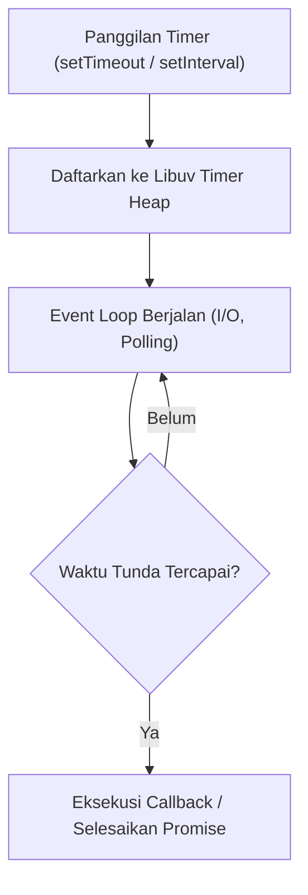

# Timer

> Ringkasan
>
> - Fungsi: Mengatur penundaan eksekusi kode, pengulangan berkala, dan jeda asinkron tanpa memblokir thread utama di runtime Node.js.
> - Digunakan saat: Menjadwalkan tugas latar belakang, membatasi durasi operasi (_timeout_), memberi jeda percobaan ulang (_retry delay_), atau menjalankan fungsi secara berulang.
> - Aturan praktis: Utamakan modul `node:timers/promises` bersama kata kunci `await` agar penulisan kode lebih rapi dan linier, serta selalu batalkan timer yang tidak lagi dipakai agar proses Node.js tidak menggantung.

---

## Tujuan Belajar

- Memahami cara kerja antrean penundaan waktu pada siklus Event Loop Node.js.
- Membedakan fungsi timer bergaya callback tradisional dengan API modern `node:timers/promises`.
- Menggunakan `setTimeout` dan `setInterval` berbasis Promise untuk membuat jeda dan perulangan berkala.
- Menghentikan atau membatalkan penundaan waktu secara aman menggunakan `AbortController`.
- Menjadwalkan tugas langsung pada putaran berikutnya menggunakan `setImmediate` dan `scheduler.yield()`.

---

## Konsep

Kita bisa membayangkan cara kerja Event Loop dan timer seperti kasir di restoran cepat saji. Kasir hanya melayani satu pelanggan dalam satu waktu. Ketika ada pelanggan memesan paket ayam goreng yang butuh waktu masak lima menit (`setTimeout`), kasir tidak akan berdiri diam menunggu ayam matang.

Kasir akan memberikan nomor antrean kepada pelanggan tersebut, lalu segera melayani pesanan pelanggan berikutnya di antrean. Begitu alarm dapur berdering menandakan pesanan sudah siap, kasir memanggil nomor antrean tersebut di sela-sela waktu senggang tanpa menghentikan kelancaran antrean utama.



---

## Referensi

| Item                    | Fungsi                                                               | Catatan                                                                             |
| :---------------------- | :------------------------------------------------------------------- | :---------------------------------------------------------------------------------- |
| **`setTimeout()`**      | Menunda eksekusi kode selama durasi waktu tertentu (dalam milidetik) | Versi `node:timers/promises` mengembalikan Promise yang bisa di-`await`             |
| **`setInterval()`**     | Menjalankan kode berulang kali dengan jeda interval waktu tetap      | Versi `node:timers/promises` mengembalikan iterable asinkron untuk `for await...of` |
| **`setImmediate()`**    | Menjadwalkan eksekusi tepat setelah fase I/O saat ini tuntas         | Memecah komputasi berat agar tidak memonopoli Event Loop                            |
| **`clearTimeout()`**    | Membatalkan timer penundaan `setTimeout` sebelum waktunya tiba       | Mencegah pemanggilan fungsi dan membersihkan alokasi penanda waktu                  |
| **`clearInterval()`**   | Menghentikan pengulangan berkala dari `setInterval`                  | Wajib dipanggil agar proses Node.js bisa berhenti secara wajar                      |
| **`scheduler.yield()`** | Mengalah sejenak dan menyerahkan giliran eksekusi ke tugas lain      | Fitur modern dari `node:timers/promises` untuk membagi beban kerja                  |

### `setTimeout()`

Fungsi `setTimeout()` menunda kelanjutan baris kode selama durasi milidetik tertentu. Node.js menyediakan dua antarmuka berbeda: versi modern berbasis Promise (`node:timers/promises`) dan versi klasik berbasis callback (`node:timers` atau global).

Struktur parameter versi modern: `setTimeout(delay, value, options)`

- `delay`: Durasi penundaan waktu dalam satuan milidetik sebelum Promise selesai (opsional, tipe data: `number`, nilai bawaan: `1`).
- `value`: Nilai kembalian yang dihasilkan saat Promise berhasil selesai (opsional, tipe data: `any`, nilai bawaan: `undefined`).
- `options`: Objek konfigurasi tambahan (opsional, tipe data: `object`), mencakup `{ signal }` (`AbortSignal` untuk membatalkan timer) dan `{ ref: boolean }` (menentukan apakah timer menahan Event Loop atau tidak, nilai bawaan: `true`).
- Nilai kembalian: Mengembalikan objek `Promise<any>` yang selesai setelah durasi `delay` terlewati.

Struktur parameter versi callback: `setTimeout(callback, delay, ...args)`

- `callback`: Fungsi yang akan dipanggil setelah durasi penundaan habis (wajib, tipe data: `Function`).
- `delay`: Durasi penundaan waktu dalam satuan milidetik sebelum fungsi dipanggil (opsional, tipe data: `number`, nilai bawaan: `1`).
- `...args`: Nilai tambahan yang otomatis diteruskan sebagai parameter ke dalam fungsi callback (opsional, tipe data: `any[]`).
- Nilai kembalian: Mengembalikan objek pengenal timer (`Timeout`) yang dapat dibatalkan melalui `clearTimeout()`.

Contoh 1: Versi modern Promise (`node:timers/promises`) dengan kata kunci `await`:

```javascript
import { setTimeout } from "node:timers/promises";

console.log("Start wait");
// Menunda 50 ms dan mengembalikan nilai 'done' ke variabel result
const result = await setTimeout(50, "done");

console.log(result);
// Output:
// Start wait
// done
```

Contoh 2: Versi klasik callback (`node:timers`) dengan meneruskan argumen tambahan:

```javascript
import { setTimeout } from "node:timers";

// Menerima argumen tambahan ('Hello', 'Node.js') langsung pada parameter fungsi callback
setTimeout(
  (greeting, name) => {
    console.log(`${greeting}, ${name}!`);
    // Output: Hello, Node.js!
  },
  50,
  "Hello",
  "Node.js",
);
```

Kasus lain: Membatalkan jeda waktu Promise di tengah jalan menggunakan opsi `signal` dari `AbortController` yang akan melempar error `AbortError`.

```javascript
import { setTimeout } from "node:timers/promises";

const ac = new AbortController();
// Mengirimkan objek { signal } pada parameter options
const timerPromise = setTimeout(1000, "unreachable", { signal: ac.signal });

ac.abort();

try {
  await timerPromise;
} catch (error) {
  console.log(error.name);
  // Output: AbortError
}
```

### `setInterval()`

Fungsi `setInterval()` menjalankan operasi berulang kali dengan jeda interval waktu tetap. Pada versi modern berbasis Promise (`node:timers/promises`), fungsi ini menghasilkan iterable asinkron yang dikonsumsi menggunakan perulangan `for await...of`. Pada versi klasik (`node:timers`), fungsi menerima callback yang dipanggil berulang di setiap detak.

Struktur parameter versi modern: `setInterval(delay, value, options)`

- `delay`: Durasi jeda waktu antar-detak dalam satuan milidetik (opsional, tipe data: `number`, nilai bawaan: `1`).
- `value`: Nilai yang dihasilkan di setiap putaran perulangan `for await...of` (opsional, tipe data: `any`, nilai bawaan: `undefined`).
- `options`: Objek konfigurasi tambahan (opsional, tipe data: `object`), mencakup `{ signal }` (`AbortSignal` untuk menghentikan iterasi dari luar loop) dan `{ ref: boolean }` (nilai bawaan: `true`).
- Nilai kembalian: Mengembalikan objek `AsyncIterable<any>` untuk perulangan asinkron.

Struktur parameter versi callback: `setInterval(callback, delay, ...args)`

- `callback`: Fungsi yang dipanggil secara berulang di setiap interval waktu (wajib, tipe data: `Function`).
- `delay`: Durasi interval dalam satuan milidetik antar pemanggilan (opsional, tipe data: `number`, nilai bawaan: `1`).
- `...args`: Nilai tambahan yang otomatis diteruskan ke fungsi callback (opsional, tipe data: `any[]`).
- Nilai kembalian: Mengembalikan objek pengenal timer (`Timeout`) yang harus dihentikan via `clearInterval()`.

Contoh 1: Versi modern Promise (`node:timers/promises`) dengan `for await...of`:

```javascript
import { setInterval } from "node:timers/promises";

const ticks = [];
// Menghasilkan teks 'tick' di setiap detak 20 ms
for await (const time of setInterval(20, "tick")) {
  ticks.push(time);
  if (ticks.length === 3) break;
}

console.log(ticks);
// Output: [ 'tick', 'tick', 'tick' ]
```

Contoh 2: Versi klasik callback (`node:timers`) dengan argumen tambahan dan penghentian manual:

```javascript
import { setInterval, clearInterval } from "node:timers";

let count = 0;
// Meneruskan teks 'Ping' sebagai argumen pertama ke callback
const intervalId = setInterval(
  (prefix) => {
    count++;
    console.log(`${prefix} ${count}`);
    if (count >= 2) {
      clearInterval(intervalId);
    }
  },
  20,
  "Ping",
);
// Output:
// Ping 1
// Ping 2
```

Kasus lain: Menghentikan perulangan interval asinkron dari luar loop menggunakan pembatalan opsi `signal` dari `AbortController`.

```javascript
import { setInterval } from "node:timers/promises";

const ac = new AbortController();
const history = [];

try {
  for await (const time of setInterval(10, Date.now(), {
    signal: ac.signal,
  })) {
    history.push("tick");
    if (history.length === 2) ac.abort();
  }
} catch (error) {
  console.log(error.name, history.length);
  // Output: AbortError 2
}
```

### `setImmediate()`

Fungsi `setImmediate()` menjadwalkan eksekusi tepat setelah fase penanganan I/O saat ini selesai diperiksa oleh Libuv pada Event Loop (fase Check).

Struktur parameter versi modern: `setImmediate(value, options)`

- `value`: Nilai kembalian yang dihasilkan saat Promise berhasil selesai (opsional, tipe data: `any`, nilai bawaan: `undefined`).
- `options`: Objek konfigurasi tambahan (opsional, tipe data: `object`) seperti `{ ref: boolean }` (nilai bawaan: `true`).
- Nilai kembalian: Mengembalikan objek `Promise<any>`.

Struktur parameter versi callback: `setImmediate(callback, ...args)`

- `callback`: Fungsi yang dieksekusi di fase Check Event Loop (wajib, tipe data: `Function`).
- `...args`: Nilai tambahan yang otomatis diteruskan ke fungsi callback (opsional, tipe data: `any[]`).
- Nilai kembalian: Mengembalikan objek pengenal timer (`Immediate`) yang dapat dibatalkan lewat `clearImmediate()`.

Contoh 1: Versi modern Promise (`node:timers/promises`) dengan kata kunci `await`:

```javascript
import { setImmediate } from "node:timers/promises";

console.log("Before");
// Mengembalikan teks 'immediate arrival' setelah antrean I/O diperiksa
const value = await setImmediate("immediate arrival");
console.log(value);
// Output:
// Before
// immediate arrival
```

Contoh 2: Versi klasik callback (`node:timers`) dengan argumen tambahan:

```javascript
import { setImmediate } from "node:timers";

setImmediate(
  (taskName, taskId) => {
    console.log(`Executing ${taskName} #${taskId}`);
    // Output: Executing Cleanup #42
  },
  "Cleanup",
  42,
);
```

Kasus lain: Memeriksa sifat asinkron `setImmediate` callback yang tidak memblokir baris kode sinkron berikutnya.

```javascript
import { setImmediate } from "node:timers";

let isCalled = false;
setImmediate(() => {
  isCalled = true;
});

console.log(isCalled);
// Output: false
```

### `clearTimeout()`

Fungsi `clearTimeout()` digunakan untuk membatalkan timer yang sebelumnya dijadwalkan lewat fungsi `setTimeout` berbasis callback.

Struktur parameter: `clearTimeout(timeout)`

- `timeout`: Objek pengenal timer yang dikembalikan saat memanggil `setTimeout()` versi callback (opsional, tipe data: `Timeout | string | number`).
- Nilai kembalian: Mengembalikan nilai `undefined`.

```javascript
import { setTimeout, clearTimeout } from "node:timers";

let status = "unchanged";
const timerId = setTimeout(() => {
  status = "changed";
}, 50);

clearTimeout(timerId);

console.log(status);
// Output: unchanged
```

Kasus lain: Memanggil `clearTimeout()` dengan nilai `undefined` atau nilai tidak valid tetap aman dan tidak akan memicu error.

```javascript
import { clearTimeout } from "node:timers";

clearTimeout(undefined);
console.log("Safe");
// Output: Safe
```

### `clearInterval()`

Fungsi `clearInterval()` dipakai untuk menghentikan putaran waktu berkala yang dibuat oleh fungsi `setInterval` berbasis callback.

Struktur parameter: `clearInterval(interval)`

- `interval`: Objek pengenal timer yang dikembalikan saat memanggil `setInterval()` versi callback (opsional, tipe data: `Timeout | string | number`).
- Nilai kembalian: Mengembalikan nilai `undefined`.

```javascript
import { setInterval, clearInterval } from "node:timers";

let count = 0;
const intervalId = setInterval(() => {
  count++;
}, 10);

clearInterval(intervalId);

console.log(count);
// Output: 0
```

Kasus lain: Menghentikan putaran interval langsung dari dalam fungsi callback saat sebuah kondisi terpenuhi.

```javascript
import { setInterval, clearInterval } from "node:timers";

let counter = 0;
const timer = setInterval(() => {
  counter++;
  if (counter >= 2) {
    clearInterval(timer);
    console.log("Stopped at:", counter);
  }
}, 5);
// Output: Stopped at: 2
```

### `scheduler.yield()`

Fungsi `scheduler.yield()` dari modul `node:timers/promises` menunda kelanjutan fungsi asinkron sejenak untuk memberikan giliran kepada tugas-tugas lain di Event Loop agar bisa berjalan duluan.

Struktur parameter: `scheduler.yield()`

- Tidak memerlukan parameter apa pun.
- Nilai kembalian: Mengembalikan objek `Promise<void>` yang selesai ketika giliran eksekusi diserahkan kembali ke Event Loop (tipe data: `Promise<void>`).

```javascript
import { scheduler } from "node:timers/promises";

const trace = [];
trace.push("start");

await scheduler.yield();
trace.push("end");

console.log(trace);
// Output: [ 'start', 'end' ]
```

Kasus lain: Menggunakan `scheduler.yield()` di dalam perulangan hitungan yang panjang agar prosesnya tidak mengunci responsivitas thread utama.

```javascript
import { scheduler } from "node:timers/promises";

let iteration = 0;
while (iteration < 3) {
  iteration++;
  await scheduler.yield();
}

console.log("Iterations completed:", iteration);
// Output: Iterations completed: 3
```

### Perbandingan: Versi Promise (`node:timers/promises`) vs Versi Callback (`node:timers`)

| Karakteristik             | Versi Promise (`node:timers/promises`)                                           | Versi Callback (`node:timers`)                                    |
| :------------------------ | :------------------------------------------------------------------------------- | :---------------------------------------------------------------- |
| **Gaya Penulisan**        | Linier dan sekuensial dengan kata kunci `await` atau perulangan `for await...of` | Asinkron bertingkat (_callback-based_)                            |
| **Urutan `setTimeout`**   | `setTimeout(delay, value, options)`                                              | `setTimeout(callback, delay, ...args)`                            |
| **Urutan `setInterval`**  | `setInterval(delay, value, options)`                                             | `setInterval(callback, delay, ...args)`                           |
| **Urutan `setImmediate`** | `setImmediate(value, options)`                                                   | `setImmediate(callback, ...args)`                                 |
| **Penyaluran Data**       | Nilai dikembalikan via Promise (`value`)                                         | Nilai diteruskan sebagai parameter ke fungsi callback (`...args`) |
| **Mekanisme Pembatalan**  | Objek `AbortSignal` via `AbortController`                                        | Pemanggilan `clearTimeout(id)` atau `clearInterval(id)`           |
| **Nilai Kembalian**       | Objek `Promise` atau `AsyncIterable`                                             | Objek pengenal timer (`Timeout` atau `Immediate`)                 |

### Perbandingan: Mekanisme Asinkron dan Timer di Node.js

| Metode                     | Kategori Antrean         | Waktu Eksekusi                                                    |
| :------------------------- | :----------------------- | :---------------------------------------------------------------- |
| **`process.nextTick()`**   | Microtask Queue          | Langsung setelah operasi JavaScript saat ini selesai, sebelum I/O |
| **`Promise.then()`**       | Microtask Queue          | Bersama antrean microtask lainnya, mendahului seluruh macrotask   |
| **`setImmediate()`**       | Macrotask (Check Phase)  | Tepat setelah fase Poll I/O selesai diperiksa                     |
| **`setTimeout()`**         | Macrotask (Timers Phase) | Setelah durasi tunda milidetik terlewati                          |
| **`node:timers/promises`** | Modern Promise API       | Mengembalikan Promise yang selesai pada siklus timer terkait      |

---

## Kesalahan Umum

### Memblokir Event Loop dengan Operasi Komputasi Sinkron

Timer di Node.js tidak berjalan di thread sistem operasi terpisah. Jika ada perulangan sinkron yang memakan waktu lama, panggilan callback timer akan ikut tertahan dan terlambat dieksekusi.

```javascript
// Salah
setTimeout(() => console.log("Invoked"), 10);
const deadline = Date.now() + 1000;
while (Date.now() < deadline) {
  // Loop sinkron ini mengunci thread utama selama 1 detik penuh
}
```

```javascript
// Benar
import { setTimeout } from "node:timers/promises";

console.log("Waiting without blocking thread");
await setTimeout(1000);
console.log("Invoked on time");
```

### Lupa Membatalkan `setInterval` Berbasis Callback

Jika kita lupa memanggil `clearInterval()`, timer akan terus berdetak di latar belakang sehingga proses Node.js tidak akan pernah keluar atau berhenti secara wajar.

```javascript
// Salah
import { setInterval } from "node:timers";

setInterval(() => {
  console.log("Ping");
}, 1000);
// Aplikasi Node.js akan terus menggantung dan tidak pernah selesai
```

```javascript
// Benar
import { setInterval, clearInterval } from "node:timers";

const timer = setInterval(() => {
  console.log("Ping");
}, 1000);
// Hentikan timer saat tugas selesai
clearInterval(timer);
```

### Menulis Pembungkus Promise Manual untuk Jeda Waktu

Membuat fungsi `sleep` manual dengan `new Promise((resolve) => setTimeout(resolve, ms))` sebenarnya tidak diperlukan lagi, karena Node.js sudah menyediakan modul resmi bawaan `node:timers/promises`.

```javascript
// Salah
const sleep = (ms) => new Promise((resolve) => setTimeout(resolve, ms));
await sleep(100);
```

```javascript
// Benar
import { setTimeout } from "node:timers/promises";

await setTimeout(100);
```

---

## Studi Kasus

Skenario: Membangun mekanisme pemanggilan operasi jaringan atau database dengan percobaan ulang otomatis dan jeda bertingkat (_exponential backoff retry_) menggunakan `setTimeout` dari `node:timers/promises` untuk menjaga keandalan sistem saat terjadi gangguan sementara.

```javascript
import { setTimeout } from "node:timers/promises";

async function executeWithRetry(operation, maxAttempts = 3, baseDelayMs = 50) {
  let attempt = 1;
  while (attempt <= maxAttempts) {
    try {
      return await operation();
    } catch (error) {
      if (attempt === maxAttempts) {
        throw new Error(
          `Operasi gagal setelah ${maxAttempts} percobaan: ${error.message}`,
        );
      }
      const delay = baseDelayMs * Math.pow(2, attempt - 1);
      await setTimeout(delay);
      attempt++;
    }
  }
}

// Skenario 1: Operasi yang pulih pada percobaan ketiga
let failureCount = 0;
const result = await executeWithRetry(
  async () => {
    failureCount++;
    if (failureCount < 3) {
      throw new Error("Koneksi terputus");
    }
    return "Koneksi Berhasil";
  },
  3,
  20,
);

console.log("Result:", result);
// Output: Result: Koneksi Berhasil

// Skenario 2: Operasi yang gagal terus menerus hingga batas percobaan habis
try {
  await executeWithRetry(
    async () => {
      throw new Error("Database down");
    },
    2,
    10,
  );
} catch (err) {
  console.log("Final Error:", err.message);
  // Output: Final Error: Operasi gagal setelah 2 percobaan: Database down
}
```

Pola ini umum diterapkan di industri backend untuk menangani kegagalan sementara (_transient failure_) pada layanan pihak ketiga. Penggunaan jeda bertingkat yang dihitung secara dinamis memberikan waktu bagi server target untuk pulih tanpa membanjiri antrean jaringan dengan permintaan berulang dalam interval yang terlalu rapat.

---

## Latihan Mandiri

### Soal 1 (Dasar)

Buat fungsi `countdown(startSeconds)` yang memanfaatkan iterator `setInterval` dari `node:timers/promises` untuk mencetak angka hitung mundur mulai dari `startSeconds` hingga `0`, lalu mengembalikan teks string `'Time expired!'`.

Contoh input:

```javascript
await countdown(3);
```

Contoh output yang diharapkan:

```javascript
// 3
// 2
// 1
// 0
"Time expired!";
```

Batasan: Gunakan fungsi `setInterval` dari modul `node:timers/promises` dan hentikan perulangan dengan kata kunci `break` saat mencapai angka nol.

### Soal 2 (Menengah)

Buat fungsi `delayedAction(actionFn, delayMs, signal)` yang menunda eksekusi sebuah fungsi aksi selama `delayMs` milidetik menggunakan `setTimeout` dari `node:timers/promises`.

Fungsi harus mendukung opsi pembatalan via `signal` (`AbortSignal`). Jika pembatalan terjadi sebelum jeda waktu selesai, tangkap error `AbortError` dan kembalikan teks `'Action cancelled'`. Jika jeda waktu berhasil dilewati tanpa pembatalan, jalankan `actionFn()` dan kembalikan hasilnya.

Contoh input 1 (berhasil dieksekusi tanpa pembatalan):

```javascript
const result = await delayedAction(() => "Task completed", 50);
console.log(result);
```

Contoh output 1 yang diharapkan:

```javascript
// Output: Task completed
```

Contoh input 2 (dibatalkan sebelum jeda waktu selesai):

```javascript
const ac = new AbortController();
const actionPromise = delayedAction(() => "Never runs", 100, ac.signal);
ac.abort();

const result = await actionPromise;
console.log(result);
```

Contoh output 2 yang diharapkan:

```javascript
// Output: Action cancelled
```

Batasan: Gunakan fungsi `setTimeout` dari modul `node:timers/promises` dengan opsi `{ signal }`, serta tangkap error `AbortError` menggunakan blok `try...catch`.

### Soal 3 (Menantang)

Buat class pengatur tugas berulang yang terkendali bernama `IntervalWorker`.

Spesifikasi konstruktor: menerima `taskFn` (fungsi asinkron yang dijalankan), `intervalMs` (durasi jeda antar-eksekusi dalam satuan milidetik), dan `maxRuns` (batas maksimal putaran eksekusi).

Metode class:

- `start()`: Menjalankan eksekusi tugas secara berulang menggunakan iterator `setInterval` dari `node:timers/promises`. Setiap putaran mencatat hasil kembalian tugas ke dalam array riwayat internal dalam bentuk objek `{ status: 'success', value: ... }`.
- Jika `taskFn` melempar error pada putaran tertentu, tangkap error tersebut secara internal, simpan catatan `{ status: 'failure', error: err.message }` ke dalam riwayat, dan lanjutkan putaran berikutnya tanpa menghentikan worker.
- `stop()`: Membatalkan siklus timer seketika menggunakan `AbortController` internal tanpa menunggu iterasi berikutnya.
- Jika iterasi mencapai `maxRuns`, hentikan siklus secara otomatis dan kembalikan array riwayat eksekusi.
- `getHistory()`: Mengembalikan salinan dangkal (_shallow copy_) dari array riwayat eksekusi.

Contoh input 1 (eksekusi tuntas sesuai `maxRuns` dan verifikasi metode `getHistory()`):

```javascript
let counter = 0;
const worker = new IntervalWorker(
  async () => {
    counter++;
    if (counter === 2) throw new Error("Temporary failure");
    return `Success run ${counter}`;
  },
  20,
  3,
);

const result = await worker.start();
console.log("Result:", result);
console.log("History:", worker.getHistory());
```

Contoh output 1 yang diharapkan:

```javascript
// Output:
// Result: [
//   { status: 'success', value: 'Success run 1' },
//   { status: 'failure', error: 'Temporary failure' },
//   { status: 'success', value: 'Success run 3' }
// ]
// History: [
//   { status: 'success', value: 'Success run 1' },
//   { status: 'failure', error: 'Temporary failure' },
//   { status: 'success', value: 'Success run 3' }
// ]
```

Contoh input 2 (penghentian manual menggunakan `stop()` sebelum `maxRuns` tercapai):

```javascript
let counter = 0;
let worker;

worker = new IntervalWorker(
  async () => {
    counter++;
    if (counter === 2) {
      worker.stop();
    }
    return `Task ${counter}`;
  },
  20,
  5,
);

const result = await worker.start();
console.log("Result:", result);
```

Contoh output 2 yang diharapkan:

```javascript
// Output:
// Result: [
//   { status: 'success', value: 'Task 1' },
//   { status: 'success', value: 'Task 2' }
// ]
```

Batasan: Dilarang menggunakan paket eksternal dari NPM. Kendalikan penghentian perulangan menggunakan `AbortController` dan iterator `node:timers/promises`.

---

## Navigasi

[Sebelumnya: Stream](../10-stream/README.md) | [Selanjutnya: Net](../12-net/README.md) | [Daftar Isi](../README.md)
