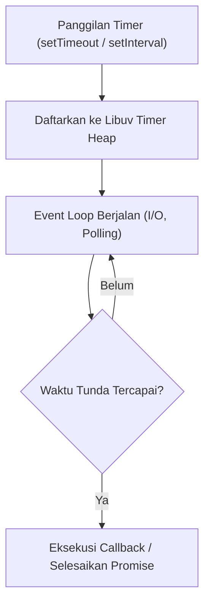

# Timer

> Ringkasan
>
> - Fungsi: Mengatur penundaan eksekusi kode, pengulangan berkala, dan jeda asinkron tanpa memblokir thread utama di runtime Node.js.
> - Digunakan saat: Menjadwalkan tugas latar belakang, membatasi durasi operasi (_timeout_), memberi jeda percobaan ulang (_retry delay_), atau menjalankan fungsi secara berulang.
> - Aturan praktis: Utamakan modul `node:timers/promises` bersama kata kunci `await` agar penulisan kode lebih rapi dan linier, serta selalu batalkan timer yang tidak lagi dipakai agar proses Node.js tidak menggantung.

---

## Tujuan Belajar

- Memahami cara kerja antrean penundaan waktu pada siklus Event Loop Node.js.
- Membedakan fungsi timer bergaya callback tradisional dengan API modern `node:timers/promises`.
- Menggunakan `setTimeout` dan `setInterval` berbasis Promise untuk membuat jeda dan perulangan berkala.
- Menghentikan atau membatalkan penundaan waktu secara aman menggunakan `AbortController`.
- Menjadwalkan tugas langsung pada putaran berikutnya menggunakan `setImmediate` dan `scheduler.yield()`.

---

## Konsep

Kita bisa membayangkan cara kerja Event Loop dan timer seperti kasir di restoran cepat saji. Kasir hanya melayani satu pelanggan dalam satu waktu. Ketika ada pelanggan memesan paket ayam goreng yang butuh waktu masak lima menit (`setTimeout`), kasir tidak akan berdiri diam menunggu ayam matang.

Kasir akan memberikan nomor antrean kepada pelanggan tersebut, lalu segera melayani pesanan pelanggan berikutnya di antrean. Begitu alarm dapur berdering menandakan pesanan sudah siap, kasir memanggil nomor antrean tersebut di sela-sela waktu senggang tanpa menghentikan kelancaran antrean utama.



---

## Referensi

| Item                    | Fungsi                                                               | Catatan                                                                             |
| :---------------------- | :------------------------------------------------------------------- | :---------------------------------------------------------------------------------- |
| **`setTimeout()`**      | Menunda eksekusi kode selama durasi waktu tertentu (dalam milidetik) | Versi `node:timers/promises` mengembalikan Promise yang bisa di-`await`             |
| **`setInterval()`**     | Menjalankan kode berulang kali dengan jeda interval waktu tetap      | Versi `node:timers/promises` mengembalikan iterable asinkron untuk `for await...of` |
| **`setImmediate()`**    | Menjadwalkan eksekusi tepat setelah fase I/O saat ini tuntas         | Memecah komputasi berat agar tidak memonopoli Event Loop                            |
| **`clearTimeout()`**    | Membatalkan timer penundaan `setTimeout` sebelum waktunya tiba       | Mencegah pemanggilan fungsi dan membersihkan alokasi penanda waktu                  |
| **`clearInterval()`**   | Menghentikan pengulangan berkala dari `setInterval`                  | Wajib dipanggil agar proses Node.js bisa berhenti secara wajar                      |
| **`scheduler.yield()`** | Mengalah sejenak dan menyerahkan giliran eksekusi ke tugas lain      | Fitur modern dari `node:timers/promises` untuk membagi beban kerja                  |

### `setTimeout()`

Fungsi `setTimeout()` dari modul `node:timers/promises` menunda kelanjutan baris kode selama durasi milidetik yang ditentukan tanpa perlu membuat wrapper Promise manual.

```javascript
import { setTimeout } from "node:timers/promises";

console.log("Start wait");
const result = await setTimeout(50, "done");

console.log(result);
// Output: Start wait
// done
```

Kasus lain: Membatalkan jeda waktu di tengah jalan menggunakan sinyal `AbortController` yang akan melempar error `AbortError`.

```javascript
import { setTimeout } from "node:timers/promises";

const ac = new AbortController();
const timerPromise = setTimeout(1000, "unreachable", { signal: ac.signal });

ac.abort();

try {
  await timerPromise;
} catch (error) {
  console.log(error.name);
  // Output: AbortError
}
```

### `setInterval()`

Fungsi `setInterval()` dari modul `node:timers/promises` menghasilkan sebuah iterator asinkron yang bisa kita putar berulang menggunakan perulangan `for await...of` pada setiap detak interval.

```javascript
import { setInterval } from "node:timers/promises";

const ticks = [];
for await (const time of setInterval(20, "tick")) {
  ticks.push(time);
  if (ticks.length === 3) break;
}

console.log(ticks);
// Output: [ 'tick', 'tick', 'tick' ]
```

Kasus lain: Menghentikan perulangan interval asinkron dari luar loop menggunakan pembatalan `signal` dari `AbortController`.

```javascript
import { setInterval } from "node:timers/promises";

const ac = new AbortController();
const history = [];

try {
  for await (const time of setInterval(10, Date.now(), {
    signal: ac.signal,
  })) {
    history.push("tick");
    if (history.length === 2) ac.abort();
  }
} catch (error) {
  console.log(error.name, history.length);
  // Output: AbortError 2
}
```

### `setImmediate()`

Fungsi `setImmediate()` menjadwalkan eksekusi fungsi tepat setelah fase penanganan I/O saat ini selesai diperiksa oleh Libuv.

```javascript
import { setImmediate } from "node:timers/promises";

console.log("Before");
const value = await setImmediate("immediate arrival");
console.log(value);
// Output: Before
// immediate arrival
```

Kasus lain: Menggunakan versi callback biasa `setImmediate` dari modul `node:timers` tanpa Promise.

```javascript
import { setImmediate } from "node:timers";

let isCalled = false;
setImmediate(() => {
  isCalled = true;
});

console.log(isCalled);
// Output: false
```

### `clearTimeout()`

Fungsi `clearTimeout()` digunakan untuk membatalkan timer yang sebelumnya dijadwalkan lewat fungsi `setTimeout` berbasis callback.

```javascript
import { setTimeout, clearTimeout } from "node:timers";

let status = "unchanged";
const timerId = setTimeout(() => {
  status = "changed";
}, 50);

clearTimeout(timerId);

console.log(status);
// Output: unchanged
```

Kasus lain: Memanggil `clearTimeout()` dengan nilai `undefined` tetap aman dan tidak akan memicu error.

```javascript
import { clearTimeout } from "node:timers";

clearTimeout(undefined);
console.log("Safe");
// Output: Safe
```

### `clearInterval()`

Fungsi `clearInterval()` dipakai untuk menghentikan putaran waktu berkala yang dibuat oleh fungsi `setInterval` berbasis callback.

```javascript
import { setInterval, clearInterval } from "node:timers";

let count = 0;
const intervalId = setInterval(() => {
  count++;
}, 10);

clearInterval(intervalId);

console.log(count);
// Output: 0
```

Kasus lain: Menghentikan putaran interval langsung dari dalam fungsi callback saat sebuah kondisi terpenuhi.

```javascript
import { setInterval, clearInterval } from "node:timers";

let counter = 0;
const timer = setInterval(() => {
  counter++;
  if (counter >= 2) {
    clearInterval(timer);
    console.log("Stopped at:", counter);
  }
}, 5);
// Output: Stopped at: 2
```

### `scheduler.yield()`

Fungsi `scheduler.yield()` dari modul `node:timers/promises` menunda kelanjutan fungsi asinkron sejenak untuk memberikan giliran kepada tugas-tugas lain di Event Loop agar bisa berjalan duluan.

```javascript
import { scheduler } from "node:timers/promises";

const trace = [];
trace.push("start");

await scheduler.yield();
trace.push("end");

console.log(trace);
// Output: [ 'start', 'end' ]
```

Kasus lain: Menggunakan `scheduler.yield()` di dalam perulangan hitungan yang panjang agar prosesnya tidak mengunci responsivitas thread utama.

```javascript
import { scheduler } from "node:timers/promises";

let iteration = 0;
while (iteration < 3) {
  iteration++;
  await scheduler.yield();
}

console.log("Iterations completed:", iteration);
// Output: Iterations completed: 3
```

### Perbandingan: Mekanisme Asinkron dan Timer di Node.js

| Metode                     | Kategori Antrean         | Waktu Eksekusi                                                    |
| :------------------------- | :----------------------- | :---------------------------------------------------------------- |
| **`process.nextTick()`**   | Microtask Queue          | Langsung setelah operasi JavaScript saat ini selesai, sebelum I/O |
| **`Promise.then()`**       | Microtask Queue          | Bersama antrean microtask lainnya, mendahului seluruh macrotask   |
| **`setImmediate()`**       | Macrotask (Check Phase)  | Tepat setelah fase Poll I/O selesai diperiksa                     |
| **`setTimeout()`**         | Macrotask (Timers Phase) | Setelah durasi tunda milidetik terlewati                          |
| **`node:timers/promises`** | Modern Promise API       | Mengembalikan Promise yang selesai pada siklus timer terkait      |

---

## Kesalahan Umum

### Memblokir Event Loop dengan Operasi Komputasi Sinkron

Timer di Node.js tidak berjalan di thread sistem operasi terpisah. Jika ada perulangan sinkron yang memakan waktu lama, panggilan callback timer akan ikut tertahan dan terlambat dieksekusi.

```javascript
// Salah
setTimeout(() => console.log("Invoked"), 10);
const deadline = Date.now() + 1000;
while (Date.now() < deadline) {
  // Loop sinkron ini mengunci thread utama selama 1 detik penuh
}
```

```javascript
// Benar
import { setTimeout } from "node:timers/promises";

console.log("Waiting without blocking thread");
await setTimeout(1000);
console.log("Invoked on time");
```

### Lupa Membatalkan `setInterval` Berbasis Callback

Jika kita lupa memanggil `clearInterval()`, timer akan terus berdetak di latar belakang sehingga proses Node.js tidak akan pernah keluar atau berhenti secara wajar.

```javascript
// Salah
import { setInterval } from "node:timers";

setInterval(() => {
  console.log("Ping");
}, 1000);
// Aplikasi Node.js akan terus menggantung dan tidak pernah selesai
```

```javascript
// Benar
import { setInterval, clearInterval } from "node:timers";

const timer = setInterval(() => {
  console.log("Ping");
}, 1000);
// Hentikan timer saat tugas selesai
clearInterval(timer);
```

### Menulis Pembungkus Promise Manual untuk Jeda Waktu

Membuat fungsi `sleep` manual dengan `new Promise((resolve) => setTimeout(resolve, ms))` sebenarnya tidak diperlukan lagi, karena Node.js sudah menyediakan modul resmi bawaan `node:timers/promises`.

```javascript
// Salah
const sleep = (ms) => new Promise((resolve) => setTimeout(resolve, ms));
await sleep(100);
```

```javascript
// Benar
import { setTimeout } from "node:timers/promises";

await setTimeout(100);
```

---

## Studi Kasus

Skenario: Membangun pembungkus pemanggilan fungsi yang dilengkapi batas waktu maksimal (_timeout guard_) menggunakan kombinasi `node:timers/promises` dan `AbortController` agar operasi tidak menggantung selamanya.

```javascript
import { setTimeout } from "node:timers/promises";

async function executeWithTimeout(taskFn, timeoutMs) {
  const ac = new AbortController();
  const timeoutPromise = setTimeout(timeoutMs, null, {
    signal: ac.signal,
  }).then(() => {
    throw new Error("TIMEOUT");
  });

  try {
    const result = await Promise.race([taskFn(ac.signal), timeoutPromise]);
    ac.abort();
    return result;
  } catch (error) {
    ac.abort();
    throw error;
  }
}

const successResult = await executeWithTimeout(async () => {
  await setTimeout(20);
  return "Data Complete";
}, 100);

console.log("Success:", successResult);
// Output: Success: Data Complete

try {
  await executeWithTimeout(async () => {
    await setTimeout(200);
    return "Data Late";
  }, 50);
} catch (err) {
  console.log("Failed:", err.message);
  // Output: Failed: TIMEOUT
}
```

Struktur ini memanfaatkan `Promise.race` untuk mengadu kecepatan tugas asinkron melawan batas waktu. Pemanggilan `ac.abort()` memastikan bahwa timer pembatas waktu segera dibatalkan seketika, baik saat tugas berhasil mendahului batas waktu maupun saat terjadi kegagalan.

---

## Latihan Mandiri

### Soal 1 (Dasar)

Buat fungsi `countdown(startSeconds)` yang memanfaatkan iterator `setInterval` dari `node:timers/promises` untuk mencetak angka hitung mundur mulai dari `startSeconds` hingga `0`, lalu mengembalikan teks string `'Time expired!'`.

Contoh input:

```javascript
await countdown(3);
```

Contoh output yang diharapkan:

```javascript
// 3
// 2
// 1
// 0
// 'Time expired!'
```

Batasan: Gunakan fungsi `setInterval` dari modul `node:timers/promises` dan hentikan perulangan dengan kata kunci `break` saat mencapai angka nol.

### Soal 2 (Menengah)

Buat fungsi `withTimeout(taskPromise, durationMs)` yang memanfaatkan `setTimeout` dari `node:timers/promises` dan `Promise.race()`. Jika `taskPromise` belum tuntas sebelum durasi `durationMs` milidetik habis, fungsi harus melempar error dengan pesan `'Operation timed out'`.

Contoh input 1 (tugas selesai tepat waktu):

```javascript
await withTimeout(Promise.resolve("Data Retrieved"), 100);
```

Contoh output 1:

```javascript
"Data Retrieved";
```

Contoh input 2 (tugas melebihi batas waktu):

```javascript
import { setTimeout } from "node:timers/promises";

await withTimeout(setTimeout(200, "Late Data"), 50);
```

Contoh output 2:

```javascript
// Melempar error Error: 'Operation timed out'
```

Batasan: Wajib menggunakan `Promise.race` dan modul `node:timers/promises`.

### Soal 3 (Menantang)

Buat kelas pengatur tugas berulang yang terkendali bernama `IntervalWorker`.

Spesifikasi konstruktor: menerima `taskFn` (fungsi asinkron yang dijalankan), `intervalMs` (durasi jeda antar-eksekusi), dan `maxRuns` (batas maksimal putaran eksekusi).

Metode kelas:

- `start()`: Menjalankan eksekusi tugas secara berulang menggunakan iterator `setInterval` dari `node:timers/promises`. Setiap putaran mencatat hasil kembalian tugas ke dalam array riwayat internal dalam bentuk objek `{ status: 'success', value: ... }`.
- Jika `taskFn` melempar error pada putaran tertentu, tangkap error tersebut secara internal, simpan catatan `{ status: 'failure', error: err.message }` ke dalam riwayat, dan lanjutkan putaran berikutnya tanpa menghentikan worker.
- `stop()`: Membatalkan siklus timer seketika menggunakan `AbortController` internal tanpa menunggu iterasi berikutnya.
- Jika iterasi mencapai `maxRuns`, hentikan siklus secara otomatis dan kembalikan array riwayat eksekusi.
- Sediakan metode getter `getHistory()` yang mengembalikan salinan dangkal (_shallow copy_) dari riwayat.

Contoh input:

```javascript
let counter = 0;
const worker = new IntervalWorker(
  async () => {
    counter++;
    if (counter === 2) throw new Error("Temporary failure");
    return `Success run ${counter}`;
  },
  20,
  3,
);

const history = await worker.start();
console.log(history);
```

Contoh output yang diharapkan:

```javascript
[
  { status: "success", value: "Success run 1" },
  { status: "failure", error: "Temporary failure" },
  { status: "success", value: "Success run 3" },
];
```

Batasan: Dilarang menggunakan paket eksternal dari NPM. Kendalikan penghentian perulangan menggunakan `AbortController` dan iterator `node:timers/promises`.

---

## Navigasi

[Sebelumnya: Stream](../10-stream/README.md) | [Selanjutnya: Net](../12-net/README.md) | [Daftar Isi](../README.md)
