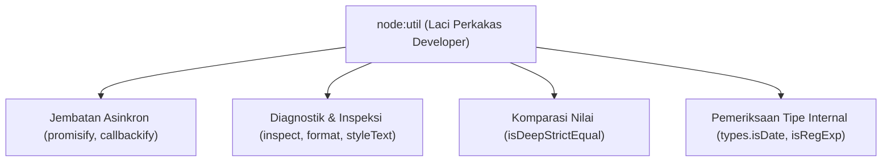

# Util

> Ringkasan
> - Tingkat: Fondasi
> - Fungsi: Menyediakan fungsi utilitas pendukung untuk inspeksi objek, formatting string, komparasi mendalam, dan konversi callback ke Promise.
> - Digunakan saat: Men-debug struktur data kompleks, membandingkan kesamaan objek/array mendalam, serta mewarnai teks di terminal tanpa library pihak ketiga.
> - Aturan praktis: Gunakan `util.isDeepStrictEqual()` daripada perbandingan `JSON.stringify()`; manfaatkan `util.styleText()` bawaan modern untuk pewarnaan terminal.

## Cheat Sheet

| Tugas | Kode |
| :--- | :--- |
| Mengonversi fungsi callback ke Promise | `const fnAsync = util.promisify(legacyFn);` |
| Membandingkan dua objek secara mendalam | `util.isDeepStrictEqual(objA, objB);` |
| Memformat string teks template | `util.format("User: %s (id: %d)", "Ali", 1);` |
| Menginspeksi objek bersarang ke string | `util.inspect(obj, { depth: null });` |
| Memeriksa tipe data internal runtime | `util.types.isDate(val);` |
| Mewarnai teks terminal secara native | `util.styleText("green", "Sukses");` |

## Tujuan Belajar

- Menjembatani fungsi callback klasik ke Promise asinkron via `util.promisify()`.
- Menginspeksi objek berlapis dan referensi melingkar memakai `util.inspect()`.
- Membandingkan kesetaraan struktur data kompleks secara presisi via `util.isDeepStrictEqual()`.
- Memformat string teks diagnostik dan mewarnai terminal memakai `util.format()` dan `util.styleText()`.

## Konsep

Bayangkan sebuah bengkel mekanik mobil. Selain kunci pas utama, obeng, dan dongkrak (modul inti seperti `fs` dan `http`), ada sebuah laci perkakas serbaguna berisi kaca pembesar, penggaris presisi, senter, dan kabel adapter jembatan. Modul `node:util` adalah laci perkakas tersebut. Modul ini menyediakan fungsi-fungsi pembantu internal yang memudahkan developer memeriksa isi mesin objek secara mendalam (`util.inspect`), mengukur apakah dua onderdil benar-benar identik (`util.isDeepStrictEqual`), serta menyambungkan soket lama ke colokan modern (`util.promisify`).



## Referensi

| Item | Fungsi | Catatan |
| :--- | :--- | :--- |
| `util.promisify(original)` | Mengubah fungsi berbasis callback menjadi fungsi Promise | Wajib mengikuti konvensi callback `(err, value)` |
| `util.inspect(object, [options])` | Mengembalikan representasi string terformat dari objek | Mampu menangani referensi melingkar (_circular_) |
| `util.format(format, [...args])` | Menyusun string memakai placeholder printf (`%s`, `%d`, `%j`) | Mirip fungsi formatting string di bahasa C |
| `util.isDeepStrictEqual(val1, val2)` | Membandingkan apakah dua nilai memiliki struktur identik | Membandingkan prototype, properti simbol, dan Map/Set |
| `util.types` | Kumpulan fungsi pembantu pengecekan tipe data runtime | Membedakan objek Date, RegExp, Promise, dan buffer |
| `util.styleText(format, text)` | Memberikan warna ANSI dan gaya teks pada output terminal | Fitur modern bawaan Node.js tanpa dependensi |

### `util.promisify(original)`

`util.promisify()` membungkus fungsi bergaya error-first callback `(err, value) => {}` menjadi fungsi yang mengembalikan Promise.

Struktur parameter: `util.promisify(original)`
- `original` (function, wajib): fungsi berbasis callback yang ingin dikonversi.

Nilai kembalian: fungsi baru yang mengembalikan `Promise<any>`.

```javascript
import util from "node:util";

const legacyGreet = (name, callback) => {
  callback(null, `Halo ${name}`);
};

const greetAsync = util.promisify(legacyGreet);
const message = await greetAsync("Budi");

console.log(message);
// Output: Halo Budi
```

Kondisi khusus: Melempar error jika fungsi callback target tidak menaruh argumen error di urutan pertama.

### `util.inspect(object, [options])`

`util.inspect()` mengembalikan representasi string terstruktur dari objek untuk keperluan debugging.

Struktur parameter: `util.inspect(object, options)`
- `object` (any, wajib): nilai atau objek yang ingin diinspeksi.
- `options` (object, opsional): pengaturan seperti `{ depth: 2, compact: true, colors: false }`.

Nilai kembalian: string representasi objek (`string`).

```javascript
import util from "node:util";

const data = { user: { id: 1, tags: ["admin", "dev"] } };
const output = util.inspect(data, { compact: true });

console.log(typeof output);
// Output: string
console.log(output.includes("admin"));
// Output: true
```

Kondisi khusus: Objek dengan referensi melingkar otomatis ditandai sebagai `[Circular]` tanpa memicu infinite loop.

### `util.format(format, [...args])`

`util.format()` menghasilkan string terformat menggunakan placeholder gaya `printf`.

Struktur parameter: `util.format(format, ...args)`
- `format` (string, wajib): string template yang berisi placeholder seperti `%s` (string), `%d` (number), atau `%j` (JSON).
- `args` (any, opsional): nilai yang disisipkan ke masing-masing placeholder.

Nilai kembalian: string hasil format (`string`).

```javascript
import util from "node:util";

const msg = util.format("Akun %s memiliki saldo: Rp%d", "Ali", 50000);
console.log(msg);
// Output: Akun Ali memiliki saldo: Rp50000
```

Kondisi khusus: Jika jumlah argumen melebihi jumlah placeholder, argumen sisa otomatis disambung di akhir string dengan spasi pemisah.

### `util.isDeepStrictEqual(val1, val2)`

`util.isDeepStrictEqual()` memeriksa apakah dua objek atau nilai primitif sama secara mendalam (deep equality).

Struktur parameter: `util.isDeepStrictEqual(val1, val2)`
- `val1` (any, wajib): nilai pertama yang dibandingkan.
- `val2` (any, wajib): nilai kedua yang dibandingkan.

Nilai kembalian: boolean `true` bila identik, atau `false` jika berbeda (`boolean`).

```javascript
import util from "node:util";

const a = { items: [1, 2], config: { active: true } };
const b = { items: [1, 2], config: { active: true } };

console.log(a === b);
// Output: false
console.log(util.isDeepStrictEqual(a, b));
// Output: true
```

Kondisi khusus: Memeriksa prototipe objek dan properti tersembunyi non-enumerable, sehingga lebih akurat daripada perbandingan `JSON.stringify()`.

### `util.styleText(format, text)`

`util.styleText()` menambahkan kode escape warna ANSI pada string teks untuk mempercantik tampilan di terminal.

Struktur parameter: `util.styleText(format, text)`
- `format` (string atau Array<string>, wajib): nama gaya seperti `"red"`, `"green"`, `"bold"`, atau `"underline"`.
- `text` (string, wajib): teks yang ingin diwarnai.

Nilai kembalian: string teks berformat ANSI (`string`).

```javascript
import util from "node:util";

const styled = util.styleText(["green", "bold"], "SUKSES");
console.log(styled.includes("SUKSES"));
// Output: true
```

Kondisi khusus: Tersedia sejak Node.js versi 20.12.0 dan 22.0.0 ke atas sebagai pengganti library eksternal pewarna terminal.

## Kesalahan Umum

### Memakai `JSON.stringify()` untuk Membandingkan Kesamaan Objek

`JSON.stringify()` tidak menjamin urutan kunci properti objek dan mengabaikan tipe data seperti `undefined`, fungsi, atau `Date`.

```javascript
// Salah: Urutan kunci yang berbeda menghasilkan string berbeda
const obj1 = { a: 1, b: 2 };
const obj2 = { b: 2, a: 1 };
console.log(JSON.stringify(obj1) === JSON.stringify(obj2)); // false

// Benar
import util from "node:util";
console.log(util.isDeepStrictEqual(obj1, obj2)); // true
```

### Mengandalkan `typeof` untuk Validasi Objek Khusus

`typeof new Date()` dan `typeof /abc/` selalu menghasilkan string `"object"` sehingga tidak bisa membedakan tipe sebenarnya.

```javascript
// Salah
if (typeof dateValue === "object") { /* Belum tentu Date */ }

// Benar
import util from "node:util";
if (util.types.isDate(dateValue)) { /* Dipastikan instance Date */ }
```

## Studi Kasus

Membangun sistem pengawas konfigurasi (_configuration auditor_) yang mendeteksi perubahan konfigurasi aplikasi memakai `util.isDeepStrictEqual`, serta memformat catatan riwayat perubahan memakai `util.format` dan `util.inspect`.

```javascript
import util from "node:util";

class ConfigAuditor {
  constructor(initialConfig = {}) {
    this.currentConfig = initialConfig;
  }

  updateConfig(newConfig) {
    if (util.isDeepStrictEqual(this.currentConfig, newConfig)) {
      return { changed: false, message: "Konfigurasi tidak berubah" };
    }

    const logMessage = util.format(
      "Konfigurasi diperbarui: %s -> %s",
      util.inspect(this.currentConfig, { compact: true }),
      util.inspect(newConfig, { compact: true })
    );

    this.currentConfig = newConfig;
    return { changed: true, message: logMessage };
  }
}

const auditor = new ConfigAuditor({ env: "dev", port: 3000 });

const noChange = auditor.updateConfig({ env: "dev", port: 3000 });
console.log(noChange.changed);
// Output: false

const changed = auditor.updateConfig({ env: "prod", port: 8080 });
console.log(changed.changed);
// Output: true
console.log(changed.message.includes("8080"));
// Output: true
```

Pola audit ini menjamin perbandingan konfigurasi bersarang berjalan presisi tanpa terpengaruh urutan deklarasi properti, serta menghasilkan log diagnostik yang ringkas dan mudah dibaca.

## Latihan Mandiri

Buat fungsi `inspectStateDiff(oldState, newState, options = {})` untuk membandingkan dua snapshot state aplikasi.

- **Level 1 (Dasar):** Periksa kesetaraan mendalam antara `oldState` dan `newState` memakai `util.isDeepStrictEqual()`. Jika kedua state identik, kembalikan objek `{ isEqual: true, diffLog: "Tidak ada perubahan" }`.
- **Level 2 (Menengah):** Jika state berbeda, format string log perubahan memakai `util.format()` dan `util.inspect()`. Gunakan template `"Perubahan state: %s -> %s"` dengan representasi compact dari kedua objek. Kembalikan `{ isEqual: false, diffLog }`.
- **Level 3 (Menantang):** Jika salah satu parameter bukan objek atau bernilai `null`, lempar `TypeError("Parameter state harus berupa objek valid")`. Jika opsi `options.colored` bernilai `true`, bungkus string `diffLog` dengan warna hijau memakai `util.styleText("green", diffLog)`.

Contoh input dan output normal:

```javascript
const res = inspectStateDiff({ role: "user" }, { role: "admin" });

console.log(res.isEqual);
// Output: false
console.log(res.diffLog.includes("admin"));
// Output: true
```

Contoh input dan penanganan error:

```javascript
try {
  inspectStateDiff(null, { role: "admin" });
} catch (err) {
  console.log(err.message);
  // Output: Parameter state harus berupa objek valid
}
```

Tanda selesai:
- [ ] Perbandingan mendalam memakai `util.isDeepStrictEqual()` mengenali kesamaan dan perbedaan state.
- [ ] Pesan perubahan disusun rapi memakai `util.format()` dan `util.inspect()`.
- [ ] Parameter state yang bernilai null atau bukan objek melempar `TypeError`.

---

## Navigasi

[Sebelumnya: HTTP](../10-http/README.md) | [Selanjutnya: Crypto](../12-crypto/README.md) | [Daftar Isi](../README.md)
