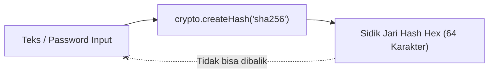

# Crypto

> Ringkasan
> - Tingkat: Fondasi
> - Fungsi: Menyediakan fungsi kriptografi keamanan tingkat lanjut untuk hashing satu arah, pembuatan data acak, HMAC, dan verifikasi integritas data.
> - Digunakan saat: Mengamankan kata sandi pada password manager, membuat token sesi acak yang aman, menandatangani payload webhook, dan memeriksa integritas data.
> - Aturan praktis: Jangan gunakan `Math.random()` untuk token keamanan; selalu gunakan `crypto.randomBytes()` atau `crypto.randomUUID()`, dan bandingkan hash dengan `crypto.timingSafeEqual()`.

---

## Cheat Sheet

| Tugas | Kode |
| :--- | :--- |
| Buat UUID v4 acak aman | `crypto.randomUUID()` |
| Buat byte biner acak aman | `crypto.randomBytes(16).toString('hex')` |
| Buat hash SHA-256 | `crypto.createHash('sha256').update(data).digest('hex')` |
| Buat tanda tangan HMAC | `crypto.createHmac('sha256', key).update(data).digest('hex')` |
| Komparasi hash tahan timing-attack | `crypto.timingSafeEqual(bufA, bufB)` |

---

## Tujuan Belajar

- Memahami peran modul `node:crypto` dalam keamanan data aplikasi backend.
- Membedakan pembuatan data acak biasa dengan generator acak aman secara kriptografi (_CSPRNG_).
- Membuat nilai hash satu arah menggunakan algoritma SHA-256.
- Menghasilkan tanda tangan digital payload menggunakan HMAC.
- Mencegah serangan pembacaan waktu (_timing attack_) memakai `timingSafeEqual`.

---

## Konsep

Modul `node:crypto` menyediakan instrumen brankas keamanan pada Node.js:
1. **Acak Kriptografis (`randomUUID` & `randomBytes`)**: Membangkitkan angka acak murni yang tidak bisa diprediksi oleh peretas, berbeda dengan `Math.random()` yang berbasis deret semu.
2. **Hash Satu Arah (`createHash`)**: Menghancurkan teks menjadi sidik jari digital sepanjang 64 karakter heksadesimal (SHA-256). Proses ini bersifat satu arah dan tidak bisa dibalikkan ke teks awal.
3. **HMAC (`createHmac`)**: Hash yang dibubuhi kunci rahasia (_secret key_). Siapa pun yang memiliki kunci dapat memverifikasi bahwa isi dokumen tidak pernah diubah di tengah jalan oleh pihak ketiga.



---

## Referensi

| Item | Fungsi | Catatan |
| :--- | :--- | :--- |
| `crypto.randomUUID()` | Menghasilkan string ID unik standar UUID v4 | Cepat dan langsung menghasilkan format string acak |
| `crypto.randomBytes(size)` | Menghasilkan buffer byte acak berkekuatan kriptografi | Standar utama untuk pembuatan token reset dan salt |
| `crypto.createHash(algo)` | Membuat objek hash satu arah (seperti `'sha256'`) | Digunakan untuk checksum dan verifikasi integritas file |
| `crypto.createHmac(algo, key)` | Membuat hash bertanda tangan dengan kunci rahasia | Menandatangani payload webhook dan token otentikasi |
| `crypto.timingSafeEqual(a, b)` | Membandingkan dua buffer dalam durasi waktu konstan | Mencegah serangan intip waktu respons (_timing attack_) |

### `crypto.randomUUID()` dan `crypto.randomBytes(size)`

`crypto.randomUUID()` menghasilkan ID unik standar UUID v4, sedangkan `crypto.randomBytes()` menghasilkan deretan byte acak murni.

```javascript
import crypto from "node:crypto";

const id = crypto.randomUUID();
console.log(typeof id === "string" && id.length === 36);
// Output: true

const token = crypto.randomBytes(16).toString("hex");
console.log(token.length === 32);
// Output: true
```

Jangan pernah menggunakan `Math.random()` untuk token sesi, API key, atau tautan reset password karena algoritmanya bisa ditebak polanya oleh peretas.

### `crypto.createHash(algorithm)`

`crypto.createHash()` menghitung sidik jari hash satu arah dari data input.

```javascript
import crypto from "node:crypto";

const hash = crypto.createHash("sha256").update("password123").digest("hex");

console.log(hash.length === 64);
// Output: true
```

Data input yang sama selalu menghasilkan nilai hash yang persis sama, tetapi perubahan satu huruf pun akan menghasilkan nilai hash yang berubah total (_avalanche effect_).

### `crypto.createHmac(algorithm, key)`

`crypto.createHmac()` mengombinasikan data dengan kunci rahasia untuk menghasilkan tanda tangan yang membuktikan keaslian pengirim.

```javascript
import crypto from "node:crypto";

const hmac = crypto
  .createHmac("sha256", "my-secret-key")
  .update("transaction-message")
  .digest("hex");

console.log(hmac.length === 64);
// Output: true
```

### `crypto.timingSafeEqual(bufA, bufB)`

Operator `===` membandingkan string karakter demi karakter dan langsung berhenti begitu menemukan huruf pertama yang salah. Peretas bisa mengukur selisih nanodetik respon tersebut untuk menebak token rahasia (_timing attack_). `timingSafeEqual()` membandingkan dua buffer dalam durasi waktu yang selalu sama.

```javascript
import crypto from "node:crypto";

const a = Buffer.from("signatureA");
const b = Buffer.from("signatureA");

const isEqual = crypto.timingSafeEqual(a, b);
console.log(isEqual);
// Output: true
```

Kedua buffer wajib memiliki panjang ukuran byte yang sama persis saat diuji dengan `timingSafeEqual`.

---

## Kesalahan Umum

### Memakai `Math.random()` untuk Keperluan Keamanan

`Math.random()` bukan generator acak kriptografi dan rentan dieksploitasi oleh penyerang untuk merekayasa token.

```javascript
// Incorrect
const token = Math.random().toString(36).substring(2);
```

```javascript
// Correct
import crypto from "node:crypto";
const token = crypto.randomBytes(32).toString("hex");
```

### Membandingkan Tanda Tangan HMAC dengan Operator `===`

Membandingkan tanda tangan digital atau token rahasia memakai operator kesamaan biasa membuka celah pembacaan waktu respon (_timing attack_).

```javascript
// Incorrect
if (userSignature === validSignature) {}
```

```javascript
// Correct
import crypto from "node:crypto";
const a = Buffer.from(userSignature);
const b = Buffer.from(validSignature);
if (a.length === b.length && crypto.timingSafeEqual(a, b)) {}
```

---

## Studi Kasus

Skenario: Membangun sistem penandatangan dan pemverifikasi webhook payload yang aman dari manipulasi data dan serangan _timing attack_.

```javascript
import crypto from "node:crypto";

function signPayload(payload, secretKey) {
  return crypto.createHmac("sha256", secretKey).update(payload).digest("hex");
}

function verifyPayloadSignature(payload, signature, secretKey) {
  const expectedSignature = signPayload(payload, secretKey);
  const sigBuf = Buffer.from(signature);
  const expBuf = Buffer.from(expectedSignature);

  if (sigBuf.length !== expBuf.length) {
    return false;
  }

  return crypto.timingSafeEqual(sigBuf, expBuf);
}

const payload = JSON.stringify({ userId: 1, vault: "finance" });
const signature = signPayload(payload, "master-secret");

console.log(verifyPayloadSignature(payload, signature, "master-secret"));
// Output: true

console.log(verifyPayloadSignature(payload, signature, "wrong-secret"));
// Output: false
```

Pola ini menjamin integritas paket data yang dikirim antar-server: penerima dapat memverifikasi bahwa data benar-benar berasal dari pemilik kunci rahasia.

---

## Latihan Mandiri

Buat modul pembantu brankas kredensial (_credential vault helper_) yang menyediakan fungsi pembuatan token acak dan hashing kata sandi dengan salt. Kerjakan dalam tiga level bertahap.

### Level 1 (Dasar)

Buat fungsi `generateSecureToken(byteLength)` yang menghasilkan token acak heksadesimal menggunakan `crypto.randomBytes(byteLength).toString('hex')`. Jika `byteLength` tidak diberikan, gunakan nilai bawaan `32`.

### Level 2 (Menengah)

Buat fungsi `hashMasterPassword(password, salt)` yang menggabungkan `password` dan string `salt`, lalu mengembalikan nilai hash SHA-256 dalam format heksadesimal memakai `crypto.createHash('sha256')`.

### Level 3 (Menantang)

Validasi parameter pada `generateSecureToken`. Jika `byteLength` bukan angka atau bernilai kurang dari atau sama dengan nol, lemparkan error `TypeError` dengan pesan `"byteLength must be a positive number"`.

Contoh input dan output jalur normal:

```javascript
const token = generateSecureToken(16);
console.log(token.length === 32);
// Output: true

const pwdHash = hashMasterPassword("adminPass", "randomSalt");
console.log(pwdHash.length === 64);
// Output: true
```

Contoh input dan output saat byteLength tidak valid:

```javascript
try {
  generateSecureToken(-5);
} catch (error) {
  console.log(error.name);
  // Output: TypeError
}
```

Tanda selesai:
- [ ] Token acak dibuat dengan `crypto.randomBytes()`.
- [ ] Hash kata sandi dihasilkan dengan algoritma SHA-256 dan salt.
- [ ] Validasi nilai parameter melempar `TypeError` untuk angka tidak valid.

---

## Navigasi

[Sebelumnya: Util](../11-util/README.md) | [Selanjutnya: OS](../13-os/README.md) | [Daftar Isi](../README.md)
