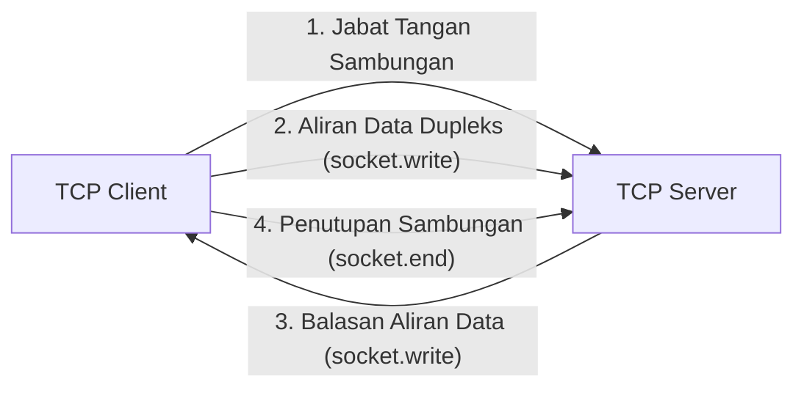

# Net

> Ringkasan
> - Fungsi: Membangun server dan klien jaringan berbasis protokol TCP (*Transmission Control Protocol*) dengan aliran data dua arah (*bidirectional stream*).
> - Digunakan saat: Mengembangkan layanan komunikasi tingkat rendah seperti protokol kustom, IPC (*inter-process communication*), broker pesan, atau perkakas diagnostik soket jaringan.
> - Aturan praktis: Selalu pasang penangan event `'error'` pada server dan soket klien untuk mencegah terminasi proses mendadak saat koneksi terputus tiba-tiba.

---

## Tujuan Belajar

- Memahami prinsip komunikasi TCP pada lapisan transport jaringan dan sifat transmisi aliran byte (*stream of bytes*).
- Membuat server TCP menggunakan `net.createServer()` serta mengelola siklus koneksi klien.
- Membangun klien TCP menggunakan `net.createConnection()` untuk mengirim dan menerima data.
- Mengelola siklus hidup soket melalui event `'connect'`, `'data'`, `'end'`, `'close'`, dan `'error'`.
- Menerapkan pembatasan pesan (*message framing*) untuk mengatasi penggabungan dan fragmentasi paket data.

---

## Konsep

> Protokol TCP dianalogikan seperti sambungan panggilan telepon dua arah. Sebelum percakapan dimulai, kedua pihak melakukan jabat tangan sambungan (*three-way handshake*) untuk memastikan saluran siap. Setelah tersambung, kedua pihak dapat berbicara dan mendengar secara bersamaan (*full-duplex*). Data yang diucapkan tiba secara berurutan dan terjamin utuh, tetapi pembicara harus menyepakati jeda kalimat (*delimiter*) sendiri agar lawan bicara tahu kapan satu pesan berakhir.



---

## Referensi

| Item | Fungsi | Catatan |
| :--- | :--- | :--- |
| **`net.createServer()`** | Membuat instans server TCP baru | Menghasilkan objek `net.Server` untuk mendengarkan koneksi masuk |
| **`net.createConnection()`** | Membuka koneksi TCP ke server target | Menghasilkan instans soket dupleks `net.Socket` aktif |
| **`server.listen()`** | Mengikat server pada port dan alamat host tertentu | Nilai port `0` memerintahkan sistem operasi mengalokasikan port acak |
| **`server.close()`** | Menghentikan server dari menerima koneksi baru | Koneksi aktif yang sudah terhubung tetap berjalan hingga ditutup |
| **`socket.write()`** | Mengirimkan data potongan teks atau buffer ke soket | Mengembalikan nilai boolean penanda kondisi antrean buffer pengiriman |
| **`socket.end()`** | Menutup setengah aliran data dari sisi lokal | Mengirimkan sinyal akhir pengiriman namun masih dapat menerima data |
| **`socket.destroy()`** | Menghancurkan dan menutup koneksi soket seketika | Menghentikan transmisi seketika tanpa menunggu sisa antrean buffer |
| **`socket.setTimeout()`** | Mengatur batas waktu inaktivitas transfer data soket | Memancarkan event `'timeout'` tanpa memutus koneksi secara otomatis |

### `net.createServer()`

Fungsi `net.createServer()` digunakan untuk menginisialisasi server TCP baru yang siap menangani koneksi klien yang masuk. Fungsi ini menerima argumen fungsi pendengar yang dipanggil setiap kali soket klien berhasil tersambung.

```javascript
import net from 'node:net';

const server = net.createServer((socket) => {
  socket.end('Hello from TCP Server');
});

server.listen(0, () => {
  const { port } = server.address();
  const client = net.createConnection({ port });
  client.on('data', (chunk) => {
    console.log(chunk.toString());
    // Output: Hello from TCP Server
    client.destroy();
    server.close();
  });
});
```

Kasus lain: Mendeteksi koneksi klien melalui pendaftaran manual listener event `'connection'`.

```javascript
import net from 'node:net';

const server = net.createServer();
server.on('connection', (socket) => {
  console.log('Incoming connection detected:', Boolean(socket.remoteAddress));
  // Output: Incoming connection detected: true
  socket.destroy();
  server.close();
});

server.listen(0, () => {
  const client = net.createConnection({ port: server.address().port });
  client.on('error', () => {});
});
```

### `net.createConnection()`

Fungsi `net.createConnection()` digunakan untuk membuat soket klien baru dan menginisialisasi sambungan TCP ke server target. Fungsi ini menerima opsi koneksi seperti nomor port dan alamat host tujuan.

```javascript
import net from 'node:net';

const server = net.createServer((socket) => {
  socket.write('Connection successful');
  socket.end();
}).listen(0, () => {
  const client = net.createConnection({ port: server.address().port }, () => {
    console.log('Active connection status:', !client.connecting);
    // Output: Active connection status: true
  });

  client.on('data', () => {
    client.destroy();
    server.close();
  });
});
```

Kasus lain: Menangani galat penolakan sambungan saat server target tidak aktif melalui kode galat `ECONNREFUSED`.

```javascript
import net from 'node:net';

const client = net.createConnection({ port: 1 });
client.on('error', (error) => {
  console.log(error.code);
  // Output: ECONNREFUSED
});
```

### `server.listen()`

Metode `server.listen()` digunakan untuk mengikat server TCP pada port dan alamat IP tertentu agar siap menerima koneksi jaringan luar. Jika nilai port diisi `0`, sistem operasi akan otomatis memilihkan port acak yang sedang bebas.

```javascript
import net from 'node:net';

const server = net.createServer();
server.listen(0, '127.0.0.1', () => {
  const info = server.address();
  console.log(info.address, typeof info.port);
  // Output: 127.0.0.1 number
  server.close();
});
```

Kasus lain: Menangkap kode galat `EADDRINUSE` saat mencoba mengikat port yang sudah digunakan oleh proses lain.

```javascript
import net from 'node:net';

const server1 = net.createServer().listen(0, () => {
  const { port } = server1.address();
  const server2 = net.createServer();
  server2.listen(port, () => {});
  server2.on('error', (error) => {
    console.log(error.code);
    // Output: EADDRINUSE
    server1.close();
  });
});
```

### `server.close()`

Metode `server.close()` digunakan untuk menghentikan server dari menerima koneksi masuk baru. Panggilan ini tidak mematikan koneksi klien yang sudah aktif, melainkan menunggu soket klien tersebut selesai atau dihancurkan.

```javascript
import net from 'node:net';

const server = net.createServer();
server.listen(0, () => {
  console.log('Before close:', server.listening);
  // Output: Before close: true
  server.close(() => {
    console.log('After close:', server.listening);
    // Output: After close: false
  });
});
```

Kasus lain: Memanggil `server.close()` saat server belum dalam kondisi berjalan memicu galat runtime `ERR_SERVER_NOT_RUNNING`.

```javascript
import net from 'node:net';

const server = net.createServer();
server.close((error) => {
  console.log(error.code);
  // Output: ERR_SERVER_NOT_RUNNING
});
```

### `socket.write()`

Metode `socket.write()` digunakan untuk mengirimkan data berupa string atau buffer ke soket tujuan. Metode ini mengembalikan nilai boolean `false` jika buffer pengiriman lokal kernel penuh sehingga pengirim perlu menerapkan jeda aliran (*backpressure*).

```javascript
import net from 'node:net';

const server = net.createServer((socket) => {
  socket.on('data', (chunk) => {
    console.log(chunk.toString());
    // Output: Client message
    socket.destroy();
    server.close();
  });
}).listen(0, () => {
  const client = net.createConnection({ port: server.address().port }, () => {
    const isBuffered = client.write('Client message');
    console.log('Buffered:', isBuffered);
    // Output: Buffered: true
    client.destroy();
  });
});
```

Kasus lain: Menulis data ke soket yang telah ditutup memicu pemancaran event error dengan kode `ERR_STREAM_WRITE_AFTER_END`.

```javascript
import net from 'node:net';

const server = net.createServer((socket) => {
  socket.end();
}).listen(0, () => {
  const client = net.createConnection({ port: server.address().port }, () => {
    client.on('error', (error) => {
      console.log(error.code);
      // Output: ERR_STREAM_WRITE_AFTER_END
      client.destroy();
      server.close();
    });
    client.end();
    client.write('Late data');
  });
});
```

### `socket.end()`

Metode `socket.end()` digunakan untuk menutup setengah jalur transmisi dari sisi lokal dengan mengirimkan paket FIN ke sisi penerima. Soket masih dapat menerima data balasan dari lawan bicara hingga pihak seberang juga menutup sambungannya.

```javascript
import net from 'node:net';

const server = net.createServer((socket) => {
  socket.on('data', (chunk) => {
    console.log('Received by server:', chunk.toString());
    // Output: Received by server: Finished sending
  });
  socket.on('end', () => {
    console.log('Client sent end signal');
    // Output: Client sent end signal
    socket.end();
    server.close();
  });
}).listen(0, () => {
  const client = net.createConnection({ port: server.address().port }, () => {
    client.end('Finished sending');
  });
  client.on('close', () => client.destroy());
});
```

Kasus lain: Memanggil `socket.end()` tanpa argumen untuk mengirimkan sinyal penutupan transmisi tanpa membawa muatan data.

```javascript
import net from 'node:net';

const server = net.createServer((socket) => {
  socket.on('end', () => {
    console.log('FIN signal received');
    // Output: FIN signal received
    socket.destroy();
    server.close();
  });
}).listen(0, () => {
  const client = net.createConnection({ port: server.address().port }, () => {
    client.end();
  });
  client.on('close', () => client.destroy());
});
```

### `socket.destroy()`

Metode `socket.destroy()` digunakan untuk memutus dan menghancurkan koneksi soket seketika pada tingkat sistem operasi. Metode ini berguna untuk penanganan darurat saat terjadi galat fatal atau batas waktu inaktivitas.

```javascript
import net from 'node:net';

const server = net.createServer((socket) => {
  socket.destroy();
  console.log('Socket destroyed status:', socket.destroyed);
  // Output: Socket destroyed status: true
  server.close();
}).listen(0, () => {
  const client = net.createConnection({ port: server.address().port });
  client.on('close', () => client.destroy());
});
```

Kasus lain: Menghancurkan soket dengan menyertakan objek galat untuk memicu pemancaran event `'error'` secara terprogram.

```javascript
import net from 'node:net';

const socket = new net.Socket();
socket.on('error', (error) => {
  console.log(error.message);
  // Output: Forced close by application
});
socket.destroy(new Error('Forced close by application'));
```

### `socket.setTimeout()`

Metode `socket.setTimeout()` digunakan untuk mengatur durasi waktu hening maksimal sebelum soket memancarkan event `'timeout'`. Pemanggilan ini tidak menutup soket otomatis sehingga tindakan penutupan atau penghancuran harus ditentukan secara eksplisit.

```javascript
import net from 'node:net';

const server = net.createServer((socket) => {
  socket.setTimeout(50);
  socket.on('timeout', () => {
    console.log('Inactivity timeout reached');
    // Output: Inactivity timeout reached
    socket.destroy();
    server.close();
  });
}).listen(0, () => {
  const client = net.createConnection({ port: server.address().port });
  client.on('close', () => client.destroy());
});
```

Kasus lain: Membatalkan pewaktu inaktivitas soket dengan memberikan nilai durasi `0`.

```javascript
import net from 'node:net';

const socket = new net.Socket();
socket.setTimeout(100);
socket.setTimeout(0);
console.log('Timeout disabled');
// Output: Timeout disabled
socket.destroy();
```

### Perbandingan: Soket TCP (`node:net`) vs Server HTTP (`node:http`)

| Karakteristik | Soket TCP (`node:net`) | Server HTTP (`node:http`) |
| :--- | :--- | :--- |
| **Lapisan Jaringan** | Lapisan 4 (Transport Layer) | Lapisan 7 (Application Layer) |
| **Format Muatan** | Aliran byte mentah tanpa struktur (*raw bytes*) | Pesan terstruktur (*headers*, kode status, *body*) |
| **Sifat Sambungan** | Sambungan persisten dua arah penuh (*full-duplex*) | Siklus permintaan dan respons (*request-response*) |
| **Aturan Pembatas** | Ditentukan manual oleh pengembang (*framing*) | Ditentukan otomatis oleh spesifikasi protokol HTTP |

---

## Kesalahan Umum

### Mengabaikan Penanganan Event Error pada Soket

Ketiadaan pendengar event `'error'` pada instans soket menyebabkan runtime Node.js melempar galat tak tertangani dan menghentikan seluruh proses aplikasi saat sambungan terputus mendadak.

```javascript
// Salah
const client = net.createConnection({ port: 8080 });
client.write('Hello Server');
```

```javascript
// Benar
const client = net.createConnection({ port: 8080 });
client.on('error', (error) => {
  console.log('Connection failed or closed:', error.message);
});
client.write('Hello Server');
```

### Mengasumsikan Satu Panggilan Write Menghasilkan Tepat Satu Event Data

Protokol TCP bekerja berbasis aliran byte tanpa konsep batas pesan, sehingga pemanggilan `write()` beruntun dapat digabungkan (*packet coalescing*) atau dipecah (*fragmentation*) saat tiba di sisi penerima.

```javascript
// Salah
socket.on('data', (chunk) => {
  const message = JSON.parse(chunk.toString());
  processMessage(message);
});
```

```javascript
// Benar
let buffer = '';
socket.on('data', (chunk) => {
  buffer += chunk.toString();
  const lines = buffer.split('\n');
  buffer = lines.pop();
  for (const line of lines) {
    if (line.trim()) processMessage(JSON.parse(line));
  }
});
```

### Mengabaikan Pemutusan Soket pada Event Timeout

Event `'timeout'` hanya bertindak sebagai sinyal peringatan dan tidak memutus sambungan soket secara otomatis, sehingga soket yang menggantung akan terus menghabiskan alokasi file descriptor sistem operasi.

```javascript
// Salah
socket.setTimeout(5000);
socket.on('timeout', () => {
  console.log('Idle connection detected');
});
```

```javascript
// Benar
socket.setTimeout(5000);
socket.on('timeout', () => {
  socket.destroy(new Error('Connection timeout exceeded'));
});
```

---

## Studi Kasus

Skenario: Membangun server gema pesan berbasis pembatas baris baru (*newline-delimited JSON echo server*) mandiri dengan proteksi validasi muatan data, pemulihan galat parsing, dan penutupan sambungan teratur.

```javascript
import net from 'node:net';

function createEchoServer() {
  const server = net.createServer((socket) => {
    let buffer = '';

    socket.on('data', (chunk) => {
      buffer += chunk.toString('utf-8');
      const lines = buffer.split('\n');
      buffer = lines.pop();

      for (const line of lines) {
        if (!line.trim()) continue;
        try {
          const payload = JSON.parse(line);
          const response = JSON.stringify({
            status: 'OK',
            echo: payload.message,
            length: payload.message.length,
          });
          socket.write(response + '\n');
        } catch {
          const errorMessage = JSON.stringify({
            status: 'ERR',
            message: 'Invalid JSON format',
          });
          socket.write(errorMessage + '\n');
        }
      }
    });

    socket.on('error', () => {
      socket.destroy();
    });
  });

  return server;
}

const server = createEchoServer();
server.listen(0, () => {
  const { port } = server.address();
  const client = net.createConnection({ port }, () => {
    client.write(JSON.stringify({ message: 'Hello TCP' }) + '\n');
  });

  client.on('data', (chunk) => {
    const response = JSON.parse(chunk.toString().trim());
    console.log('Status:', response.status);
    console.log('Echo:', response.echo);
    console.log('Length:', response.length);
    client.destroy();
    server.close();
  });

  client.on('error', () => {
    client.destroy();
    server.close();
  });
});

// Output:
// Status: OK
// Echo: Hello TCP
// Length: 9
```

Desain ini dipilih karena memisahkan akumulasi aliran byte menggunakan pembatas baris baru `\n`, menjamin pesan diuraikan secara utuh meskipun tiba dalam beberapa pecahan paket terpisah, serta mengisolasi galat parsing agar soket tidak tertutup tiba-tiba saat menerima format pesan yang salah.

---

## Latihan Mandiri

### Soal 1 (Dasar)

Buat fungsi `checkActivePort(host, port, timeoutMs)` yang memeriksa apakah port TCP pada host tertentu terbuka dan menerima koneksi sebelum batas waktu tercapai. Fungsi mengembalikan Promise bernilai boolean `true` jika koneksi berhasil, atau `false` jika koneksi gagal atau batas waktu habis.

Contoh masukan:

```javascript
await checkActivePort('127.0.0.1', 80, 200);
```

Contoh keluaran yang diharapkan:

```javascript
false
```

Batasan: Gunakan modul bawaan `node:net` tanpa pustaka eksternal. Soket harus dihancurkan (`destroy`) segera setelah status koneksi terdeteksi atau batas waktu tercapai.

### Soal 2 (Menengah)

Buat fungsi `parseMessageFrames(initialBuffer, chunk, delimiter)` yang memproses aliran potongan data TCP yang terfragmentasi. Fungsi menerima sisa teks yang belum selesai dari pembacaan sebelumnya (`initialBuffer`), potongan data baru yang baru tiba (`chunk`), serta string karakter pemisah pesan (`delimiter`). Fungsi harus mengembalikan objek berisi daftar pesan lengkap yang sudah berhasil dipisahkan dan sisa teks yang belum memiliki pemisah penutup.

Contoh masukan:

```javascript
parseMessageFrames('initial_part', '_continuation\nsecond_msg\npending_third', '\n');
```

Contoh keluaran yang diharapkan:

```javascript
{
  completeMessages: [ 'initial_part_continuation', 'second_msg' ],
  remainingBuffer: 'pending_third'
}
```

Batasan: Gunakan fungsi murni berbasis manipulasi string tanpa dependensi luar. Tangani kondisi jika potongan data memuat beberapa pemisah berurutan tanpa teks pesan di antaranya.

### Soal 3 (Menantang)

Buat fungsi `createTcpCommandServer()` yang menghasilkan server TCP pengelola perintah teks berbaris (`\n`). Server harus mampu mengelola banyak klien konkuren dengan ketentuan berikut:

1. Klien mengirim perintah teks berformat `COMMAND:VALUE\n`.
2. Jika perintah berupa `SET:key=value`, simpan pasangan kunci dan nilai ke penyimpanan internal server, lalu balas dengan `OK:STORED\n`.
3. Jika perintah berupa `GET:key`, ambil nilai dari kunci tersebut dan balas dengan `VAL:value\n`. Jika kunci tidak ditemukan, balas dengan `ERR:NOT_FOUND\n`.
4. Jika perintah berupa `COUNT`, balas dengan jumlah total kunci yang tersimpan dengan pola `VAL:count\n`.
5. Jika perintah berupa `QUIT`, tutup soket klien tersebut secara teratur.
6. Ketentuan penanganan kasus tepi:
   - Jika format baris tidak memuat karakter titik dua `:` atau perintah tidak dikenali, balas dengan `ERR:INVALID_COMMAND\n`.
   - Batasi panjang buffer per klien maksimal 256 karakter. Jika sebuah baris data belum memiliki `\n` dan telah melampaui 256 karakter, balas dengan `ERR:PAYLOAD_TOO_LARGE\n` dan hancurkan soket klien tersebut seketika untuk mencegah serangan kehabisan memori.
   - Tangani penutupan soket mendadak (`error` dan `close`) agar tidak menimbulkan kebocoran sumber daya pada server.

Contoh skenario interaksi klien:

```javascript
// Client sends: "SET:language=javascript\n"
// Server response: "OK:STORED\n"

// Client sends: "GET:language\n"
// Server response: "VAL:javascript\n"

// Client sends: "GET:version\n"
// Server response: "ERR:NOT_FOUND\n"

// Client sends: "INVALID_FORMAT\n"
// Server response: "ERR:INVALID_COMMAND\n"
```

Batasan: Seluruh server harus dibangun menggunakan `node:net` murni, mandiri, dan bebas dependensi luar.

---

## Navigasi

[Sebelumnya: Timer](../11-timer/README.md) | [Selanjutnya: DNS](../13-dns/README.md) | [Daftar Isi](../README.md)
