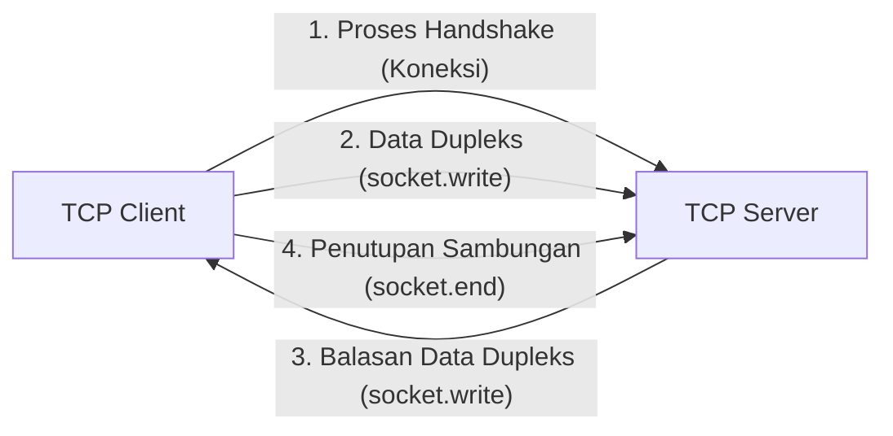

# Net

> Ringkasan
>
> - Fungsi: Membangun server dan client jaringan berbasis protokol TCP (_Transmission Control Protocol_) dengan stream data dua arah secara langsung.
> - Digunakan saat: Mengembangkan layanan komunikasi tingkat rendah seperti protokol kustom, komunikasi antar-proses (IPC), broker pesan ringan, atau perkakas diagnostik soket jaringan.
> - Aturan praktis: Selalu pasang listener event `'error'` pada server dan soket client agar aplikasi tidak mendadak mati (_crash_) saat koneksi terputus tiba-tiba.

---

## Tujuan Belajar

- Memahami prinsip kerja komunikasi TCP pada lapisan transport jaringan serta sifat komunikasinya yang berbasis deretan byte mentah (_stream of bytes_).
- Membuat server TCP menggunakan `net.createServer()` serta mengelola siklus koneksi client yang masuk.
- Mengikat server ke nomor port dan alamat host tertentu menggunakan `server.listen()`.
- Membangun client TCP menggunakan `net.createConnection()` untuk bertukar data dua arah.
- Mengirim data dan menangani status antrean pengiriman buffer via `socket.write()`.
- Mengatur batas waktu inaktivitas transfer data soket menggunakan `socket.setTimeout()`.
- Mengelola terminasi koneksi soket (`socket.end()`, `socket.destroy()`) dan penutupan server (`server.close()`).
- Menerapkan pembatasan batas pesan (_message framing_) untuk mengatasi pemecahan atau penggabungan paket data di jaringan.

---

## Konsep

Protokol TCP bisa kita bayangkan seperti percakapan lewat panggilan telepon. Sebelum obrolan dimulai, kedua belah pihak melakukan proses _three-way handshake_ untuk memastikan koneksinya sudah siap dan terhubung dengan baik.

Setelah panggilan tersambung, kedua belah pihak bisa berbicara dan mendengarkan secara bersamaan (_full-duplex_). Seluruh informasi yang dikirim dijamin tiba secara utuh dan berurutan. Namun, karena TCP mentransfer data secara kontinu tanpa pemisah bawaan (_stream of bytes_), pihak pengirim dan penerima harus menyepakati penanda akhir pesan sendiri (misalnya memakai karakter baris baru `\n`) agar lawan bicara tahu kapan satu pesan selesai dibaca.



---

## Referensi

| Item                         | Fungsi                                                   | Catatan                                                               |
| :--------------------------- | :------------------------------------------------------- | :-------------------------------------------------------------------- |
| **`net.createServer()`**     | Membuat server TCP baru                                  | Menghasilkan objek `net.Server` untuk menunggu koneksi masuk          |
| **`server.listen()`**        | Mengikat server pada nomor port dan alamat host tertentu | Nilai port `0` meminta sistem operasi memilihkan port acak yang bebas |
| **`net.createConnection()`** | Membuka koneksi TCP ke server target                     | Menghasilkan soket dupleks `net.Socket` yang aktif                    |
| **`socket.write()`**         | Mengirimkan teks atau buffer data ke ujung soket lainnya | Mengembalikan nilai boolean penanda kondisi antrean buffer pengiriman |
| **`socket.setTimeout()`**    | Mengatur batas waktu hening tanpa aktivitas data         | Memancarkan event `'timeout'` tanpa memutus koneksi secara otomatis   |
| **`socket.end()`**           | Menutup saluran pengiriman data dari sisi lokal          | Mengirimkan sinyal FIN, namun masih bisa menerima sisa data balasan   |
| **`socket.destroy()`**       | Memutuskan dan menutup koneksi soket seketika            | Menghentikan komunikasi langsung tanpa menunggu sisa antrean          |
| **`server.close()`**         | Menghentikan server dari menerima koneksi baru           | Koneksi yang sudah terhubung tetap dibiarkan berjalan hingga selesai  |

### `net.createServer()`

Fungsi `net.createServer()` digunakan untuk membuat server TCP baru yang siap melayani koneksi dari client. Kita bisa langsung memberikan fungsi callback yang akan otomatis terdaftar sebagai listener event `'connection'`.

Struktur parameter: `net.createServer(options, connectionListener)`

- `options`: Objek konfigurasi server (opsional, tipe data: `object`, nilai bawaan: `{}`), mendukung properti seperti `allowHalfOpen` (tipe `boolean`, bawaan: `false`), `pauseOnConnect` (tipe `boolean`, bawaan: `false`), `noDelay` (tipe `boolean`, bawaan: `false`), dan `keepAlive` (tipe `boolean`, bawaan: `false`).
- `connectionListener`: Fungsi callback yang otomatis didaftarkan sebagai listener untuk event `'connection'` setiap kali ada koneksi client baru yang terhubung (opsional, tipe data: `Function`). Callback menerima argumen soket dupleks bertipe `net.Socket`.
- Nilai kembalian: Mengembalikan instance server baru yang belum aktif mendengarkan koneksi sebelum `server.listen()` dipanggil (tipe data: `net.Server`).

```javascript
import net from "node:net";

// Membuat server TCP dengan callback penangan koneksi client
const server = net.createServer((socket) => {
  // Mengirim pesan balasan lalu menutup saluran pengiriman lokal
  socket.end("Hello from TCP Server");
});

// Mengaktifkan server pada port 0 (port acak yang tersedia)
server.listen(0, () => {
  const { port } = server.address();
  // Membuka koneksi client ke nomor port server yang baru dibuka
  const client = net.createConnection({ port });

  client.on("data", (chunk) => {
    console.log(chunk.toString());
    client.destroy();
    server.close();
  });
});

// Output: Hello from TCP Server
```

Kasus lain: Mendeteksi koneksi client lewat pendaftaran manual event `'connection'` menggunakan metode `.on()`.

```javascript
import net from "node:net";

const server = net.createServer();

// Mendaftarkan listener event connection secara manual
server.on("connection", (socket) => {
  console.log("Incoming connection detected:", Boolean(socket.remoteAddress));
  socket.destroy();
  server.close();
});

server.listen(0, () => {
  const client = net.createConnection({ port: server.address().port });
  client.on("error", () => {});
});

// Output: Incoming connection detected: true
```

### `server.listen()`

Metode `server.listen()` bertugas mengikat server TCP pada nomor port dan alamat host tertentu agar siap menerima koneksi client. Mengisi nomor port dengan nilai `0` memberi tahu sistem operasi untuk memilihkan port kosong yang tersedia secara acak.

Struktur parameter: `server.listen(port, host, backlog, callback)`

- `port`: Nomor port jaringan yang ingin didengarkan oleh server (opsional, tipe data: `number`, nilai bawaan: `0`).
- `host`: Alamat IP atau nama host yang diikat oleh server (opsional, tipe data: `string`, nilai bawaan: `'0.0.0.0'` untuk IPv4 atau `'::'` untuk IPv6).
- `backlog`: Jumlah maksimal antrean koneksi tertunda yang diizinkan sistem operasi (opsional, tipe data: `number`, nilai bawaan: `511`).
- `callback`: Fungsi listener satu kali yang otomatis didaftarkan ke event `'listening'` saat server siap menerima koneksi (opsional, tipe data: `Function`).
- Nilai kembalian: Mengembalikan referensi instance server itu sendiri untuk mendukung pemanggilan berantai (tipe data: `net.Server`).

```javascript
import net from "node:net";

const server = net.createServer();

// Mengikat server ke host lokal '127.0.0.1' dan port acak 0
server.listen(0, "127.0.0.1", () => {
  const info = server.address();
  console.log(info.address, typeof info.port);
  server.close();
});

// Output: 127.0.0.1 number
```

Kasus lain: Menangkap error berkode `EADDRINUSE` saat mencoba mengikat server ke nomor port yang sedang dipakai oleh proses lain.

```javascript
import net from "node:net";

// Server pertama mendengarkan pada port acak yang dialokasikan sistem
const server1 = net.createServer().listen(0, () => {
  const { port } = server1.address();
  const server2 = net.createServer();

  // Mencoba mengikat server kedua ke nomor port yang sama persis
  server2.listen(port, () => {});

  server2.on("error", (error) => {
    console.log(error.code);
    server1.close();
  });
});

// Output: EADDRINUSE
```

### `net.createConnection()`

Fungsi `net.createConnection()` dipakai untuk membuat soket client baru dan langsung membuka sambungan TCP ke server tujuan berdasarkan nomor port dan host.

Struktur parameter: `net.createConnection(options, connectListener)`

- `options`: Objek konfigurasi koneksi client (wajib, tipe data: `object`), memuat properti `port` (nomor port server tujuan, wajib, tipe data: `number`), `host` (alamat host server tujuan, opsional, tipe data: `string`, nilai bawaan: `'localhost'`), `localAddress` (alamat antarmuka jaringan lokal yang dipakai, opsional, tipe data: `string`), dan `timeout` (batas waktu koneksi dalam milidetik, opsional, tipe data: `number`).
- `connectListener`: Fungsi callback yang otomatis didaftarkan sebagai listener event `'connect'` ketika sambungan TCP berhasil terhubung (opsional, tipe data: `Function`).
- Nilai kembalian: Mengembalikan instance soket dupleks aktif yang langsung memulai proses koneksi (tipe data: `net.Socket`).

```javascript
import net from "node:net";

const server = net
  .createServer((socket) => {
    socket.write("Connection successful");
    socket.end();
  })
  .listen(0, () => {
    // Membuka koneksi ke port server dan mendaftarkan listener connect
    const client = net.createConnection({ port: server.address().port }, () => {
      console.log("Active connection status:", !client.connecting);
    });

    client.on("data", () => {
      client.destroy();
      server.close();
    });
  });

// Output: Active connection status: true
```

Kasus lain: Menangani penolakan sambungan ketika server target sedang tidak aktif lewat penangkapan event `'error'` dengan kode `ECONNREFUSED`.

```javascript
import net from "node:net";

// Mencoba menghubungi port 1 yang tertutup pada sistem lokal
const client = net.createConnection({ port: 1 });

client.on("error", (error) => {
  console.log(error.code);
});

// Output: ECONNREFUSED
```

### `socket.write()`

Metode `socket.write()` dipakai untuk mengirimkan data teks atau buffer melalui sambungan soket ke pihak seberang. Metode ini mengembalikan status boolean apakah data langsung berhasil dialirkan ke buffer kernel atau masih tertahan di antrean memori aplikasi karena buffer penuh (_backpressure_).

Struktur parameter: `socket.write(data, encoding, callback)`

- `data`: Muatan data yang akan dikirim melalui koneksi soket (wajib, tipe data: `string | Buffer | Uint8Array`).
- `encoding`: Format pengkodean karakter saat parameter `data` bertipe `string` (opsional, tipe data: `string`, nilai bawaan: `'utf8'`).
- `callback`: Fungsi callback yang dipanggil setelah data tersebut selesai dialirkan keluar dari antrean penampung (opsional, tipe data: `Function`).
- Nilai kembalian: Mengembalikan nilai boolean `true` jika seluruh data berhasil dialirkan langsung ke buffer pengiriman kernel, atau `false` jika buffer kernel penuh sehingga data diantrekan di memori pengguna Node.js (tipe data: `boolean`).

```javascript
import net from "node:net";

const server = net
  .createServer((socket) => {
    socket.on("data", (chunk) => {
      console.log(chunk.toString());
      socket.destroy();
      server.close();
    });
  })
  .listen(0, () => {
    const client = net.createConnection({ port: server.address().port }, () => {
      // Mengirimkan pesan string melalui soket client
      const isFlushed = client.write("Client message");
      console.log("Flushed:", isFlushed);
      client.destroy();
    });
  });

// Output:
// Flushed: true
// Client message
```

Kasus lain: Mengirimkan data ke soket yang saluran tulisnya sudah ditutup (`socket.end()`) akan memicu event error berkode `ERR_STREAM_WRITE_AFTER_END`.

```javascript
import net from "node:net";

const server = net
  .createServer((socket) => {
    socket.end();
  })
  .listen(0, () => {
    const client = net.createConnection({ port: server.address().port }, () => {
      client.on("error", (error) => {
        console.log(error.code);
        client.destroy();
        server.close();
      });

      // Menutup saluran tulis soket terlebih dahulu
      client.end();
      // Mencoba menulis data baru ke soket yang telah ditutup saluran tulisnya
      client.write("Late data");
    });
  });

// Output: ERR_STREAM_WRITE_AFTER_END
```

### `socket.setTimeout()`

Metode `socket.setTimeout()` digunakan untuk menyetel batas durasi hening maksimal tanpa aktivitas transfer data sebelum soket memancarkan sinyal event `'timeout'`. Perlu diingat bahwa event ini tidak otomatis memutuskan koneksi, sehingga penutupan atau penghancuran soket harus dipanggil secara mandiri.

Struktur parameter: `socket.setTimeout(timeout, callback)`

- `timeout`: Batas durasi inaktivitas komunikasi pada soket dalam satuan milidetik sebelum event `'timeout'` dipancarkan (wajib, tipe data: `number`). Nilai `0` menonaktifkan fitur batas waktu hening.
- `callback`: Fungsi listener satu kali yang otomatis didaftarkan untuk event `'timeout'` pada soket tersebut (opsional, tipe data: `Function`).
- Nilai kembalian: Mengembalikan instance soket itu sendiri untuk mendukung pemanggilan berantai (tipe data: `net.Socket`).

```javascript
import net from "node:net";

const server = net
  .createServer((socket) => {
    // Menyetel batas inaktivitas komunikasi selama 50 milidetik
    socket.setTimeout(50);

    socket.on("timeout", () => {
      console.log("Inactivity timeout reached");
      // Memutus sambungan soket secara mandiri di dalam listener timeout
      socket.destroy();
      server.close();
    });
  })
  .listen(0, () => {
    const client = net.createConnection({ port: server.address().port });
    client.on("close", () => client.destroy());
  });

// Output: Inactivity timeout reached
```

Kasus lain: Membatalkan atau menonaktifkan batas waktu inaktivitas soket yang sedang berjalan dengan mengisi nilai `0`.

```javascript
import net from "node:net";

const socket = new net.Socket();
// Mengaktifkan batas waktu 100 milidetik
socket.setTimeout(100);
// Menonaktifkan kembali batas waktu dengan mengirim nilai 0
socket.setTimeout(0);

console.log("Timeout disabled");
socket.destroy();

// Output: Timeout disabled
```

### `socket.end()`

Metode `socket.end()` menutup saluran pengiriman data dari pihak lokal dengan mengirimkan sinyal penutup (FIN) ke pihak seberang. Meskipun saluran tulis sudah ditutup, pihak lokal masih bisa membaca sisa data balasan dari seberang sampai lawan bicara juga menutup sambungannya.

Struktur parameter: `socket.end(data, encoding, callback)`

- `data`: Muatan data terakhir opsional yang ingin dikirimkan tepat sebelum saluran tulis ditutup (opsional, tipe data: `string | Buffer | Uint8Array`).
- `encoding`: Format pengkodean teks saat parameter `data` bertipe `string` (opsional, tipe data: `string`, nilai bawaan: `'utf8'`).
- `callback`: Fungsi callback yang otomatis didaftarkan untuk event `'finish'` ketika saluran pengiriman soket benar-benar selesai ditutup (opsional, tipe data: `Function`).
- Nilai kembalian: Mengembalikan instance soket itu sendiri (tipe data: `net.Socket`).

```javascript
import net from "node:net";

const server = net
  .createServer((socket) => {
    socket.on("data", (chunk) => {
      console.log("Received by server:", chunk.toString());
    });

    socket.on("end", () => {
      console.log("Client sent end signal");
      socket.end();
      server.close();
    });
  })
  .listen(0, () => {
    const client = net.createConnection({ port: server.address().port }, () => {
      // Mengirimkan pesan penutup sekaligus menutup saluran pengiriman
      client.end("Finished sending");
    });

    client.on("close", () => client.destroy());
  });

// Output:
// Received by server: Finished sending
// Client sent end signal
```

Kasus lain: Memanggil `socket.end()` tanpa menyertakan argumen untuk langsung mengirimkan sinyal selesai (FIN) tanpa muatan data baru.

```javascript
import net from "node:net";

const server = net
  .createServer((socket) => {
    socket.on("end", () => {
      console.log("FIN signal received");
      socket.destroy();
      server.close();
    });
  })
  .listen(0, () => {
    const client = net.createConnection({ port: server.address().port }, () => {
      // Mengirim sinyal selesai langsung tanpa data tambahan
      client.end();
    });

    client.on("close", () => client.destroy());
  });

// Output: FIN signal received
```

### `socket.destroy()`

Metode `socket.destroy()` langsung memutus dan menghancurkan koneksi soket seketika di tingkat sistem operasi. Metode ini berguna untuk penanganan darurat saat terjadi error fatal atau sambungan yang menggantung melebihi batas waktu.

Struktur parameter: `socket.destroy(error)`

- `error`: Objek error opsional yang akan dipancarkan ke listener event `'error'` pada soket tersebut (opsional, tipe data: `Error`).
- Nilai kembalian: Mengembalikan instance soket itu sendiri (tipe data: `net.Socket`).

```javascript
import net from "node:net";

const server = net
  .createServer((socket) => {
    // Memutus koneksi soket seketika
    socket.destroy();
    console.log("Socket destroyed status:", socket.destroyed);
    server.close();
  })
  .listen(0, () => {
    const client = net.createConnection({ port: server.address().port });
    client.on("close", () => client.destroy());
  });

// Output: Socket destroyed status: true
```

Kasus lain: Menghancurkan soket dengan menyertakan objek error untuk memicu pemancaran event `'error'` secara terprogram.

```javascript
import net from "node:net";

const socket = new net.Socket();

socket.on("error", (error) => {
  console.log(error.message);
});

// Menghancurkan soket dengan alasan error kustom
socket.destroy(new Error("Forced close by application"));

// Output: Forced close by application
```

### `server.close()`

Metode `server.close()` digunakan untuk memberi tahu server agar berhenti menerima koneksi baru dari client. Koneksi client yang sudah tersambung tetap dibiarkan berjalan hingga selesai secara wajar.

Struktur parameter: `server.close(callback)`

- `callback`: Fungsi callback opsional yang dipanggil saat seluruh koneksi client selesai dan server benar-benar berhenti mendengarkan (event `'close'`) (opsional, tipe data: `Function`). Jika terjadi kegagalan selama penutupan server, objek `Error` diteruskan sebagai argumen pertama.
- Nilai kembalian: Mengembalikan instance server itu sendiri (tipe data: `net.Server`).

```javascript
import net from "node:net";

const server = net.createServer();

server.listen(0, () => {
  console.log("Before close:", server.listening);

  // Menghentikan server dari menerima koneksi baru
  server.close(() => {
    console.log("After close:", server.listening);
  });
});

// Output:
// Before close: true
// After close: false
```

Kasus lain: Memanggil `server.close()` saat server belum pernah dijalankan atau sudah berhenti akan menghasilkan error berkode `ERR_SERVER_NOT_RUNNING`.

```javascript
import net from "node:net";

const server = net.createServer();

// Memanggil penutupan saat server belum aktif mendengarkan
server.close((error) => {
  console.log(error.code);
});

// Output: ERR_SERVER_NOT_RUNNING
```

---

## Kesalahan Umum

### Lupa Memasang Handler Event Error pada Soket

Jika kita tidak memasang listener event `'error'` pada soket, Node.js akan menganggap setiap kegagalan jaringan (seperti koneksi yang terputus mendadak atau penolakan sambungan) sebagai unhandled exception yang langsung mematikan seluruh proses aplikasi.

```javascript
// Salah
const client = net.createConnection({ port: 8080 });
client.write("Hello Server");
```

```javascript
// Benar
const client = net.createConnection({ port: 8080 });
client.on("error", (error) => {
  console.log("Connection failed or closed:", error.message);
});
client.write("Hello Server");
```

### Mengira Satu Panggilan Write Pasti Tiba Sebagai Satu Event Data

Protokol TCP bekerja dengan sistem stream byte tanpa mengetahui batas sebuah kalimat. Artinya, beberapa panggilan `socket.write()` terpisah bisa saja digabungkan jadi satu paket besar di jaringan (_packet coalescing_), atau sebaliknya, satu pesan panjang bisa terpecah menjadi beberapa potongan data kecil (_fragmentation_).

```javascript
// Salah
socket.on("data", (chunk) => {
  const message = JSON.parse(chunk.toString());
  processMessage(message);
});
```

```javascript
// Benar
let buffer = "";
socket.on("data", (chunk) => {
  buffer += chunk.toString();
  const lines = buffer.split("\n");
  buffer = lines.pop();
  for (const line of lines) {
    if (line.trim()) processMessage(JSON.parse(line));
  }
});
```

### Tidak Memutus Soket Saat Terjadi Timeout

Event `'timeout'` hanyalah sinyal pemberitahuan batas waktu hening dan tidak otomatis memutuskan hubungan. Jika kita tidak memanggil `socket.destroy()` atau `socket.end()` di dalam listener event `'timeout'`, soket yang menganggur akan terus menggantung dan memboroskan alokasi file descriptor sistem operasi.

```javascript
// Salah
socket.setTimeout(5000);
socket.on("timeout", () => {
  console.log("Idle connection detected");
});
```

```javascript
// Benar
socket.setTimeout(5000);
socket.on("timeout", () => {
  socket.destroy(new Error("Connection timeout exceeded"));
});
```

---

## Studi Kasus

Skenario: Membangun server gema pesan berbasis format baris baru (_newline-delimited JSON echo server_) mandiri yang dilengkapi validasi data, penanganan error parsing, serta penutupan sambungan yang rapi.

```javascript
import net from "node:net";

function createEchoServer() {
  const server = net.createServer((socket) => {
    let buffer = "";

    socket.on("data", (chunk) => {
      buffer += chunk.toString("utf-8");
      const lines = buffer.split("\n");
      buffer = lines.pop();

      for (const line of lines) {
        if (!line.trim()) continue;
        try {
          const payload = JSON.parse(line);
          const response = JSON.stringify({
            status: "OK",
            echo: payload.message,
            length: payload.message.length,
          });
          socket.write(response + "\n");
        } catch {
          const errorMessage = JSON.stringify({
            status: "ERR",
            message: "Invalid JSON format",
          });
          socket.write(errorMessage + "\n");
        }
      }
    });

    socket.on("error", () => {
      socket.destroy();
    });
  });

  return server;
}

const server = createEchoServer();
server.listen(0, () => {
  const { port } = server.address();
  const client = net.createConnection({ port }, () => {
    client.write(JSON.stringify({ message: "Hello TCP" }) + "\n");
  });

  client.on("data", (chunk) => {
    const response = JSON.parse(chunk.toString().trim());
    console.log("Status:", response.status);
    console.log("Echo:", response.echo);
    console.log("Length:", response.length);
    client.destroy();
    server.close();
  });

  client.on("error", () => {
    client.destroy();
    server.close();
  });
});

// Output:
// Status: OK
// Echo: Hello TCP
// Length: 9
```

Pola ini mengumpulkan stream data byte menggunakan pembatas baris baru `\n`. Cara ini menjamin setiap pesan JSON berhasil diuraikan secara utuh meskipun datanya tiba dalam beberapa potongan terpisah, sekaligus melindungi server dari kerusakan parsing jika menerima format data yang tidak valid. Di industri perangkat lunak, teknik pembatasan batas pesan (_message framing_) seperti ini merupakan fondasi protokol komunikasi jaringan tingkat rendah, antrean pesan (_message queue_), dan sinkronisasi data antar-proses (IPC) agar pertukaran data biner atau teks tetap andal tanpa risiko kehilangan batas pesan (_data tearing_).

---

## Latihan Mandiri

### Soal 1 (Dasar)

Buat fungsi `checkActivePort(host, port, timeoutMs)` yang memeriksa apakah port TCP pada komputer target sedang terbuka dan menerima koneksi sebelum batas waktu habis. Fungsi ini mengembalikan nilai boolean `true` jika koneksi berhasil, atau `false` jika koneksi gagal atau kehabisan waktu.

Spesifikasi parameter dan nilai kembalian:

- `host`: Alamat IP atau host target (tipe data: `string`).
- `port`: Nomor port target yang diuji (tipe data: `number`).
- `timeoutMs`: Batas waktu maksimal penantian koneksi dalam satuan milidetik (tipe data: `number`).
- Nilai kembalian: Mengembalikan Promise yang menghasilkan nilai boolean `true` (jika soket berhasil tersambung) atau `false` (jika terjadi error atau timeout) (tipe data: `Promise<boolean>`).

Contoh input 1 (port aktif dan berhasil terhubung):

```javascript
import net from "node:net";

const server = net.createServer().listen(0);
const { port } = server.address();

const isOpen = await checkActivePort("127.0.0.1", port, 200);
console.log(isOpen);

server.close();
```

Contoh output 1 yang diharapkan:

```javascript
// Output: true
```

Contoh input 2 (port tidak aktif atau ditolak):

```javascript
const isOpen = await checkActivePort("127.0.0.1", 1, 200);
console.log(isOpen);
```

Contoh output 2 yang diharapkan:

```javascript
// Output: false
```

Batasan: Gunakan modul bawaan `node:net` murni. Soket harus langsung dihancurkan (`destroy()`) segera setelah status koneksi diketahui atau batas waktu terlewati untuk mencegah kebocoran sumber daya.

### Soal 2 (Menengah)

Buat fungsi `parseMessageFrames(initialBuffer, chunk, delimiter)` yang memproses stream potongan data TCP yang terfragmentasi. Fungsi menerima sisa teks dari pembacaan sebelumnya (`initialBuffer`), data baru yang baru saja masuk (`chunk`), serta karakter pemisah pesan (`delimiter`). Fungsi harus mengembalikan objek yang memuat daftar pesan lengkap yang berhasil dipisahkan dan sisa teks yang belum memiliki penanda penutup.

Spesifikasi parameter dan nilai kembalian:

- `initialBuffer`: Sisa string buffer dari pembacaan sebelumnya (tipe data: `string`).
- `chunk`: Potongan string data baru yang baru diterima dari soket (tipe data: `string`).
- `delimiter`: Karakter pemisah batas pesan (tipe data: `string`).
- Nilai kembalian: Mengembalikan objek dengan struktur `{ completeMessages: string[], remainingBuffer: string }`.

Contoh input 1 (pesan terfragmentasi normal):

```javascript
const result = parseMessageFrames(
  "initial_part",
  "_continuation\nsecond_msg\npending_third",
  "\n",
);
console.log(result);
```

Contoh output 1 yang diharapkan:

```javascript
// Output:
// {
//   completeMessages: [ 'initial_part_continuation', 'second_msg' ],
//   remainingBuffer: 'pending_third'
// }
```

Contoh input 2 (kondisi khusus: pemisah berturut-turut tanpa teks pesan di antaranya):

```javascript
const result = parseMessageFrames("", "first\n\nsecond\n", "\n");
console.log(result);
```

Contoh output 2 yang diharapkan:

```javascript
// Output:
// {
//   completeMessages: [ 'first', 'second' ],
//   remainingBuffer: ''
// }
```

Batasan: Gunakan fungsi murni berbasis pengolahan teks string tanpa dependensi luar. Abaikan elemen string kosong jika terdapat beberapa delimiter yang bersebelahan.

### Soal 3 (Menantang)

Buat fungsi `createTcpCommandServer()` yang menghasilkan server TCP pengelola perintah teks berbasis baris (`\n`). Server harus mampu melayani banyak koneksi client dengan ketentuan berikut:

1. Client mengirim perintah dengan format `COMMAND:VALUE\n` (atau `COMMAND\n` untuk perintah tanpa argumen seperti `COUNT` dan `QUIT`).
2. Jika perintah berupa `SET:key=value`, simpan pasangan kunci dan nilai ke penyimpanan internal (misalnya `Map`), lalu balas dengan `OK:STORED\n`.
3. Jika perintah berupa `GET:key`, cari nilai kunci tersebut dan balas dengan `VAL:value\n`. Jika tidak ditemukan, balas dengan `ERR:NOT_FOUND\n`.
4. Jika perintah berupa `COUNT`, balas dengan jumlah total kunci yang tersimpan menggunakan format `VAL:count\n`.
5. Jika perintah berupa `QUIT`, tutup saluran soket client secara teratur via `socket.end()`.
6. Penanganan kondisi khusus (_edge cases_):
   - Jika format baris tidak dikenali atau salah, balas dengan `ERR:INVALID_COMMAND\n`.
   - Batasi panjang buffer per client maksimal 256 karakter. Jika sebuah baris data belum memiliki `\n` dan sudah melewati 256 karakter, balas dengan `ERR:PAYLOAD_TOO_LARGE\n` dan langsung hancurkan soket client tersebut via `socket.destroy()` untuk mencegah banjir memori.
   - Tangani penutupan soket mendadak (`error` dan `close`) agar tidak meninggalkan alokasi yang menggantung di server.

Contoh input 1 (eksekusi perintah valid):

```javascript
import net from "node:net";

const server = createTcpCommandServer();
server.listen(0, () => {
  const { port } = server.address();
  const client = net.createConnection({ port }, () => {
    client.write("SET:language=javascript\nGET:language\nCOUNT\nQUIT\n");
  });

  client.on("data", (chunk) => {
    process.stdout.write(chunk.toString());
  });

  client.on("close", () => {
    server.close();
  });
});
```

Contoh output 1 yang diharapkan:

```javascript
// Output:
// OK:STORED
// VAL:javascript
// VAL:1
```

Contoh input 2 (kondisi khusus: perintah tidak valid dan data tidak ditemukan):

```javascript
import net from "node:net";

const server = createTcpCommandServer();
server.listen(0, () => {
  const { port } = server.address();
  const client = net.createConnection({ port }, () => {
    client.write("INVALID_SYNTAX\nGET:unknown_key\nQUIT\n");
  });

  client.on("data", (chunk) => {
    process.stdout.write(chunk.toString());
  });

  client.on("close", () => {
    server.close();
  });
});
```

Contoh output 2 yang diharapkan:

```javascript
// Output:
// ERR:INVALID_COMMAND
// ERR:NOT_FOUND
```

Contoh input 3 (kondisi khusus: deteksi payload berlebih melebihi 256 karakter):

```javascript
import net from "node:net";

const server = createTcpCommandServer();
server.listen(0, () => {
  const { port } = server.address();
  const client = net.createConnection({ port }, () => {
    // Mengirim string sepanjang 300 karakter tanpa penanda baris baru
    client.write("A".repeat(300));
  });

  client.on("data", (chunk) => {
    process.stdout.write(chunk.toString());
  });

  client.on("close", () => {
    server.close();
  });
});
```

Contoh output 3 yang diharapkan:

```javascript
// Output:
// ERR:PAYLOAD_TOO_LARGE
```

Batasan: Seluruh server wajib dibangun menggunakan modul `node:net` bawaan tanpa paket tambahan dari luar.

---

## Navigasi

[Sebelumnya: Timer](../11-timer/README.md) | [Selanjutnya: DNS](../13-dns/README.md) | [Daftar Isi](../README.md)
