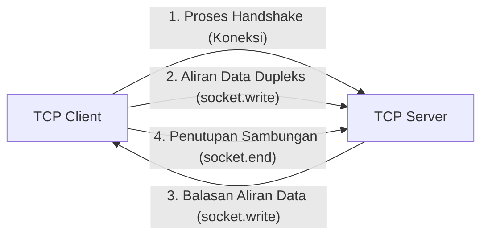

# Net

> Ringkasan
>
> - Fungsi: Membangun server dan klien jaringan berbasis protokol TCP (_Transmission Control Protocol_) dengan aliran data dua arah secara langsung.
> - Digunakan saat: Mengembangkan layanan komunikasi tingkat rendah seperti protokol kustom, komunikasi antar-proses (IPC), broker pesan ringan, atau perkakas diagnostik soket jaringan.
> - Aturan praktis: Selalu pasang listener event `'error'` pada server dan soket klien agar aplikasi tidak mendadak mati (_crash_) saat koneksi terputus tiba-tiba.

---

## Tujuan Belajar

- Memahami prinsip kerja komunikasi TCP pada lapisan transport jaringan serta sifat alirannya yang berbasis deretan byte mentah (_stream of bytes_).
- Membuat server TCP menggunakan `net.createServer()` serta mengelola siklus koneksi klien yang masuk.
- Membangun klien TCP menggunakan `net.createConnection()` untuk bertukar data dua arah.
- Mengelola siklus hidup soket melalui event `'connect'`, `'data'`, `'end'`, `'close'`, dan `'error'`.
- Menerapkan pembatasan batas pesan (_message framing_) untuk mengatasi pemecahan atau penggabungan paket data di jaringan.

---

## Konsep

Protokol TCP bisa kita bayangkan seperti percakapan lewat panggilan telepon. Sebelum obrolan dimulai, kedua belah pihak melakukan proses proses _three-way handshake_ untuk memastikan jalurnya sudah siap dan terhubung dengan baik.

Setelah panggilan tersambung, kedua belah pihak bisa berbicara dan mendengarkan secara bersamaan (_full-duplex_). Seluruh informasi yang dikirim dijamin tiba secara utuh dan berurutan. Namun, karena TCP mengalirkan data seperti aliran air murni tanpa pemisah bawaan, pihak pengirim dan penerima harus menyepakati penanda akhir pesan sendiri (misalnya memakai karakter baris baru `\n`) agar lawan bicara tahu kapan satu pesan selesai dibaca.



---

## Referensi

| Item                         | Fungsi                                                    | Catatan                                                                  |
| :--------------------------- | :-------------------------------------------------------- | :----------------------------------------------------------------------- |
| **`net.createServer()`**     | Membuat server TCP baru                                   | Menghasilkan objek `net.Server` untuk menunggu koneksi masuk             |
| **`net.createConnection()`** | Membuka koneksi TCP ke server target                      | Menghasilkan soket dupleks `net.Socket` yang aktif                       |
| **`server.listen()`**        | Mengikat server pada nomor port dan alamat host tertentu  | Nilai port `0` meminta sistem operasi memilihkan port acak yang bebas    |
| **`server.close()`**         | Menghentikan server dari menerima koneksi baru            | Koneksi yang sudah terhubung tetap dibiarkan berjalan hingga selesai     |
| **`socket.write()`**         | Mengirimkan teks atau buffer data ke ujung soket lainnya  | Mengembalikan nilai boolean penanda kondisi antrean buffer pengiriman    |
| **`socket.end()`**           | Menutup jalur pengiriman data dari sisi lokal             | Mengirimkan sinyal selesai kirim, namun masih bisa menerima data balasan |
| **`socket.destroy()`**       | Memutuskan dan menutup koneksi soket seketika             | Menghentikan komunikasi langsung tanpa menunggu sisa antrean             |
| **`socket.setTimeout()`**    | Mengatur batas waktu hening tanpa aktivitas transfer data | Memancarkan event `'timeout'` tanpa memutus koneksi secara otomatis      |

### `net.createServer()`

Fungsi `net.createServer()` digunakan untuk membuat server TCP baru yang siap melayani koneksi dari klien. Kita bisa langsung memberikan fungsi callback yang akan dipanggil setiap kali ada klien baru yang terhubung.

```javascript
import net from "node:net";

const server = net.createServer((socket) => {
  socket.end("Hello from TCP Server");
});

server.listen(0, () => {
  const { port } = server.address();
  const client = net.createConnection({ port });
  client.on("data", (chunk) => {
    console.log(chunk.toString());
    // Output: Hello from TCP Server
    client.destroy();
    server.close();
  });
});
```

Kasus lain: Mendeteksi koneksi klien lewat pendaftaran manual event `'connection'`.

```javascript
import net from "node:net";

const server = net.createServer();
server.on("connection", (socket) => {
  console.log("Incoming connection detected:", Boolean(socket.remoteAddress));
  // Output: Incoming connection detected: true
  socket.destroy();
  server.close();
});

server.listen(0, () => {
  const client = net.createConnection({ port: server.address().port });
  client.on("error", () => {});
});
```

### `net.createConnection()`

Fungsi `net.createConnection()` dipakai untuk membuat soket klien baru dan langsung membuka sambungan TCP ke server tujuan berdasarkan nomor port dan host.

```javascript
import net from "node:net";

const server = net
  .createServer((socket) => {
    socket.write("Connection successful");
    socket.end();
  })
  .listen(0, () => {
    const client = net.createConnection({ port: server.address().port }, () => {
      console.log("Active connection status:", !client.connecting);
      // Output: Active connection status: true
    });

    client.on("data", () => {
      client.destroy();
      server.close();
    });
  });
```

Kasus lain: Menangani penolakan sambungan saat server tujuan sedang mati lewat kode error `ECONNREFUSED`.

```javascript
import net from "node:net";

const client = net.createConnection({ port: 1 });
client.on("error", (error) => {
  console.log(error.code);
  // Output: ECONNREFUSED
});
```

### `server.listen()`

Metode `server.listen()` bertugas mengikat server TCP pada nomor port dan alamat IP tertentu agar siap menerima permintaan koneksi. Mengisi port dengan angka `0` memberi tahu sistem operasi untuk mencarikan port kosong secara acak.

```javascript
import net from "node:net";

const server = net.createServer();
server.listen(0, "127.0.0.1", () => {
  const info = server.address();
  console.log(info.address, typeof info.port);
  // Output: 127.0.0.1 number
  server.close();
});
```

Kasus lain: Menangkap kode error `EADDRINUSE` saat mencoba menggunakan nomor port yang kebetulan sedang dipakai oleh aplikasi lain.

```javascript
import net from "node:net";

const server1 = net.createServer().listen(0, () => {
  const { port } = server1.address();
  const server2 = net.createServer();
  server2.listen(port, () => {});
  server2.on("error", (error) => {
    console.log(error.code);
    // Output: EADDRINUSE
    server1.close();
  });
});
```

### `server.close()`

Metode `server.close()` digunakan untuk memberi tahu server agar berhenti menerima klien baru. Koneksi klien yang sudah terhubung tidak akan diputus paksa, melainkan dibiarkan berjalan sampai selesai.

```javascript
import net from "node:net";

const server = net.createServer();
server.listen(0, () => {
  console.log("Before close:", server.listening);
  // Output: Before close: true
  server.close(() => {
    console.log("After close:", server.listening);
    // Output: After close: false
  });
});
```

Kasus lain: Memanggil `server.close()` saat server belum pernah dijalankan akan menghasilkan error `ERR_SERVER_NOT_RUNNING`.

```javascript
import net from "node:net";

const server = net.createServer();
server.close((error) => {
  console.log(error.code);
  // Output: ERR_SERVER_NOT_RUNNING
});
```

### `socket.write()`

Metode `socket.write()` dipakai untuk mengirimkan data teks atau buffer ke seberang sambungan. Metode ini mengembalikan nilai boolean `false` jika penampung pengiriman lokal kernel sedang penuh, memberi tanda agar kita menahan pengiriman data berikutnya sejenak (_backpressure_).

```javascript
import net from "node:net";

const server = net
  .createServer((socket) => {
    socket.on("data", (chunk) => {
      console.log(chunk.toString());
      // Output: Client message
      socket.destroy();
      server.close();
    });
  })
  .listen(0, () => {
    const client = net.createConnection({ port: server.address().port }, () => {
      const isBuffered = client.write("Client message");
      console.log("Buffered:", isBuffered);
      // Output: Buffered: true
      client.destroy();
    });
  });
```

Kasus lain: Mencoba mengirim data ke soket yang sudah ditutup akan memicu event error dengan kode `ERR_STREAM_WRITE_AFTER_END`.

```javascript
import net from "node:net";

const server = net
  .createServer((socket) => {
    socket.end();
  })
  .listen(0, () => {
    const client = net.createConnection({ port: server.address().port }, () => {
      client.on("error", (error) => {
        console.log(error.code);
        // Output: ERR_STREAM_WRITE_AFTER_END
        client.destroy();
        server.close();
      });
      client.end();
      client.write("Late data");
    });
  });
```

### `socket.end()`

Metode `socket.end()` menutup jalur pengiriman data dari pihak kita dengan mengirimkan sinyal FIN ke lawan bicara. Meskipun kita sudah selesai mengirim, kita tetap bisa menerima sisa data balasan sampai lawan bicara juga menutup sambungannya.

```javascript
import net from "node:net";

const server = net
  .createServer((socket) => {
    socket.on("data", (chunk) => {
      console.log("Received by server:", chunk.toString());
      // Output: Received by server: Finished sending
    });
    socket.on("end", () => {
      console.log("Client sent end signal");
      // Output: Client sent end signal
      socket.end();
      server.close();
    });
  })
  .listen(0, () => {
    const client = net.createConnection({ port: server.address().port }, () => {
      client.end("Finished sending");
    });
    client.on("close", () => client.destroy());
  });
```

Kasus lain: Memanggil `socket.end()` tanpa menyertakan argumen untuk langsung mengirimkan sinyal selesai tanpa muatan data baru.

```javascript
import net from "node:net";

const server = net
  .createServer((socket) => {
    socket.on("end", () => {
      console.log("FIN signal received");
      // Output: FIN signal received
      socket.destroy();
      server.close();
    });
  })
  .listen(0, () => {
    const client = net.createConnection({ port: server.address().port }, () => {
      client.end();
    });
    client.on("close", () => client.destroy());
  });
```

### `socket.destroy()`

Metode `socket.destroy()` langsung memutus dan menghancurkan koneksi soket seketika di tingkat sistem operasi. Sangat bermanfaat untuk penanganan darurat saat terjadi error parah atau koneksi yang menggantung melebihi batas waktu.

```javascript
import net from "node:net";

const server = net
  .createServer((socket) => {
    socket.destroy();
    console.log("Socket destroyed status:", socket.destroyed);
    // Output: Socket destroyed status: true
    server.close();
  })
  .listen(0, () => {
    const client = net.createConnection({ port: server.address().port });
    client.on("close", () => client.destroy());
  });
```

Kasus lain: Menghancurkan soket dengan menyertakan objek error untuk memicu pemancaran event `'error'` secara terprogram.

```javascript
import net from "node:net";

const socket = new net.Socket();
socket.on("error", (error) => {
  console.log(error.message);
  // Output: Forced close by application
});
socket.destroy(new Error("Forced close by application"));
```

### `socket.setTimeout()`

Metode `socket.setTimeout()` digunakan untuk menyetel batas waktu hening maksimal sebelum soket memancarkan sinyal event `'timeout'`. Perlu diingat bahwa event ini tidak otomatis memutus koneksi, sehingga kita harus menutup atau menghancurkan soketnya secara manual di dalam listener.

```javascript
import net from "node:net";

const server = net
  .createServer((socket) => {
    socket.setTimeout(50);
    socket.on("timeout", () => {
      console.log("Inactivity timeout reached");
      // Output: Inactivity timeout reached
      socket.destroy();
      server.close();
    });
  })
  .listen(0, () => {
    const client = net.createConnection({ port: server.address().port });
    client.on("close", () => client.destroy());
  });
```

Kasus lain: Membatalkan penghitung waktu inaktivitas soket dengan mengisi angka `0`.

```javascript
import net from "node:net";

const socket = new net.Socket();
socket.setTimeout(100);
socket.setTimeout(0);
console.log("Timeout disabled");
// Output: Timeout disabled
socket.destroy();
```

### Perbandingan: Soket TCP (`node:net`) vs Server HTTP (`node:http`)

| Karakteristik        | Soket TCP (`node:net`)                          | Server HTTP (`node:http`)                                      |
| :------------------- | :---------------------------------------------- | :------------------------------------------------------------- |
| **Lapisan Jaringan** | Lapisan 4 (Transport Layer)                     | Lapisan 7 (Application Layer)                                  |
| **Bentuk Data**      | Aliran byte mentah tanpa struktur (_raw bytes_) | Pesan terstruktur (_headers_, status code, _body_)             |
| **Sifat Hubungan**   | Sambungan tetap dua arah penuh (_full-duplex_)  | Siklus tanya-jawab permintaan dan respons (_request-response_) |
| **Pemisah Pesan**    | Ditentukan manual oleh pengembang (_framing_)   | Ditentukan otomatis sesuai spesifikasi protokol HTTP           |

---

## Kesalahan Umum

### Lupa Memasang Penangan Event Error pada Soket

Jika kita tidak memasang listener event `'error'` pada soket, Node.js akan menganggap setiap kegagalan jaringan (seperti koneksi yang terputus mendadak) sebagai pengecualian tak tertangani yang langsung mematikan seluruh aplikasi.

```javascript
// Salah
const client = net.createConnection({ port: 8080 });
client.write("Hello Server");
```

```javascript
// Benar
const client = net.createConnection({ port: 8080 });
client.on("error", (error) => {
  console.log("Connection failed or closed:", error.message);
});
client.write("Hello Server");
```

### Mengira Satu Panggilan Write Pasti Tiba Sebagai Satu Event Data

Protokol TCP bekerja dengan sistem aliran byte tanpa mengetahui batas sebuah kalimat. Artinya, beberapa panggilan `write()` terpisah bisa saja digabungkan jadi satu paket besar di jaringan (_packet coalescing_), atau sebaliknya, satu pesan panjang bisa terpecah menjadi beberapa potongan data kecil (_fragmentation_).

```javascript
// Salah
socket.on("data", (chunk) => {
  const message = JSON.parse(chunk.toString());
  processMessage(message);
});
```

```javascript
// Benar
let buffer = "";
socket.on("data", (chunk) => {
  buffer += chunk.toString();
  const lines = buffer.split("\n");
  buffer = lines.pop();
  for (const line of lines) {
    if (line.trim()) processMessage(JSON.parse(line));
  }
});
```

### Tidak Memutus Soket Saat Terjadi Timeout

Event `'timeout'` hanyalah sinyal pemberitahuan dan tidak otomatis memutuskan hubungan. Jika kita tidak memanggil `socket.destroy()` atau `socket.end()`, soket yang menganggur akan terus menggantung dan menghabiskan jatah sumber daya sistem operasi.

```javascript
// Salah
socket.setTimeout(5000);
socket.on("timeout", () => {
  console.log("Idle connection detected");
});
```

```javascript
// Benar
socket.setTimeout(5000);
socket.on("timeout", () => {
  socket.destroy(new Error("Connection timeout exceeded"));
});
```

---

## Studi Kasus

Skenario: Membangun server gema pesan berbasis format baris baru (_newline-delimited JSON echo server_) mandiri yang dilengkapi validasi data, penanganan error parsing, serta penutupan sambungan yang rapi.

```javascript
import net from "node:net";

function createEchoServer() {
  const server = net.createServer((socket) => {
    let buffer = "";

    socket.on("data", (chunk) => {
      buffer += chunk.toString("utf-8");
      const lines = buffer.split("\n");
      buffer = lines.pop();

      for (const line of lines) {
        if (!line.trim()) continue;
        try {
          const payload = JSON.parse(line);
          const response = JSON.stringify({
            status: "OK",
            echo: payload.message,
            length: payload.message.length,
          });
          socket.write(response + "\n");
        } catch {
          const errorMessage = JSON.stringify({
            status: "ERR",
            message: "Invalid JSON format",
          });
          socket.write(errorMessage + "\n");
        }
      }
    });

    socket.on("error", () => {
      socket.destroy();
    });
  });

  return server;
}

const server = createEchoServer();
server.listen(0, () => {
  const { port } = server.address();
  const client = net.createConnection({ port }, () => {
    client.write(JSON.stringify({ message: "Hello TCP" }) + "\n");
  });

  client.on("data", (chunk) => {
    const response = JSON.parse(chunk.toString().trim());
    console.log("Status:", response.status);
    console.log("Echo:", response.echo);
    console.log("Length:", response.length);
    client.destroy();
    server.close();
  });

  client.on("error", () => {
    client.destroy();
    server.close();
  });
});

// Output:
// Status: OK
// Echo: Hello TCP
// Length: 9
```

Pola ini mengumpulkan aliran data byte menggunakan pembatas baris baru `\n`. Cara ini menjamin setiap pesan JSON berhasil diuraikan secara utuh meskipun datanya tiba dalam beberapa potongan terpisah, sekaligus melindungi server dari kerusakan parsing jika menerima format data yang tidak valid.

---

## Latihan Mandiri

### Soal 1 (Dasar)

Buat fungsi `checkActivePort(host, port, timeoutMs)` yang memeriksa apakah port TCP pada komputer target sedang terbuka dan menerima koneksi sebelum batas waktu habis. Fungsi ini mengembalikan nilai boolean `true` jika koneksi berhasil, atau `false` jika koneksi gagal atau kehabisan waktu.

Contoh input:

```javascript
await checkActivePort("127.0.0.1", 80, 200);
```

Contoh output yang diharapkan:

```javascript
false;
```

Batasan: Gunakan modul bawaan `node:net` murni. Soket harus langsung dihancurkan (`destroy`) segera setelah status koneksi diketahui atau batas waktu terlewati.

### Soal 2 (Menengah)

Buat fungsi `parseMessageFrames(initialBuffer, chunk, delimiter)` yang memproses aliran potongan data TCP yang terfragmentasi. Fungsi menerima sisa teks dari pembacaan sebelumnya (`initialBuffer`), data baru yang baru saja masuk (`chunk`), serta karakter pemisah pesan (`delimiter`). Fungsi harus mengembalikan objek yang memuat daftar pesan lengkap yang berhasil dipisahkan dan sisa teks yang belum memiliki penanda penutup.

Contoh input:

```javascript
parseMessageFrames(
  "initial_part",
  "_continuation\nsecond_msg\npending_third",
  "\n",
);
```

Contoh output yang diharapkan:

```javascript
{
  completeMessages: [ 'initial_part_continuation', 'second_msg' ],
  remainingBuffer: 'pending_third'
}
```

Batasan: Gunakan fungsi murni berbasis pengolahan teks string tanpa dependensi luar. Tangani kondisi jika potongan data memuat beberapa pemisah berturut-turut tanpa isi pesan di antaranya.

### Soal 3 (Menantang)

Buat fungsi `createTcpCommandServer()` yang menghasilkan server TCP pengelola perintah teks berbasis baris (`\n`). Server harus mampu melayani banyak koneksi klien dengan ketentuan berikut:

1. Klien mengirim perintah dengan format `COMMAND:VALUE\n`.
2. Jika perintah berupa `SET:key=value`, simpan pasangan kunci dan nilai ke penyimpanan memori internal server, lalu balas dengan `OK:STORED\n`.
3. Jika perintah berupa `GET:key`, cari nilai kunci tersebut dan balas dengan `VAL:value\n`. Jika tidak ditemukan, balas dengan `ERR:NOT_FOUND\n`.
4. Jika perintah berupa `COUNT`, balas dengan jumlah total kunci yang tersimpan menggunakan pola `VAL:count\n`.
5. Jika perintah berupa `QUIT`, tutup soket klien secara teratur.
6. Penanganan kasus khusus:
   - Jika format baris tidak memiliki karakter titik dua `:` atau perintah tidak dikenali, balas dengan `ERR:INVALID_COMMAND\n`.
   - Batasi panjang buffer per klien maksimal 256 karakter. Jika sebuah baris data belum memiliki `\n` dan sudah melewati 256 karakter, balas dengan `ERR:PAYLOAD_TOO_LARGE\n` dan langsung hancurkan soket klien tersebut untuk mencegah banjir memori.
   - Tangani penutupan soket mendadak (`error` dan `close`) agar tidak meninggalkan alokasi yang menggantung di server.

Contoh skenario interaksi klien:

```javascript
// Klien mengirim: "SET:language=javascript\n"
// Server membalas: "OK:STORED\n"

// Klien mengirim: "GET:language\n"
// Server membalas: "VAL:javascript\n"

// Klien mengirim: "GET:version\n"
// Server membalas: "ERR:NOT_FOUND\n"

// Klien mengirim: "INVALID_FORMAT\n"
// Server membalas: "ERR:INVALID_COMMAND\n"
```

Batasan: Seluruh server wajib dibangun menggunakan modul `node:net` bawaan tanpa paket tambahan dari luar.

---

## Navigasi

[Sebelumnya: Timer](../11-timer/README.md) | [Selanjutnya: DNS](../13-dns/README.md) | [Daftar Isi](../README.md)
