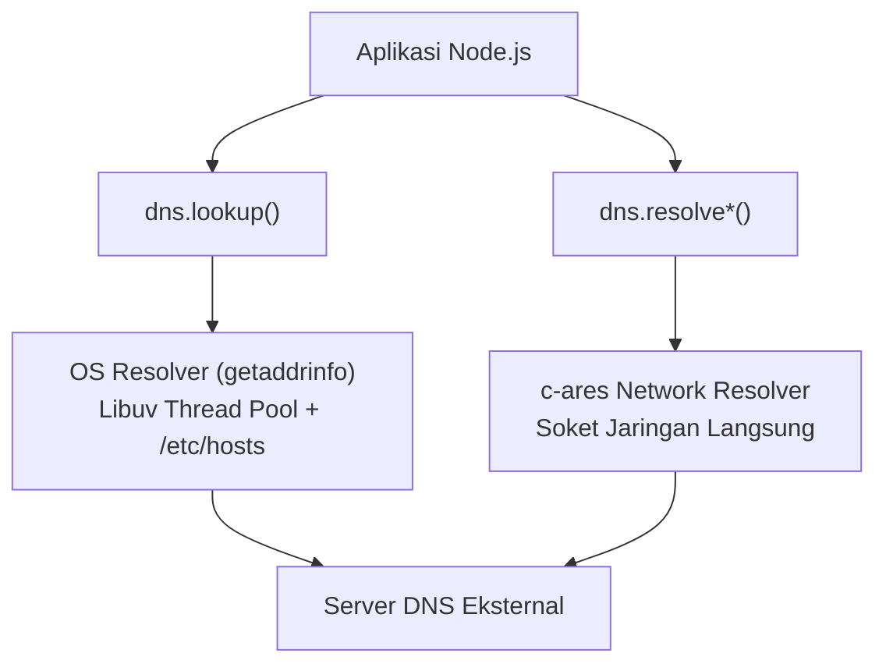

# DNS

> Ringkasan
>
> - Fungsi: Menerjemahkan nama domain menjadi alamat IP serta menginspeksi berbagai tipe record DNS jaringan.
> - Digunakan saat: Memvalidasi keberadaan domain email, memetakan alamat IP host sebelum inisiasi koneksi jaringan, atau mengaudit record Name Server.
> - Aturan praktis: Gunakan `dns.lookup()` untuk resolusi lokal terintegrasi sistem operasi via Libuv thread pool, dan gunakan keluarga `dns.resolve*()` untuk query jaringan DNS non-blocking langsung ke server DNS.

---

## Tujuan Belajar

- Membedakan mekanisme kerja `dns.lookup()` berbasis sistem operasi dengan keluarga metode jaringan `dns.resolve*()`.
- Menggunakan API resolusi DNS asinkron berbasis Promise pada subpath `node:dns/promises`.
- Melakukan query DNS untuk record spesifik (`resolve4`, `resolveMx`, `resolveTxt`, `resolveNs`).
- Melakukan pencarian balik dari alamat IP ke nama host menggunakan `dns.reverse()`.
- Mengatur dan membaca daftar server resolver DNS kustom menggunakan `dns.setServers()` dan `dns.getServers()`.
- Menerapkan penanganan kondisi khusus dan error sistem DNS (`ENOTFOUND`, `ENODATA`, `ERR_INVALID_IP_ADDRESS`).

---

## Konsep

Domain Name System (DNS) bekerja mirip dengan buku kontak telepon pada ponsel pintar kita. Alih-alih menghafal serangkaian angka numerik yang rumit untuk setiap komputer server di internet (alamat IP), kita cukup mengingat nama pengenal yang mudah dibaca manusia (nama domain).

Saat kita melakukan panggilan atau membuka alamat web, sistem secara otomatis mencocokkan nama tersebut dengan alamat IP aslinya di balik layar. Selain alamat IP utama, buku kontak DNS juga menyimpan informasi konfigurasi lain, seperti alamat server penerima email (record MX) atau catatan teks identitas untuk verifikasi domain (record TXT).

Node.js menyediakan dua mekanisme resolusi DNS yang berbeda secara fundamental:

1. **OS Resolver (`dns.lookup`)**: Memanggil fungsi sistem operasi lokal C `getaddrinfo(3)`. Karena fungsi C ini bersifat sinkron dan memblokir, Node.js menjalankannya di dalam Libuv _thread pool_. Pemanggilan ini membaca konfigurasi lokal komputer seperti file `/etc/hosts` di Linux/macOS atau file `hosts` di Windows.
2. **Network Resolver (`dns.resolve*` dan `dns.reverse`)**: Mengirim kueri langsung ke server DNS jaringan via soket UDP/TCP menggunakan library C `c-ares`. Pemanggilan ini berjalan murni secara asinkron non-blocking tanpa mengonsumsi thread pool Libuv, serta mengabaikan konfigurasi file host lokal komputer.



### Perbandingan Karakteristik Resolver

| Karakteristik          | `dns.lookup()`                                      | `dns.resolve*()`                                           |
| :--------------------- | :-------------------------------------------------- | :--------------------------------------------------------- |
| **Mekanisme**          | Memanggil API C sistem operasi (`getaddrinfo`)      | Mengirim kueri langsung via library c-ares ke server DNS   |
| **Thread Pool**        | Mengonsumsi worker thread pada Libuv thread pool    | Murni asinkron non-blocking tanpa thread pool              |
| **File Hosts Lokal**   | Memperhitungkan konfigurasi file `/etc/hosts` lokal | Mengabaikan file `/etc/hosts` lokal                        |
| **Tipe Record**        | Terbatas pada pemetaan IP (A dan AAAA)              | Mendukung seluruh tipe record (A, AAAA, MX, TXT, NS, dll.) |
| **Konfigurasi Server** | Mengikuti konfigurasi jaringan sistem operasi       | Dapat diubah secara dinamis via `dns.setServers()`         |

---

## Referensi

| Item                   | Fungsi                                                                | Catatan                                                           |
| :--------------------- | :-------------------------------------------------------------------- | :---------------------------------------------------------------- |
| **`dns.lookup()`**     | Menyelesaikan nama host menjadi alamat IP via resolver sistem operasi | Memakai thread pool Libuv dan membaca file hosts lokal            |
| **`dns.resolve4()`**   | Meminta record IPv4 (record A) langsung ke server DNS jaringan        | Murni asinkron non-blocking tanpa thread pool Libuv               |
| **`dns.resolveMx()`**  | Mengambil record Mail Exchange untuk routing server email             | Mengembalikan array objek berisi prioritas dan nama host server   |
| **`dns.resolveTxt()`** | Mengambil record teks arbitrer dari suatu domain                      | Mengembalikan array dua dimensi berisi potongan teks (record TXT) |
| **`dns.resolveNs()`**  | Mengambil daftar Name Server otoritatif pengelola domain              | Mengembalikan array string berisi nama host server DNS resmi      |
| **`dns.reverse()`**    | Menerjemahkan alamat IP kembali menjadi nama host terkait             | Menggunakan query record PTR (_reverse DNS lookup_)               |
| **`dns.setServers()`** | Menetapkan alamat IP server DNS kustom untuk query jaringan           | Memengaruhi pemanggilan fungsi `resolve*()` dan `reverse()`       |
| **`dns.getServers()`** | Membaca daftar alamat IP server DNS yang sedang aktif digunakan       | Mengembalikan array string alamat IP berformat RFC 5952           |

### `dns.lookup()`

Fungsi `dns.lookup()` menyelesaikan nama host menjadi alamat IP menggunakan resolver bawaan sistem operasi melalui fungsi sistem `getaddrinfo`. Operasi ini berjalan di dalam thread pool Libuv dan memperhitungkan konfigurasi file host lokal sistem seperti `/etc/hosts`.

Struktur parameter: `dns.lookup(hostname, options)`

- `hostname`: Nama host yang akan diresolusi (wajib, tipe data: `string`).
- `options`: Konfigurasi pencarian atau angka versi protokol IP (opsional, tipe data: `number` atau `object`, nilai bawaan: `0`). Jika berupa objek, properti yang didukung meliputi:
  - `family`: Versi protokol IP yang diinginkan, yaitu `4` untuk IPv4, `6` untuk IPv6, atau `0` untuk menerima keduanya (opsional, tipe data: `number`, nilai bawaan: `0`).
  - `all`: Menentukan apakah resolusi mengembalikan seluruh alamat IP yang ditemukan dalam array (`true`) atau hanya satu alamat pertama (`false`) (opsional, tipe data: `boolean`, nilai bawaan: `false`).
  - `order`: Urutan pengembalian alamat IP, dengan pilihan `'verbatim'` (sesuai urutan dari DNS), `'ipv4first'`, atau `'ipv6first'` (opsional, tipe data: `string`, nilai bawaan: `'verbatim'`).
- Nilai kembalian: Mengembalikan `Promise<object>` berisi properti `address` (`string`) dan `family` (`number`) jika `all` bernilai `false`, atau `Promise<object[]>` berisi daftar objek `{ address, family }` jika `all` bernilai `true`.

Contoh 1: Resolusi dasar nama host lokal `localhost` menghasilkan alamat IP tunggal dan nomor versinya:

```javascript
import dns from "node:dns/promises";

const result = await dns.lookup("localhost");
console.log(result.address);
console.log(result.family);
// Output:
// 127.0.0.1
// 4
```

Contoh 2: Resolusi dengan opsi `{ all: true }` untuk mendapatkan seluruh varian alamat yang terdaftar dalam bentuk array:

```javascript
import dns from "node:dns/promises";

// Mengirimkan objek { all: true } pada parameter options
const addresses = await dns.lookup("localhost", { all: true });
console.log(Array.isArray(addresses));
console.log(addresses[0].address);
// Output:
// true
// 127.0.0.1
```

Kondisi khusus dan penanganan error (_edge cases_): Jika nama host tidak ditemukan atau tidak dapat diresolusi oleh sistem, Promise akan ditolak dengan error berkode `ENOTFOUND` atau `EAI_AGAIN`.

```javascript
import dns from "node:dns/promises";

try {
  await dns.lookup("host-pasti-tidak-ditemukan.internal");
} catch (error) {
  console.log(typeof error.code === "string");
  // Output:
  // true
}
```

### `dns.resolve4()`

Fungsi `dns.resolve4()` meminta daftar alamat IPv4 (record A) langsung ke server DNS jaringan menggunakan protokol DNS via library c-ares. Pemanggilan ini berjalan murni secara non-blocking tanpa mengonsumsi antrean thread pool Libuv dan mengabaikan file host lokal komputer.

Struktur parameter: `dns.resolve4(hostname, options)`

- `hostname`: Nama domain yang ingin diresolusi record IPv4-nya (wajib, tipe data: `string`).
- `options`: Opsi tambahan konfigurasi record (opsional, tipe data: `object`). Properti yang didukung mencakup:
  - `ttl`: Menentukan apakah hasil menyertakan durasi masa berlaku cache (_Time-To-Live_) dalam satuan detik (opsional, tipe data: `boolean`, nilai bawaan: `false`).
- Nilai kembalian: Mengembalikan `Promise<string[]>` berisi daftar alamat IPv4 jika `ttl` bernilai `false`, atau `Promise<object[]>` berisi array objek `{ address, ttl }` jika `ttl` bernilai `true`.

Contoh 1: Meminta daftar alamat IPv4 dari domain target:

```javascript
import dns from "node:dns/promises";

const addresses = await dns.resolve4("nodejs.org");
console.log(Array.isArray(addresses));
```

Contoh 2: Meminta daftar alamat IPv4 lengkap dengan informasi durasi cache TTL menggunakan opsi `{ ttl: true }`:

```javascript
import dns from "node:dns/promises";

// Mengirimkan objek { ttl: true } pada parameter options
const records = await dns.resolve4("nodejs.org", { ttl: true });
console.log(records);
```

Kondisi khusus dan penanganan error (_edge cases_): Jika nama domain tidak ditemukan di jaringan server DNS, pemanggilan melempar error berkode `ENOTFOUND` atau `ECONNREFUSED`.

```javascript
import dns from "node:dns/promises";

try {
  await dns.resolve4("domain-pasti-tidak-ada.invalid");
} catch (error) {
  console.log(typeof error.code === "string");
}
```

> **Catatan:** Pemanggilan fungsi keluarga `dns.resolve*()` membutuhkan koneksi jaringan aktif ke server DNS eksternal pada port 53.

### `dns.resolveMx()`

Fungsi `dns.resolveMx()` mengambil daftar record Mail Exchange (MX) dari suatu nama domain untuk mengetahui server tujuan pengiriman email beserta urutan prioritas rutenya.

Struktur parameter: `dns.resolveMx(hostname)`

- `hostname`: Nama domain yang ingin diperiksa konfigurasi server emailnya (wajib, tipe data: `string`).
- Nilai kembalian: Mengembalikan `Promise<object[]>` di mana setiap elemen berupa objek dengan properti `exchange` (nama host server email tujuan, tipe data: `string`) dan `priority` (angka bobot prioritas pengiriman rute, tipe data: `number`).

Contoh: Mengambil record MX dari domain:

```javascript
import dns from "node:dns/promises";

const mxRecords = await dns.resolveMx("nodejs.org");
console.log(mxRecords);
```

Kondisi khusus dan penanganan error (_edge cases_): Jika domain terdaftar secara valid tetapi pemilik sengaja tidak mengonfigurasi server email sama sekali, server DNS akan mengembalikan kode error `ENODATA`.

```javascript
import dns from "node:dns/promises";

try {
  await dns.resolveMx("example.com");
} catch (error) {
  console.log(error.code === "ENODATA" || typeof error.code === "string");
}
```

### `dns.resolveTxt()`

Fungsi `dns.resolveTxt()` mengambil data teks arbitrer (record TXT) dari nama domain target. Record ini lazim dimanfaatkan untuk verifikasi kepemilikan domain oleh layanan pihak ketiga serta autentikasi keamanan email seperti SPF (_Sender Policy Framework_) dan DKIM.

Struktur parameter: `dns.resolveTxt(hostname)`

- `hostname`: Nama domain yang ingin dibaca record teksnya (wajib, tipe data: `string`).
- Nilai kembalian: Mengembalikan `Promise<string[][]>` berupa array dua dimensi, di mana setiap record teks direpresentasikan sebagai array berisi pecahan potongan teks (_chunks_) string.

Contoh: Membaca record TXT dari domain:

```javascript
import dns from "node:dns/promises";

const txtRecords = await dns.resolveTxt("nodejs.org");
console.log(txtRecords);
```

Kondisi khusus dan penanganan error (_edge cases_): Sebuah record teks berukuran panjang dapat dipecah oleh server DNS menjadi beberapa pecahan string di dalam satu array, sehingga aplikasi perlu menggabungkannya kembali menggunakan `.join('')`.

```javascript
const chunks = ["v=spf1 include:_spf.google.com ", "~all"];
const fullRecord = chunks.join("");
console.log(fullRecord);
// Output:
// v=spf1 include:_spf.google.com ~all
```

### `dns.resolveNs()`

Fungsi `dns.resolveNs()` mengambil daftar Name Server (record NS) otoritatif yang bertanggung jawab mengelola delegasi zona DNS untuk domain yang bersangkutan.

Struktur parameter: `dns.resolveNs(hostname)`

- `hostname`: Nama domain yang ingin dicari daftar Name Server otoritatifnya (wajib, tipe data: `string`).
- Nilai kembalian: Mengembalikan `Promise<string[]>` berisi kumpulan nama host server nama otoritatif.

Contoh: Meminta daftar Name Server dari domain:

```javascript
import dns from "node:dns/promises";

const nsRecords = await dns.resolveNs("nodejs.org");
console.log(nsRecords);
```

Kondisi khusus dan penanganan error (_edge cases_): Memberikan argumen berupa format alamat IP alih-alih nama domain yang sah akan memicu penolakan kueri dengan error sistem.

```javascript
import dns from "node:dns/promises";

try {
  await dns.resolveNs("127.0.0.1");
} catch (error) {
  console.log(typeof error.code === "string");
}
```

### `dns.reverse()`

Fungsi `dns.reverse()` melakukan pencarian balik dari alamat IP numerik (IPv4 atau IPv6) untuk menemukan nama host domain yang terasosiasi dengannya berdasarkan record PTR (_Pointer Record_).

Struktur parameter: `dns.reverse(ip)`

- `ip`: Alamat IP valid (IPv4 atau IPv6) yang akan dicari nama hostnya (wajib, tipe data: `string`).
- Nilai kembalian: Mengembalikan `Promise<string[]>` berisi daftar nama host yang dipetakan ke alamat IP tersebut.

Contoh: Melakukan pencarian balik alamat IP:

```javascript
import dns from "node:dns/promises";

const hostnames = await dns.reverse("8.8.8.8");
console.log(hostnames);
```

Kondisi khusus dan penanganan error (_edge cases_): Jika string yang diberikan bukan format alamat IP yang valid, fungsi melempar error dengan kode `EINVAL` sebelum mengirim kueri ke jaringan.

```javascript
import dns from "node:dns/promises";

try {
  await dns.reverse("bukan-alamat-ip");
} catch (error) {
  console.log(error.code);
  // Output:
  // EINVAL
}
```

### `dns.setServers()`

Fungsi `dns.setServers()` mengatur alamat IP dan port server DNS yang akan digunakan oleh seluruh pemanggilan fungsi `resolve*()` dan `reverse()` di dalam proses aplikasi. Fungsi ini tidak memengaruhi cara kerja `dns.lookup()`.

Struktur parameter: `dns.setServers(servers)`

- `servers`: Array berisi daftar string alamat IP server DNS berformat RFC 5952, dengan nomor port opsional (wajib, tipe data: `string[]`).
- Nilai kembalian: Mengembalikan nilai `undefined`.

Contoh: Mengarahkan kueri DNS ke resolver publik Cloudflare dan Google:

```javascript
import dns from "node:dns/promises";

// Menetapkan alamat server DNS publik Cloudflare dan Google
dns.setServers(["1.1.1.1", "8.8.8.8"]);
console.log(dns.getServers());
// Output:
// [ '1.1.1.1', '8.8.8.8' ]
```

Kondisi khusus dan penanganan error (_edge cases_): Jika salah satu elemen array bukan alamat IP yang valid, fungsi langsung melempar error dengan kode `ERR_INVALID_IP_ADDRESS`. Selain itu, `dns.setServers()` dilarang dipanggil ketika kueri DNS lain sedang berjalan aktif.

```javascript
import dns from "node:dns/promises";

try {
  dns.setServers(["999.999.999.999"]);
} catch (error) {
  console.log(error.code);
  // Output:
  // ERR_INVALID_IP_ADDRESS
}
```

> **Catatan:** Untuk mengonfigurasi resolver tanpa mengubah setelan proses global secara menyeluruh, Node.js menyediakan class `Resolver` (`new dns.Resolver()`) yang memiliki metode `setServers()` tersendiri untuk instance tersebut.

### `dns.getServers()`

Fungsi `dns.getServers()` mengembalikan daftar alamat IP server DNS yang saat ini sedang aktif digunakan oleh Node.js untuk operasi resolusi jaringan.

Struktur parameter: `dns.getServers()`

- Fungsi ini tidak menerima parameter apa pun.
- Nilai kembalian: Mengembalikan array string (`string[]`) berisi alamat IP server DNS yang terdaftar dalam format RFC 5952.

Contoh 1: Membaca konfigurasi server resolver yang sedang aktif:

```javascript
import dns from "node:dns/promises";

dns.setServers(["8.8.8.8", "8.8.4.4"]);
const activeServers = dns.getServers();
console.log(activeServers);
// Output:
// [ '8.8.8.8', '8.8.4.4' ]
```

Contoh 2: Membaca alamat server dengan konfigurasi port kustom (di luar port standar 53):

```javascript
import dns from "node:dns/promises";

// Menetapkan server DNS lokal dengan port kustom 5353
dns.setServers(["127.0.0.1:5353"]);
console.log(dns.getServers());
// Output:
// [ '127.0.0.1:5353' ]
```

---

## Kesalahan Umum

### Memanggil `dns.lookup()` untuk Memeriksa Banyak Domain Sekaligus

Penyebab: `dns.lookup()` mengandalkan fungsi sistem operasi `getaddrinfo` yang berjalan di dalam Libuv thread pool dengan kapasitas bawaan 4 worker thread.
Akibat: Memanggil `dns.lookup()` dalam perulangan massal secara bersamaan akan memonopoli seluruh thread worker. Operasi I/O lain yang membutuhkan thread pool (seperti pembacaan file di modul `node:fs` atau enkripsi di modul `node:crypto`) akan ikut tersendat dan mengantre panjang.
Solusi: Gunakan keluarga fungsi `dns.resolve*()` (seperti `dns.resolve4()`) yang murni berjalan asinkron non-blocking berbasis soket jaringan c-ares tanpa membebani thread pool Libuv.

```javascript
// Salah
const domainList = ["example.com", "nodejs.org"];
for (const domain of domainList) {
  await dns.lookup(domain);
}
```

```javascript
// Benar
const domainList = ["example.com", "nodejs.org"];
for (const domain of domainList) {
  await dns.resolve4(domain);
}
```

### Mengasumsikan Hasil `dns.resolve4()` adalah Nilai String Tunggal

Penyebab: Mengira pemanggilan resolver hanya menghasilkan satu nilai string alamat IP tunggal.
Akibat: Pada domain yang menerapkan penyeimbang beban (_round-robin DNS_), fungsi mengembalikan array berisi beberapa alamat IP. Memanggil metode string (seperti `.startsWith()`) secara langsung pada hasil kembalian akan memicu TypeError.
Solusi: Perlakukan hasil resolusi sebagai array dan ambil indeks pertama jika aplikasi hanya membutuhkan satu alamat IP utama.

```javascript
// Salah
const ip = await dns.resolve4("example.com");
console.log(ip.startsWith("192."));
```

```javascript
// Benar
const ipList = await dns.resolve4("example.com");
const primaryIp = ipList[0];
console.log(typeof primaryIp === "string");
```

### Mengabaikan Penanganan Error `ENODATA` pada Domain yang Aktif

Penyebab: Menganggap setiap error pada resolusi record menandakan domain rusak atau koneksi jaringan terputus total.
Akibat: Aplikasi melempar exception fatal saat memeriksa tipe record tertentu (misalnya record MX pada domain yang sengaja tidak memiliki server email), padahal nama domain tersebut aktif dan terdaftar secara sah.
Solusi: Periksa kode error di dalam blok `catch`. Jika kodenya bernilai `'ENODATA'` atau `'ENOTFOUND'`, tangani kondisi tersebut secara terarah dengan menetapkan array kosong alih-alih menghentikan program.

```javascript
// Salah
const mx = await dns.resolveMx("domain-tanpa-email.com");
```

```javascript
// Benar
let mx = [];
try {
  mx = await dns.resolveMx("domain-tanpa-email.com");
} catch (error) {
  if (error.code === "ENODATA" || error.code === "ENOTFOUND") {
    mx = [];
  }
}
```

---

## Studi Kasus

Skenario: Membangun modul verifikasi domain email sebelum proses registrasi pengguna baru (`verifyEmailDomain`). Modul bertugas memastikan format email valid, memeriksa keberadaan server email aktif (record MX), mengonfirmasi keberadaan record SPF pada record TXT untuk mitigasi pemalsuan identitas, serta mendukung resolver tiruan agar mudah diuji secara mandiri tanpa ketergantungan jaringan luar.

```javascript
import dns from "node:dns/promises";

async function verifyEmailDomain(emailAddress, resolver = dns) {
  const parts = emailAddress.split("@");
  if (parts.length !== 2 || !parts[0] || !parts[1]) {
    return { valid: false, reason: "INVALID_FORMAT", mx: [], hasSpf: false };
  }

  const domain = parts[1].toLowerCase();

  let mxList = [];
  try {
    mxList = await resolver.resolveMx(domain);
  } catch {
    mxList = [];
  }

  let txtList = [];
  try {
    txtList = await resolver.resolveTxt(domain);
  } catch {
    txtList = [];
  }

  const hasSpf = txtList.some((records) =>
    records.some((text) => text.startsWith("v=spf1")),
  );

  const valid = mxList.length > 0;
  return {
    valid,
    reason: valid ? "OK" : "NO_MX_RECORDS",
    mx: mxList.map((item) => item.exchange),
    hasSpf,
  };
}

// Simulasi pengujian mandiri menggunakan resolver tiruan
const mockResolver = {
  resolveMx: async () => [{ exchange: "mail.example.com", priority: 10 }],
  resolveTxt: async () => [["v=spf1 include:_spf.example.com ~all"]],
};

const result = await verifyEmailDomain("user@example.com", mockResolver);
console.log(result.valid);
console.log(result.reason);
console.log(result.mx[0]);
console.log(result.hasSpf);
// Output:
// true
// OK
// mail.example.com
// true
```

Pola arsitektur ini menerapkan prinsip injeksi dependensi (_dependency injection_) dengan parameter `resolver = dns`. Pendekatan ini memungkinkan backend melakukan audit konfigurasi server tujuan secara berurutan dan terisolasi. Penanganan error independen pada query MX dan TXT memastikan ketiadaan satu tipe record tidak membatalkan pemeriksaan record lainnya, sekaligus memungkinkan unit test berjalan cepat tanpa koneksi internet.

---

## Latihan Mandiri

### Soal 1 (Dasar)

Buat fungsi `resolveLocalIp(hostname)` yang menyelesaikan nama host komputer menggunakan `dns.lookup()`. Fungsi harus mengembalikan objek berisi alamat IP (`ip`) dan versi keluarga alamat (`family`). Jika pencarian gagal, tangkap error-nya dan kembalikan nilai `null`.

Contoh input 1 (berhasil):

```javascript
await resolveLocalIp("localhost");
```

Contoh output 1:

```javascript
{ ip: '127.0.0.1', family: 4 }
```

Contoh input 2 (gagal):

```javascript
await resolveLocalIp("hostname-tidak-ditemukan.local");
```

Contoh output 2:

```javascript
null;
```

Batasan: Gunakan modul bawaan `node:dns/promises` dan tangani error sistem menggunakan blok `try...catch`.

### Soal 2 (Menengah)

Buat fungsi `extractSpfRecord(txtRecords)` yang memproses struktur array dua dimensi hasil query record TXT. Fungsi bertugas mencari elemen teks yang diawali dengan `"v=spf1"`, membedah daftar mekanisme aturan otorisasi di dalamnya ke dalam array `rules`, serta mengekstrak penanda kebijakan akhir ke properti `qualifier` (seperti `'-all'`, `'~all'`, atau `'?all'`).

Contoh input 1 (record ditemukan):

```javascript
extractSpfRecord([
  ["v=spf1 include:_spf.example.com ip4:192.0.2.0/24 -all"],
  ["google-site-verification=token123"],
]);
```

Contoh output 1:

```javascript
{
  version: 'spf1',
  rules: [ 'include:_spf.example.com', 'ip4:192.0.2.0/24' ],
  qualifier: '-all'
}
```

Contoh input 2 (record tidak ditemukan):

```javascript
extractSpfRecord([["google-site-verification=token123"]]);
```

Contoh output 2:

```javascript
null;
```

Batasan: Gunakan manipulasi string dan array JavaScript standar. Jika tidak ada record yang diawali `"v=spf1"`, fungsi wajib mengembalikan nilai `null`.

### Soal 3 (Menantang)

Buat fungsi diagnostik kesehatan domain `diagnoseDomain(domainName, customResolver)`. Fungsi ini menerima nama domain dan objek resolver, lalu menjalankan pemeriksaan beruntun dengan kriteria berikut:

1. Validasi input: Jika `domainName` berupa string kosong atau bukan bertipe string, kembalikan objek `{ success: false, reason: 'INVALID_DOMAIN_NAME' }`.
2. Query IPv4 (`resolve4`): Ambil daftar alamat IPv4 dan tentukan properti `hasRedundancy: boolean` bernilai `true` jika jumlah IP lebih dari 1, atau `false` jika sebaliknya.
3. Query Mail Exchange (`resolveMx`): Urutkan daftar server email pada properti `sortedMx` berdasarkan angka `priority` dari nilai terkecil (prioritas utama) ke terbesar.
4. Query Name Server (`resolveNs`): Hitung total server nama otoritatif ke dalam properti `totalNs: number`.
5. Kondisi khusus: Jika suatu kueri menghasilkan kode error `ENODATA` atau `ENOTFOUND`, perlakukan data record terkait sebagai array kosong `[]` tanpa menggagalkan pengujian record lainnya.

Contoh input 1 (berhasil):

```javascript
const mockResolver = {
  resolve4: async () => ["93.184.216.34", "93.184.216.35"],
  resolveMx: async () => [
    { exchange: "backup.mail.com", priority: 20 },
    { exchange: "primary.mail.com", priority: 10 },
  ],
  resolveNs: async () => ["ns1.example.com", "ns2.example.com"],
};

await diagnoseDomain("example.com", mockResolver);
```

Contoh output 1:

```javascript
{
  success: true,
  domain: 'example.com',
  ipv4: [ '93.184.216.34', '93.184.216.35' ],
  hasRedundancy: true,
  sortedMx: [
    { exchange: 'primary.mail.com', priority: 10 },
    { exchange: 'backup.mail.com', priority: 20 }
  ],
  totalNs: 2
}
```

Contoh input 2 (input tidak valid):

```javascript
await diagnoseDomain("", mockResolver);
```

Contoh output 2:

```javascript
{ success: false, reason: 'INVALID_DOMAIN_NAME' }
```

Batasan: Jalankan setiap kueri secara berurutan menggunakan blok `try...catch` mandiri tanpa menggunakan metode kombinator `Promise.all()` atau `Promise.allSettled()`.

---

## Navigasi

[Sebelumnya: Net](../12-net/README.md) | [Selanjutnya: HTTP](../14-http/README.md) | [Daftar Isi](../README.md)
