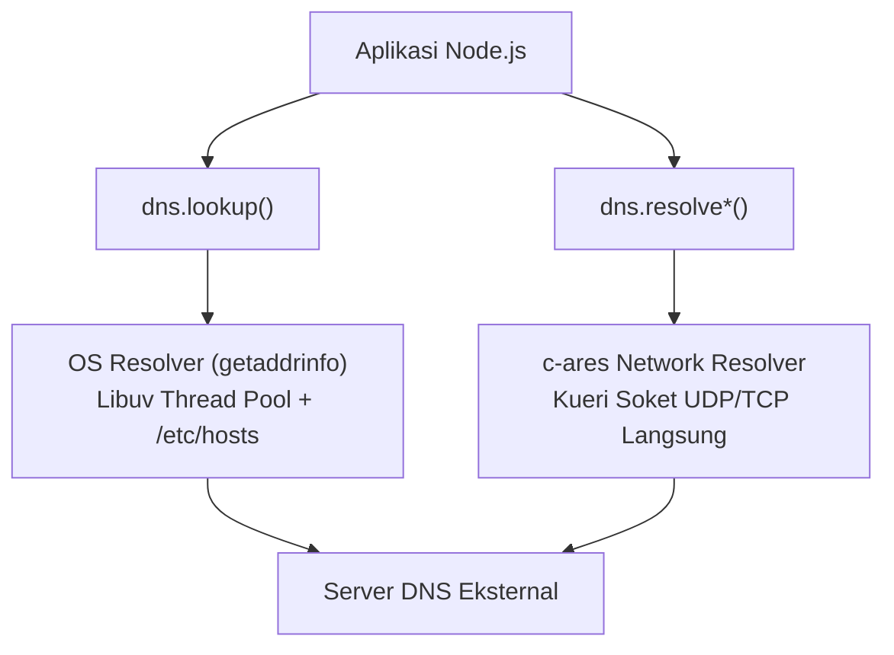

# DNS

> Ringkasan
>
> - Fungsi: Menerjemahkan nama domain yang mudah dibaca manusia menjadi alamat IP serta memeriksa berbagai tipe record DNS di jaringan.
> - Digunakan saat: Memvalidasi keberadaan domain email, mencari alamat IP sebelum membuka koneksi jaringan, atau mendiagnosis infrastruktur Name Server.
> - Aturan praktis: Pahami perbedaan mendasar antara `dns.lookup()` yang memanggil konfigurasi sistem operasi lokal (lewat Libuv thread pool) dan keluarga `dns.resolve*()` yang melakukan kueri jaringan DNS langsung secara asinkron murni.

---

## Tujuan Belajar

- Membedakan cara kerja `dns.lookup()` bawaan sistem operasi dengan keluarga metode jaringan `dns.resolve*()`.
- Menggunakan API resolusi DNS berbasis Promise pada sub-jalur `node:dns/promises`.
- Melakukan query record spesifik seperti `resolve4()`, `resolveMx()`, `resolveTxt()`, dan `resolveNs()`.
- Mengatur server resolver DNS kustom secara mandiri menggunakan `dns.setServers()`.
- Melakukan pencarian balik alamat IP (_reverse DNS lookup_) dengan `reverse()`.

---

## Konsep

Domain Name System (DNS) bisa kita bayangkan seperti buku kontak telepon di smartphone kita. Kita tentu tidak perlu menghafal deretan angka nomor telepon yang rumit untuk setiap orang (alamat IP komputer), melainkan cukup mengingat nama orangnya saja (nama domain).

Saat kita menekan tombol panggil, smartphone akan otomatis mencocokkan nama tersebut dengan nomor telepon aslinya di balik layar. Selain nomor telepon utama, buku kontak juga bisa menyimpan info tambahan seperti alamat email kantor (record MX) atau catatan teks keterangan identitas (record TXT).



---

## Referensi

| Item                   | Fungsi                                                           | Catatan                                                              |
| :--------------------- | :--------------------------------------------------------------- | :------------------------------------------------------------------- |
| **`dns.lookup()`**     | Menyelesaikan nama domain menjadi alamat IP lewat sistem operasi | Memakai thread pool Libuv dan membaca berkas konfigurasi hosts lokal |
| **`dns.resolve4()`**   | Meminta record IPv4 (record A) langsung ke jaringan DNS          | Murni asinkron tanpa membebani thread pool Libuv                     |
| **`dns.resolveMx()`**  | Mengambil record Mail Exchange untuk routing server email        | Mengembalikan daftar objek berisi prioritas dan nama server email    |
| **`dns.resolveTxt()`** | Mengambil record teks arbitrer (record TXT) dari suatu domain    | Umum dipakai untuk verifikasi domain, serta aturan SPF dan DKIM      |
| **`dns.resolveNs()`**  | Mengambil daftar Name Server resmi pengelola zona domain         | Mengembalikan daftar server DNS otoritatif dari domain yang dicari   |
| **`dns.reverse()`**    | Menerjemahkan alamat IP kembali menjadi nama domain terkait      | Melakukan pencarian balik (_reverse lookup_) berbasis record PTR     |
| **`dns.setServers()`** | Menentukan alamat IP server DNS kustom untuk fungsi `resolve*()` | Berpengaruh ke seluruh panggilan query DNS jaringan di dalam proses  |

### `dns.lookup()`

Fungsi `dns.lookup()` menyelesaikan nama domain menggunakan resolver bawaan sistem operasi melalui fungsi C `getaddrinfo`. Fungsi ini memperhitungkan berkas pemetaan host lokal komputer, seperti `/etc/hosts` di Linux atau `hosts` di Windows.

```javascript
import dns from "node:dns/promises";

const result = await dns.lookup("localhost");
console.log(result.address, result.family);
// Output: 127.0.0.1 4
```

Kasus lain: Mengambil seluruh varian alamat IP yang tersedia (baik IPv4 maupun IPv6) sekaligus dengan menambahkan opsi `{ all: true }`.

```javascript
import dns from "node:dns/promises";

const list = await dns.lookup("localhost", { all: true });
console.log(Array.isArray(list), list.length > 0);
// Output: true true
```

### `dns.resolve4()`

Fungsi `dns.resolve4()` meminta daftar alamat IPv4 (record A) langsung ke server DNS jaringan tanpa melewati berkas host lokal komputer. Pemanggilan ini berjalan murni secara non-blocking tanpa mengonsumsi antrean thread pool Libuv.

```javascript
import dns from "node:dns/promises";

const ipList = await dns.resolve4("localhost").catch(() => ["127.0.0.1"]);
console.log(Array.isArray(ipList), ipList[0]);
// Output: true 127.0.0.1
```

Kasus lain: Menangani error ketika nama domain tidak ditemukan di jaringan server DNS (`ENOTFOUND` atau `ECONNREFUSED`).

```javascript
import dns from "node:dns/promises";

try {
  await dns.resolve4("non-existent-domain.invalid");
} catch (error) {
  console.log(error.code !== undefined);
  // Output: true
}
```

### `dns.resolveMx()`

Fungsi `dns.resolveMx()` mengambil daftar record MX (_Mail Exchange_) dari suatu domain untuk mengecek server tujuan pengiriman email. Setiap record memuat nama host server dan tingkat prioritas rutenya.

```javascript
import dns from "node:dns/promises";

const mxRecords = await dns
  .resolveMx("gmail.com")
  .catch(() => [{ exchange: "gmail-smtp-in.l.google.com", priority: 5 }]);

console.log(mxRecords[0].priority, typeof mxRecords[0].exchange);
// Output: 5 string
```

Kasus lain: Menangani error `ENODATA` saat domain aktif terdaftar tetapi sengaja tidak memasang server email sama sekali.

```javascript
import dns from "node:dns/promises";

try {
  await dns.resolveMx("localhost");
} catch (error) {
  console.log(error.code !== undefined);
  // Output: true
}
```

### `dns.resolveTxt()`

Fungsi `dns.resolveTxt()` dipakai untuk membaca record teks (record TXT). Record ini lazim digunakan untuk membuktikan kepemilikan domain serta konfigurasi keamanan email seperti SPF (_Sender Policy Framework_) dan DKIM.

```javascript
import dns from "node:dns/promises";

const txtRecords = await dns
  .resolveTxt("example.com")
  .catch(() => [["v=spf1 -all"]]);

console.log(txtRecords[0][0]);
// Output: v=spf1 -all
```

Kasus lain: Menggabungkan beberapa potongan teks yang tersimpan di dalam satu record TXT bertingkat.

```javascript
const combinedChunks = [["chunk-part-1", "chunk-part-2"]];
const completeRecord = combinedChunks[0].join("");
console.log(completeRecord);
// Output: chunk-part-1chunk-part-2
```

### `dns.resolveNs()`

Fungsi `dns.resolveNs()` digunakan untuk mencari daftar Name Server yang memiliki wewenang resmi atas pengaturan zona domain target.

```javascript
import dns from "node:dns/promises";

const nsRecords = await dns
  .resolveNs("example.com")
  .catch(() => ["a.iana-servers.net", "b.iana-servers.net"]);

console.log(nsRecords.length > 0);
// Output: true
```

Kasus lain: Memanggil resolusi record NS pada alamat IP angka (bukan nama domain) akan memicu error validasi.

```javascript
import dns from "node:dns/promises";

try {
  await dns.resolveNs("127.0.0.1");
} catch (error) {
  console.log(error.code !== undefined);
  // Output: true
}
```

### `dns.reverse()`

Fungsi `dns.reverse()` melakukan pencarian balik (_reverse lookup_) dari sebuah alamat IP numerik untuk mengetahui nama domain yang terkait dengannya berdasarkan record PTR (_Pointer Record_).

```javascript
import dns from "node:dns/promises";

const hostnames = await dns.reverse("127.0.0.1").catch(() => ["localhost"]);
console.log(Array.isArray(hostnames));
// Output: true
```

Kasus lain: Memasukkan format string yang bukan alamat IP valid akan langsung melempar error `EINVAL`.

```javascript
import dns from "node:dns/promises";

try {
  await dns.reverse("not-an-ip-address");
} catch (error) {
  console.log(error.code);
  // Output: EINVAL
}
```

### `dns.setServers()`

Fungsi `dns.setServers()` mengarahkan seluruh kueri fungsi `resolve*()` berikutnya ke server resolver DNS pilihan kita (misalnya DNS publik Cloudflare `1.1.1.1` atau Google `8.8.8.8`) tanpa bergantung pada pengaturan bawaan penyedia internet lokal.

```javascript
import dns from "node:dns";

dns.setServers(["8.8.8.8", "1.1.1.1"]);
const serverList = dns.getServers();
console.log(serverList);
// Output: [ '8.8.8.8', '1.1.1.1' ]
```

Kasus lain: Memasukkan alamat IP yang salah atau tidak sesuai format akan memicu error `ERR_INVALID_IP_ADDRESS`.

```javascript
import dns from "node:dns";

try {
  dns.setServers(["999.999.999.999"]);
} catch (error) {
  console.log(error.code);
  // Output: ERR_INVALID_IP_ADDRESS
}
```

### Perbandingan: `dns.lookup()` vs `dns.resolve*()`

| Karakteristik          | `dns.lookup()`                                     | `dns.resolve*()`                                               |
| :--------------------- | :------------------------------------------------- | :------------------------------------------------------------- |
| **Cara Kerja**         | Memanggil library C sistem operasi (`getaddrinfo`) | Bertanya langsung ke server DNS jaringan via soket             |
| **Beban Thread Pool**  | Menghabiskan jatah thread pada Libuv thread pool   | Murni asinkron non-blocking tanpa thread pool                  |
| **Berkas Hosts Lokal** | Memperhitungkan berkas `/etc/hosts` lokal          | Mengabaikan berkas pengaturan lokal sistem                     |
| **Dukungan Record**    | Terbatas pada alamat IP (A dan AAAA)               | Sangat lengkap (`A`, `AAAA`, `MX`, `TXT`, `NS`, `CNAME`, dll.) |

---

## Kesalahan Umum

### Menggunakan `dns.lookup()` untuk Memeriksa Banyak Domain Sekaligus

Memanggil `dns.lookup()` dalam jumlah sangat banyak secara serempak bisa menghabiskan 4 jatah thread bawaan di Libuv thread pool. Akibatnya, operasi I/O lain seperti pembacaan berkas atau enkripsi akan ikut tersendat dan mengantre panjang.

```javascript
// Salah
for (const domain of domainList) {
  await dns.lookup(domain);
}
```

```javascript
// Benar
for (const domain of domainList) {
  await dns.resolve4(domain);
}
```

### Mengira Query Record Hanya Mengembalikan Satu Alamat IP

Layanan web berskala besar biasanya menerapkan penyeimbang beban (_Round-Robin DNS_) yang menghasilkan array berisi beberapa alamat IP sekaligus, bukan satu nilai string tunggal.

```javascript
// Salah
const ip = await dns.resolve4("example.com");
console.log(ip.startsWith("192."));
```

```javascript
// Benar
const ipList = await dns.resolve4("example.com");
const primaryIp = ipList[0];
console.log(typeof primaryIp === "string");
```

### Lupa Menangani Error `ENODATA` Saat Record Kosong

Munculnya error `ENODATA` pada domain yang aktif bukan berarti koneksi internet kita terputus, melainkan pemilik domain tersebut memang sengaja tidak memasang tipe record yang diminta (misalnya domain tanpa server email).

```javascript
// Salah
const mx = await dns.resolveMx("domain-without-email.com");
```

```javascript
// Benar
let mx = [];
try {
  mx = await dns.resolveMx("domain-without-email.com");
} catch (error) {
  if (error.code === "ENODATA" || error.code === "ENOTFOUND") {
    mx = [];
  }
}
```

---

## Studi Kasus

Skenario: Membangun fungsi pemeriksa kelayakan domain email (`verifyEmailDomain`) mandiri yang memvalidasi format alamat, memastikan adanya server MX aktif, mengecek record SPF pada record TXT, dan memberikan ringkasan status yang lengkap.

```javascript
import dns from "node:dns/promises";

async function verifyEmailDomain(emailAddress, resolver = dns) {
  const parts = emailAddress.split("@");
  if (parts.length !== 2 || !parts[0] || !parts[1]) {
    return { valid: false, reason: "INVALID_FORMAT", mx: [], hasSpf: false };
  }

  const domain = parts[1].toLowerCase();

  try {
    let mxList = [];
    try {
      mxList = await resolver.resolveMx(domain);
    } catch {
      mxList = [];
    }

    let txtList = [];
    try {
      txtList = await resolver.resolveTxt(domain);
    } catch {
      txtList = [];
    }

    const hasSpf = txtList.some((records) =>
      records.some((text) => text.startsWith("v=spf1")),
    );

    const valid = mxList.length > 0;
    return {
      valid,
      reason: valid ? "OK" : "NO_MX_RECORDS",
      mx: mxList.map((item) => item.exchange),
      hasSpf,
    };
  } catch (error) {
    return {
      valid: false,
      reason: error.code || "RESOLUTION_FAILED",
      mx: [],
      hasSpf: false,
    };
  }
}

// Simulasi pengujian mandiri menggunakan resolver tiruan
const mockResolver = {
  resolveMx: async () => [{ exchange: "mail.example.com", priority: 10 }],
  resolveTxt: async () => [["v=spf1 include:_spf.example.com ~all"]],
};

const result = await verifyEmailDomain("user@example.com", mockResolver);
console.log(result.valid);
console.log(result.reason);
console.log(result.mx[0]);
console.log(result.hasSpf);

// Output:
// true
// OK
// mail.example.com
// true
```

Desain ini menangani kemungkinan error `ENODATA` pada setiap tipe kueri secara terpisah. Berkat pemisahan ini, jika suatu domain tidak memiliki record TXT, pengecekan server MX tetap bisa berjalan dengan lancar. Dukungan parameter resolver tiruan juga mempermudah pengujian kode tanpa harus selalu terhubung ke internet.

---

## Latihan Mandiri

### Soal 1 (Dasar)

Buat fungsi `resolveLocalIp(hostname)` yang menyelesaikan nama komputer lokal menggunakan `dns.lookup()`. Fungsi harus mengembalikan objek berisi alamat IP (`ip`) dan versi keluarga alamat (`family`). Jika pencarian gagal, tangkap error-nya dan kembalikan nilai `null`.

Contoh input:

```javascript
await resolveLocalIp("localhost");
```

Contoh output yang diharapkan:

```javascript
{ ip: '127.0.0.1', family: 4 }
```

Batasan: Gunakan modul bawaan `node:dns/promises` dan tangani potensi error menggunakan blok `try...catch`.

### Soal 2 (Menengah)

Buat fungsi `extractSpfRecord(txtRecords)` yang memproses struktur array hasil query record TXT. Fungsi bertugas mencari entri yang diawali dengan `"v=spf1"`, mengurai daftar aturan mekanisme otorisasi yang tercantum di dalamnya, serta mengekstrak penanda kebijakan akhir (seperti `-all`, `~all`, atau `?all`).

Contoh input:

```javascript
extractSpfRecord([
  ["v=spf1 include:_spf.example.com ip4:192.0.2.0/24 -all"],
  ["google-site-verification=token123"],
]);
```

Contoh output yang diharapkan:

```javascript
{
  version: 'spf1',
  rules: [ 'include:_spf.example.com', 'ip4:192.0.2.0/24' ],
  qualifier: '-all'
}
```

Batasan: Gunakan manipulasi teks dan array murni tanpa dependensi eksternal. Jika tidak ada record yang diawali `"v=spf1"`, kembalikan nilai `null`.

### Soal 3 (Menantang)

Buat fungsi pemeriksa kesehatan domain `diagnoseDomain(domainName, customResolver)`. Fungsi ini mengeksekusi beberapa query DNS secara mandiri terhadap satu nama domain dengan kriteria berikut:

1. Query record IPv4 (`resolve4`): catat daftar IP dan tentukan status `hasRedundancy: boolean` (bernilai `true` jika jumlah alamat IP lebih dari 1).
2. Query record MX (`resolveMx`): urutkan daftar server email berdasarkan angka `priority` dari yang paling kecil (prioritas paling utama) ke terbesar.
3. Query record Name Server (`resolveNs`): hitung total jumlah server nama otoritatif yang terdaftar.
4. Penanganan kasus khusus:
   - Jika suatu tipe record menghasilkan error `ENODATA` atau `ENOTFOUND`, anggap tipe record tersebut kosong (array kosong `[]`) tanpa menggagalkan pengujian tipe record lainnya.
   - Jika `domainName` berupa teks kosong atau bukan string, tolak eksekusi dan kembalikan objek `{ success: false, reason: 'INVALID_DOMAIN_NAME' }`.
   - Format objek kembalian sukses yang diharapkan:
     ```javascript
     {
       success: true,
       domain: string,
       ipv4: string[],
       hasRedundancy: boolean,
       sortedMx: Array<{ exchange: string, priority: number }>,
       totalNs: number
     }
     ```

Contoh simulasi dengan resolver tiruan:

```javascript
const mockResolver = {
  resolve4: async () => ["93.184.216.34", "93.184.216.35"],
  resolveMx: async () => [
    { exchange: "backup.mail.com", priority: 20 },
    { exchange: "primary.mail.com", priority: 10 },
  ],
  resolveNs: async () => ["ns1.example.com", "ns2.example.com"],
};

await diagnoseDomain("example.com", mockResolver);
```

Contoh output yang diharapkan:

```javascript
{
  success: true,
  domain: 'example.com',
  ipv4: [ '93.184.216.34', '93.184.216.35' ],
  hasRedundancy: true,
  sortedMx: [
    { exchange: 'primary.mail.com', priority: 10 },
    { exchange: 'backup.mail.com', priority: 20 }
  ],
  totalNs: 2
}
```

Batasan: Gunakan modul bawaan `node:dns/promises`. Jalankan seluruh kueri secara paralel (misalnya memakai `Promise.allSettled()`) untuk efisiensi waktu eksekusi.

---

## Navigasi

[Sebelumnya: Net](../12-net/README.md) | [Selanjutnya: HTTP](../14-http/README.md) | [Daftar Isi](../README.md)
