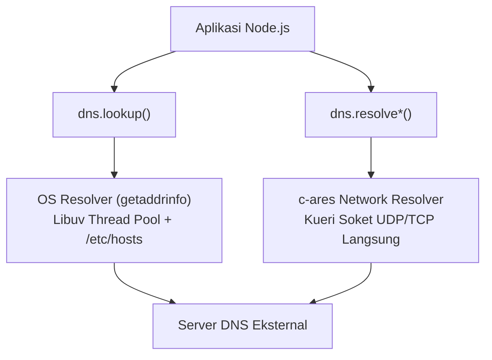

# DNS

> Ringkasan
>
> - Fungsi: Menerjemahkan nama domain yang ramah manusia menjadi alamat IP serta menginspeksi berbagai tipe rekaman DNS jaringan.
> - Digunakan saat: Validasi keberadaan domain surel, resolusi alamat host sebelum membuka koneksi jaringan, atau diagnosa infrastruktur nama server.
> - Aturan praktis: Pahami perbedaan mendasar antara `dns.lookup()` yang memanggil konfigurasi sistem operasi lokal melalui thread pool Libuv dan `dns.resolve*()` yang melakukan kueri jaringan DNS langsung secara asinkron murni.

---

## Tujuan Belajar

- Membedakan mekanisme kerja `dns.lookup()` berbasis sistem operasi dengan keluarga metode jaringan `dns.resolve*()`.
- Menggunakan API resolusi DNS berbasis Promise pada sub-jalur `node:dns/promises`.
- Melakukan kueri rekaman spesifik seperti `resolve4()`, `resolveMx()`, `resolveTxt()`, dan `resolveNs()`.
- Mengonfigurasi resolver server nama DNS khusus secara terprogram menggunakan `dns.setServers()`.
- Menerapkan pencarian balik alamat IP (*reverse DNS lookup*) dengan `reverse()`.

---

## Konsep

> Domain Name System (DNS) dianalogikan seperti buku kontak telepon pada ponsel pintar. Pengguna tidak perlu menghafal deretan angka nomor telepon yang rumit (alamat IP mesin), melainkan cukup mengingat nama pemilik kontak (nama domain). Saat panggilan dimulai, aplikasi buku kontak secara otomatis mencocokkan nama dengan nomor aslinya. Selain nomor utama, buku kontak juga dapat menyimpan catatan tambahan seperti alamat surel kantor (rekaman MX) atau catatan teks keterangan identitas (rekaman TXT).



---

## Referensi

| Item | Fungsi | Catatan |
| :--- | :----- | :------ |
| **`dns.lookup()`** | Menerjemahkan nama host menjadi alamat IP via sistem operasi | Menggunakan thread pool Libuv dan membaca berkas konfigurasi host lokal |
| **`dns.resolve4()`** | Melakukan kueri rekaman IPv4 (rekaman A) langsung ke jaringan | Berjalan murni asinkron tanpa membebani Libuv thread pool |
| **`dns.resolveMx()`** | Mengambil rekaman Mail Exchange untuk penanganan perutean surel | Mengembalikan daftar objek berisi nilai prioritas dan nama host pertukaran |
| **`dns.resolveTxt()`** | Mengambil rekaman teks arbitrer (rekaman TXT) dari suatu domain | Umum digunakan untuk verifikasi kepemilikan domain, SPF, dan DKIM |
| **`dns.resolveNs()`** | Mengambil rekaman Name Server otoritatif pengelola zona domain | Mengembalikan daftar nama server DNS induk dari domain target |
| **`dns.reverse()`** | Menerjemahkan alamat IP kembali menjadi daftar nama domain | Melakukan pencarian balik (*reverse lookup*) berbasis rekaman PTR |
| **`dns.setServers()`** | Menentukan daftar IP resolver DNS kustom untuk seluruh `resolve*()` | Mempengaruhi seluruh panggilan kueri jaringan DNS berikutnya dalam proses |

### `dns.lookup()`

Fungsi `dns.lookup()` digunakan untuk menyelesaikan nama domain menggunakan resolver bawaan sistem operasi melalui panggilan C `getaddrinfo`. Fungsi ini memperhitungkan berkas pemetaan host lokal seperti `/etc/hosts` di Linux atau `hosts` di Windows.

```javascript
import dns from "node:dns/promises";

const hasil = await dns.lookup("localhost");
console.log(hasil.address, hasil.family);
// Output: 127.0.0.1 4
```

Kasus lain: Mengambil seluruh varian alamat IP yang tersedia (IPv4 dan IPv6) sekaligus dengan menambahkan opsi `all: true`.

```javascript
import dns from "node:dns/promises";

const daftar = await dns.lookup("localhost", { all: true });
console.log(Array.isArray(daftar), daftar.length > 0);
// Output: true true
```

### `dns.resolve4()`

Fungsi `dns.resolve4()` digunakan untuk meminta daftar alamat IPv4 (rekaman A) langsung ke server DNS jaringan tanpa melewati konfigurasi host lokal sistem operasi. Pemanggilan ini tidak mengonsumsi antrean thread pool Libuv.

```javascript
import dns from "node:dns/promises";

const ipList = await dns.resolve4("localhost").catch(() => ["127.0.0.1"]);
console.log(Array.isArray(ipList), ipList[0]);
// Output: true 127.0.0.1
```

Kasus lain: Menangani galat saat nama domain tidak ditemukan di server DNS jaringan (`ENOTFOUND` atau `ECONNREFUSED`).

```javascript
import dns from "node:dns/promises";

try {
  await dns.resolve4("domain-palsu-tidak-nyata.invalid");
} catch (error) {
  console.log(error.code !== undefined);
  // Output: true
}
```

### `dns.resolveMx()`

Fungsi `dns.resolveMx()` digunakan untuk mengambil daftar rekaman MX (*Mail Exchange*) dari suatu domain guna memvalidasi tujuan server pengiriman surel. Setiap rekaman memuat nama host server dan tingkat prioritas rute.

```javascript
import dns from "node:dns/promises";

const mxRecords = await dns.resolveMx("gmail.com").catch(() => [
  { exchange: "gmail-smtp-in.l.google.com", priority: 5 },
]);

console.log(mxRecords[0].priority, typeof mxRecords[0].exchange);
// Output: 5 string
```

Kasus lain: Menangani galat `ENODATA` ketika domain terdaftar aktif tetapi tidak mengonfigurasikan rekaman server surel.

```javascript
import dns from "node:dns/promises";

try {
  await dns.resolveMx("localhost");
} catch (error) {
  console.log(error.code !== undefined);
  // Output: true
}
```

### `dns.resolveTxt()`

Fungsi `dns.resolveTxt()` digunakan untuk membaca rekaman teks (rekaman TXT) yang sering dimanfaatkan untuk validasi kepemilikan domain serta keamanan surel seperti SPF (*Sender Policy Framework*) dan DKIM.

```javascript
import dns from "node:dns/promises";

const txtRecords = await dns.resolveTxt("example.com").catch(() => [
  ["v=spf1 -all"],
]);

console.log(txtRecords[0][0]);
// Output: v=spf1 -all
```

Kasus lain: Menangani domain yang memuat beberapa baris fragmen rekaman teks sekaligus di dalam satu zona rekaman TXT.

```javascript
const fragmenGabungan = [["fragmen-bagian-1", "fragmen-bagian-2"]];
const barisUtuh = fragmenGabungan[0].join("");
console.log(barisUtuh);
// Output: fragmen-bagian-1fragmen-bagian-2
```

### `dns.resolveNs()`

Fungsi `dns.resolveNs()` digunakan untuk mendapatkan daftar Name Server yang memiliki otoritas resmi atas pengelolaan zona konfigurasi domain yang bersangkutan.

```javascript
import dns from "node:dns/promises";

const nsRecords = await dns.resolveNs("example.com").catch(() => [
  "a.iana-servers.net",
  "b.iana-servers.net",
]);

console.log(nsRecords.length > 0);
// Output: true
```

Kasus lain: Menangani galat saat memanggil resolusi rekaman NS pada alamat IP numerik mentah alih-alih nama domain.

```javascript
import dns from "node:dns/promises";

try {
  await dns.resolveNs("127.0.0.1");
} catch (error) {
  console.log(error.code !== undefined);
  // Output: true
}
```

### `dns.reverse()`

Fungsi `dns.reverse()` digunakan untuk melakukan pencarian balik (*reverse lookup*) dari alamat IP numerik ke nama domain terkait berdasarkan rekaman PTR (*Pointer Record*).

```javascript
import dns from "node:dns/promises";

const hostnames = await dns.reverse("127.0.0.1").catch(() => ["localhost"]);
console.log(Array.isArray(hostnames));
// Output: true
```

Kasus lain: Melempar galat `EINVAL` ketika parameter alamat IP yang dimasukkan memiliki format string yang tidak valid.

```javascript
import dns from "node:dns/promises";

try {
  await dns.reverse("bukan-alamat-ip");
} catch (error) {
  console.log(error.code);
  // Output: EINVAL
}
```

### `dns.setServers()`

Fungsi `dns.setServers()` digunakan untuk mengarahkan seluruh kueri jaringan `resolve*()` berikutnya ke server resolver DNS kustom (seperti DNS publik Google atau Cloudflare) tanpa terikat pada resolver penyedia internet lokal.

```javascript
import dns from "node:dns";

dns.setServers(["8.8.8.8", "1.1.1.1"]);
const daftarServer = dns.getServers();
console.log(daftarServer);
// Output: [ '8.8.8.8', '1.1.1.1' ]
```

Kasus lain: Memasukkan string alamat IP yang tidak valid melempar galat `ERR_INVALID_IP_ADDRESS`.

```javascript
import dns from "node:dns";

try {
  dns.setServers(["999.999.999.999"]);
} catch (error) {
  console.log(error.code);
  // Output: ERR_INVALID_IP_ADDRESS
}
```

### Perbandingan: `dns.lookup()` vs `dns.resolve*()`

| Karakteristik | `dns.lookup()` | `dns.resolve*()` |
| :--- | :--- | :--- |
| **Mekanisme Eksekusi** | Memanggil pustaka C sistem operasi (`getaddrinfo`) | Melakukan kueri soket jaringan langsung ke resolver DNS |
| **Penggunaan Thread Pool** | Mengonsumsi thread pekerja pada Libuv thread pool | Murni asinkron non-blocking tanpa thread pool |
| **Pengaruh Berkas Hosts** | Membaca konfigurasi berkas `/etc/hosts` lokal | Mengabaikan berkas konfigurasi lokal sistem |
| **Jenis Rekaman** | Terbatas pada alamat IP host (A dan AAAA) | Lengkap (`A`, `AAAA`, `MX`, `TXT`, `NS`, `CNAME`, `SRV`) |

---

## Kesalahan Umum

### Memakai `dns.lookup()` untuk Resolusi Massal Bersamaan

Pemanggilan `dns.lookup()` dalam jumlah besar secara serempak dapat memenuhi kuota default 4 thread pada Libuv thread pool sehingga memblokir tugas I/O sistem berkas dan kriptografi.

```javascript
// Salah
for (const domain of daftarDomain) {
  await dns.lookup(domain);
}
```

```javascript
// Benar
for (const domain of daftarDomain) {
  await dns.resolve4(domain);
}
```

### Mengasumsikan Kueri Rekaman Mengembalikan Tepat Satu Alamat IP

Layanan berskala besar umumnya menerapkan mekanisme penyeimbang beban DNS (*Round-Robin*) yang mengembalikan larik berisi beberapa alamat IP berbeda sekaligus.

```javascript
// Salah
const ip = await dns.resolve4("contoh.com");
console.log(ip.startsWith("192."));
```

```javascript
// Benar
const ipList = await dns.resolve4("contoh.com");
const ipUtama = ipList[0];
console.log(typeof ipUtama === "string");
```

### Mengabaikan Penanganan Galat `ENODATA` saat Rekaman Kosong

Ketiadaan rekaman tipe tertentu pada domain yang aktif bukan berarti jaringan rusak, melainkan domain tersebut memang tidak mempublikasikan tipe rekaman terkait.

```javascript
// Salah
const mx = await dns.resolveMx("domain-tanpa-email.com");
```

```javascript
// Benar
let mx = [];
try {
  mx = await dns.resolveMx("domain-tanpa-email.com");
} catch (error) {
  if (error.code === "ENODATA" || error.code === "ENOTFOUND") {
    mx = [];
  }
}
```

---

## Studi Kasus

Skenario: Membangun fungsi pemeriksa dan validasi konfigurasi domain surel (`periksaDomainSurel`) mandiri yang memvalidasi format sintaksis alamat, memverifikasi ketersediaan server MX, mengekstrak rekaman SPF dari rekaman TXT, dan mengembalikan status keabsahan secara komprehensif.

```javascript
import dns from "node:dns/promises";

async function periksaDomainSurel(alamatSurel, penyediaResolver = dns) {
  const bagian = alamatSurel.split("@");
  if (bagian.length !== 2 || !bagian[0] || !bagian[1]) {
    return { valid: false, alasan: "FORMAT_TIDAK_VALID", mx: [], punyaSpf: false };
  }

  const domain = bagian[1].toLowerCase();

  try {
    let mxList = [];
    try {
      mxList = await penyediaResolver.resolveMx(domain);
    } catch {
      mxList = [];
    }

    let txtList = [];
    try {
      txtList = await penyediaResolver.resolveTxt(domain);
    } catch {
      txtList = [];
    }

    const punyaSpf = txtList.some((baris) =>
      baris.some((teks) => teks.startsWith("v=spf1"))
    );

    const valid = mxList.length > 0;
    return {
      valid,
      alasan: valid ? "OK" : "TIDAK_ADA_MX",
      mx: mxList.map((m) => m.exchange),
      punyaSpf,
    };
  } catch (error) {
    return { valid: false, alasan: error.code || "RESOLUSI_GAGAL", mx: [], punyaSpf: false };
  }
}

// Pengujian mandiri menggunakan resolver tiruan teruji
const resolverTiruan = {
  resolveMx: async () => [{ exchange: "mail.contoh.com", priority: 10 }],
  resolveTxt: async () => [["v=spf1 include:_spf.contoh.com ~all"]],
};

const hasil = await periksaDomainSurel("pengguna@contoh.com", resolverTiruan);
console.log(hasil.valid);
console.log(hasil.alasan);
console.log(hasil.mx[0]);
console.log(hasil.punyaSpf);

// Output:
// true
// OK
// mail.contoh.com
// true
```

Desain ini dipilih karena mengisolasi penanganan galat `ENODATA` pada masing-masing tipe kueri secara independen sehingga kegagalan satu rekaman tidak mematikan evaluasi rekaman lainnya, serta menyediakan antarmuka injeksi dependensi resolver untuk memfasilitasi pengujian unit yang konsisten.

---

## Latihan Mandiri

### Soal 1 (Dasar)

Buat fungsi `ambilIpLokal(namaHost)` yang menyelesaikan nama host menggunakan `dns.lookup()`. Fungsi harus mengembalikan objek berisi alamat IP (`ip`) dan versi keluarga alamat (`versi`). Jika resolusi gagal, fungsi harus menangkap galat dan mengembalikan nilai `null`.

Contoh masukan:

```javascript
await ambilIpLokal("localhost");
```

Contoh keluaran yang diharapkan:

```javascript
{ ip: '127.0.0.1', versi: 4 }
```

Batasan: Gunakan modul bawaan `node:dns/promises`. Pastikan penanganan galat menggunakan blok `try...catch`.

### Soal 2 (Menengah)

Buat fungsi `ekstrakDomainSpf(daftarTxt)` yang memproses struktur data array hasil pembacaan rekaman TXT. Fungsi wajib menyaring rekaman yang diawali dengan `"v=spf1"`, memisahkan aturan-aturan mekanisme otorisasi yang ada di dalamnya, dan mengekstrak penentu kebijakan akhir (seperti `-all`, `~all`, atau `?all`).

Contoh masukan:

```javascript
ekstrakDomainSpf([
  ["v=spf1 include:_spf.contoh.com ip4:192.0.2.0/24 -all"],
  ["google-site-verification=token123"]
]);
```

Contoh keluaran yang diharapkan:

```javascript
{
  versi: 'spf1',
  aturan: [ 'include:_spf.contoh.com', 'ip4:192.0.2.0/24' ],
  penentu: '-all'
}
```

Batasan: Gunakan manipulasi string dan larik murni tanpa modul pihak ketiga. Jika tidak ditemukan rekaman yang diawali `"v=spf1"`, kembalikan nilai `null`.

### Soal 3 (Menantang)

Buat fungsi auditor kesehatan konfigurasi jaringan domain `diagnosaDomain(namaDomain, resolverKustom)`. Fungsi ini mengeksekusi kueri multi-rekaman secara independen terhadap satu nama domain dengan ketentuan berikut:

1. Kueri rekaman IPv4 (`resolve4`): catat daftar IP dan tentukan properti `adaRedundansi: boolean` (bernilai `true` jika jumlah alamat IP lebih dari 1).
2. Kueri rekaman MX (`resolveMx`): urutkan daftar server surel berdasarkan nilai `priority` dari yang paling kecil (prioritas utama) ke terbesar.
3. Kueri rekaman Name Server (`resolveNs`): catat jumlah total server nama otoritatif yang terdaftar.
4. Ketentuan penanganan kasus tepi:
   - Jika suatu tipe rekaman melempar galat `ENODATA` atau `ENOTFOUND`, anggap tipe rekaman tersebut kosong (larik kosong `[]`) tanpa menggagalkan pengujian tipe rekaman lainnya.
   - Jika `namaDomain` berupa string kosong atau bukan tipe data string, tolak eksekusi dan kembalikan objek `{ sukses: false, alasan: 'NAMA_DOMAIN_TIDAK_VALID' }`.
   - Hasil keluaran sukses harus memuat struktur ringkasan terpadu:
     ```javascript
     {
       sukses: true,
       domain: string,
       ipv4: string[],
       adaRedundansi: boolean,
       mxTerurut: Array<{ exchange: string, priority: number }>,
       totalNs: number
     }
     ```

Contoh interaksi dengan penyedia resolver tiruan:

```javascript
const resolver = {
  resolve4: async () => ["93.184.216.34", "93.184.216.35"],
  resolveMx: async () => [
    { exchange: "backup.mail.com", priority: 20 },
    { exchange: "utama.mail.com", priority: 10 }
  ],
  resolveNs: async () => ["ns1.contoh.com", "ns2.contoh.com"]
};

await diagnosaDomain("contoh.com", resolver);
```

Contoh keluaran yang diharapkan:

```javascript
{
  sukses: true,
  domain: 'contoh.com',
  ipv4: [ '93.184.216.34', '93.184.216.35' ],
  adaRedundansi: true,
  mxTerurut: [
    { exchange: 'utama.mail.com', priority: 10 },
    { exchange: 'backup.mail.com', priority: 20 }
  ],
  totalNs: 2
}
```

Batasan: Gunakan modul bawaan `node:dns/promises` dan pastikan eksekusi kueri antar rekaman berjalan secara paralel (misal menggunakan `Promise.allSettled()`) untuk performa maksimal.

---

## Navigasi

[Sebelumnya: Net](../12-net/README.md) | [Selanjutnya: HTTP](../14-http/README.md) | [Daftar Isi](../README.md)
