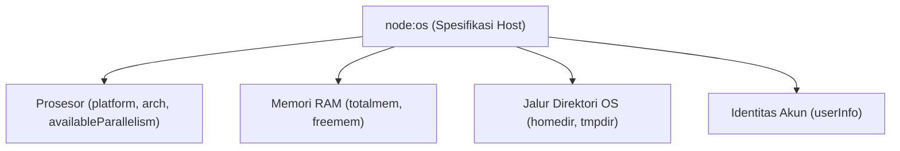

# OS

> Ringkasan
> - Tingkat: Pendukung
> - Fungsi: Menyediakan API untuk membaca informasi perangkat keras dan sistem operasi host tempat runtime Node.js berjalan.
> - Digunakan saat: Mengonfigurasi jumlah worker paralel, memantau penggunaan RAM fisik host, menentukan lokasi folder temporary, dan logging metadata server.
> - Aturan praktis: Gunakan `os.availableParallelism()` daripada `os.cpus().length` untuk mendeteksi alokasi core CPU yang akurat di dalam container Docker.

## Cheat Sheet

| Tugas | Kode |
| :--- | :--- |
| Membaca nama platform sistem operasi | `os.platform();` |
| Membaca jenis arsitektur CPU | `os.arch();` |
| Mengetahui kuota core CPU yang tersedia | `os.availableParallelism();` |
| Membaca total kapasitas memori RAM fisik | `os.totalmem();` |
| Membaca sisa memori RAM yang masih bebas | `os.freemem();` |
| Mengambil path direktori home pengguna | `os.homedir();` |
| Mengambil path direktori temporary sistem | `os.tmpdir();` |
| Menginspeksi profil pengguna sistem aktif | `os.userInfo();` |

## Tujuan Belajar

- Mengidentifikasi platform sistem operasi dan arsitektur hardware host.
- Menentukan batas konkurensi pemrosesan berbasis CPU memakai `os.availableParallelism()`.
- Menghitung kapasitas dan persentase konsumsi memori fisik RAM server.
- Mengakses path sistem penting seperti direktori temporary dan direktori home pengguna.

## Konsep

Bayangkan server komputer seperti sebuah gedung pabrik fisik. Objek `process` adalah meja kerja mandor di dalam salah satu ruangan, sedangkan modul `node:os` adalah denah arsitektur dan spesifikasi teknis seluruh bangunan pabrik tersebut. Melalui modul `node:os`, aplikasi dapat mengetahui berapa jumlah mesin pemroses yang terpasang di pabrik (`os.availableParallelism`), seberapa luas gudang penyimpanan utama (`os.totalmem`), berapa sisa ruang kosong yang belum terisi barang (`os.freemem`), serta di mana letak tempat pembuangan sampah sementara (`os.tmpdir`).



## Referensi

| Item | Fungsi | Catatan |
| :--- | :--- | :--- |
| `os.platform()` | Mengembalikan string nama platform sistem operasi | Contoh: `'linux'`, `'darwin'`, `'win32'` |
| `os.arch()` | Mengembalikan arsitektur CPU tempat biner berjalan | Contoh: `'x64'`, `'arm64'`, `'ia32'` |
| `os.availableParallelism()` | Mengembalikan estimasi core logis yang boleh dipakai | Mengikuti batas cgroup CPU di Docker / container |
| `os.totalmem()` | Mengembalikan total ukuran memori RAM fisik dalam byte | Nilai statis kapasitas RAM yang terpasang di mesin |
| `os.freemem()` | Mengembalikan jumlah RAM fisik yang belum terpakai | Nilai dinamis yang berubah setiap saat |
| `os.uptime()` | Menghitung durasi sistem operasi aktif dalam detik | Berbeda dengan `process.uptime()` yang hanya menghitung Node.js |
| `os.homedir()` | Mengembalikan path absolut direktori home pengguna saat ini | Bersifat lintas platform (misal `/home/user` atau `C:\Users\user`) |
| `os.tmpdir()` | Mengembalikan path folder file temporary default sistem | Lokasi aman untuk file cache sementara |
| `os.userInfo([options])` | Mengembalikan informasi akun pengguna yang menjalankan proses | Memuat properti `username`, `uid`, `gid`, dan `shell` |

### `os.platform()` dan `os.arch()`

`os.platform()` mengembalikan jenis sistem operasi, sedangkan `os.arch()` mengembalikan arsitektur prosesor.

Struktur parameter: kedua fungsi dipanggil tanpa argumen.

Nilai kembalian: string identifikasi platform dan arsitektur (`string`).

```javascript
import os from "node:os";

console.log(typeof os.platform());
// Output: string
console.log(typeof os.arch());
// Output: string
```

Kondisi khusus: Nilai `os.platform()` pada macOS selalu berupa `"darwin"`, dan pada Windows selalu berupa `"win32"` bahkan pada arsitektur 64-bit.

### `os.availableParallelism()`

`os.availableParallelism()` mengembalikan jumlah core CPU logis yang benar-benar dialokasikan dan tersedia bagi proses saat ini.

Struktur parameter: `os.availableParallelism()` tanpa argumen.

Nilai kembalian: angka jumlah core prosesor (`number`).

```javascript
import os from "node:os";

const cores = os.availableParallelism();
console.log(cores > 0);
// Output: true
```

Kondisi khusus: Metode ini dirilis pada Node.js 18.14.0 / 19.4.0 ke atas untuk menggantikan `os.cpus().length` yang sering salah menghitung kuota core di dalam container Docker.

### `os.totalmem()` dan `os.freemem()`

`os.totalmem()` mengembalikan kapasitas RAM total, sedangkan `os.freemem()` mengembalikan kapasitas RAM yang belum terpakai dalam satuan byte.

Struktur parameter: kedua fungsi dipanggil tanpa argumen.

Nilai kembalian: angka ukuran kapasitas dalam satuan byte (`number`).

```javascript
import os from "node:os";

const totalBytes = os.totalmem();
const freeBytes = os.freemem();

console.log(totalBytes > 0);
// Output: true
console.log(freeBytes > 0);
// Output: true
```

Kondisi khusus: Nilai `os.freemem()` adalah sisa memori fisik murni; sistem operasi modern sering kali mengalokasikan RAM bebas untuk buffer/cache disk secara otomatis.

### `os.homedir()` dan `os.tmpdir()`

`os.homedir()` mengambil alamat direktori home pengguna, sedangkan `os.tmpdir()` mengambil alamat direktori penyimpanan file sementara sistem operasi.

Struktur parameter: kedua fungsi dipanggil tanpa argumen.

Nilai kembalian: string path absolut direktori (`string`).

```javascript
import os from "node:os";

console.log(typeof os.homedir());
// Output: string
console.log(typeof os.tmpdir());
// Output: string
```

Kondisi khusus: File yang ditulis ke dalam `os.tmpdir()` dapat dihapus secara otomatis oleh sistem operasi saat komputer di-restart atau saat pembersihan berkala berjalan.

### `os.userInfo([options])`

`os.userInfo()` mengembalikan rekam jejak pengguna sistem operasi yang sedang mengeksekusi proses runtime.

Struktur parameter: `os.userInfo(options)`
- `options` (object, opsional): pengaturan encoding string (default: `"utf-8"`).

Nilai kembalian: objek berisi rincian identitas akun sistem (`object`).

```javascript
import os from "node:os";

const user = os.userInfo();
console.log(typeof user.username);
// Output: string
console.log(typeof user.homedir);
// Output: string
```

Kondisi khusus: Pada sistem POSIX, properti `uid` dan `gid` bernilai integer, sedangkan pada sistem Windows nilainya selalu `-1`.

## Kesalahan Umum

### Menggunakan `os.cpus().length` di Lingkungan Container

Di dalam lingkungan Docker atau Kubernetes, `os.cpus().length` tetap membaca total core fisik mesin host sehingga memicu alokasi thread berlebih di luar batas kuota cgroup.

```javascript
// Salah: Membaca total core mesin fisik induk
const workerCount = os.cpus().length;

// Benar: Menghormati batasan kuota container
const workerCount = os.availableParallelism();
```

### Mengasumsikan `os.freemem()` Mewakili Kapasitas yang Bisa Dipakai V8 Heap

`os.freemem()` mencatat memori fisik OS secara global, bukan batas memori heap JavaScript yang diizinkan untuk aplikasi Node.js.

```javascript
// Salah asumsi: mengira aplikasi bisa memakai seluruh RAM bebas OS
const bufferSize = os.freemem(); // Bisa melempar out-of-memory di V8 heap

// Benar: Pantau alokasi heap via process.memoryUsage().heapUsed
```

## Studi Kasus

Membangun evaluator kesiapan sistem (_host system evaluator_) yang membaca metrik perangkat keras, menghitung persentase beban RAM fisik, dan menentukan kuota worker yang aman untuk aplikasi backend.

```javascript
import os from "node:os";

class HostSystemEvaluator {
  getSystemSnapshot() {
    const totalMem = os.totalmem();
    const freeMem = os.freemem();
    const usedPercent = Number(((1 - freeMem / totalMem) * 100).toFixed(2));
    const availableCores = os.availableParallelism();

    return {
      platform: os.platform(),
      architecture: os.arch(),
      allocatedCores: availableCores,
      memoryUsagePercent: usedPercent,
      isHealthy: usedPercent < 90,
    };
  }
}

const evaluator = new HostSystemEvaluator();
const snapshot = evaluator.getSystemSnapshot();

console.log(typeof snapshot.platform);
// Output: string
console.log(snapshot.allocatedCores > 0);
// Output: true
console.log(snapshot.memoryUsagePercent >= 0);
// Output: true
console.log(typeof snapshot.isHealthy);
// Output: boolean
```

Pola evaluasi ini membantu arsitektur microservice melaporkan metrik kesiapan node ke load balancer sebelum menerima lalu lintas traffic produksi.

## Latihan Mandiri

Buat fungsi `inspectHostServer(options = {})` untuk mengumpulkan diagnostik spesifikasi komputer server.

- **Level 1 (Dasar):** Ambil informasi platform sistem operasi memakai `os.platform()`, arsitektur CPU via `os.arch()`, dan jumlah core prosesor aktif lewat `os.availableParallelism()`. Kembalikan objek `{ platform, arch, cpuCores }`.
- **Level 2 (Menengah):** Hitung metrik memori RAM host: total RAM dalam gigabyte (`totalGb = Number((os.totalmem() / 1024 / 1024 / 1024).toFixed(2))`) dan persentase RAM bebas (`freePercent = Number(((os.freemem() / os.totalmem()) * 100).toFixed(2))`). Tambahkan kedua nilai ke objek kembalian.
- **Level 3 (Menantang):** Dukung opsi `options.minFreePercent`. Jika `freePercent` berada di bawah nilai ambang tersebut, set properti `status: "WARNING"` (default: `"HEALTHY"`). Jika opsi `options.strictMode` bernilai `true` saat kondisi warning terjadi, lempar `Error("Kapasitas RAM bebas berada di bawah batas minimum")`.

Contoh input dan output normal:

```javascript
const info = inspectHostServer();

console.log(typeof info.platform);
// Output: string
console.log(info.cpuCores > 0);
// Output: true
console.log(info.totalGb > 0);
// Output: true
console.log(info.status);
// Output: HEALTHY
```

Contoh input dan penanganan error:

```javascript
try {
  inspectHostServer({ minFreePercent: 100, strictMode: true });
} catch (err) {
  console.log(err.message);
  // Output: Kapasitas RAM bebas berada di bawah batas minimum
}
```

Tanda selesai:
- [ ] Informasi platform, arsitektur, dan core prosesor terbaca secara akurat.
- [ ] Total RAM dan persentase memori bebas terhitung dalam satuan yang tepat.
- [ ] Mode ketat melempar error saat persentase memori bebas berada di bawah ambang batas.

---

## Navigasi

[Sebelumnya: Crypto](../12-crypto/README.md) | [Selanjutnya: Worker Threads](../14-worker-threads/README.md) | [Daftar Isi](../README.md)
