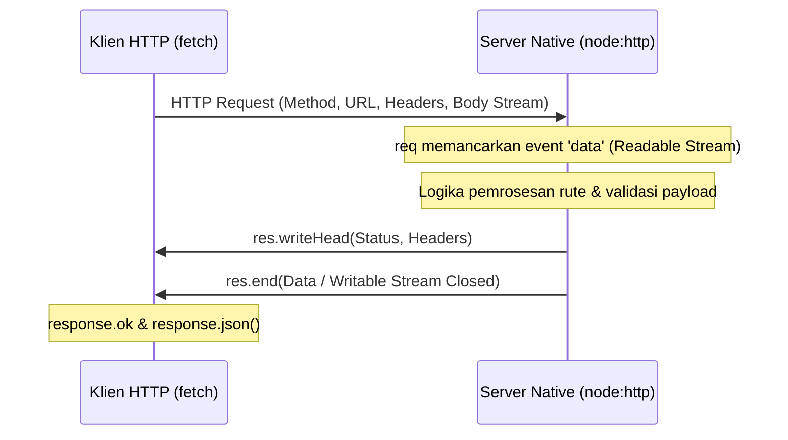

# HTTP

> Ringkasan
>
> - Fungsi: Membangun server web HTTP native dan melakukan komunikasi permintaan klien berbasis standar protokol HTTP/1.1 serta Fetch API modern.
> - Digunakan saat: Menyediakan antarmuka REST API, membangun gateway proksi jaringan, mengonsumsi data dari layanan web eksternal, atau mempelajari fondasi internal framework backend.
> - Aturan praktis: Selalu panggil `res.end()` di sisi server untuk menutup aliran respons, dan pasang `AbortSignal.timeout()` serta periksa `response.ok` di sisi klien untuk mencegah permintaan menggantung.

---

## Tujuan Belajar

- Memahami siklus permintaan dan respons (*request-response cycle*) pada arsitektur protokol HTTP/1.1.
- Membangun server web HTTP native menggunakan modul `node:http` tanpa ketergantungan framework pihak ketiga.
- Mengelola aliran data masuk `req` sebagai *Readable Stream* dan aliran data keluar `res` sebagai *Writable Stream*.
- Menggunakan fungsi global `fetch()` untuk melakukan panggilan HTTP modern dengan metode GET dan POST.
- Menangani pembatalan permintaan dan batas waktu jaringan menggunakan antarmuka `AbortSignal.timeout()`.

---

## Konsep

> Arsitektur HTTP dianalogikan seperti alur pemesanan makanan di sebuah restoran. Klien bertindak sebagai tamu yang memberikan buku catatan pesanan (`req` / *IncomingMessage*) berisi rute menu dan instruksi khusus kepada pelayan. Server bertindak sebagai tim dapur yang memproses pesanan dan menyajikan hasilnya di atas nampan hidangan (`res` / *ServerResponse*). Pesanan hanya selesai setelah pelayan resmi mengantarkan nampan dan menutup meja (`res.end()`). Di saat yang sama, tim dapur juga dapat bertindak sebagai klien (`fetch`) yang memesan bahan baku ke pemasok luar.



---

## Referensi

| Item | Fungsi | Catatan |
| :--- | :----- | :------ |
| **`http.createServer()`** | Membuat instans server web HTTP baru | Menerima fungsi penangan dengan argumen `req` dan `res` |
| **`server.listen()`** | Mengikat server pada port dan alamat host tertentu | Menjalankan server agar siap mendengarkan koneksi masuk |
| **`req.method` & `req.url`** | Membaca metode HTTP dan jalur URI permintaan | Dasar penentuan percabangan logika perutean (*routing*) manual |
| **`res.writeHead()`** | Menuliskan kode status HTTP dan header respons | Wajib dikirimkan sebelum penulisan tubuh respons (*body*) ke klien |
| **`res.end()`** | Mengirimkan potongan akhir data dan menutup respons | Menuntaskan transaksi HTTP agar koneksi klien tidak menggantung |
| **`fetch()`** | Melakukan permintaan HTTP klien standar WHATWG | Tersedia global di runtime Node.js berbasis Promise |
| **`AbortSignal.timeout()`** | Membuat sinyal pembatalan otomatis berbasis batas waktu | Menghentikan permintaan klien saat server target lambat |

### `http.createServer()`

Fungsi `http.createServer()` digunakan untuk membuat instans server HTTP baru. Setiap ada permintaan masuk, server akan memanggil fungsi callback dengan menyediakan objek permintaan `req` dan objek respons `res`.

```javascript
import http from "node:http";

const server = http.createServer((req, res) => {
  res.writeHead(200, { "Content-Type": "text/plain" });
  res.end("Server aktif");
});

server.listen(0, async () => {
  const { port } = server.address();
  const respons = await fetch(`http://127.0.0.1:${port}`);
  console.log(await respons.text());
  // Output: Server aktif
  server.close();
});
```

Kasus lain: Mendaftarkan penangan permintaan menggunakan event listener `'request'` terpisah dari fungsi inisialisasi.

```javascript
import http from "node:http";

const server = http.createServer();
server.on("request", (req, res) => {
  res.end("Penangan manual");
});

server.listen(0, async () => {
  const { port } = server.address();
  const respons = await fetch(`http://127.0.0.1:${port}`);
  console.log(await respons.text());
  // Output: Penangan manual
  server.close();
});
```

### `server.listen()`

Metode `server.listen()` digunakan untuk mengaktifkan server agar mulai mendengarkan koneksi pada alamat IP dan port yang ditentukan. Memberikan nilai port `0` memerintahkan sistem operasi mengalokasikan port bebas secara dinamis.

```javascript
import http from "node:http";

const server = http.createServer((req, res) => res.end("OK"));
server.listen(0, "127.0.0.1", () => {
  const info = server.address();
  console.log(info.address, typeof info.port);
  // Output: 127.0.0.1 number
  server.close();
});
```

Kasus lain: Memicu galat `EADDRINUSE` ketika mencoba mengikat server ke port yang telah digunakan oleh proses lain.

```javascript
import http from "node:http";

const s1 = http.createServer().listen(0, () => {
  const s2 = http.createServer();
  s2.listen(s1.address().port);
  s2.on("error", (error) => {
    console.log(error.code);
    // Output: EADDRINUSE
    s1.close();
  });
});
```

### `req.method` & `req.url`

Properti `req.method` menyimpan kata kerja HTTP (seperti `GET`, `POST`, `PUT`, `DELETE`), sedangkan `req.url` menyimpan jalur tautan beserta parameter query yang diminta oleh klien.

```javascript
import http from "node:http";

const server = http.createServer((req, res) => {
  console.log(req.method, req.url);
  // Output: GET /api/pengguna?status=aktif
  res.end("Diterima");
});

server.listen(0, async () => {
  const { port } = server.address();
  await fetch(`http://127.0.0.1:${port}/api/pengguna?status=aktif`);
  server.close();
});
```

Kasus lain: Mengurai komponen URL dan parameter query string menggunakan kelas standar `URL`.

```javascript
import http from "node:http";

const server = http.createServer((req, res) => {
  const parsed = new URL(req.url, `http://${req.headers.host}`);
  console.log(parsed.pathname, parsed.searchParams.get("role"));
  // Output: /admin superuser
  res.end("OK");
});

server.listen(0, async () => {
  const { port } = server.address();
  await fetch(`http://127.0.0.1:${port}/admin?role=superuser`);
  server.close();
});
```

### `res.writeHead()`

Metode `res.writeHead()` digunakan untuk mengirimkan kode status respons HTTP (seperti 200, 201, 404, 500) dan header respons ke soket klien sebelum badan respons dikirimkan.

```javascript
import http from "node:http";

const server = http.createServer((req, res) => {
  res.writeHead(201, {
    "Content-Type": "application/json",
    "X-Aplikasi": "NodeJS-Core",
  });
  res.end(JSON.stringify({ status: "Dibuat" }));
});

server.listen(0, async () => {
  const { port } = server.address();
  const respons = await fetch(`http://127.0.0.1:${port}`);
  console.log(respons.status, respons.headers.get("x-aplikasi"));
  // Output: 201 NodeJS-Core
  server.close();
});
```

Kasus lain: Memanggil `res.writeHead()` saat header respons telah dikirimkan memicu galat runtime `ERR_HTTP_HEADERS_SENT`.

```javascript
import http from "node:http";

const server = http.createServer((req, res) => {
  res.writeHead(200);
  try {
    res.writeHead(404);
  } catch (error) {
    console.log(error.code);
    // Output: ERR_HTTP_HEADERS_SENT
  }
  res.end("OK");
});

server.listen(0, async () => {
  const { port } = server.address();
  await fetch(`http://127.0.0.1:${port}`);
  server.close();
});
```

### `res.end()`

Metode `res.end()` digunakan untuk menyelesaikan siklus respons HTTP dan mengirimkan data penutup opsional. Memanggil metode ini wajib dilakukan agar koneksi klien mengetahui bahwa seluruh data respons telah selesai ditransmisikan.

```javascript
import http from "node:http";

const server = http.createServer((req, res) => {
  res.write("Bagian 1 - ");
  res.end("Bagian 2");
});

server.listen(0, async () => {
  const { port } = server.address();
  const respons = await fetch(`http://127.0.0.1:${port}`);
  console.log(await respons.text());
  // Output: Bagian 1 - Bagian 2
  server.close();
});
```

Kasus lain: Menulis data menggunakan `res.write()` setelah `res.end()` dipanggil memicu galat `ERR_STREAM_WRITE_AFTER_END`.

```javascript
import http from "node:http";

const server = http.createServer((req, res) => {
  res.end("Selesai");
  try {
    res.write("Terlambat");
  } catch (error) {
    console.log(error.code);
    // Output: ERR_STREAM_WRITE_AFTER_END
  }
});

server.listen(0, async () => {
  const { port } = server.address();
  await fetch(`http://127.0.0.1:${port}`);
  server.close();
});
```

### `fetch()`

Fungsi global `fetch()` adalah antarmuka standar untuk melakukan panggilan HTTP asinkron berbasis Promise. Fungsi ini mendukung berbagai opsi seperti metode pengiriman, header, dan pengiriman payload body string.

```javascript
import http from "node:http";

const server = http.createServer((req, res) => {
  res.writeHead(200, { "Content-Type": "application/json" });
  res.end(JSON.stringify({ status: "sukses", kode: 101 }));
});

server.listen(0, async () => {
  const { port } = server.address();
  const respons = await fetch(`http://127.0.0.1:${port}`);
  console.log(respons.ok, respons.status);
  // Output: true 200
  const data = await respons.json();
  console.log(data.status, data.kode);
  // Output: sukses 101
  server.close();
});
```

Kasus lain: Panggilan ke endpoint yang menghasilkan status galat HTTP non-2xx tidak melempar penolakan Promise sehingga nilai `respons.ok` bernilai `false`.

```javascript
import http from "node:http";

const server = http.createServer((req, res) => {
  res.writeHead(404);
  res.end("Tidak Ditemukan");
});

server.listen(0, async () => {
  const { port } = server.address();
  const respons = await fetch(`http://127.0.0.1:${port}`);
  console.log(respons.ok, respons.status);
  // Output: false 404
  server.close();
});
```

### `AbortSignal.timeout()`

Metode `AbortSignal.timeout()` digunakan untuk membuat sinyal pembatalan otomatis setelah melewati durasi waktu milidetik tertentu. Jika server target tidak merespons dalam jendela waktu tersebut, `fetch()` akan melempar galat `TimeoutError`.

```javascript
import http from "node:http";

const server = http.createServer((req, res) => {
  setTimeout(() => res.end("Terlambat"), 100);
});

server.listen(0, async () => {
  const { port } = server.address();
  try {
    await fetch(`http://127.0.0.1:${port}`, {
      signal: AbortSignal.timeout(20),
    });
  } catch (error) {
    console.log(error.name);
    // Output: TimeoutError
  }
  server.close();
});
```

Kasus lain: Memeriksa properti `signal.aborted` untuk memvalidasi apakah sinyal telah kedaluwarsa sebelum memulai proses.

```javascript
const signal = AbortSignal.timeout(10);
await new Promise((resolve) => setTimeout(resolve, 20));
console.log(signal.aborted);
// Output: true
```

### Perbandingan: Server Native (`node:http`) vs Framework (Express.js)

| Karakteristik | Server Native (`node:http`) | Framework (Express / Fastify) |
| :--- | :--- | :--- |
| **Instalasi** | Bawaan Node.js tanpa dependensi | Wajib melalui instalasi paket NPM eksternal |
| **Arsitektur Dasar** | Fondasi inti asli runtime | Lapisan pembungkus (*wrapper*) di atas `node:http` |
| **Parsing Body JSON** | Manual via akumulasi potongan stream buffer | Otomatis melalui middleware terstruktur |
| **Pengelolaan Rute** | Percabangan manual logika kondisi | Router deklaratif (`app.get`, `app.post`) |

### Perbandingan: `fetch()` di Node.js vs Browser

| Karakteristik | `fetch()` di Node.js (Server) | `fetch()` di Browser (Klien Web) |
| :--- | :--- | :--- |
| **Kebijakan CORS** | Bebas tanpa hambatan aturan Same-Origin | Dibatasi ketat oleh mekanisme keamanan peramban |
| **Format Alamat URL** | Wajib URL absolut (`http://...`) | Mendukung URL relatif mengikuti origin aktif |
| **Header Terlarang** | Bebas mengubah header apa pun secara penuh | Dilarang memodifikasi header sensitif peramban |
| **Pengelolaan Cookie** | Manual via parsing header respons | Otomatis tersimpan dan terkelola via Cookie Jar |

---

## Kesalahan Umum

### Lupa Memanggil `res.end()` pada Cabang Penanganan Rute

Ketiadaan pemanggilan `res.end()` menyebabkan koneksi soket klien menggantung tanpa kepastian (*hanging request*) hingga menghabiskan batas waktu soket.

```javascript
// Salah
const server = http.createServer((req, res) => {
  res.writeHead(200);
  res.write("Berhasil");
});
```

```javascript
// Benar
const server = http.createServer((req, res) => {
  res.writeHead(200);
  res.end("Berhasil");
});
```

### Mengabaikan Validasi Properti `response.ok` pada Panggilan `fetch()`

Fungsi `fetch()` tidak melempar galat ketika server mengembalikan status 404 atau 500 karena status tersebut tetap merupakan respons HTTP yang sah dari sudut pandang protokol.

```javascript
// Salah
const respons = await fetch("http://127.0.0.1:3000/rute-salah");
const data = await respons.json();
```

```javascript
// Benar
const respons = await fetch("http://127.0.0.1:3000/rute-salah");
if (!respons.ok) {
  throw new Error(`HTTP Galat: ${respons.status}`);
}
const data = await respons.json();
```

### Menggunakan URL Relatif pada Pemanggilan `fetch()` di Lingkungan Node.js

Node.js tidak memiliki konteks dokumen peramban sehingga pemanggilan jalur relatif seperti `fetch('/api/data')` langsung menghasilkan galat `TypeError: Failed to parse URL`.

```javascript
// Salah
const res = await fetch("/api/data");
```

```javascript
// Benar
const res = await fetch("http://127.0.0.1:3000/api/data");
```

---

## Studi Kasus

Skenario: Membangun server REST API native mandiri untuk manajemen data inventaris buku yang menangani rute metode `GET` dan `POST`, parsing body JSON berbasis akumulasi aliran chunk, penanganan rute tidak terdaftar (404), serta verifikasi pengujian menggunakan klien `fetch()` global.

```javascript
import http from "node:http";

function buatAplikasiServer() {
  const dataBuku = [{ id: 1, judul: "Belajar Node.js" }];

  const server = http.createServer((req, res) => {
    const url = new URL(req.url, `http://${req.headers.host}`);

    if (req.method === "GET" && url.pathname === "/api/buku") {
      res.writeHead(200, { "Content-Type": "application/json" });
      res.end(JSON.stringify({ sukses: true, data: dataBuku }));
      return;
    }

    if (req.method === "POST" && url.pathname === "/api/buku") {
      const potongan = [];
      req.on("data", (chunk) => potongan.push(chunk));
      req.on("end", () => {
        try {
          const body = JSON.parse(Buffer.concat(potongan).toString());
          const bukuBaru = { id: dataBuku.length + 1, judul: body.judul };
          dataBuku.push(bukuBaru);

          res.writeHead(201, { "Content-Type": "application/json" });
          res.end(JSON.stringify({ sukses: true, data: bukuBaru }));
        } catch {
          res.writeHead(400, { "Content-Type": "application/json" });
          res.end(JSON.stringify({ sukses: false, pesan: "JSON tidak valid" }));
        }
      });
      return;
    }

    res.writeHead(404, { "Content-Type": "application/json" });
    res.end(JSON.stringify({ sukses: false, pesan: "Endpoint tidak ditemukan" }));
  });

  return server;
}

const server = buatAplikasiServer();
server.listen(0, async () => {
  const { port } = server.address();
  const baseUrl = `http://127.0.0.1:${port}`;

  // 1. Eksekusi pengujian penambahan data via POST
  const postRes = await fetch(`${baseUrl}/api/buku`, {
    method: "POST",
    headers: { "Content-Type": "application/json" },
    body: JSON.stringify({ judul: "Arsitektur Backend" }),
  });
  const postData = await postRes.json();
  console.log("Status POST:", postRes.status);
  console.log("Buku Baru:", postData.data.judul);

  // 2. Eksekusi pengujian pembacaan data via GET
  const getRes = await fetch(`${baseUrl}/api/buku`);
  const getData = await getRes.json();
  console.log("Total Buku:", getData.data.length);

  server.close();
});

// Output:
// Status POST: 201
// Buku Baru: Arsitektur Backend
// Total Buku: 2
```

Desain ini dipilih karena mengalirkan pembacaan data body secara non-blocking melalui event `'data'` dan `'end'`, membungkus parsing payload dengan blok proteksi galat untuk mencegah matinya server saat format data keliru, serta menggunakan kelas `URL` standar WHATWG untuk parsing rute yang kebal terhadap manipulasi karakter query parameter.

---

## Latihan Mandiri

### Soal 1 (Dasar)

Buat fungsi klien `ambilDataDenganBatasWaktu(url, timeoutMs)` menggunakan `fetch()` global dan `AbortSignal.timeout()`. Fungsi mengembalikan objek `{ sukses: true, status: number, data: any }` jika server mengembalikan respons sukses (status HTTP 200–299). Jika respons non-2xx atau terjadi pembatalan akibat batas waktu, kembalikan objek `{ sukses: false, alasan: string }`.

Contoh masukan:

```javascript
await ambilDataDenganBatasWaktu("http://127.0.0.1:9999/data", 100);
```

Contoh keluaran yang diharapkan:

```javascript
{ sukses: false, alasan: 'GAGAL_KONEKSI' }
```

Batasan: Gunakan fungsi bawaan `fetch()` dan `AbortSignal.timeout()` tanpa pustaka HTTP pihak ketiga.

### Soal 2 (Menengah)

Buat fungsi pengurai muatan stream `bacaBodyJson(req, batasUkuranByte)` yang menerima objek permintaan `req` (Readable Stream) dan batasan ukuran byte maksimal. Fungsi harus mengembalikan Promise yang menyelesaikan objek hasil parsing JSON.

Ketentuan penanganan kasus tepi:
- Jika akumulasi ukuran potongan stream yang diterima melebihi `batasUkuranByte`, segera batalkan pembacaan dan tolak Promise dengan objek galat berpesan `'PAYLOAD_TERLALU_BESAR'`.
- Jika potongan stream selesai dibaca tetapi format string bukan JSON yang valid, tolak Promise dengan objek galat berpesan `'JSON_TIDAK_VALID'`.

Contoh masukan:

```javascript
// Simulasi pembacaan stream request dengan payload valid di bawah 1024 byte
await bacaBodyJson(req, 1024);
```

Contoh keluaran yang diharapkan:

```javascript
{ nama: 'Laptop', harga: 15000000 }
```

Batasan: Murni menggunakan buffer dan penanganan event `'data'` dan `'end'` pada aliran stream `req`.

### Soal 3 (Menantang)

Buat fungsi server perantara `buatServerGateway(pemetaanTarget)` yang bertindak sebagai API Gateway penerus (*reverse proxy*). Server menerima permintaan HTTP masuk dan meneruskannya ke server upstream target berdasarkan prefiks jalur URL.

Ketentuan fungsional:
1. Argumen `pemetaanTarget` berupa objek pemetaan prefiks rute, misalnya `{ '/auth': 'http://127.0.0.1:4001', '/produk': 'http://127.0.0.1:4002' }`.
2. Jika ada permintaan masuk dengan URL `/auth/login`, teruskan metode HTTP, header esensial, dan muatan body ke `http://127.0.0.1:4001/login` menggunakan `fetch()`.
3. Kembalikan status HTTP, header, dan isi respons dari server upstream ke klien pemanggil asli.
4. Ketentuan penanganan kasus tepi:
   - Jika jalur URL tidak cocok dengan salah satu entri pemetaan, kembalikan HTTP 404 dengan body JSON `{ "galat": "Rute gateway tidak ditemukan" }`.
   - Pasang batas waktu pembatalan selama 1500 milidetik saat meneruskan ke upstream dengan `AbortSignal.timeout(1500)`. Jika batas waktu tercapai, kembalikan HTTP 504 dengan body JSON `{ "galat": "Gateway Timeout" }`.
   - Jika server upstream tujuan mati atau menolak koneksi jaringan, tangkap galat tersebut dan kembalikan HTTP 502 dengan body JSON `{ "galat": "Bad Gateway" }`.

Contoh masukan konfigurasi:

```javascript
const gateway = buatServerGateway({
  "/api": "http://127.0.0.1:5000"
});
```

Contoh respons klien saat upstream mati:

```javascript
// Status HTTP: 502
// Body: { "galat": "Bad Gateway" }
```

Batasan: Dilarang menggunakan pustaka pembungkus proksi eksternal. Wajib mengimplementasikan arsitektur murni menggunakan `node:http` dan `fetch()`.

---

## Navigasi

[Sebelumnya: DNS](../13-dns/README.md) | [Selanjutnya: Cluster](../15-cluster/README.md) | [Daftar Isi](../README.md)
