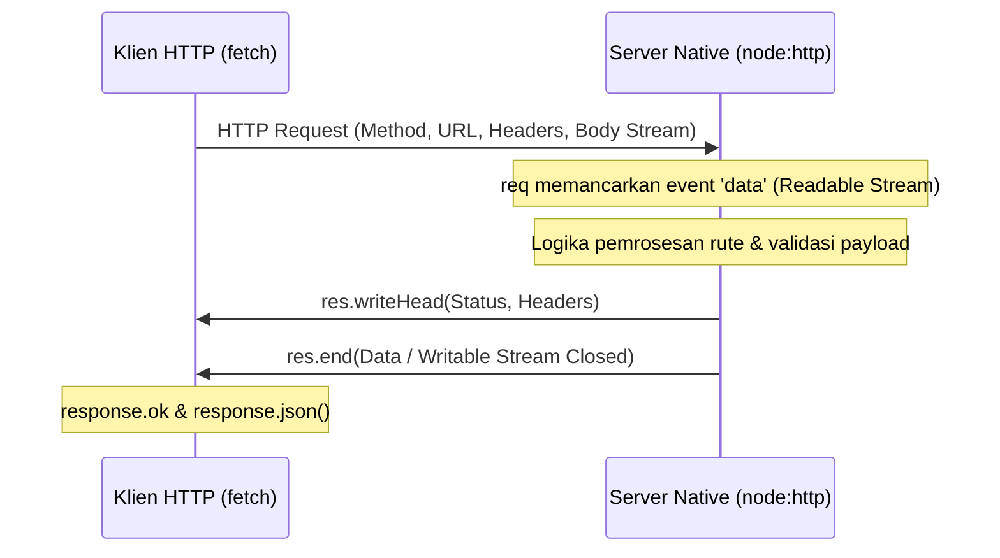

# HTTP

> Ringkasan
>
> - Fungsi: Membangun server web HTTP native dan melakukan panggilan HTTP klien berbasis standar protokol HTTP/1.1 serta Fetch API modern.
> - Digunakan saat: Menyediakan antarmuka REST API, membangun gateway proxy jaringan, mengonsumsi data dari layanan web eksternal, atau mempelajari fondasi internal framework backend.
> - Aturan praktis: Selalu panggil `res.end()` di sisi server untuk menuntaskan respons, serta pasang `AbortSignal.timeout()` dan periksa `response.ok` di sisi klien agar permintaan tidak menggantung tanpa kepastian.

---

## Tujuan Belajar

- Memahami siklus permintaan dan respons (_request-response cycle_) pada arsitektur protokol HTTP/1.1.
- Membangun server web HTTP native menggunakan modul bawaan `node:http` tanpa ketergantungan framework luar.
- Mengelola aliran data masuk `req` sebagai _Readable Stream_ dan aliran data keluar `res` sebagai _Writable Stream_.
- Menggunakan fungsi global `fetch()` untuk melakukan panggilan HTTP modern dengan metode GET dan POST.
- Menangani pembatalan permintaan dan batas waktu jaringan menggunakan antarmuka `AbortSignal.timeout()`.

---

## Konsep

Arsitektur HTTP bisa kita bayangkan seperti alur pemesanan makanan di sebuah restoran. Klien bertindak sebagai tamu yang memberikan secarik kertas pesanan (`req` / _IncomingMessage_) berisi pilihan menu dan instruksi tambahan kepada pelayan.

Server bertindak sebagai tim dapur yang memproses hidangan dan menyiapkannya di atas nampan sajian (`res` / _ServerResponse_). Pesanan baru dianggap tuntas ketika pelayan resmi mengantarkan nampan hidangan ke meja tamu dan menutup siklus pelayanan (`res.end()`). Di saat yang sama, tim dapur juga bisa bertindak sebagai pembeli (`fetch`) yang memesan bahan baku ke pasar atau pemasok bahan makanan di luar.



---

## Referensi

| Item                         | Fungsi                                                        | Catatan                                                            |
| :--------------------------- | :------------------------------------------------------------ | :----------------------------------------------------------------- |
| **`http.createServer()`**    | Membuat server web HTTP baru                                  | Menerima fungsi penangan dengan parameter `req` dan `res`          |
| **`server.listen()`**        | Mengikat server pada nomor port dan host tertentu             | Mengaktifkan server agar siap menerima permintaan masuk            |
| **`req.method` & `req.url`** | Membaca metode HTTP dan jalur URI yang diminta klien          | Menjadi fondasi penentuan percabangan rute (_routing_) manual      |
| **`res.writeHead()`**        | Mengirimkan kode status HTTP dan header respons               | Harus dipanggil sebelum menulis isi data respons (_body_) ke klien |
| **`res.end()`**              | Mengirimkan data akhir dan menutup respons                    | Menuntaskan transaksi HTTP agar koneksi klien tidak menggantung    |
| **`fetch()`**                | Melakukan permintaan HTTP klien standar WHATWG                | Tersedia secara global di Node.js berbasis Promise                 |
| **`AbortSignal.timeout()`**  | Menyiapkan sinyal pembatalan otomatis berdasarkan batas waktu | Menghentikan panggilan klien saat server target lambat merespons   |

### `http.createServer()`

Fungsi `http.createServer()` digunakan untuk membuat server HTTP baru. Setiap kali ada permintaan yang masuk, server akan memanggil fungsi callback dengan memberikan objek permintaan `req` dan objek respons `res`.

```javascript
import http from "node:http";

const server = http.createServer((req, res) => {
  res.writeHead(200, { "Content-Type": "text/plain" });
  res.end("Server active");
});

server.listen(0, async () => {
  const { port } = server.address();
  const response = await fetch(`http://127.0.0.1:${port}`);
  console.log(await response.text());
  // Output: Server active
  server.close();
});
```

Kasus lain: Mendaftarkan penangan permintaan lewat listener event `'request'` secara terpisah.

```javascript
import http from "node:http";

const server = http.createServer();
server.on("request", (req, res) => {
  res.end("Manual handler");
});

server.listen(0, async () => {
  const { port } = server.address();
  const response = await fetch(`http://127.0.0.1:${port}`);
  console.log(await response.text());
  // Output: Manual handler
  server.close();
});
```

### `server.listen()`

Metode `server.listen()` bertugas mengaktifkan server agar mulai mendengarkan koneksi pada alamat IP dan port tertentu. Memberikan angka port `0` meminta sistem operasi memilihkan port acak yang sedang kosong.

```javascript
import http from "node:http";

const server = http.createServer((req, res) => res.end("OK"));
server.listen(0, "127.0.0.1", () => {
  const info = server.address();
  console.log(info.address, typeof info.port);
  // Output: 127.0.0.1 number
  server.close();
});
```

Kasus lain: Menangkap error `EADDRINUSE` ketika mencoba mengikat server ke port yang sedang digunakan aplikasi lain.

```javascript
import http from "node:http";

const s1 = http.createServer().listen(0, () => {
  const s2 = http.createServer();
  s2.listen(s1.address().port);
  s2.on("error", (error) => {
    console.log(error.code);
    // Output: EADDRINUSE
    s1.close();
  });
});
```

### `req.method` & `req.url`

Properti `req.method` menyimpan kata kerja HTTP (seperti `GET`, `POST`, `PUT`, `DELETE`), sedangkan `req.url` berisi jalur alamat beserta parameter query yang dikirimkan oleh klien.

```javascript
import http from "node:http";

const server = http.createServer((req, res) => {
  console.log(req.method, req.url);
  // Output: GET /api/users?status=active
  res.end("Received");
});

server.listen(0, async () => {
  const { port } = server.address();
  await fetch(`http://127.0.0.1:${port}/api/users?status=active`);
  server.close();
});
```

Kasus lain: Mengurai komponen URL dan parameter query string menggunakan kelas standar `URL`.

```javascript
import http from "node:http";

const server = http.createServer((req, res) => {
  const parsed = new URL(req.url, `http://${req.headers.host}`);
  console.log(parsed.pathname, parsed.searchParams.get("role"));
  // Output: /admin superuser
  res.end("OK");
});

server.listen(0, async () => {
  const { port } = server.address();
  await fetch(`http://127.0.0.1:${port}/admin?role=superuser`);
  server.close();
});
```

### `res.writeHead()`

Metode `res.writeHead()` digunakan untuk mengirimkan kode status respons HTTP (seperti 200, 201, 404, atau 500) beserta informasi header ke klien sebelum badan respons (_body_) mulai dikirimkan.

```javascript
import http from "node:http";

const server = http.createServer((req, res) => {
  res.writeHead(201, {
    "Content-Type": "application/json",
    "X-App-Name": "NodeJS-Core",
  });
  res.end(JSON.stringify({ status: "Created" }));
});

server.listen(0, async () => {
  const { port } = server.address();
  const response = await fetch(`http://127.0.0.1:${port}`);
  console.log(response.status, response.headers.get("x-app-name"));
  // Output: 201 NodeJS-Core
  server.close();
});
```

Kasus lain: Memanggil `res.writeHead()` saat header respons sudah terlanjur terkirim akan memicu error runtime `ERR_HTTP_HEADERS_SENT`.

```javascript
import http from "node:http";

const server = http.createServer((req, res) => {
  res.writeHead(200);
  try {
    res.writeHead(404);
  } catch (error) {
    console.log(error.code);
    // Output: ERR_HTTP_HEADERS_SENT
  }
  res.end("OK");
});

server.listen(0, async () => {
  const { port } = server.address();
  await fetch(`http://127.0.0.1:${port}`);
  server.close();
});
```

### `res.end()`

Metode `res.end()` digunakan untuk menutup siklus respons HTTP dan mengirimkan data potongan terakhir jika ada. Memanggil metode ini sangat penting agar browser atau klien tahu bahwa seluruh data respons telah selesai dikirim.

```javascript
import http from "node:http";

const server = http.createServer((req, res) => {
  res.write("Part 1 - ");
  res.end("Part 2");
});

server.listen(0, async () => {
  const { port } = server.address();
  const response = await fetch(`http://127.0.0.1:${port}`);
  console.log(await response.text());
  // Output: Part 1 - Part 2
  server.close();
});
```

Kasus lain: Mencoba mengirim data menggunakan `res.write()` setelah `res.end()` dipanggil akan memicu error `ERR_STREAM_WRITE_AFTER_END`.

```javascript
import http from "node:http";

const server = http.createServer((req, res) => {
  res.end("Finished");
  try {
    res.write("Late");
  } catch (error) {
    console.log(error.code);
    // Output: ERR_STREAM_WRITE_AFTER_END
  }
});

server.listen(0, async () => {
  const { port } = server.address();
  await fetch(`http://127.0.0.1:${port}`);
  server.close();
});
```

### `fetch()`

Fungsi global `fetch()` adalah cara modern di Node.js untuk melakukan panggilan HTTP asinkron berbasis Promise tanpa modul tambahan, mendukung pengiriman metode, header kustom, maupun data body.

```javascript
import http from "node:http";

const server = http.createServer((req, res) => {
  res.writeHead(200, { "Content-Type": "application/json" });
  res.end(JSON.stringify({ status: "success", code: 101 }));
});

server.listen(0, async () => {
  const { port } = server.address();
  const response = await fetch(`http://127.0.0.1:${port}`);
  console.log(response.ok, response.status);
  // Output: true 200
  const data = await response.json();
  console.log(data.status, data.code);
  // Output: success 101
  server.close();
});
```

Kasus lain: Panggilan ke alamat yang menghasilkan kode status non-2xx (seperti 404 atau 500) tidak akan melempar error Promise, melainkan ditandai dengan properti `response.ok` bernilai `false`.

```javascript
import http from "node:http";

const server = http.createServer((req, res) => {
  res.writeHead(404);
  res.end("Not Found");
});

server.listen(0, async () => {
  const { port } = server.address();
  const response = await fetch(`http://127.0.0.1:${port}`);
  console.log(response.ok, response.status);
  // Output: false 404
  server.close();
});
```

### `AbortSignal.timeout()`

Metode `AbortSignal.timeout()` membuat sinyal pembatalan otomatis jika waktu tunggu melampaui batas milidetik tertentu. Jika server target terlambat membalas, `fetch()` akan membatalkan koneksi dan melempar error `TimeoutError`.

```javascript
import http from "node:http";

const server = http.createServer((req, res) => {
  setTimeout(() => res.end("Late"), 100);
});

server.listen(0, async () => {
  const { port } = server.address();
  try {
    await fetch(`http://127.0.0.1:${port}`, {
      signal: AbortSignal.timeout(20),
    });
  } catch (error) {
    console.log(error.name);
    // Output: TimeoutError
  }
  server.close();
});
```

Kasus lain: Memeriksa nilai properti `signal.aborted` untuk mengetahui apakah sinyal pembatalan sudah aktif sebelum menjalankan proses.

```javascript
const signal = AbortSignal.timeout(10);
await new Promise((resolve) => setTimeout(resolve, 20));
console.log(signal.aborted);
// Output: true
```

### Perbandingan: Server Native (`node:http`) vs Framework (Express.js)

| Karakteristik            | Server Native (`node:http`)                       | Framework (Express / Fastify)                          |
| :----------------------- | :------------------------------------------------ | :----------------------------------------------------- |
| **Kebutuhan Instalasi**  | Bawaan Node.js tanpa perlu install apa pun        | Harus diinstal lewat paket NPM eksternal               |
| **Arsitektur Dasar**     | Fondasi inti asli dari runtime Node.js            | Lapisan pembungkus (_wrapper_) di atas `node:http`     |
| **Pengolahan Body JSON** | Manual dengan mengumpulkan potongan stream buffer | Otomatis melalui middleware bawaan framework           |
| **Pengaturan Rute**      | Percabangan manual menggunakan `if` atau `switch` | Menggunakan fungsi router deklaratif (`app.get`, dll.) |

### Perbandingan: `fetch()` di Node.js vs Browser

| Karakteristik          | `fetch()` di Node.js (Server)                | `fetch()` di Browser (Frontend)                            |
| :--------------------- | :------------------------------------------- | :--------------------------------------------------------- |
| **Kebijakan CORS**     | Bebas tanpa terhalang aturan Same-Origin     | Dibatasi ketat oleh kebijakan keamanan browser             |
| **Format Alamat URL**  | Wajib menggunakan URL lengkap (`http://...`) | Bisa menggunakan path relatif mengikuti halaman aktif      |
| **Header Terlarang**   | Bebas mengatur header apa pun tanpa batas    | Dilarang memodifikasi header tertentu yang dikunci browser |
| **Pengelolaan Cookie** | Manual lewat pembacaan header respons        | Otomatis disimpan dan dikelola oleh browser                |

---

## Kesalahan Umum

### Lupa Memanggil `res.end()` pada Salah Satu Cabang Rute

Jika kita lupa menuliskan `res.end()`, koneksi klien akan terus menggantung tanpa akhir (_hanging request_) sampai browser atau klien mengalami timeout.

```javascript
// Salah
const server = http.createServer((req, res) => {
  res.writeHead(200);
  res.write("Success");
  // Lupa memanggil res.end() sehingga browser menunggu selamanya
});
```

```javascript
// Benar
const server = http.createServer((req, res) => {
  res.writeHead(200);
  res.end("Success");
});
```

### Mengabaikan Pengecekan Properti `response.ok` pada `fetch()`

Fungsi `fetch()` tidak otomatis melempar error ketika server mengembalikan status error seperti 404 (Not Found) atau 500 (Internal Server Error) karena status tersebut tetap dianggap sebagai balasan HTTP yang sah.

```javascript
// Salah
const response = await fetch("http://127.0.0.1:3000/wrong-route");
const data = await response.json(); // Berpotensi crash jika isi respons bukan format JSON
```

```javascript
// Benar
const response = await fetch("http://127.0.0.1:3000/wrong-route");
if (!response.ok) {
  throw new Error(`HTTP Error: ${response.status}`);
}
const data = await response.json();
```

### Memakai URL Relatif pada `fetch()` di Lingkungan Node.js

Node.js di sisi server tidak memiliki konteks halaman web seperti di browser. Oleh karena itu, memanggil alamat relatif seperti `fetch('/api/data')` akan langsung memicu error `TypeError: Failed to parse URL`.

```javascript
// Salah
const res = await fetch("/api/data");
```

```javascript
// Benar
const res = await fetch("http://127.0.0.1:3000/api/data");
```

---

## Studi Kasus

Skenario: Membangun server REST API native mandiri untuk pengelolaan katalog buku yang menangani rute metode `GET` dan `POST`, mengumpulkan body JSON dari aliran chunk, menangani rute yang tidak terdaftar (404), serta diverifikasi menggunakan klien `fetch()` bawaan.

```javascript
import http from "node:http";

function createServerApp() {
  const books = [{ id: 1, title: "Learning Node.js" }];

  const server = http.createServer((req, res) => {
    const url = new URL(req.url, `http://${req.headers.host}`);

    if (req.method === "GET" && url.pathname === "/api/books") {
      res.writeHead(200, { "Content-Type": "application/json" });
      res.end(JSON.stringify({ success: true, data: books }));
      return;
    }

    if (req.method === "POST" && url.pathname === "/api/books") {
      const chunks = [];
      req.on("data", (chunk) => chunks.push(chunk));
      req.on("end", () => {
        try {
          const body = JSON.parse(Buffer.concat(chunks).toString());
          const newBook = { id: books.length + 1, title: body.title };
          books.push(newBook);

          res.writeHead(201, { "Content-Type": "application/json" });
          res.end(JSON.stringify({ success: true, data: newBook }));
        } catch {
          res.writeHead(400, { "Content-Type": "application/json" });
          res.end(
            JSON.stringify({ success: false, message: "Invalid JSON format" }),
          );
        }
      });
      return;
    }

    res.writeHead(404, { "Content-Type": "application/json" });
    res.end(JSON.stringify({ success: false, message: "Endpoint not found" }));
  });

  return server;
}

const server = createServerApp();
server.listen(0, async () => {
  const { port } = server.address();
  const baseUrl = `http://127.0.0.1:${port}`;

  // 1. Uji coba menambahkan data baru lewat metode POST
  const postRes = await fetch(`${baseUrl}/api/books`, {
    method: "POST",
    headers: { "Content-Type": "application/json" },
    body: JSON.stringify({ title: "Backend Architecture" }),
  });
  const postData = await postRes.json();
  console.log("POST status:", postRes.status);
  console.log("New book:", postData.data.title);

  // 2. Uji coba mengambil daftar buku lewat metode GET
  const getRes = await fetch(`${baseUrl}/api/books`);
  const getData = await getRes.json();
  console.log("Total books:", getData.data.length);

  server.close();
});

// Output:
// POST status: 201
// New book: Backend Architecture
// Total books: 2
```

Pendekatan ini membaca data kiriman body secara bertahap lewat event `'data'` dan `'end'`, membungkus parsing data dengan proteksi error agar server tidak mati saat menerima format yang salah, serta mengandalkan kelas standar `URL` WHATWG agar pemrosesan query string selalu akurat.

---

## Latihan Mandiri

### Soal 1 (Dasar)

Buat fungsi pembantu `fetchWithTimeout(url, timeoutMs)` menggunakan fungsi global `fetch()` dan `AbortSignal.timeout()`. Fungsi harus mengembalikan objek `{ success: true, status: number, data: any }` jika server memberikan respons sukses (status HTTP 200–299). Jika status di luar rentang itu atau terjadi pembatalan akibat batas waktu, kembalikan objek `{ success: false, reason: string }`.

Contoh input:

```javascript
await fetchWithTimeout("http://127.0.0.1:9999/data", 100);
```

Contoh output yang diharapkan:

```javascript
{ success: false, reason: 'CONNECTION_FAILED' }
```

Batasan: Gunakan fungsi bawaan `fetch()` dan `AbortSignal.timeout()` tanpa dependensi luar.

### Soal 2 (Menengah)

Buat fungsi pengurai aliran data `parseJsonBody(req, maxByteSize)` yang menerima objek permintaan `req` (Readable Stream) dan batas maksimal ukuran byte. Fungsi harus mengembalikan Promise yang menghasilkan objek hasil parsing JSON.

Ketentuan penanganan kasus khusus:

- Jika ukuran data chunk yang masuk melebihi `maxByteSize`, segera hentikan pembacaan dan tolak Promise dengan objek error berpesan `'PAYLOAD_TOO_LARGE'`.
- Jika data selesai dibaca tetapi formatnya bukan JSON yang sah, tolak Promise dengan objek error berpesan `'INVALID_JSON'`.

Contoh input:

```javascript
// Simulasi membaca stream permintaan dengan payload sah di bawah 1024 byte
await parseJsonBody(req, 1024);
```

Contoh output yang diharapkan:

```javascript
{ name: 'Laptop', price: 15000000 }
```

Batasan: Gunakan modul buffer dan penanganan event `'data'` serta `'end'` langsung pada aliran stream `req`.

### Soal 3 (Menantang)

Buat fungsi server perantara `createGatewayServer(routeMap)` yang bertindak sebagai API Gateway (_reverse proxy_). Server menerima permintaan HTTP masuk lalu meneruskannya ke server tujuan (_upstream_) berdasarkan awalan jalur URL.

Ketentuan fungsional:

1. Parameter `routeMap` berupa objek konfigurasi awalan rute, misalnya `{ '/auth': 'http://127.0.0.1:4001', '/products': 'http://127.0.0.1:4002' }`.
2. Jika ada permintaan masuk ke `/auth/login`, teruskan metode HTTP, header penting, dan data body ke `http://127.0.0.1:4001/login` menggunakan `fetch()`.
3. Kembalikan status HTTP, header, dan isi balasan dari server upstream ke klien pemanggil asli.
4. Penanganan kasus khusus:
   - Jika jalur URL tidak cocok dengan entri yang ada di peta rute, kembalikan HTTP 404 dengan body JSON `{ "error": "Gateway route not found" }`.
   - Batasi waktu tunggu ke upstream maksimal 1500 milidetik menggunakan `AbortSignal.timeout(1500)`. Jika batas waktu terlampaui, kembalikan HTTP 504 dengan body JSON `{ "error": "Gateway Timeout" }`.
   - Jika server upstream tujuan sedang mati atau menolak sambungan, tangkap error-nya dan kembalikan HTTP 502 dengan body JSON `{ "error": "Bad Gateway" }`.

Contoh konfigurasi:

```javascript
const gateway = createGatewayServer({
  "/api": "http://127.0.0.1:5000",
});
```

Contoh respons klien saat upstream mati:

```javascript
// Status HTTP: 502
// Body: { "error": "Bad Gateway" }
```

Batasan: Dilarang menggunakan library proxy pihak ketiga. Bangun arsitektur murni menggunakan modul bawaan `node:http` dan fungsi `fetch()`.

---

## Navigasi

[Sebelumnya: DNS](../13-dns/README.md) | [Selanjutnya: Cluster](../15-cluster/README.md) | [Daftar Isi](../README.md)
