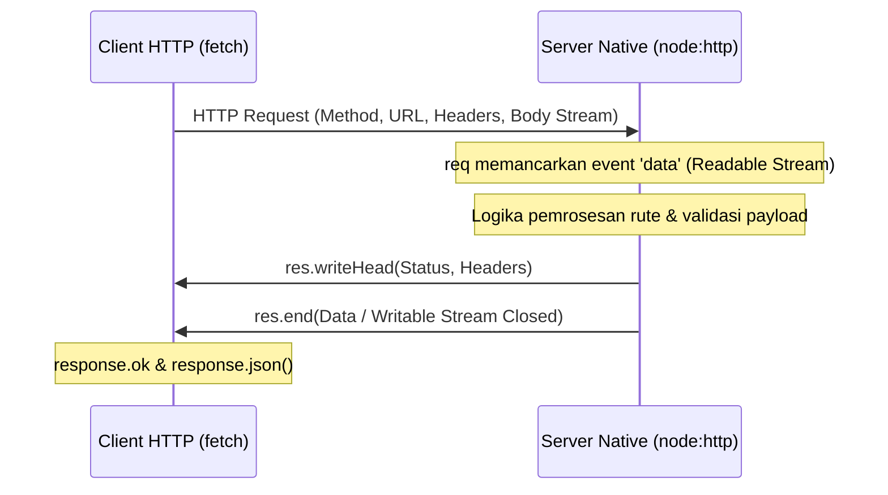

# HTTP

> Ringkasan
>
> - Fungsi: Membangun server web HTTP native dan melakukan panggilan HTTP client berbasis standar protokol HTTP/1.1 serta Fetch API modern.
> - Digunakan saat: Menyediakan antarmuka REST API, membangun gateway proxy jaringan, mengonsumsi data dari layanan web eksternal, atau mempelajari fondasi internal framework backend.
> - Aturan praktis: Selalu panggil `res.end()` di sisi server untuk menuntaskan respons, serta pasang `AbortSignal.timeout()` dan periksa `response.ok` di sisi client agar permintaan tidak menggantung tanpa kepastian.

---

## Tujuan Belajar

- Memahami siklus permintaan dan respons (_request-response cycle_) pada arsitektur protokol HTTP/1.1.
- Membangun server web HTTP native menggunakan modul bawaan `node:http` tanpa ketergantungan framework luar.
- Mengelola stream data masuk `req` sebagai _Readable Stream_ dan stream data keluar `res` sebagai _Writable Stream_.
- Mengirimkan kode status HTTP dan header respons secara tepat menggunakan `res.writeHead()`.
- Menutup transaksi HTTP secara aman menggunakan `res.end()` dan menghentikan server via `server.close()`.
- Menggunakan fungsi global `fetch()` untuk melakukan panggilan HTTP modern dengan metode GET dan POST.
- Menangani pembatalan permintaan dan batas waktu jaringan menggunakan antarmuka `AbortSignal.timeout()`.

---

## Konsep

Arsitektur HTTP bisa kita bayangkan seperti alur pemesanan makanan di sebuah restoran. Client bertindak sebagai tamu yang memberikan secarik kertas pesanan (`req` / _IncomingMessage_) berisi pilihan menu dan instruksi tambahan kepada pelayan.

Server bertindak sebagai tim dapur yang memproses hidangan dan menyiapkannya di atas nampan sajian (`res` / _ServerResponse_). Pesanan baru dianggap tuntas ketika pelayan resmi mengantarkan nampan hidangan ke meja tamu dan menutup siklus pelayanan (`res.end()`). Di saat yang sama, tim dapur juga bisa bertindak sebagai pembeli (`fetch`) yang memesan bahan baku ke pasar atau pemasok bahan makanan di luar.



### Perbandingan Karakteristik Server: Native (`node:http`) vs Framework

| Karakteristik            | Server Native (`node:http`)                       | Framework (Express / Fastify)                          |
| :----------------------- | :------------------------------------------------ | :----------------------------------------------------- |
| **Kebutuhan Instalasi**  | Bawaan Node.js tanpa perlu install apa pun        | Harus diinstal lewat paket NPM eksternal               |
| **Arsitektur Dasar**     | Fondasi inti asli dari runtime Node.js            | Lapisan pembungkus (_wrapper_) di atas `node:http`     |
| **Pengolahan Body JSON** | Manual dengan mengumpulkan potongan stream buffer | Otomatis melalui middleware bawaan framework           |
| **Pengaturan Rute**      | Percabangan manual menggunakan `if` atau `switch` | Menggunakan fungsi router deklaratif (`app.get`, dll.) |

### Perbandingan Lingkungan: `fetch()` di Node.js vs Browser

| Karakteristik          | `fetch()` di Node.js (Server)                | `fetch()` di Browser (Frontend)                            |
| :--------------------- | :------------------------------------------- | :--------------------------------------------------------- |
| **Kebijakan CORS**     | Bebas tanpa terhalang aturan Same-Origin     | Dibatasi ketat oleh kebijakan keamanan browser             |
| **Format Alamat URL**  | Wajib menggunakan URL lengkap (`http://...`) | Bisa menggunakan path relatif mengikuti halaman aktif      |
| **Header Terlarang**   | Bebas mengatur header apa pun tanpa batas    | Dilarang memodifikasi header tertentu yang dikunci browser |
| **Pengelolaan Cookie** | Manual lewat pembacaan header respons        | Otomatis disimpan dan dikelola oleh browser                |

---

## Referensi

| Item                        | Fungsi                                                     | Catatan                                                             |
| :-------------------------- | :--------------------------------------------------------- | :------------------------------------------------------------------ |
| **`http.createServer()`**   | Membuat instance server HTTP baru                          | Menerima fungsi callback handler dengan parameter `req` dan `res`   |
| **`server.listen()`**       | Mengikat server pada nomor port dan host tertentu          | Port `0` meminta sistem operasi memilihkan port acak yang bebas     |
| **`req.method & req.url`**  | Membaca metode HTTP dan path alamat permintaan client      | Properti baca-saja pada objek stream `http.IncomingMessage`         |
| **`res.writeHead()`**       | Mengirimkan kode status HTTP dan header respons            | Wajib dipanggil sebelum potongan isi body respons dikirimkan        |
| **`res.end()`**             | Mengirim data potongan terakhir dan menutup respons        | Menuntaskan transaksi HTTP agar koneksi client tidak menggantung    |
| **`server.close()`**        | Menghentikan server dari menerima koneksi baru             | Menutup server secara anggun setelah request aktif tuntas           |
| **`fetch()`**               | Melakukan permintaan HTTP client berbasis Promise          | Fitur global standar WHATWG bawaan Node.js modern                   |
| **`AbortSignal.timeout()`** | Menyiapkan sinyal pembatalan otomatis berbasis batas waktu | Mencegah permintaan client menggantung saat server lambat merespons |

### `http.createServer()`

Fungsi `http.createServer()` digunakan untuk membuat instance server HTTP baru. Setiap kali terdapat permintaan masuk dari client, server akan memanggil fungsi handler dengan meneruskan instance `http.IncomingMessage` sebagai `req` dan `http.ServerResponse` sebagai `res`.

Struktur parameter: `http.createServer(options, requestListener)`

- `options`: Objek konfigurasi server opsional (opsional, tipe data: `object`, nilai bawaan: `{}`). Mendukung konfigurasi seperti batas ukuran header `maxHeaderSize` (`number`), batas waktu permintaan `requestTimeout` (`number`), dan opsi `keepAlive` (`boolean`).
- `requestListener`: Fungsi handler permintaan yang otomatis dipasangkan ke event `'request'` (opsional, tipe data: `Function`, nilai bawaan: `undefined`). Menerima dua argumen: `req` (`http.IncomingMessage`) dan `res` (`http.ServerResponse`).
- Nilai kembalian: Mengembalikan instance `http.Server` baru yang belum aktif sebelum metode `.listen()` dipanggil.

Contoh 1: Membuat server HTTP dasar dengan handler inline dan merespons teks:

```javascript
import http from "node:http";

// Meneruskan requestListener dengan parameter req dan res
const server = http.createServer((req, res) => {
  res.writeHead(200, { "Content-Type": "text/plain" });
  res.end("Server active");
});

server.listen(0, "127.0.0.1", async () => {
  const { port } = server.address();
  const response = await fetch(`http://127.0.0.1:${port}`);
  console.log(await response.text());
  // Output: Server active
  server.close();
});
```

Contoh 2: Mendaftarkan handler permintaan secara eksplisit melalui event listener `'request'`:

```javascript
import http from "node:http";

const server = http.createServer();
// Memasang listener terpisah pada event 'request'
server.on("request", (req, res) => {
  res.end("Manual handler");
});

server.listen(0, "127.0.0.1", async () => {
  const { port } = server.address();
  const response = await fetch(`http://127.0.0.1:${port}`);
  console.log(await response.text());
  // Output: Manual handler
  server.close();
});
```

Kondisi khusus dan penanganan error (_edge cases_): Memasang listener pada event `'error'` di instance server sangat disarankan untuk menangani kegagalan level soket atau bentrok port.

### `server.listen()`

Metode `server.listen()` mengaktifkan server HTTP agar mulai memantau dan menerima koneksi masuk pada nomor port serta alamat host yang ditentukan.

Struktur parameter: `server.listen(port, host, callback)`

- `port`: Nomor port jaringan yang ingin dipantau; memberikan angka `0` meminta sistem operasi memilihkan port kosong acak yang tersedia (opsional, tipe data: `number`, nilai bawaan: `0`).
- `host`: Nama host atau alamat IP antarmuka jaringan yang diikat (opsional, tipe data: `string`, nilai bawaan: `'0.0.0.0'` atau `'::'`).
- `callback`: Fungsi yang dieksekusi tepat saat server telah sukses mengikat port dan siap menerima permintaan (opsional, tipe data: `Function`, nilai bawaan: `undefined`).
- Nilai kembalian: Mengembalikan instance `http.Server` yang sama sehingga dapat dirangkai dengan pemanggilan metode lain.

Contoh: Mengikat server ke alamat loopback lokal `127.0.0.1` dan membaca nomor port aktif menggunakan `server.address()`:

```javascript
import http from "node:http";

const server = http.createServer((req, res) => res.end("OK"));
// Mengikat port 0 dan host loopback 127.0.0.1
server.listen(0, "127.0.0.1", () => {
  const info = server.address();
  console.log(info.address);
  console.log(typeof info.port);
  // Output:
  // 127.0.0.1
  // number
  server.close();
});
```

Kondisi khusus dan penanganan error (_edge cases_): Jika mencoba mendengarkan pada port yang sudah digunakan oleh proses lain, instance server akan memancarkan event `'error'` dengan kode error sistem `EADDRINUSE`.

```javascript
import http from "node:http";

const firstServer = http.createServer().listen(0, "127.0.0.1", () => {
  const busyPort = firstServer.address().port;
  const secondServer = http.createServer();

  secondServer.on("error", (error) => {
    console.log(error.code);
    // Output: EADDRINUSE
    firstServer.close();
  });

  secondServer.listen(busyPort, "127.0.0.1");
});
```

### `req.method & req.url`

Objek `req` merupakan instance dari `http.IncomingMessage` sekaligus sebuah _Readable Stream_ yang merepresentasikan permintaan client. Properti `req.method` menyimpan kata kerja HTTP (seperti `'GET'` atau `'POST'`), sedangkan `req.url` memuat string path URI dan parameter query yang diminta.

Struktur pemanggilan: Properti baca-saja pada instance objek `http.IncomingMessage`.

- `req.method`: Nilai string kata kerja HTTP yang dikirimkan client dalam huruf kapital (tipe data: `string`, contoh: `'GET'`, `'POST'`, `'PUT'`, `'DELETE'`).
- `req.url`: Nilai string URL permintaan dari client yang memuat path dan parameter query (tipe data: `string`, contoh: `'/api/users?status=active'`).
- `req.headers`: Objek pasangan kunci-nilai header HTTP yang dikirim oleh client dalam format huruf kecil (tipe data: `object`).
- Nilai kembalian: Masing-masing mengembalikan string primitif yang merefleksikan baris awal permintaan HTTP client.

Contoh 1: Menginspeksi metode dan URL permintaan untuk membuat routing dasar:

```javascript
import http from "node:http";

const server = http.createServer((req, res) => {
  console.log(req.method);
  console.log(req.url);
  // Output:
  // GET
  // /api/users?status=active
  res.end("Received");
});

server.listen(0, "127.0.0.1", async () => {
  const { port } = server.address();
  await fetch(`http://127.0.0.1:${port}/api/users?status=active`);
  server.close();
});
```

Contoh 2: Memanfaatkan class standar `URL` bawaan untuk membedah pathname dan query string:

```javascript
import http from "node:http";

const server = http.createServer((req, res) => {
  // Menggabungkan req.url dengan host header untuk membentuk objek URL lengkap
  const parsedUrl = new URL(req.url, `http://${req.headers.host}`);
  console.log(parsedUrl.pathname);
  console.log(parsedUrl.searchParams.get("role"));
  // Output:
  // /admin
  // superuser
  res.end("OK");
});

server.listen(0, "127.0.0.1", async () => {
  const { port } = server.address();
  await fetch(`http://127.0.0.1:${port}/admin?role=superuser`);
  server.close();
});
```

Kondisi khusus dan penanganan error (_edge cases_): Pada permintaan dengan body data (seperti `POST` atau `PUT`), `req` harus dikonsumsi sebagai Readable Stream menggunakan event listener `'data'` dan `'end'` atau perulangan `for await...of`.

### `res.writeHead()`

Metode `res.writeHead()` mengirimkan baris status HTTP dan header respons ke client. Metode ini harus dipanggil sebelum data isi body pertama kali ditulis menggunakan `res.write()` atau `res.end()`.

Struktur parameter: `res.writeHead(statusCode, statusMessage, headers)`

- `statusCode`: Angka kode status respons HTTP 3-digit (wajib, tipe data: `number`, contoh: `200`, `201`, `404`, `500`).
- `statusMessage`: Pesan teks deskripsi status HTTP (opsional, tipe data: `string`, nilai bawaan: teks standar sesuai `statusCode`).
- `headers`: Objek header respons yang dikirimkan ke client (opsional, tipe data: `object`, contoh: `{ 'Content-Type': 'application/json' }`).
- Nilai kembalian: Mengembalikan instance `http.ServerResponse` yang sama untuk pemanggilan berantai.

Contoh: Mengirimkan kode status 201 Created dan header kustom:

```javascript
import http from "node:http";

const server = http.createServer((req, res) => {
  // Menetapkan kode status 201 dan objek header respons
  res.writeHead(201, {
    "Content-Type": "application/json",
    "X-App-Name": "NodeJS-Core",
  });
  res.end(JSON.stringify({ status: "Created" }));
});

server.listen(0, "127.0.0.1", async () => {
  const { port } = server.address();
  const response = await fetch(`http://127.0.0.1:${port}`);
  console.log(response.status);
  console.log(response.headers.get("x-app-name"));
  // Output:
  // 201
  // NodeJS-Core
  server.close();
});
```

Kondisi khusus dan penanganan error (_edge cases_): Memanggil `res.writeHead()` saat header respons sudah terlanjur terkirim ke client akan melempar error runtime `ERR_HTTP_HEADERS_SENT`.

```javascript
import http from "node:http";

const server = http.createServer((req, res) => {
  res.writeHead(200);
  try {
    res.writeHead(404);
  } catch (error) {
    console.log(error.code);
    // Output: ERR_HTTP_HEADERS_SENT
  }
  res.end("OK");
});

server.listen(0, "127.0.0.1", async () => {
  const { port } = server.address();
  await fetch(`http://127.0.0.1:${port}`);
  server.close();
});
```

### `res.end()`

Metode `res.end()` memberi sinyal kepada server dan client bahwa seluruh header dan badan respons telah selesai dikirim. Memanggil metode ini wajib dilakukan pada setiap permintaan agar koneksi client tidak menggantung tanpa kepastian.

Struktur parameter: `res.end(data, encoding, callback)`

- `data`: Potongan data terakhir yang dikirim tepat sebelum respons ditutup (opsional, tipe data: `string` atau `Buffer`, nilai bawaan: `undefined`).
- `encoding`: Format pengkodean karakter jika parameter `data` berupa string (opsional, tipe data: `string`, nilai bawaan: `'utf8'`).
- `callback`: Fungsi callback yang dieksekusi saat stream data respons telah tuntas dikirim (opsional, tipe data: `Function`, nilai bawaan: `undefined`).
- Nilai kembalian: Mengembalikan instance `http.ServerResponse` yang sama.

Contoh: Mengirimkan potongan data bertahap dengan `res.write()` lalu mengakhiri dengan `res.end()`:

```javascript
import http from "node:http";

const server = http.createServer((req, res) => {
  res.write("Part 1 - ");
  res.end("Part 2");
});

server.listen(0, "127.0.0.1", async () => {
  const { port } = server.address();
  const response = await fetch(`http://127.0.0.1:${port}`);
  console.log(await response.text());
  // Output: Part 1 - Part 2
  server.close();
});
```

Kondisi khusus dan penanganan error (_edge cases_): Mencoba menulis data baru ke stream respons menggunakan `res.write()` setelah `res.end()` dipanggil akan memancarkan event `'error'` dengan kode `ERR_STREAM_WRITE_AFTER_END`.

```javascript
import http from "node:http";

const server = http.createServer((req, res) => {
  res.on("error", (error) => {
    console.log(error.code);
    // Output: ERR_STREAM_WRITE_AFTER_END
  });
  res.end("Finished");
  res.write("Late", () => {});
});

server.listen(0, "127.0.0.1", async () => {
  const { port } = server.address();
  await fetch(`http://127.0.0.1:${port}`);
  server.close();
});
```

### `server.close()`

Metode `server.close()` menghentikan server dari menerima koneksi baru namun tetap membiarkan koneksi yang sedang berlangsung menyelesaikan transaksinya secara wajar (_graceful shutdown_).

Struktur parameter: `server.close(callback)`

- `callback`: Fungsi yang dipanggil saat seluruh koneksi client aktif telah selesai dan server resmi berhenti beroperasi (opsional, tipe data: `Function`, nilai bawaan: `undefined`). Menerima satu parameter `error` jika penutupan gagal atau server belum pernah aktif.
- Nilai kembalian: Mengembalikan instance `http.Server` yang sama.

Contoh: Memeriksa status properti `server.listening` sebelum dan sesudah penutupan:

```javascript
import http from "node:http";

const server = http.createServer((req, res) => res.end("OK"));

server.listen(0, "127.0.0.1", () => {
  console.log(server.listening);
  // Output: true

  server.close(() => {
    console.log(server.listening);
    // Output: false
  });
});
```

Kondisi khusus dan penanganan error (_edge cases_): Memanggil `server.close()` pada server yang belum pernah mendengarkan atau sudah ditutup akan meneruskan error dengan kode `ERR_SERVER_NOT_RUNNING` ke dalam fungsi callback.

```javascript
import http from "node:http";

const server = http.createServer();
server.close((error) => {
  console.log(error.code);
  // Output: ERR_SERVER_NOT_RUNNING
});
```

### `fetch()`

Fungsi global `fetch()` merupakan antarmuka modern bawaan Node.js berbasis Promise standar WHATWG untuk melakukan permintaan HTTP client secara asinkron tanpa memerlukan modul atau library pihak ketiga.

Struktur parameter: `fetch(resource, options)`

- `resource`: Alamat URL tujuan pemanggilan berupa teks string absolut atau instance objek `URL` (wajib, tipe data: `string` atau `URL`).
- `options`: Objek konfigurasi permintaan HTTP (opsional, tipe data: `object`, nilai bawaan: `{}`). Opsi penting meliputi:
  - `method`: Kata kerja HTTP seperti `'GET'`, `'POST'`, `'PUT'`, `'DELETE'` (opsional, tipe data: `string`, nilai bawaan: `'GET'`).
  - `headers`: Objek header permintaan yang dikirimkan ke server (opsional, tipe data: `object`).
  - `body`: Isi data permintaan untuk metode seperti POST atau PUT (opsional, tipe data: `string`, `Buffer`, atau stream).
  - `signal`: Instance `AbortSignal` untuk mengontrol pembatalan atau batas waktu panggilan (opsional, tipe data: `AbortSignal`).
- Nilai kembalian: Mengembalikan `Promise<Response>` yang selesai menghasilkan objek `Response` WHATWG.

Contoh: Melakukan permintaan client dengan metode GET dan mengonsumsi balasan JSON:

```javascript
import http from "node:http";

const server = http.createServer((req, res) => {
  res.writeHead(200, { "Content-Type": "application/json" });
  res.end(JSON.stringify({ status: "success", code: 101 }));
});

server.listen(0, "127.0.0.1", async () => {
  const { port } = server.address();
  const response = await fetch(`http://127.0.0.1:${port}`);
  console.log(response.ok);
  console.log(response.status);
  // Output:
  // true
  // 200

  const data = await response.json();
  console.log(data.status);
  console.log(data.code);
  // Output:
  // success
  // 101

  server.close();
});
```

Kondisi khusus dan penanganan error (_edge cases_): Panggilan ke URL yang menghasilkan kode status non-2xx (seperti 404 atau 500) tidak otomatis melempar error rejected Promise, melainkan ditandai dengan properti `response.ok` bernilai `false`.

```javascript
import http from "node:http";

const server = http.createServer((req, res) => {
  res.writeHead(404);
  res.end("Not Found");
});

server.listen(0, "127.0.0.1", async () => {
  const { port } = server.address();
  const response = await fetch(`http://127.0.0.1:${port}`);
  console.log(response.ok);
  console.log(response.status);
  // Output:
  // false
  // 404
  server.close();
});
```

### `AbortSignal.timeout()`

Metode statis `AbortSignal.timeout()` menghasilkan instance `AbortSignal` yang otomatis dibatalkan setelah durasi waktu milidetik tertentu terlampaui. Fitur ini lazim dipasangkan pada opsi `signal` fungsi `fetch()` untuk mencegah permintaan client menggantung tanpa batas waktu.

Struktur parameter: `AbortSignal.timeout(delay)`

- `delay`: Durasi batas waktu tunggu dalam satuan milidetik sebelum sinyal pembatalan terpicu (wajib, tipe data: `number`).
- Nilai kembalian: Mengembalikan instance `AbortSignal` yang akan melempar `TimeoutError` pada operasi asinkron yang memantaunya jika durasi terlewati.

Contoh: Membatalkan permintaan `fetch()` jika server tidak merespons dalam batas waktu 20 milidetik:

```javascript
import http from "node:http";

const server = http.createServer((req, res) => {
  // Sengaja menunda respons selama 100 ms
  setTimeout(() => res.end("Late"), 100);
});

server.listen(0, "127.0.0.1", async () => {
  const { port } = server.address();
  try {
    // Membatasi waktu tunggu maksimal 20 ms
    await fetch(`http://127.0.0.1:${port}`, {
      signal: AbortSignal.timeout(20),
    });
  } catch (error) {
    console.log(error.name);
    // Output: TimeoutError
  }
  server.close();
});
```

Kondisi khusus dan penanganan error (_edge cases_): Memeriksa status apakah sinyal sudah dibatalkan atau belum dapat dilakukan secara langsung melalui properti `signal.aborted`.

```javascript
const signal = AbortSignal.timeout(10);
await new Promise((resolve) => setTimeout(resolve, 20));
console.log(signal.aborted);
// Output: true
```

---

## Kesalahan Umum

### Lupa Memanggil `res.end()` pada Salah Satu Cabang Rute

Penyebab: Lupa memanggil metode `res.end()` pada salah satu percabangan alur logika server.
Akibat: Koneksi client akan terus menunggu tanpa akhir (_hanging request_) hingga batas waktu timeout browser atau client terlampaui.
Solusi: Pastikan setiap jalur eksekusi percabangan di dalam handler selalu diakhiri dengan pemanggilan `res.end()`.

```javascript
// Salah
const server = http.createServer((req, res) => {
  res.writeHead(200);
  res.write("Success");
  // Lupa memanggil res.end() sehingga client menunggu selamanya
});
```

```javascript
// Benar
const server = http.createServer((req, res) => {
  res.writeHead(200);
  res.end("Success");
});
```

### Mengabaikan Pengecekan Properti `response.ok` pada `fetch()`

Penyebab: Mengasumsikan bahwa fungsi `fetch()` otomatis melempar error Promise ketika server mengembalikan status error 4xx atau 5xx.
Akibat: Eksekusi berlanjut dan memanggil `response.json()` pada balasan halaman error teks atau HTML, memicu exception `SyntaxError: Unexpected token`.
Solusi: Selalu lakukan validasi menggunakan `response.ok` sebelum mengurai isi data body respons.

```javascript
// Salah
const response = await fetch("http://127.0.0.1:3000/wrong-route");
const data = await response.json(); // Berpotensi crash jika server mengirim halaman HTML 404
```

```javascript
// Benar
const response = await fetch("http://127.0.0.1:3000/wrong-route");
if (!response.ok) {
  throw new Error(`HTTP Error: ${response.status}`);
}
const data = await response.json();
```

### Memakai URL Relatif pada `fetch()` di Lingkungan Node.js

Penyebab: Menggunakan path relatif (seperti `/api/data`) saat melakukan panggilan `fetch()` di lingkungan runtime Node.js.
Akibat: Berbeda dengan browser yang memiliki basis URL halaman aktif, Node.js tidak memiliki origin bawaan sehingga langsung melempar error `TypeError: Failed to parse URL`.
Solusi: Selalu gunakan format URL absolut lengkap dengan protokol dan host.

```javascript
// Salah
const res = await fetch("/api/data");
```

```javascript
// Benar
const res = await fetch("http://127.0.0.1:3000/api/data");
```

### Memanggil `res.writeHead()` Setelah Header Terkirim

Penyebab: Memanggil `res.writeHead()` atau `res.setHeader()` setelah potongan body pertama sudah dikirimkan via `res.write()` atau `res.end()`.
Akibat: Node.js melempar error runtime fatal `ERR_HTTP_HEADERS_SENT` karena header HTTP telah terlanjur dikirimkan ke jaringan.
Solusi: Selesaikan seluruh penetapan kode status dan header sebelum memulai penulisan data body.

```javascript
// Salah
const server = http.createServer((req, res) => {
  res.write("Data content");
  res.writeHead(200, { "Content-Type": "text/plain" }); // Fatal error
  res.end();
});
```

```javascript
// Benar
const server = http.createServer((req, res) => {
  res.writeHead(200, { "Content-Type": "text/plain" });
  res.write("Data content");
  res.end();
});
```

---

## Studi Kasus

Skenario: Membangun server REST API native mandiri untuk pengelolaan katalog buku yang menangani rute metode `GET` dan `POST`, mengumpulkan body JSON dari stream chunk secara aman, menangani rute yang tidak terdaftar (404), serta diverifikasi menggunakan client `fetch()` bawaan.

```javascript
import http from "node:http";

function createServerApp() {
  const books = [{ id: 1, title: "Learning Node.js" }];

  const server = http.createServer((req, res) => {
    const url = new URL(req.url, `http://${req.headers.host}`);

    if (req.method === "GET" && url.pathname === "/api/books") {
      res.writeHead(200, { "Content-Type": "application/json" });
      res.end(JSON.stringify({ success: true, data: books }));
      return;
    }

    if (req.method === "POST" && url.pathname === "/api/books") {
      const chunks = [];
      req.on("data", (chunk) => chunks.push(chunk));
      req.on("end", () => {
        try {
          const body = JSON.parse(Buffer.concat(chunks).toString());
          const newBook = { id: books.length + 1, title: body.title };
          books.push(newBook);

          res.writeHead(201, { "Content-Type": "application/json" });
          res.end(JSON.stringify({ success: true, data: newBook }));
        } catch {
          res.writeHead(400, { "Content-Type": "application/json" });
          res.end(
            JSON.stringify({ success: false, message: "Invalid JSON format" }),
          );
        }
      });
      return;
    }

    res.writeHead(404, { "Content-Type": "application/json" });
    res.end(JSON.stringify({ success: false, message: "Endpoint not found" }));
  });

  return server;
}

const server = createServerApp();
server.listen(0, "127.0.0.1", async () => {
  const { port } = server.address();
  const baseUrl = `http://127.0.0.1:${port}`;

  // 1. Uji coba menambahkan data baru lewat metode POST
  const postRes = await fetch(`${baseUrl}/api/books`, {
    method: "POST",
    headers: { "Content-Type": "application/json" },
    body: JSON.stringify({ title: "Backend Architecture" }),
  });
  const postData = await postRes.json();
  console.log("POST status:", postRes.status);
  console.log("New book:", postData.data.title);

  // 2. Uji coba mengambil daftar buku lewat metode GET
  const getRes = await fetch(`${baseUrl}/api/books`);
  const getData = await getRes.json();
  console.log("Total books:", getData.data.length);

  server.close();
});

// Output:
// POST status: 201
// New book: Backend Architecture
// Total books: 2
```

Pola arsitektur ini mendemonstrasikan konsumsi stream data masuk `req` secara bertahap lewat event `'data'` dan `'end'`, membungkus parsing data JSON dengan blok `try...catch` agar server tidak berhenti mendadak saat menerima format data yang tidak valid, serta memanfaatkan class standar `URL` WHATWG untuk memastikan penguraian path dan parameter rute akurat tanpa memerlukan dependensi luar.

---

## Latihan Mandiri

### Soal 1 (Dasar)

Buat fungsi pembantu `fetchWithTimeout(url, timeoutMs)` menggunakan fungsi global `fetch()` dan `AbortSignal.timeout()`. Fungsi bertindak sebagai HTTP client untuk memanggil alamat endpoint tertentu dengan batas waktu penantian.

Spesifikasi parameter dan nilai kembalian:

- `url`: Alamat URL lengkap target yang ingin dihubungi (tipe data: `string`).
- `timeoutMs`: Batas waktu maksimal penantian respons dalam satuan milidetik (tipe data: `number`).
- Nilai kembalian: Mengembalikan Promise berisi objek `{ success: true, status: number, data: any }` jika server memberikan respons sukses (status HTTP 200–299). Properti `data` diisi secara dinamis dengan hasil parsing JSON dari server tujuan (`await response.json()`). Jika status di luar rentang itu atau terjadi pembatalan akibat batas waktu maupun koneksi gagal, kembalikan objek `{ success: false, reason: string }` (seperti `'CONNECTION_FAILED'`, `'TIMEOUT'`, atau `'HTTP_404'`).

> **Kondisi Pengujian:** Fungsi ini murni bertindak sebagai HTTP client, sehingga properti `data` bersifat dinamis mengikuti apa pun payload yang dikirimkan oleh server target. Untuk pengujian lokal secara mandiri tanpa internet, buat server HTTP sementara menggunakan port acak `0` yang membalas status 200 dan data JSON `{ message: 'Hello Node' }`.

Contoh input 1 (respons sukses 200 OK dari server pengujian):

```javascript
import http from "node:http";

const server = http.createServer((req, res) => {
  res.writeHead(200, { "Content-Type": "application/json" });
  res.end(JSON.stringify({ message: "Hello Node" }));
});

await new Promise((resolve) => server.listen(0, "127.0.0.1", resolve));
const { port } = server.address();

const result = await fetchWithTimeout(`http://127.0.0.1:${port}`, 1000);
console.log(result);

server.close();
```

Contoh output 1 yang diharapkan:

```javascript
{ success: true, status: 200, data: { message: 'Hello Node' } }
```

Contoh input 2 (koneksi ditolak / server mati):

```javascript
const result = await fetchWithTimeout("http://127.0.0.1:1", 500);
console.log(result);
```

Contoh output 2 yang diharapkan:

```javascript
{ success: false, reason: 'CONNECTION_FAILED' }
```

Contoh input 3 (batas waktu habis / timeout):

```javascript
import http from "node:http";

// Server pengujian sengaja tidak memanggil res.end() untuk memicu timeout
const hangingServer = http.createServer(() => {});
await new Promise((resolve) => hangingServer.listen(0, "127.0.0.1", resolve));
const { port } = hangingServer.address();

const result = await fetchWithTimeout(`http://127.0.0.1:${port}`, 100);
console.log(result);

hangingServer.close();
```

Contoh output 3 yang diharapkan:

```javascript
{ success: false, reason: 'TIMEOUT' }
```

Batasan: Gunakan fungsi bawaan `fetch()` dan `AbortSignal.timeout()` tanpa dependensi luar. Tangani potensi error jaringan dan `TimeoutError` menggunakan blok `try...catch`.

### Soal 2 (Menengah)

Buat fungsi pengurai stream data `parseJsonBody(req, maxByteSize)` yang menerima objek permintaan masuk `req` (Readable Stream) dan batas maksimal ukuran byte. Fungsi harus mengembalikan Promise yang menghasilkan objek hasil parsing JSON.

Spesifikasi parameter dan nilai kembalian:

- `req`: Stream data permintaan HTTP masuk bertipe Readable Stream (wajib, tipe data: `http.IncomingMessage` atau `stream.Readable`).
- `maxByteSize`: Batas ukuran maksimal data yang diizinkan dalam satuan byte (wajib, tipe data: `number`).
- Nilai kembalian: Mengembalikan `Promise<object>` yang menghasilkan objek JavaScript dari penguraian payload JSON.

Ketentuan penanganan kondisi khusus:

- Jika akumulasi ukuran chunk data yang masuk melebihi `maxByteSize`, segera hentikan pembacaan stream dengan memanggil `req.destroy()` dan tolak Promise dengan objek error berpesan `'PAYLOAD_TOO_LARGE'`.
- Jika data selesai dibaca tetapi format string-nya bukan JSON yang sah, tolak Promise dengan objek error berpesan `'INVALID_JSON'`.
- Jika stream `req` mengalami error jaringan internal sebelum selesai dibaca, tolak Promise dengan error terkait.

> **Kondisi Pengujian:** Objek `req` diperoleh dari penangan `http.createServer((req, res) => { ... })` saat client mengirim permintaan POST ber-body JSON (atau dapat disimulasikan menggunakan `Readable.from()` dari modul `node:stream`). Untuk pengujian mandiri di komputer lokal, buat server HTTP sementara pada port acak `0` lalu lakukan panggilan POST menggunakan fungsi global `fetch()`.

Contoh input 1 (berhasil membaca payload sah di bawah 1024 byte):

```javascript
import http from "node:http";

const server = http.createServer(async (req, res) => {
  try {
    const body = await parseJsonBody(req, 1024);
    res.writeHead(200, { "Content-Type": "application/json" });
    res.end(JSON.stringify(body));
  } catch (error) {
    res.writeHead(400);
    res.end(error.message);
  }
});

await new Promise((resolve) => server.listen(0, "127.0.0.1", resolve));
const { port } = server.address();

const response = await fetch(`http://127.0.0.1:${port}`, {
  method: "POST",
  headers: { "Content-Type": "application/json" },
  body: JSON.stringify({ name: "Laptop", price: 15000000 }),
});

const result = await response.json();
console.log(result);

server.close();
```

Contoh output 1 yang diharapkan:

```javascript
{ name: 'Laptop', price: 15000000 }
```

Contoh input 2 (payload melebihi batas ukuran maksimal 1000 byte):

```javascript
import http from "node:http";

let capturedError = "";
const server = http.createServer(async (req, res) => {
  try {
    await parseJsonBody(req, 1000);
    res.writeHead(200);
    res.end("OK");
  } catch (error) {
    capturedError = error.message;
    res.destroy();
  }
});

await new Promise((resolve) => server.listen(0, "127.0.0.1", resolve));
const { port } = server.address();

try {
  await fetch(`http://127.0.0.1:${port}`, {
    method: "POST",
    headers: { "Content-Type": "application/json" },
    body: JSON.stringify({ description: "A".repeat(1500) }),
  });
} catch {
  // Mengabaikan pemutusan koneksi sepihak dari server
}

console.log(capturedError);
server.close();
```

Contoh output 2 yang diharapkan:

```javascript
// PAYLOAD_TOO_LARGE
```

Contoh input 3 (format data bukan JSON yang sah):

```javascript
import http from "node:http";

let capturedError = "";
const server = http.createServer(async (req, res) => {
  try {
    await parseJsonBody(req, 1024);
    res.writeHead(200);
    res.end("OK");
  } catch (error) {
    capturedError = error.message;
    res.writeHead(400);
    res.end(error.message);
  }
});

await new Promise((resolve) => server.listen(0, "127.0.0.1", resolve));
const { port } = server.address();

await fetch(`http://127.0.0.1:${port}`, {
  method: "POST",
  headers: { "Content-Type": "text/plain" },
  body: "Bukan Format JSON",
});

console.log(capturedError);
server.close();
```

Contoh output 3 yang diharapkan:

```javascript
// INVALID_JSON
```

Batasan: Gunakan modul bawaan `node:buffer` dan penanganan event `'data'`, `'end'`, serta `'error'` langsung pada stream `req`.

### Soal 3 (Menantang)

Buat fungsi server perantara `createGatewayServer(routeMap)` yang bertindak sebagai API Gateway (_reverse proxy_). Server menerima permintaan HTTP masuk lalu meneruskannya ke server tujuan (_upstream_) berdasarkan awalan path URL.

Spesifikasi parameter dan nilai kembalian:

- `routeMap`: Objek peta rute yang memetakan awalan path ke URL server upstream (wajib, tipe data: `Record<string, string>`).
- Nilai kembalian: Mengembalikan instance `http.Server` yang siap dijalankan via `.listen()`.

Ketentuan fungsional & penanganan kondisi khusus:

1. Jika ada permintaan masuk yang diawali prefix terdaftar (misal `/auth/token`), teruskan metode HTTP, header penting, dan body ke URL upstream tujuan menggunakan fungsi `fetch()`.
2. Kembalikan status HTTP, header, dan isi balasan dari server upstream ke client pemanggil asli.
3. Jika path URL tidak cocok dengan entri yang ada di peta rute, kembalikan HTTP 404 dengan body JSON `{ "error": "Gateway route not found" }`.
4. Batasi waktu tunggu ke upstream maksimal 1500 milidetik menggunakan `AbortSignal.timeout(1500)`. Jika batas waktu terlampaui, kembalikan HTTP 504 dengan body JSON `{ "error": "Gateway Timeout" }`.
5. Jika server upstream tujuan sedang mati atau menolak sambungan, tangkap error-nya dan kembalikan HTTP 502 dengan body JSON `{ "error": "Bad Gateway" }`.

> **Kondisi Pengujian:** Fungsi ini menghasilkan instance `http.Server`. Untuk menguji skenario penerusan secara lokal mandiri, buat server upstream sementara pada port acak `0`, lalu daftarkan port tersebut ke `routeMap` saat membuat instance gateway.

Contoh input 1 (berhasil diteruskan ke server upstream):

```javascript
import http from "node:http";

// 1. Menyiapkan server upstream sementara
const upstream = http.createServer((req, res) => {
  res.writeHead(200, { "Content-Type": "application/json" });
  res.end(JSON.stringify({ token: "auth-jwt-token-123" }));
});
await new Promise((resolve) => upstream.listen(0, "127.0.0.1", resolve));
const upPort = upstream.address().port;

// 2. Menjalankan gateway server dengan peta rute ke upstream
const gateway = createGatewayServer({
  "/auth": `http://127.0.0.1:${upPort}`,
});
await new Promise((resolve) => gateway.listen(0, "127.0.0.1", resolve));
const gwPort = gateway.address().port;

// 3. Client memanggil gateway pada rute /auth/token
const response = await fetch(`http://127.0.0.1:${gwPort}/auth/token`);
console.log("Status:", response.status);
console.log("Body:", await response.json());

gateway.close();
upstream.close();
```

Contoh output 1 yang diharapkan:

```javascript
// Status: 200
// Body: { token: 'auth-jwt-token-123' }
```

Contoh input 2 (rute tidak terdaftar di peta gateway / HTTP 404):

```javascript
import http from "node:http";

const gateway = createGatewayServer({
  "/auth": "http://127.0.0.1:4001",
});
await new Promise((resolve) => gateway.listen(0, "127.0.0.1", resolve));
const { port } = gateway.address();

const response = await fetch(`http://127.0.0.1:${port}/unknown`);
console.log("Status:", response.status);
console.log("Body:", await response.json());

gateway.close();
```

Contoh output 2 yang diharapkan:

```javascript
// Status: 404
// Body: { error: 'Gateway route not found' }
```

Contoh input 3 (server upstream offline / HTTP 502 Bad Gateway):

```javascript
import http from "node:http";

// Mengarahkan rute ke port 1 yang tertutup
const gateway = createGatewayServer({
  "/offline": "http://127.0.0.1:1",
});
await new Promise((resolve) => gateway.listen(0, "127.0.0.1", resolve));
const { port } = gateway.address();

const response = await fetch(`http://127.0.0.1:${port}/offline/test`);
console.log("Status:", response.status);
console.log("Body:", await response.json());

gateway.close();
```

Contoh output 3 yang diharapkan:

```javascript
// Status: 502
// Body: { error: 'Bad Gateway' }
```

Contoh input 4 (upstream lambat atau menggantung / HTTP 504 Gateway Timeout):

```javascript
import http from "node:http";

// Upstream sengaja tidak memanggil res.end() sehingga melebihi batas 1500 ms
const slowUpstream = http.createServer((req, res) => {});
await new Promise((resolve) => slowUpstream.listen(0, "127.0.0.1", resolve));
const slowPort = slowUpstream.address().port;

const gateway = createGatewayServer({
  "/slow": `http://127.0.0.1:${slowPort}`,
});
await new Promise((resolve) => gateway.listen(0, "127.0.0.1", resolve));
const gwPort = gateway.address().port;

const response = await fetch(`http://127.0.0.1:${gwPort}/slow/data`);
console.log("Status:", response.status);
console.log("Body:", await response.json());

gateway.close();
slowUpstream.close();
```

Contoh output 4 yang diharapkan:

```javascript
// Status: 504
// Body: { error: 'Gateway Timeout' }
```

Batasan: Dilarang menggunakan library proxy pihak ketiga. Bangun arsitektur murni menggunakan modul bawaan `node:http` dan fungsi `fetch()`.

---

## Navigasi

[Sebelumnya: DNS](../13-dns/README.md) | [Selanjutnya: Cluster](../15-cluster/README.md) | [Daftar Isi](../README.md)
