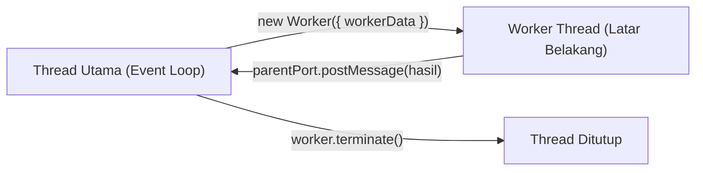

# Worker Threads

> Ringkasan
> - Tingkat: Pendukung
> - Fungsi: Menjalankan eksekusi kode JavaScript secara paralel di thread terpisah pada proses yang sama untuk menangani komputasi berat.
> - Digunakan saat: Pemrosesan komputasi CPU bound (kompresi besar, kalkulasi matematika, pemrosesan citra, enkripsi berat) tanpa membekukan Event Loop thread utama.
> - Aturan praktis: Selalu gunakan worker threads hanya untuk operasi CPU bound; gunakan I/O asinkron biasa untuk operasi jaringan atau disk.

## Cheat Sheet

| Tugas | Kode |
| :--- | :--- |
| Memeriksa status thread utama | `isMainThread` |
| Menginstansiasi thread worker baru | `const w = new Worker("./worker.mjs");` |
| Meneruskan data awal saat pembuatan | `new Worker(src, { workerData: { n: 10 } });` |
| Mengakses data awal di sisi worker | `const data = workerData;` |
| Mengirim pesan dari worker ke induk | `parentPort.postMessage({ status: "OK" });` |
| Mendengarkan pesan dari thread worker | `worker.on("message", (msg) => {});` |
| Mematikan thread worker secara paksa | `await worker.terminate();` |

## Tujuan Belajar

- Memahami arsitektur multi-threading di Node.js dan perbedaannya dengan model single-threaded Event Loop.
- Membedakan peran thread utama (`isMainThread`) dan thread latar belakang.
- Mengirim dan menerima pesan data antar-thread melalui `MessagePort` dan `postMessage()`.
- Mengisolasi dan menghentikan worker thread memakai metode `terminate()`.

## Konsep

Bayangkan sebuah kantor pelayanan publik dengan satu petugas loket utama (Event Loop). Petugas loket sangat cepat melayani warga yang hanya ingin mengambil stempel atau surat siap jadi (operasi I/O asinkron). Namun, jika ada satu warga yang meminta kuitansi perhitungan pajak rumit selama 30 menit (operasi CPU bound), antrean warga lain di belakangnya akan macet total. Modul `node:worker_threads` memungkinkan petugas loket memanggil staf kalkulator di ruang belakang (Worker Thread), menyerahkan lembar perhitungan tersebut, lalu kembali melayani antrean warga berikutnya tanpa terhenti. Begitu hitungan selesai, staf ruang belakang mengantarkan hasilnya ke loket.



## Referensi

| Item | Fungsi | Catatan |
| :--- | :--- | :--- |
| `isMainThread` | Boolean penanda apakah kode sedang berjalan di thread utama | Bernilai `true` di thread utama, `false` di worker |
| `Worker` | Class untuk membuat dan mengendalikan thread baru | Menerima path file modul atau opsi `{ eval: true }` |
| `parentPort` | Instance `MessagePort` untuk berkomunikasi dengan thread induk | Bernilai `null` jika diakses di thread utama |
| `workerData` | Data apa pun yang diteruskan saat konstruksi worker | Diduplikasi secara mendalam via `structuredClone` |
| `worker.postMessage(value)` | Mengirimkan pesan dari thread utama ke worker | Data otomatis diserialisasi dan di-clone |
| `worker.on('message', cb)` | Mendaftarkan listener untuk menangkap data dari worker | Berjalan setiap kali worker memanggil `postMessage` |
| `worker.terminate()` | Menghentikan thread worker sesegera mungkin | Mengembalikan `Promise<number>` kode status keluar |

### `isMainThread`

`isMainThread` adalah variabel boolean bawaan untuk membedakan apakah file sedang dijalankan sebagai thread utama atau sebagai thread pekerja anak.

Struktur parameter: properti boolean bawaan tanpa pemanggilan fungsi.

Nilai kembalian: boolean `true` atau `false` (`boolean`).

```javascript
import { isMainThread } from "node:worker_threads";

console.log(isMainThread);
// Output: true
```

Kondisi khusus: Properti ini sering digunakan jika satu file yang sama difungsikan sekaligus sebagai thread induk dan skrip worker.

### `Worker`

Class `Worker` mengalokasikan thread sistem operasi baru dan menjalankan skrip JavaScript di lingkungan V8 isolate terpisah.

Struktur parameter: `new Worker(filenameOrCode, options)`
- `filenameOrCode` (string atau URL, wajib): path ke file modul worker atau potongan kode string jika memakai opsi `eval`.
- `options` (object, opsional): pengaturan seperti `{ workerData, eval: boolean }`.

Nilai kembalian: instance `Worker` baru (`Worker`).

```javascript
import { Worker } from "node:worker_threads";

const worker = new Worker(
  `import { parentPort } from "node:worker_threads";
   parentPort.postMessage("Ready");`,
  { eval: true }
);

worker.on("message", (msg) => {
  console.log(msg);
  worker.terminate();
});
// Output:
// Ready
```

Kondisi khusus: Setiap instance Worker memiliki runtime V8 isolate sendiri sehingga membutuhkan alokasi memori awal tambahan (overhead memori per thread).

### `parentPort` dan `workerData`

`workerData` menampung parameter awal saat pembuatan worker, sedangkan `parentPort` adalah kanal dua arah bagi worker untuk mengirim pesan kembali ke thread utama.

Struktur parameter: `workerData` adalah nilai arbitrary. `parentPort` memiliki metode `.postMessage(data)`.

Nilai kembalian: `parentPort.postMessage` mengembalikan `void`.

```javascript
import { Worker } from "node:worker_threads";

const worker = new Worker(
  `import { parentPort, workerData } from "node:worker_threads";
   parentPort.postMessage({ double: workerData.num * 2 });`,
  { eval: true, workerData: { num: 21 } }
);

worker.on("message", (data) => {
  console.log(data.double);
  worker.terminate();
});
// Output:
// 42
```

Kondisi khusus: Di dalam thread utama, nilai `parentPort` selalu berupa `null`.

### `worker.terminate()`

`worker.terminate()` memaksa eksekusi thread worker untuk segera berhenti dan membebaskan alokasi memori thread dari sistem operasi.

Struktur parameter: `worker.terminate()` tanpa argumen wajib.

Nilai kembalian: `Promise<number>` yang mewakili kode status keluar thread.

```javascript
import { Worker } from "node:worker_threads";

const worker = new Worker('while(true) {}', { eval: true });
const exitCode = await worker.terminate();

console.log(exitCode);
// Output: 1
```

Kondisi khusus: Operasi pembatalan ini bersifat asinkron dan langsung menghentikan event loop worker tanpa menunggu tumpukan kode tuntas.

## Kesalahan Umum

### Menggunakan Worker Threads untuk Operasi I/O

Membuat worker threads untuk operasi I/O (seperti `fs.readFile` atau pemanggilan HTTP) justru memperlambat performa karena overhead inisialisasi thread dan transfer pesan.

```javascript
// Incorrect: Using worker threads for simple file I/O
const worker = new Worker("./read-file-worker.mjs");

// Correct: Use built-in asynchronous non-blocking modules
import fs from "node:fs/promises";
const data = await fs.readFile("./data.txt", "utf-8");
```

### Lupa Memanggil `worker.terminate()` Setelah Tugas Tuntas

Membuat worker baru tanpa pernah memanggil `.terminate()` akan meninggalkan thread aktif di latar belakang dan menghabiskan memori server.

```javascript
// Incorrect: Thread lingers indefinitely in background
function runTask() {
  const worker = new Worker("./task.mjs");
  worker.on("message", handleResult); // Thread memory leak
}

// Correct
function runTask() {
  const worker = new Worker("./task.mjs");
  worker.on("message", (res) => {
    handleResult(res);
    worker.terminate(); // Free thread resources
  });
}
```

## Studi Kasus

Mendelegasikan kalkulasi matematika berat (penjumlahan rentang angka besar) ke thread latar belakang agar thread utama tetap responsif menangani operasi lainnya.

```javascript
import { Worker } from "node:worker_threads";

function calculateSumAsync(limit) {
  return new Promise((resolve, reject) => {
    const workerScript = `
      import { parentPort, workerData } from "node:worker_threads";
      let sum = 0;
      for (let i = 1; i <= workerData.max; i++) {
        sum += i;
      }
      parentPort.postMessage({ max: workerData.max, total: sum });
    `;

    const worker = new Worker(workerScript, {
      eval: true,
      workerData: { max: limit },
    });

    worker.on("message", (result) => {
      worker.terminate();
      resolve(result);
    });

    worker.on("error", (err) => {
      worker.terminate();
      reject(err);
    });
  });
}

const computation = await calculateSumAsync(100);
console.log(computation.total);
// Output: 5050
```

Pola delegasi thread ini menjamin Event Loop thread utama tidak pernah terblokir oleh loop kalkulasi panjang, menjaga latency server tetap rendah di bawah beban komputasi tinggi.

## Latihan Mandiri

Buat fungsi `executeWorkerTask(taskPayload, options = {})` untuk memproses tugas kalkulasi di thread worker latar belakang.

- **Level 1 (Dasar):** Buat instance `Worker` memakai opsi `eval: true` yang menerima `workerData`. Worker menghitung hasil penggandaan nilai properti `value` (`value * 2`) dan mengirimkannya via `parentPort.postMessage()`. Tangkap hasilnya di event `'message'` dan kembalikan Promise `{ success: true, data: result }`.
- **Level 2 (Menengah):** Tangani event `'error'` pada instance worker untuk menolak Promise saat terjadi error runtime. Pastikan worker selalu dimatikan memakai `.terminate()` setelah tugas selesai atau gagal untuk mencegah kebocoran thread.
- **Level 3 (Menantang):** Dukung opsi batas waktu `options.timeoutMs`. Jika worker tidak merespons dalam batas waktu tersebut, hentikan worker via `.terminate()` dan lempar `Error("Worker execution exceeded timeout limit")`. Jika `taskPayload` bukan objek atau bernilai `null`, lempar `TypeError("Task payload must be an object")`.

Contoh input dan output normal:

```javascript
const res = await executeWorkerTask({ value: 25 });

console.log(res.success);
// Output: true
console.log(res.data);
// Output: 50
```

Contoh input dan penanganan error:

```javascript
try {
  await executeWorkerTask(null);
} catch (err) {
  console.log(err.message);
  // Output: Task payload must be an object
}
```

Tanda selesai:
- [ ] Worker thread berhasil dibuat dan mengeksekusi komputasi secara paralel.
- [ ] Kanal komunikasi antar-thread mentransfer data dengan tepat.
- [ ] Instance worker dimatikan via `terminate()` dan batas waktu timeout tertangani aman.

---

## Navigasi

[Sebelumnya: OS](../13-os/README.md) | [Selanjutnya: Zlib](../15-zlib/README.md) | [Daftar Isi](../README.md)
