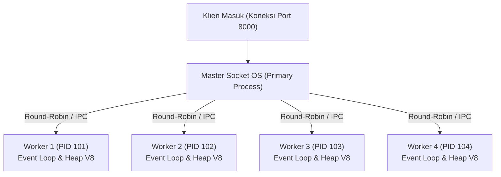

# Cluster

> Ringkasan
>
> - Fungsi: Menduplikasi satu proses Node.js menjadi beberapa proses pekerja (_worker process_) yang berbagi port jaringan yang sama guna memaksimalkan pemanfaatan prosesor multi-core.
> - Digunakan saat: Meningkatkan kapasitas lalu lintas server HTTP atau jaringan pada mesin multi-core tanpa perlu mengubah arsitektur kode secara rumit.
> - Aturan praktis: Setiap worker memiliki memori (heap V8) dan Event Loop terpisah (_share-nothing architecture_). Oleh sebab itu, data sesi login atau cache bersama sebaiknya disimpan di penyimpanan eksternal terpusat seperti Redis atau database.

---

## Tujuan Belajar

- Memahami batasan model proses tunggal (_single-threaded event loop_) pada komputer dengan prosesor multi-core.
- Membedakan peran proses utama (`cluster.isPrimary`) dan proses pekerja anak (`cluster.isWorker`).
- Menggandakan proses worker secara terprogram menggunakan metode `cluster.fork()`.
- Mengelola komunikasi antar-proses (IPC - _Inter-Process Communication_) antara Primary dan Worker via `worker.send()` dan event `'message'`.
- Menerapkan mekanisme pemulihan mandiri (_self-healing_) saat ada proses worker yang mati lewat event `cluster.on('exit')`.

---

## Konsep

Modul cluster bisa kita bayangkan seperti gerbang pembayaran tiket tol di jalan raya. Pada arsitektur satu proses biasa, hanya ada satu pintu loket yang dibuka dengan satu petugas. Meskipun ada ribuan kendaraan mengantre dan gedung tol sebenarnya memiliki 8 gardu fisik (8 core CPU), 7 gardu lainnya dibiarkan tutup dan menganggur.

Dengan arsitektur cluster, aplikasi membuka ke-8 gardu loket secara serentak (8 worker process). Di bagian depan, ada satu petugas koordinator (_Primary process_) yang bertugas menyambut kendaraan yang datang lalu mengarahkannya ke loket 1, 2, 3, dan seterusnya secara bergantian dan adil (_Round-Robin_).



---

## Referensi

| Item                     | Fungsi                                                                  | Catatan                                                                   |
| :----------------------- | :---------------------------------------------------------------------- | :------------------------------------------------------------------------ |
| **`cluster.isPrimary`**  | Menandai apakah proses saat ini bertindak sebagai proses utama          | Bernilai `true` hanya pada proses induk awal yang mengendalikan sistem    |
| **`cluster.isWorker`**   | Menandai apakah proses saat ini bertindak sebagai proses pekerja anak   | Bernilai `true` pada seluruh proses pekerja yang dihasilkan oleh `fork()` |
| **`cluster.fork()`**     | Melahirkan proses pekerja baru dari proses utama                        | Menghasilkan instance `Worker` baru dengan alokasi memori heap terpisah   |
| **`cluster.workers`**    | Objek yang menyimpan daftar seluruh worker yang sedang aktif            | Memetakan ID unik worker dan terhapus otomatis saat worker mati           |
| **`worker.send()`**      | Mengirimkan pesan data melalui saluran IPC internal                     | Menghubungkan proses utama dan worker tanpa perlu soket jaringan luar     |
| **`worker.process.pid`** | Membaca ID proses (_Process Identifier_) milik worker di sistem operasi | Membantu proses pencatatan log diagnostik dan pelacakan kinerja           |
| **`cluster.on('exit')`** | Menangkap event saat proses pekerja berhenti atau mati                  | Fondasi utama untuk membuat fitur pemulihan otomatis (_self-healing_)     |

### `cluster.isPrimary`

Properti boolean `cluster.isPrimary` digunakan untuk mengecek apakah kode kita sedang berjalan di dalam proses induk pengendali. Blok ini biasanya dipakai untuk melahirkan proses pekerja anak dan memantau kesehatan sistem.

```javascript
import cluster from "node:cluster";

console.log(cluster.isPrimary);
// Output: true
```

Kasus lain: Memeriksa nilai properti `cluster.isPrimary` saat dieksekusi di dalam proses pekerja anak yang menghasilkan nilai `false`.

```javascript
import cluster from "node:cluster";

if (cluster.isPrimary) {
  const worker = cluster.fork();
  worker.on("message", (isPrimaryInWorker) => {
    console.log("isPrimary in worker:", isPrimaryInWorker);
    // Output: isPrimary in worker: false
    worker.kill();
  });
} else {
  process.send(cluster.isPrimary);
}
```

### `cluster.isWorker`

Properti boolean `cluster.isWorker` digunakan untuk memastikan apakah kode sedang berjalan di dalam proses pekerja anak. Di dalam blok inilah kita meletakkan kode server HTTP atau pemrosesan data utama.

```javascript
import cluster from "node:cluster";

console.log(cluster.isWorker);
// Output: false
```

Kasus lain: Membandingkan alias lama `cluster.isMaster` yang sudah usang dan digantikan resmi oleh `cluster.isPrimary`.

```javascript
import cluster from "node:cluster";

console.log(cluster.isPrimary === !cluster.isWorker);
// Output: true
```

### `cluster.fork()`

Metode `cluster.fork()` dipakai untuk menduplikasi aplikasi menjadi proses pekerja anak yang baru. Metode ini hanya boleh dipanggil dari dalam konteks `cluster.isPrimary`.

```javascript
import cluster from "node:cluster";

if (cluster.isPrimary) {
  const worker = cluster.fork();
  console.log("Worker registered:", worker.id > 0);
  // Output: Worker registered: true
  worker.kill();
}
```

Kasus lain: Menyelipkan variabel lingkungan kustom saat membuat proses pekerja baru.

```javascript
import cluster from "node:cluster";

if (cluster.isPrimary) {
  const worker = cluster.fork({ QUEUE_ID: "queue-1" });
  console.log(typeof worker.id);
  // Output: number
  worker.kill();
}
```

### `cluster.workers`

Properti `cluster.workers` adalah objek kamus yang memetakan nomor ID unik ke setiap instance worker yang sedang aktif di bawah pengawasan proses utama.

```javascript
import cluster from "node:cluster";

if (cluster.isPrimary) {
  const worker = cluster.fork();
  const workerIds = Object.keys(cluster.workers);
  console.log(workerIds.length);
  // Output: 1
  worker.kill();
}
```

Kasus lain: Mengirimkan instruksi serentak ke semua worker yang terdaftar di dalam `cluster.workers`.

```javascript
import cluster from "node:cluster";

if (cluster.isPrimary) {
  const worker = cluster.fork();
  for (const id in cluster.workers) {
    cluster.workers[id].send("BROADCAST_SIGNAL");
  }
  worker.kill();
}
```

### `worker.send()`

Metode `worker.send()` digunakan untuk berkirim pesan antar-proses lewat saluran IPC (_Inter-Process Communication_) internal secara efisien tanpa memerlukan koneksi soket jaringan TCP tambahan.

```javascript
import cluster from "node:cluster";

if (cluster.isPrimary) {
  const worker = cluster.fork();
  worker.on("message", (message) => {
    console.log("Reply:", message);
    // Output: Reply: Hello Primary
    worker.kill();
  });
  worker.send("Hello Worker");
} else {
  process.on("message", (message) => {
    if (message === "Hello Worker") {
      process.send("Hello Primary");
    }
  });
}
```

Kasus lain: Mengirimkan pesan berupa objek data terstruktur atau payload JSON.

```javascript
import cluster from "node:cluster";

if (cluster.isPrimary) {
  const worker = cluster.fork();
  worker.send({ type: "CONFIG", port: 3000 });
  worker.kill();
}
```

### `worker.process.pid`

Properti `worker.process.pid` menyimpan nomor identitas unik proses sistem operasi (_Process Identifier_) milik anak proses pekerja terkait.

```javascript
import cluster from "node:cluster";

if (cluster.isPrimary) {
  const worker = cluster.fork();
  console.log("PID type:", typeof worker.process.pid);
  // Output: PID type: number
  worker.kill();
}
```

Kasus lain: Membuktikan bahwa nomor PID proses utama berbeda dengan nomor PID proses pekerja di tingkat sistem operasi.

```javascript
import cluster from "node:cluster";

if (cluster.isPrimary) {
  const worker = cluster.fork();
  console.log(process.pid !== worker.process.pid);
  // Output: true
  worker.kill();
}
```

### `cluster.on('exit')`

Event `'exit'` pada objek `cluster` akan dipancarkan saat salah satu anak proses pekerja mati, baik karena selesai bertugas secara normal, mengalami error fatal, maupun dimatikan paksa oleh sistem.

```javascript
import cluster from "node:cluster";

if (cluster.isPrimary) {
  cluster.fork();
  cluster.on("exit", (worker, code, signal) => {
    console.log("Exit code:", code, "Signal:", signal);
    // Output: Exit code: 0 Signal: null
  });
} else {
  process.exit(0);
}
```

Kasus lain: Melahirkan worker pengganti secara otomatis saat ada worker yang berhenti tidak wajar (_self-healing_).

```javascript
import cluster from "node:cluster";

if (cluster.isPrimary) {
  const worker = cluster.fork();
  cluster.on("exit", (deadWorker, code) => {
    if (code !== 0) {
      console.log("Starting replacement worker");
      // Output: Starting replacement worker
    }
  });
  worker.process.kill("SIGKILL");
}
```

### Perbandingan: Proses Utama (Primary) vs Proses Pekerja (Worker)

| Karakteristik         | Proses Utama (Primary)                       | Proses Pekerja (Worker)                          |
| :-------------------- | :------------------------------------------- | :----------------------------------------------- |
| **Pengecekan Status** | `cluster.isPrimary === true`                 | `cluster.isWorker === true`                      |
| **Peran Utama**       | Mengatur siklus hidup dan koordinasi worker  | Menangani koneksi jaringan dan memproses request |
| **Penggunaan Port**   | Memegang kendali soket master sistem operasi | Berbagi port jaringan bersama secara otomatis    |
| **Jumlah Proses**     | Selalu tepat 1 proses                        | Umumnya disesuaikan dengan jumlah core CPU       |

### Perbandingan: `node:cluster` vs `node:worker_threads`

| Karakteristik         | `node:cluster` (Multi-Proses)               | `node:worker_threads` (Multi-Threading)          |
| :-------------------- | :------------------------------------------ | :----------------------------------------------- |
| **Ruang Memori**      | Terisolasi per proses (_share-nothing_)     | Berbagi memori dalam satu proses yang sama       |
| **Penggunaan Memori** | Lebih besar (~30MB per proses V8 baru)      | Jauh lebih ringan (~1-3MB per thread)            |
| **Berbagi Data**      | Lewat saluran IPC berbasis serialisasi teks | Dapat memakai `SharedArrayBuffer` langsung       |
| **Kapan Digunakan**   | Skalabilitas I/O server web multi-core      | Komputasi berat yang membebani CPU (_CPU-bound_) |

---

## Kesalahan Umum

### Menyimpan Sesi Pengguna di Memori Lokal Worker

Setiap worker memiliki ruang memori heap V8 sendiri. Jika data login atau sesi disimpan di variabel lokal Worker A, maka saat pengguna yang sama mengirim request berikutnya dan diarahkan ke Worker B, data sesinya tidak akan ditemukan.

```javascript
// Salah
const sessionStore = new Map();
// Sesi disimpan di Worker A, tapi saat request berikutnya tiba di Worker B, data tidak ada
```

```javascript
// Benar
// Simpan sesi terpusat di penyimpanan bersama seperti Redis atau database
await redisClient.set(`session:${userId}`, sessionData);
```

### Membuat Jumlah Worker Jauh Melebihi Jumlah Core CPU

Menjalankan puluhan proses worker pada server yang hanya memiliki sedikit core CPU justru akan menurunkan kinerja server secara drastis akibat beban pergantian konteks (_context switching_) yang terlalu padat di sistem operasi.

```javascript
// Salah
for (let i = 0; i < 64; i++) {
  cluster.fork();
}
```

```javascript
// Benar
import os from "node:os";

const cpuCount = os.availableParallelism();
for (let i = 0; i < cpuCount; i++) {
  cluster.fork();
}
```

### Tidak Menangani Kematian Worker

Jika proses worker mengalami crash tanpa ada listener event `'exit'` yang membuatkan proses pengganti, kapasitas server akan berkurang secara perlahan hingga akhirnya seluruh worker mati dan server tidak bisa diakses lagi.

```javascript
// Salah
if (cluster.isPrimary) {
  cluster.fork();
}
```

```javascript
// Benar
if (cluster.isPrimary) {
  cluster.fork();
  cluster.on("exit", (worker, code) => {
    if (code !== 0) {
      cluster.fork(); // Buat worker pengganti jika worker lama mati karena error
    }
  });
}
```

---

## Studi Kasus

Skenario: Membangun server HTTP multi-proses mandiri dengan pembagian beban otomatis, pencatatan total jumlah permintaan melalui saluran IPC ke proses utama, serta penutupan proses worker yang bersih.

```javascript
import cluster from "node:cluster";
import http from "node:http";

if (cluster.isPrimary) {
  let requestCount = 0;
  const worker = cluster.fork();

  worker.on("message", (message) => {
    if (message.type === "REQUEST_RECEIVED") {
      requestCount++;
      console.log("Total requests in Primary:", requestCount);
      worker.kill();
    }
  });

  cluster.on("exit", () => {
    console.log("Worker terminated, orchestration ended");
  });
} else {
  const server = http.createServer((req, res) => {
    process.send({ type: "REQUEST_RECEIVED" });
    res.writeHead(200, { "Content-Type": "application/json" });
    res.end(JSON.stringify({ pid: process.pid }));
  });

  server.listen(0, async () => {
    const { port } = server.address();
    await fetch(`http://127.0.0.1:${port}`);
    server.close();
  });
}

// Output:
// Total requests in Primary: 1
// Worker terminated, orchestration ended
```

Desain ini membagi peran secara jelas: proses utama mengelola pencatatan metrik global, sedangkan proses pekerja fokus melayani transaksi HTTP. Arsitektur _share-nothing_ ini membuat aplikasi aman dari benturan penguncian memori, sekaligus memanfaatkan fitur pembagian port otomatis bawaan sistem operasi.

---

## Latihan Mandiri

### Soal 1 (Dasar)

Buat fungsi `calculateWorkerAllocation(customQuota)` yang menghitung jumlah worker ideal yang boleh dibuat. Fungsi membaca jumlah inti CPU yang tersedia menggunakan `os.availableParallelism()`. Jika argumen `customQuota` berupa bilangan bulat positif yang lebih kecil dari kapasitas CPU, gunakan angka tersebut. Jika `customQuota` melebihi kuota CPU atau bernilai tidak valid, batasi maksimal sebesar jumlah core CPU sistem.

Contoh input (asumsi komputer memiliki 4 core fisik):

```javascript
calculateWorkerAllocation(2);
```

Contoh output yang diharapkan:

```javascript
2;
```

Batasan: Gunakan modul bawaan `node:os` dengan fungsi `availableParallelism()`.

### Soal 2 (Menengah)

Buat fungsi pembagian tugas bergantian `distributeTasksToWorkers(workerIds, taskQueue)` yang membagi daftar pekerjaan secara bergantian dan merata (_Round-Robin_) ke seluruh worker yang terdaftar. Fungsi harus mengembalikan objek kamus yang memetakan setiap ID worker ke daftar tugas yang diterimanya.

Contoh input:

```javascript
distributeTasksToWorkers(
  ["w1", "w2"],
  ["taskA", "taskB", "taskC", "taskD", "taskE"],
);
```

Contoh output yang diharapkan:

```javascript
{
  w1: [ 'taskA', 'taskC', 'taskE' ],
  w2: [ 'taskB', 'taskD' ]
}
```

Batasan: Gunakan fungsi murni berbasis pengolahan array tanpa dependensi luar. Jika `workerIds` kosong, kembalikan objek kosong `{}`.

### Soal 3 (Menantang)

Buat fungsi pengontrol batas frekuensi kematian worker `createCrashLoopBreaker(maxCrashCount, windowMs)`. Fungsi ini bertindak sebagai sakelar pengaman (_circuit breaker_) untuk mencegah proses utama terus-menerus melahirkan worker baru secara liar (_crash loop_) saat terjadi error sistem yang fatal dalam rentang waktu singkat.

Ketentuan fungsional:

1. Fungsi mengembalikan objek pengendali dengan metode `recordWorkerCrash(workerId)`.
2. Setiap kali `recordWorkerCrash` dipanggil:
   - Catat stempel waktu (_timestamp_) saat kematian terjadi.
   - Bersihkan catatan riwayat kematian yang usianya sudah melewati batas `windowMs` dari waktu sekarang (_sliding time window_).
   - Jika jumlah kematian dalam rentang aktif masih di bawah atau sama dengan `maxCrashCount`, kembalikan objek `{ allowFork: true, activeCrashCount: number }`.
   - Jika jumlah kematian sudah melampaui `maxCrashCount`, aktifkan status pemutus dan tolak pembuatan worker baru dengan mengembalikan `{ allowFork: false, activeCrashCount: number, reason: 'CRASH_LOOP_DETECTED' }`.
3. Sediakan metode `resetStatus()` untuk mengosongkan seluruh riwayat dan mengembalikan status ke kondisi normal.

Contoh simulasi:

```javascript
const breaker = createCrashLoopBreaker(2, 5000);

breaker.recordWorkerCrash(101);
// Hasil: { allowFork: true, activeCrashCount: 1 }

breaker.recordWorkerCrash(102);
// Hasil: { allowFork: true, activeCrashCount: 2 }

breaker.recordWorkerCrash(103);
// Hasil: { allowFork: false, activeCrashCount: 3, reason: 'CRASH_LOOP_DETECTED' }
```

Batasan: Gunakan logika murni berbasis selisih waktu tanpa bantuan library eksternal.

---

## Navigasi

[Sebelumnya: HTTP](../14-http/README.md) | [Selanjutnya: Worker Threads](../16-worker-threads/README.md) | [Daftar Isi](../README.md)
