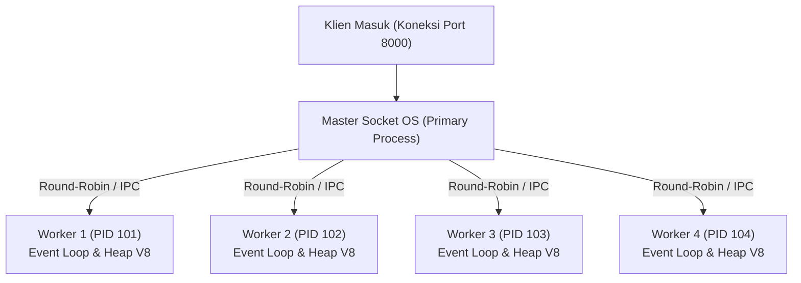

# Cluster

> Ringkasan
>
> - Fungsi: Menduplikasi satu proses Node.js menjadi beberapa proses pekerja (*worker process*) yang berbagi port jaringan yang sama untuk memaksimalkan utilisasi multi-core CPU.
> - Digunakan saat: Meningkatkan kapasitas throughput server HTTP atau jaringan pada mesin fisik berkemampuan multi-core tanpa mengubah arsitektur kode secara drastis.
> - Aturan praktis: Setiap worker memiliki memori (heap V8) dan Event Loop terpisah (*share-nothing architecture*), sehingga status sesi (*state*) atau cache bersama harus disimpan di penyimpanan eksternal terpusat seperti basis data atau Redis.

---

## Tujuan Belajar

- Memahami batasan model proses tunggal (*single-threaded event loop*) pada sistem prosesor multi-core.
- Membedakan peran proses utama (`cluster.isPrimary`) dan proses pekerja (`cluster.isWorker`).
- Menduplikasi proses worker secara terprogram menggunakan metode `cluster.fork()`.
- Mengelola komunikasi antar proses (IPC - *Inter-Process Communication*) antara Primary dan Worker via `worker.send()` dan event `'message'`.
- Menerapkan mekanisme pemulihan mandiri (*self-healing*) saat proses worker mati melalui event `cluster.on('exit')`.

---

## Konsep

> Modul cluster dianalogikan seperti gerbang pintu tol di jalan raya. Pada arsitektur proses tunggal, hanya ada 1 pintu loket yang dibuka dengan 1 petugas. Meskipun ada ribuan mobil yang mengantre dan gedung tol memiliki 8 pintu fisik (8 core CPU), 7 pintu lainnya dibiarkan menganggur. Dengan arsitektur cluster, sistem membuka 8 pintu loket secara serentak (8 worker proses). Terdapat 1 petugas koordinator (*Primary process*) di pintu masuk yang mengarahkan kendaraan yang datang secara bergantian ke loket 1, 2, 3, dan seterusnya secara merata (*Round-Robin*).



---

## Referensi

| Item | Fungsi | Catatan |
| :--- | :----- | :------ |
| **`cluster.isPrimary`** | Menandai apakah proses saat ini bertindak sebagai proses utama | Bernilai `true` hanya pada proses induk pengendali awal |
| **`cluster.isWorker`** | Menandai apakah proses saat ini bertindak sebagai anak proses pekerja | Bernilai `true` pada seluruh anak proses yang dibuat oleh `fork()` |
| **`cluster.fork()`** | Melahirkan proses pekerja baru dari proses utama | Menghasilkan instans `Worker` baru dengan alokasi heap terpisah |
| **`cluster.workers`** | Objek kamus penyimpan seluruh referensi worker yang aktif | Menggunakan properti ID worker dan terhapus otomatis saat worker mati |
| **`worker.send()`** | Mengirimkan pesan data melalui saluran IPC internal | Menghubungkan komunikasi antar proses tanpa soket jaringan eksternal |
| **`worker.process.pid`** | Membaca ID proses (*Process Identifier*) milik worker | Berguna untuk pencatatan log diagnostik dan pelacakan telemetri |
| **`cluster.on('exit')`** | Menangkap event penghentian atau kematian proses pekerja | Fondasi penerapan pemulihan mandiri (*self-healing / auto-restart*) |

### `cluster.isPrimary`

Properti boolean `cluster.isPrimary` digunakan untuk mengidentifikasi apakah kode sedang dieksekusi di dalam proses induk pengendali. Blok percabangan ini umumnya digunakan untuk menginisialisasi proses pekerja dan memantau status sistem.

```javascript
import cluster from "node:cluster";

console.log(cluster.isPrimary);
// Output: true
```

Kasus lain: Memeriksa nilai properti `cluster.isPrimary` saat dieksekusi di dalam anak proses pekerja yang mengembalikan nilai `false`.

```javascript
import cluster from "node:cluster";

if (cluster.isPrimary) {
  const worker = cluster.fork();
  worker.on("message", (isPrimaryDiWorker) => {
    console.log("isPrimary di worker:", isPrimaryDiWorker);
    // Output: isPrimary di worker: false
    worker.kill();
  });
} else {
  process.send(cluster.isPrimary);
}
```

### `cluster.isWorker`

Properti boolean `cluster.isWorker` digunakan untuk memverifikasi apakah eksekusi kode berada pada konteks proses pekerja anak. Blok percabangan ini digunakan untuk menempatkan logika server HTTP atau penanganan komputasi.

```javascript
import cluster from "node:cluster";

console.log(cluster.isWorker);
// Output: false
```

Kasus lain: Membedakan alias legacy `cluster.isMaster` yang sudah usang dan digantikan secara resmi oleh `cluster.isPrimary`.

```javascript
import cluster from "node:cluster";

console.log(cluster.isPrimary === !cluster.isWorker);
// Output: true
```

### `cluster.fork()`

Metode `cluster.fork()` digunakan untuk menduplikasi proses aplikasi saat ini menjadi anak proses pekerja baru. Metode ini hanya boleh dipanggil dari dalam konteks `cluster.isPrimary`.

```javascript
import cluster from "node:cluster";

if (cluster.isPrimary) {
  const worker = cluster.fork();
  console.log("Worker terdaftar:", worker.id > 0);
  // Output: Worker terdaftar: true
  worker.kill();
}
```

Kasus lain: Meneruskan variabel lingkungan kustom saat memanggil proses pekerja baru.

```javascript
import cluster from "node:cluster";

if (cluster.isPrimary) {
  const worker = cluster.fork({ ANTRIAN_ID: "antrian-1" });
  console.log(typeof worker.id);
  // Output: number
  worker.kill();
}
```

### `cluster.workers`

Properti `cluster.workers` adalah objek kamus yang memetakan ID unik worker ke instans objek worker yang sedang berjalan aktif di bawah kendali proses utama.

```javascript
import cluster from "node:cluster";

if (cluster.isPrimary) {
  const worker = cluster.fork();
  const daftarId = Object.keys(cluster.workers);
  console.log(daftarId.length);
  // Output: 1
  worker.kill();
}
```

Kasus lain: Mengirimkan sinyal siaran ke seluruh proses pekerja yang terdaftar di dalam `cluster.workers`.

```javascript
import cluster from "node:cluster";

if (cluster.isPrimary) {
  const worker = cluster.fork();
  for (const id in cluster.workers) {
    cluster.workers[id].send("SINYAL_SIARAN");
  }
  worker.kill();
}
```

### `worker.send()`

Metode `worker.send()` digunakan untuk mengirimkan pesan serialisasi data melalui saluran IPC (*Inter-Process Communication*) internal antara proses utama dan proses pekerja tanpa melibatkan komunikasi soket TCP eksternal.

```javascript
import cluster from "node:cluster";

if (cluster.isPrimary) {
  const worker = cluster.fork();
  worker.on("message", (pesan) => {
    console.log("Balasan:", pesan);
    // Output: Balasan: Halo Primary
    worker.kill();
  });
  worker.send("Halo Worker");
} else {
  process.on("message", (pesan) => {
    if (pesan === "Halo Worker") {
      process.send("Halo Primary");
    }
  });
}
```

Kasus lain: Menangani pengiriman pesan serialisasi objek kompleks atau objek JSON terstruktur.

```javascript
import cluster from "node:cluster";

if (cluster.isPrimary) {
  const worker = cluster.fork();
  worker.send({ tipe: "KONFIGURASI", port: 3000 });
  worker.kill();
}
```

### `worker.process.pid`

Properti `worker.process.pid` menyimpan nomor identitas proses sistem operasi (*Process Identifier*) milik anak proses pekerja yang dihasilkan.

```javascript
import cluster from "node:cluster";

if (cluster.isPrimary) {
  const worker = cluster.fork();
  console.log("Tipe PID:", typeof worker.process.pid);
  // Output: Tipe PID: number
  worker.kill();
}
```

Kasus lain: Membandingkan PID proses utama dengan PID milik proses pekerja yang terbukti berbeda di tingkat sistem operasi.

```javascript
import cluster from "node:cluster";

if (cluster.isPrimary) {
  const worker = cluster.fork();
  console.log(process.pid !== worker.process.pid);
  // Output: true
  worker.kill();
}
```

### `cluster.on('exit')`

Event `'exit'` pada objek `cluster` dipancarkan ketika salah satu anak proses pekerja mati, baik karena keluar normal, galat runtime fatal, maupun sinyal terminasi eksternal.

```javascript
import cluster from "node:cluster";

if (cluster.isPrimary) {
  cluster.fork();
  cluster.on("exit", (worker, kode, sinyal) => {
    console.log("Kode keluar:", kode, "Sinyal:", sinyal);
    // Output: Kode keluar: 0 Sinyal: null
  });
} else {
  process.exit(0);
}
```

Kasus lain: Menghidupkan kembali worker baru saat terjadi penghentian tidak wajar (*self-healing*).

```javascript
import cluster from "node:cluster";

if (cluster.isPrimary) {
  const worker = cluster.fork();
  cluster.on("exit", (workerMati, kode) => {
    if (kode !== 0) {
      console.log("Memulai worker pengganti");
      // Output: Memulai worker pengganti
    }
  });
  worker.process.kill("SIGKILL");
}
```

### Perbandingan: Proses Utama (Primary) vs Proses Pekerja (Worker)

| Karakteristik | Proses Utama (Primary) | Proses Pekerja (Worker) |
| :--- | :--- | :--- |
| **Identitas Status** | `cluster.isPrimary === true` | `cluster.isWorker === true` |
| **Tugas Pokok** | Mengatur orkestrasi dan siklus hidup worker | Melayani koneksi soket jaringan dan beban kerja |
| **Mendengarkan Port Server** | Mengatur socket master sistem operasi | Berbagi port bersama secara transparan |
| **Jumlah Instans** | Selalu tepat 1 proses | Umumnya disesuaikan dengan kapasitas core CPU |

### Perbandingan: `node:cluster` vs `node:worker_threads`

| Karakteristik | `node:cluster` (Multi-Proses) | `node:worker_threads` (Multi-Threading) |
| :--- | :--- | :--- |
| **Ruang Memori** | Terisolasi per proses (*share-nothing*) | Berbagi memori dalam satu proses yang sama |
| **Konsumsi Memori** | Lebih besar (~30MB per proses V8 baru) | Sangat ringan (~1-3MB per thread) |
| **Mekanisme Berbagi Data** | Saluran IPC berbasis serialisasi data | Dapat menggunakan `SharedArrayBuffer` langsung |
| **Tujuan Kasus Penggunaan** | Skalabilitas I/O server HTTP multi-core | Paralelisasi komputasi intensif CPU (*CPU-bound*) |

---

## Kesalahan Umum

### Menyimpan Sesi Pengguna pada Variabel Memori Lokal Worker

Setiap proses worker memiliki ruang memori heap V8 sendiri sehingga data yang disimpan di variabel lokal worker tidak akan terbaca saat permintaan berikutnya ditangani oleh worker lain.

```javascript
// Salah
const daftarSesi = new Map();
// Permintaan 1 disimpan di Worker A, permintaan 2 di Worker B tidak menemukan sesi
```

```javascript
// Benar
// Simpan sesi terpusat di penyimpanan bersama seperti Redis atau basis data
await redisClient.set(`sesi:${userId}`, dataSesi);
```

### Mengalokasikan Jumlah Worker Jauh Melebihi Kuota Inti CPU

Menjalankan puluhan proses worker pada server dengan jumlah inti CPU terbatas memicu degradasi performa drastis akibat beban peralihan konteks (*context switching*) berlebih di tingkat sistem operasi.

```javascript
// Salah
for (let i = 0; i < 64; i++) {
  cluster.fork();
}
```

```javascript
// Benar
import os from "node:os";

const kuotaCpu = os.availableParallelism();
for (let i = 0; i < kuotaCpu; i++) {
  cluster.fork();
}
```

### Mengabaikan Pemulihan Kematian Worker

Jika proses worker mengalami crash fatal tanpa adanya penanganan event `'exit'` yang melakukan penggantian, kapasitas penanganan beban server akan menurun secara bertahap hingga seluruh proses worker mati.

```javascript
// Salah
if (cluster.isPrimary) {
  cluster.fork();
}
```

```javascript
// Benar
if (cluster.isPrimary) {
  cluster.fork();
  cluster.on("exit", (worker, kode) => {
    if (kode !== 0) {
      cluster.fork();
    }
  });
}
```

---

## Studi Kasus

Skenario: Membangun arsitektur server HTTP multi-proses mandiri dengan penyeimbang beban transparan, pelaporan metrik akumulasi permintaan melalui saluran IPC ke proses utama, dan penutupan bersih instans worker.

```javascript
import cluster from "node:cluster";
import http from "node:http";

if (cluster.isPrimary) {
  let totalPermintaan = 0;
  const worker = cluster.fork();

  worker.on("message", (pesan) => {
    if (pesan.tipe === "HIT_REQUEST") {
      totalPermintaan++;
      console.log("Total permintaan di Primary:", totalPermintaan);
      worker.kill();
    }
  });

  cluster.on("exit", () => {
    console.log("Worker selesai, orkestrasi berakhir");
  });
} else {
  const server = http.createServer((req, res) => {
    process.send({ tipe: "HIT_REQUEST" });
    res.writeHead(200, { "Content-Type": "application/json" });
    res.end(JSON.stringify({ pid: process.pid }));
  });

  server.listen(0, async () => {
    const { port } = server.address();
    await fetch(`http://127.0.0.1:${port}`);
    server.close();
  });
}

// Output:
// Total permintaan di Primary: 1
// Worker selesai, orkestrasi berakhir
```

Desain ini dipilih karena memisahkan tanggung jawab antara orkestrasi metrik global pada proses utama dan pemrosesan transaksi HTTP pada proses pekerja, menjaga arsitektur *share-nothing* yang aman tanpa perebutan kunci memori, serta memanfaatkan port berbagi otomatis bawaan sistem operasi.

---

## Latihan Mandiri

### Soal 1 (Dasar)

Buat fungsi `tentukanAlokasiWorker(kuotaKustom)` yang menghitung jumlah worker ideal yang boleh dibuat. Fungsi membaca jumlah konkurensi CPU yang tersedia menggunakan `os.availableParallelism()`. Jika argumen `kuotaKustom` berupa bilangan bulat positif yang lebih kecil dari kuota CPU, gunakan nilai tersebut. Jika `kuotaKustom` lebih besar dari kuota fisik atau bernilai tidak valid, batasi maksimal sebesar kuota CPU sistem.

Contoh masukan:

```javascript
// Asumsi mesin memiliki 4 core fisik CPU
tentukanAlokasiWorker(2);
```

Contoh keluaran yang diharapkan:

```javascript
2
```

Batasan: Gunakan modul bawaan `node:os` dengan fungsi `availableParallelism()`.

### Soal 2 (Menengah)

Buat fungsi distribusi tugas Round-Robin `bagiTugasKeWorker(daftarWorkerId, antreanPekerjaan)` yang membagi daftar string pekerjaan secara bergantian dan merata ke seluruh worker yang terdaftar. Fungsi harus mengembalikan objek kamus yang memetakan setiap worker ID ke larik pekerjaan yang dialokasikan untuknya.

Contoh masukan:

```javascript
bagiTugasKeWorker(
  ["w1", "w2"],
  ["tugasA", "tugasB", "tugasC", "tugasD", "tugasE"]
);
```

Contoh keluaran yang diharapkan:

```javascript
{
  w1: [ 'tugasA', 'tugasC', 'tugasE' ],
  w2: [ 'tugasB', 'tugasD' ]
}
```

Batasan: Gunakan fungsi murni berbasis manipulasi array tanpa dependensi eksternal. Jika `daftarWorkerId` kosong, kembalikan objek kosong `{}`.

### Soal 3 (Menantang)

Buat fungsi pengelola batas pemulihan worker `buatPenahanCrashLoop(batasMaksimalCrash, jendelaWaktuMs)`. Fungsi ini bertindak sebagai pemutus sirkuit (*circuit breaker*) untuk mencegah proses utama melakukan *crash-loop* tanpa henti saat aplikasi worker mengalami kegagalan berulang dalam rentang waktu singkat.

Ketentuan fungsional:
1. Fungsi mengembalikan objek pengendali dengan metode `catatKematianWorker(workerId)`.
2. Setiap kali `catatKematianWorker` dipanggil:
   - Catat stempel waktu (*timestamp*) saat kematian terjadi.
   - Buang seluruh catatan riwayat kematian yang usianya sudah melampaui `jendelaWaktuMs` dari waktu saat ini (*sliding time window*).
   - Jika jumlah riwayat kematian yang tersisa masih di bawah atau sama dengan `batasMaksimalCrash`, kembalikan objek `{ izinkanFork: true, totalCrashAktif: number }`.
   - Jika jumlah riwayat kematian dalam jendela waktu aktif telah melampaui `batasMaksimalCrash`, aktifkan status pemutus sirkuit dan tolak pemulihan dengan mengembalikan objek `{ izinkanFork: false, totalCrashAktif: number, alasan: 'CRASH_LOOP_TERDETEKSI' }`.
3. Sediakan metode `resetStatus()` untuk mengosongkan seluruh riwayat dan memulihkan status pemutus sirkuit ke kondisi normal.

Contoh skenario eksekusi:

```javascript
const penahan = buatPenahanCrashLoop(2, 5000);

penahan.catatKematianWorker(101);
// Hasil: { izinkanFork: true, totalCrashAktif: 1 }

penahan.catatKematianWorker(102);
// Hasil: { izinkanFork: true, totalCrashAktif: 2 }

penahan.catatKematianWorker(103);
// Hasil: { izinkanFork: false, totalCrashAktif: 3, alasan: 'CRASH_LOOP_TERDETEKSI' }
```

Batasan: Gunakan logika sliding window waktu murni tanpa menggunakan pustaka pihak ketiga.

---

## Navigasi

[Sebelumnya: HTTP](../14-http/README.md) | [Selanjutnya: Worker Threads](../16-worker-threads/README.md) | [Daftar Isi](../README.md)
