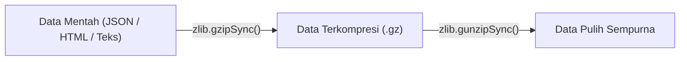

# Zlib

> Ringkasan
> - Tingkat: Pendukung
> - Fungsi: Menyediakan kompresi dan dekompresi data menggunakan algoritma industri seperti Gzip, Deflate, dan Brotli.
> - Digunakan saat: Mengompresi payload respons HTTP, memadatkan file arsip cadangan (backup), dan menghemat kuota transmisi jaringan.
> - Aturan praktis: Gunakan metode sinkron (`gzipSync`) hanya untuk string data kecil; gunakan stream transformasi (`createGzip`) untuk memproses file besar agar RAM tidak penuh.

## Cheat Sheet

| Tugas | Kode |
| :--- | :--- |
| Kompresi data dengan Gzip (sinkron) | `const c = zlib.gzipSync(data);` |
| Dekompresi data Gzip (sinkron) | `const raw = zlib.gunzipSync(c);` |
| Kompresi data dengan Deflate | `const c = zlib.deflateSync(data);` |
| Dekompresi data Deflate | `const raw = zlib.inflateSync(c);` |
| Kompresi dengan algoritma Brotli | `const c = zlib.brotliCompressSync(data);` |
| Dekompresi data Brotli | `const raw = zlib.brotliDecompressSync(c);` |
| Membuat transform stream kompresi | `const gz = zlib.createGzip();` |

## Tujuan Belajar

- Memahami prinsip kerja kompresi data dan perbedaan algoritma Gzip, Deflate, dan Brotli.
- Memadatkan dan mengekstrak data biner menggunakan fungsi sinkron bawaan `node:zlib`.
- Mengalirkan pemrosesan kompresi data berukuran besar menggunakan stream transformasi `Transform`.
- Mengukur rasio efisiensi kompresi memori pada format data teks.

## Konsep

Bayangkan sebuah kantong pakaian perjalanan luar kota. Pakaian tebal seperti jaket dan selimut memakan banyak ruang di koper jika dilipat biasa (analogi data JSON atau file teks berukuran megabyte di jaringan). Dengan kantong vakum kompresi (`node:zlib`), udara di sela-sela pakaian disedot keluar sehingga volumenya menyusut hingga 70% lebih kecil. Kantong koper menjadi jauh lebih ringkas saat dikirim lewat bagasi (hemat bandwidth jaringan). Begitu sampai di hotel tujuan, kantong dibuka kembali dan pakaian mengembang ke ukuran semula tanpa ada jahitan yang rusak (`gunzip`).



## Referensi

| Item | Fungsi | Catatan |
| :--- | :--- | :--- |
| `zlib.gzipSync(buf, [options])` | Mengompresi data menggunakan algoritma Gzip | Format paling umum digunakan pada server web |
| `zlib.gunzipSync(buf, [options])` | Membongkar kembali data terkompresi Gzip | Menghasilkan buffer data mentah asal |
| `zlib.deflateSync(buf, [options])` | Mengompresi data menggunakan standar Deflate (zlib) | Memiliki header lebih ramping daripada Gzip |
| `zlib.inflateSync(buf, [options])` | Membongkar kembali data terkompresi Deflate | Kebalikan dari operasi `deflateSync` |
| `zlib.brotliCompressSync(buf)` | Mengompresi data memakai algoritma modern Brotli | Rasio kompresi teks lebih tinggi daripada Gzip |
| `zlib.brotliDecompressSync(buf)` | Membongkar kembali data terkompresi Brotli | Kebalikan dari operasi `brotliCompressSync` |
| `zlib.createGzip([options])` | Membuat instance stream `Transform` kompresi Gzip | Ideal disambungkan ke `pipeline` untuk file besar |
| `zlib.createGunzip([options])` | Membuat instance stream `Transform` dekompresi Gzip | Memproses stream data terkompresi secara bertahap |

### `zlib.gzipSync()` dan `zlib.gunzipSync()`

Fungsi pasangan sinkron untuk kompresi dan dekompresi data menggunakan format standar Gzip.

Struktur parameter: `zlib.gzipSync(buf, options)` dan `zlib.gunzipSync(buf, options)`
- `buf` (Buffer, TypedArray, atau string, wajib): data yang akan diproses.
- `options` (object, opsional): konfigurasi tingkat kompresi.

Nilai kembalian: instance `Buffer` baru (`Buffer`).

```javascript
import zlib from "node:zlib";

const text = "Node.js Handbook";
const compressed = zlib.gzipSync(text);
const decompressed = zlib.gunzipSync(compressed).toString("utf-8");

console.log(decompressed);
// Output: Node.js Handbook
console.log(compressed.length > 0);
// Output: true
```

Kondisi khusus: Melempar error jika data yang diteruskan ke `gunzipSync()` bukan berformat Gzip yang valid atau mengalami korupsi byte.

### `zlib.brotliCompressSync()` dan `zlib.brotliDecompressSync()`

Algoritma kompresi modern yang dirancang khusus untuk optimasi transfer konten web (HTML, CSS, JSON) dengan rasio efisiensi lebih tinggi.

Struktur parameter: `zlib.brotliCompressSync(buf, options)` dan `zlib.brotliDecompressSync(buf, options)`.

Nilai kembalian: instance `Buffer` baru (`Buffer`).

```javascript
import zlib from "node:zlib";

const text = "Pembelajaran Kompresi Brotli Node.js";
const compressed = zlib.brotliCompressSync(text);
const decompressed = zlib.brotliDecompressSync(compressed).toString("utf-8");

console.log(decompressed);
// Output: Pembelajaran Kompresi Brotli Node.js
```

Kondisi khusus: Kompresi Brotli membutuhkan waktu komputasi CPU sedikit lebih tinggi daripada Gzip, namun menghasilkan output payload yang lebih ramping.

### `zlib.createGzip([options])`

`createGzip()` menghasilkan instance stream `Transform` yang mengompresi setiap potongan byte yang mengalir melewatinya.

Struktur parameter: `zlib.createGzip(options)`
- `options` (object, opsional): pengaturan level kompresi.

Nilai kembalian: instance stream `Transform` (`Gzip`).

```javascript
import { createGzip } from "node:zlib";
import { Readable, Writable } from "node:stream";
import { pipeline } from "node:stream/promises";

const source = Readable.from(["potongan data teks panjang"]);
const gzipStream = createGzip();
let compressedBytes = 0;

const dest = new Writable({
  write(chunk, enc, cb) {
    compressedBytes += chunk.length;
    cb();
  },
});

await pipeline(source, gzipStream, dest);
console.log(compressedBytes > 0);
// Output: true
```

Kondisi khusus: Selalu gunakan `pipeline()` agar error dekompresi menutup seluruh file stream yang sedang terhubung.

## Kesalahan Umum

### Memadatkan File Besar Secara Sinkron dengan `gzipSync`

Memanggil `gzipSync` pada file ratusan megabyte akan memblokir thread utama Event Loop hingga proses kompresi tuntas.

```javascript
// Salah: Event Loop terblokir total
const bigBuffer = await fs.readFile("./large.log");
const compressed = zlib.gzipSync(bigBuffer); // Server macet

// Benar: Gunakan streaming pipeline
await pipeline(
  fs.createReadStream("./large.log"),
  zlib.createGzip(),
  fs.createWriteStream("./large.log.gz")
);
```

### Mengompresi Data yang Sudah Terkompresi

Mencoba mengompresi file gambar (JPEG, PNG) atau arsip (ZIP) menggunakan Zlib tidak akan mengecilkan ukuran, bahkan sering kali menghasilkan ukuran file yang lebih besar karena overhead header.

```javascript
// Salah: Mengompresi gambar PNG dengan Gzip
const pngData = await fs.readFile("./photo.png");
const compressed = zlib.gzipSync(pngData); // Ukuran bisa membengkak
```

## Studi Kasus

Membangun penyimpanan cache data dalam memori terkompresi (_compressed in-memory store_) untuk menyimpan salinan objek data JSON dengan ukuran byte yang efisien.

```javascript
import { gzipSync, gunzipSync } from "node:zlib";

class CompressedMemoryCache {
  constructor() {
    this.cache = new Map();
  }

  set(key, value) {
    const rawString = JSON.stringify(value);
    const compressedBuffer = gzipSync(rawString);
    this.cache.set(key, compressedBuffer);

    return {
      originalBytes: rawString.length,
      compressedBytes: compressedBuffer.length,
    };
  }

  get(key) {
    const compressed = this.cache.get(key);
    if (!compressed) return null;

    const decompressed = gunzipSync(compressed).toString("utf-8");
    return JSON.parse(decompressed);
  }
}

const store = new CompressedMemoryCache();
const stats = store.set("user_101", { id: 101, name: "Ali", role: "admin" });
console.log(stats.compressedBytes > 0);
// Output: true

const user = store.get("user_101");
console.log(user.name);
// Output: Ali
```

Pola penyimpanan ini menghemat alokasi RAM server hingga puluhan persen saat menyimpan ribuan dokumen cache berformat teks JSON.

## Latihan Mandiri

Buat fungsi `compressBuffer(inputBuffer, algorithm = "gzip", options = {})` untuk memadatkan data buffer biner.

- **Level 1 (Dasar):** Kompresi `inputBuffer` memakai algoritma yang diminta: `"gzip"` (`zlib.gzipSync`), `"deflate"` (`zlib.deflateSync`), atau `"brotli"` (`zlib.brotliCompressSync`). Kembalikan objek `{ success: true, algorithm, originalSize, compressedSize, data: compressed }`.
- **Level 2 (Menengah):** Hitung persentase penghematan ukuran data (`savingsPercent = Number(((1 - compressedSize / originalSize) * 100).toFixed(2))`). Tambahkan nilai ini ke properti `savingsPercent`.
- **Level 3 (Menantang):** Jika nilai parameter `algorithm` tidak didukung (selain `"gzip"`, `"deflate"`, `"brotli"`), lempar `TypeError("Algoritma kompresi tidak didukung")`. Jika `inputBuffer` bukan Buffer atau berukuran 0 byte, lempar `RangeError("Buffer data input tidak boleh kosong")`.

Contoh input dan output normal:

```javascript
import { Buffer } from "node:buffer";

const text = "A".repeat(100);
const res = compressBuffer(Buffer.from(text), "gzip");

console.log(res.success);
// Output: true
console.log(res.algorithm);
// Output: gzip
console.log(res.savingsPercent > 0);
// Output: true
```

Contoh input dan penanganan error:

```javascript
import { Buffer } from "node:buffer";

try {
  compressBuffer(Buffer.from(""), "gzip");
} catch (err) {
  console.log(err.message);
  // Output: Buffer data input tidak boleh kosong
}
```

Tanda selesai:
- [ ] Kompresi buffer biner berjalan sesuai algoritma yang dipilih (gzip, deflate, brotli).
- [ ] Perhitungan rasio penghematan kapasitas ukuran tersaji akurat.
- [ ] Algoritma yang tidak didukung atau buffer kosong melempar error validasi.

---

## Navigasi

[Sebelumnya: Worker Threads](../14-worker-threads/README.md) | [Selanjutnya: Readline](../16-readline/README.md) | [Daftar Isi](../README.md)
